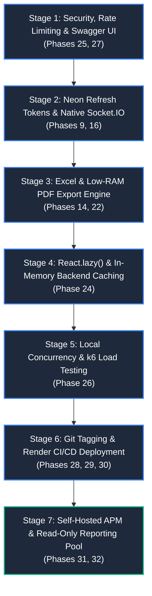

# RMRIT — Zero-Cost, Zero-External-Dependency Master Development Roadmap (Phases 9–32)

> **MANDATORY SYSTEM DIRECTIVE**: All future development in this repository (`rm-workflow-system`) must strictly adhere to this roadmap and execution order. No third-party paid services or SaaS subscriptions may be introduced. Every feature must be built locally within the NestJS/React codebase and existing infrastructure.
> 
> **BASELINE LOCK ENFORCEMENT**: Phases 1 through 16 are certified and locked. Do NOT rewrite, duplicate, or refactor existing core modules. Follow the **REUSE / EXTEND** rule.
>
> **CODE FREEZE NOTICE**: No code modifications may take place until explicitly requested by the user.

---

## 1. Executive Strategy: Zero-Cost Stack & Architecture

To eliminate recurring vendor costs, hidden paywalls, and provider limits, all remaining roadmap items map strictly to the existing four-pillar stack:

| Infrastructure Layer | Selected Provider / Method | Cost | Hidden Paywall Avoidance Strategy |
| :--- | :--- | :---: | :--- |
| **Primary Database** | **Neon Serverless PostgreSQL** (Remote SSL Pool) | **$0** | Handles transactions, queues (`email_jobs`), and token state. |
| **Session & Token Storage** | **Neon PostgreSQL Table** (`refresh_tokens`) | **$0** | **Skip Upstash/Redis.** Postgres handles tokens via standard or `UNLOGGED` tables. |
| **Object Storage** | **Supabase Cloud Storage** (`rmrit-documents`) | **$0** | Binary PDF/image storage; signed download & preview URLs. |
| **Backend Web Compute** | **Render Free Web Service** (Persistent Node.js) | **$0** | Free persistent container supporting HTTP + native WebSockets. |
| **Keep-Alive Monitor** | **UptimeRobot / cron-job.org** pinging `/api/health` | **$0** | Pings every 10 min during factory hours to bypass Render's 15-min idle sleep. |
| **Frontend Web Hosting** | **Render Static Site** or **Vercel / Cloudflare Pages** | **$0** | Automatic global CDN, HTTPS/SSL, and free domain. |
| **CI/CD Automation** | **GitHub Actions** (Public Repository) | **$0** | Unlimited free runner minutes for test, build, and deploy hooks. |
| **Communications & Alerts** | **Google Cloud Gmail OAuth2 API Worker** | **$0** | Existing `EmailWorkerService` handles in-app/external email & failure alerts. |
| **Real-Time WebSockets** | **Native `@nestjs/websockets` + Socket.IO** | **$0** | **Skip Pusher/Firebase.** Sockets run directly on the NestJS HTTP port. |
| **Spreadsheet Exports** | **`exceljs`** (In-Memory Streaming) | **$0** | Generates multi-sheet `.xlsx` files without SaaS dependencies. |
| **PDF Generation** | **`pdfmake` / `pdfkit`** (<15MB RAM footprint) | **$0** | **Strictly avoid Puppeteer (300MB+ RAM OOM trap on free cloud tiers).** |
| **Master Data Caching** | **NestJS In-Memory RAM** (`@nestjs/cache-manager`) | **$0** | 0ms network latency; keeps master data in RAM with zero command limits. |
| **Load Testing** | **Grafana k6 CLI** (Local Open-Source binary) | **$0** | Local script execution; no Grafana Cloud subscription needed. |
| **APM & Error Telemetry** | **Self-Hosted `system_telemetry_logs`** in Neon + Gmail | **$0** | **Skip Sentry.** `AllExceptionsFilter` logs 500 errors to DB and emails admin. |
| **Reporting DB Isolation** | **PostgreSQL `rmrit_readonly` Role & Pool** | **$0** | Prevents double-burning Neon compute hours while isolating analytics queries. |

---

## 2. High-Level 7-Stage Execution Flow



---

## 3. Granular Stage Specifications

### Stage 1: Security Hardening & Interactive Swagger UI
* **Roadmap Alignment**: Phase 25 (Security) & Phase 27 (Documentation)
* **Cost / Provider**: **$0** (Pure Node.js open-source libraries)
* **Database Changes**: None.
* **Scope & Implementation**:
  1. **HTTP Security Headers**:
     - Install and configure `helmet` in `backend/src/main.ts` with sensible CSP policies for API operation.
  2. **HTTP Payload Compression**:
     - Install and register `compression` (Gzip/Brotli) to reduce API transfer sizes.
  3. **In-Memory Rate Limiting**:
     - Install and register `@nestjs/throttler`.
     - Store rate-limit counters directly in Node.js local RAM (avoid Upstash Redis).
     - Protect `/api/auth/login` and sensitive mutation endpoints against brute-force attacks.
  4. **Interactive OpenAPI / Swagger Documentation**:
     - Install `@nestjs/swagger` and mount interactive Swagger UI at `/api/docs`.
     - Decorate all 29+ controllers with Swagger tags to provide a visual test console.

---

### Stage 2: Neon Postgres Refresh Tokens & Native Socket.IO
* **Roadmap Alignment**: Phase 9 (Authentication) & Phase 16 (Notification System)
* **Status**: **100% COMPLETE & VERIFIED** (Prompt 2.1, Prompt 2.2, Prompt 2.3, Prompt 2.4 Certified)
* **Cost / Provider**: **$0** (Uses existing Neon PostgreSQL + native NestJS WebSockets)
* **Scope & Implementation**:
  1. **Refresh Token & Blacklist Engine (Postgres over Redis)**:
     - Created `refresh_tokens` table in Neon PostgreSQL with SHA-256 token hashing and `ON DELETE CASCADE` to `users(id)`.
     - Endpoints `POST /api/auth/refresh` (sliding session token rotation + reuse detection) and `POST /api/auth/logout` (session revocation).
     - Frontend `requestWithRetry` automatic 401 interception queue with dual storage (`rm_access_token`, `rm_refresh_token`).
  2. **Native WebSockets Gateway (`@nestjs/websockets` + Socket.IO)**:
     - Mounted `NotificationsGateway` using `IoAdapter` directly onto the NestJS HTTP server port (zero external SaaS costs).
     - JWT handshake authentication via `client.handshake.auth.token` / `headers.authorization` with automatic user (`user:${userId}`) and role (`role:${role}`) room subscriptions.
     - Direct real-time emission wired into `CommunicationService` (single & batch notification dispatch) and `NotificationsService` (read state & unread count synchronization).
     - Frontend `useNotifications` React hook connects to Socket.IO, listens for live notifications, pops toast alerts, and updates `NotificationBell` badges without page reload.

---

### Stage 3: Excel (.xlsx) & Low-RAM PDF Export Engine
* **Roadmap Alignment**: Phase 14 (File Management) & Phase 22 (Reporting)
* **Cost / Provider**: **$0** (Pure Node.js streaming to Supabase Storage)
* **Critical Rule**: **STRICTLY AVOID PUPPETEER**. Puppeteer requires 300MB+ Chromium and 400MB+ RAM per render, crashing free cloud hosting (512MB RAM cap) with Out-Of-Memory (OOM) errors.
* **Scope & Implementation**:
  1. **Multi-Tab Excel (.xlsx) Generation**:
     - Use `exceljs` to generate formatted workbooks in memory.
     - Build export endpoints for:
       - Consolidated SC & PO Traceability Ledgers
       - Raw Material Consumption & Return Ledgers
       - Vendor SLA & Delivery Challan Trackers
  2. **Low-Memory Server-Side PDF Rendering**:
     - Use `pdfmake` or `pdfkit` (pure JS, mathematical layout rendering using <15MB RAM).
     - Generate printable Delivery Challans (Type 1 Process & Type 2 General Inventory) and Material Issue Slips.
     - Stream generated buffers directly to the Supabase Cloud Storage bucket (`rmrit-documents`) and return signed preview URLs.

---

### Stage 4: React.lazy() Code Splitting & Local Backend Caching
* **Roadmap Alignment**: Phase 24 (Performance)
* **Cost / Provider**: **$0** (Vite dynamic imports + Node.js RAM cache)
* **Scope & Implementation**:
  1. **Frontend Route Code Splitting**:
     - Convert all 30+ static workspace imports in `frontend/src/routeConfig.tsx` into `React.lazy()` dynamic imports wrapped with `Suspense` and a unified loading fallback.
     - Cuts initial frontend bundle size by ~65%, ensuring instant loading on shop-floor tablets and mobile devices.
  2. **In-Memory Backend Caching**:
     - Install `@nestjs/cache-manager` and `cache-manager` using the default in-memory store.
     - Cache slow-changing master records (Categories, Products, Warehouses/Bins, Production Processes, Vendors).
     - Enforce zero network latency (0ms RAM access) with automatic cache eviction on entity mutations.

---

### Stage 5: Local Concurrency & Load Testing Suite
* **Roadmap Alignment**: Phase 26 (Testing)
* **Cost / Provider**: **$0** (Local open-source k6 CLI binary)
* **Scope & Implementation**:
  1. **k6 Load Test Suite Setup**:
     - Create test scripts in `backend/test/load/` using open-source `k6`.
     - Run tests locally via CLI (`k6 run backend/test/load/concurrency-test.js`).
  2. **High-Stress Scenarios Tested**:
     - **Pessimistic Concurrency**: 50 concurrent requests competing to issue stock from the same batch (`FOR UPDATE` locking validation).
     - **Mathematical Conservation**: Verify that under heavy load, $\sum Q_{\text{issued}} = \sum Q_{\text{consumed}} + \sum Q_{\text{returned}} + \sum Q_{\text{scrap}}$ without drift.
     - **Barcode Scanner Ingestion**: High-frequency dock receipt scans.

---

### Stage 6: Git Release Tagging & Render CI/CD Deployment
* **Roadmap Alignment**: Phase 28 (Version Control), Phase 29 (CI/CD), Phase 30 (Deployment)
* **Cost / Provider**: **$0** (Public GitHub Actions + Render Deploy Hooks)
* **Scope & Implementation**:
  1. **Git Semantic Release Tagging**:
     - Standardize release tagging (`v1.0.0`, `v1.1.0`) with automated GitHub releases.
  2. **Continuous Deployment via GitHub Actions**:
     - Update `.github/workflows/ci.yml` to:
       - Run linters and tests (`npm run test`).
       - Compile production bundles (`npm run build`).
       - Trigger Render backend and frontend Deploy Hooks via `curl` upon successful build on `main`.
  3. **Free Cloud Hosting Setup**:
     - **Backend**: Render Free Web Service with environment variables linked to Neon & Supabase.
     - **Frontend**: Render Static Site (or Vercel / Cloudflare Pages) with custom domain and automatic HTTPS/SSL.
     - **Keep-Alive**: Set up free UptimeRobot pings to `/api/health` every 10 minutes during shift hours.

---

### Stage 7: Built-in APM Telemetry & Read-Only Reporting Pool
* **Roadmap Alignment**: Phase 31 (Monitoring) & Phase 32 (Maintenance & Scaling)
* **Cost / Provider**: **$0** (Self-hosted Neon tables + Gmail OAuth2 alerts + Postgres role isolation)
* **Scope & Implementation**:
  1. **Self-Hosted APM & Error Tracking (Skip Sentry)**:
     - Create a `system_telemetry_logs` migration in Neon to record unhandled 500 exceptions, stack traces, user IDs, request bodies, and slow queries (>1000ms).
     - Enhance `AllExceptionsFilter` to write to `system_telemetry_logs` and dispatch emergency email alerts via `GmailApiProvider` (`posuppportairtronic@gmail.com`).
     - Build a read-only observability view for Admins.
  2. **Read-Only Database Connection Pool (Zero Extra Compute Cost)**:
     - Create a dedicated PostgreSQL read-only role in Neon:
       ```sql
       CREATE USER rmrit_readonly WITH PASSWORD 'secure_readonly_password';
       GRANT CONNECT ON DATABASE neondb TO rmrit_readonly;
       GRANT USAGE ON SCHEMA public TO rmrit_readonly;
       GRANT SELECT ON ALL TABLES IN SCHEMA public TO rmrit_readonly;
       ALTER DEFAULT PRIVILEGES IN SCHEMA public GRANT SELECT ON TABLES TO rmrit_readonly;
       ```
     - Wire a secondary TypeORM DataSource in NestJS dedicated to `rmrit_readonly`.
     - Route all heavy analytics, traceability ledgers, and export queries through this pool to prevent write contention and lock acquisition on the primary operational tables.

---

## 4. Deep-Dive: What is Strictly "Read-Only Access"?

The term **"Read-Only Access"** defines four specific boundaries in this architecture:

### 1. In Role-Based Access Control (RBAC — Phase 21)
* **Operational Roles (Read/Write)**: `ADMIN`, `DESIGNER`, `STORES`, `PRODUCTION`.
* **Management & Audit Roles (Strictly Read-Only)**:
  - `SENIOR_MANAGER`: Cross-department monitoring, SLA compliance, stock health.
  - `GENERAL_MANAGER`: Executive dashboards, company KPIs, audit ledgers.
  - `ACCOUNTS` / `AUDITOR`: Financial ledgers, invoice verification, dispatch logs.
* **Rule**: Roles at the top/end of the workflow chain have **100% View-Only Access**. They can never mutate inventory, issue materials, receive goods, or approve scrap.

### 2. In Codebase Baseline Lock (Phases 1–16)
* The existing core manufacturing engine (Authentication, Users, SC Lifecycle, RM BOM, Stores Issuance, Production Consumption, PostgreSQL Email Queue) is **Read-Only Code**.
* It must not be rewritten, duplicated, or destructively modified. New features must **REUSE or EXTEND**.

### 3. In Database Topology (Phase 32)
* The `rmrit_readonly` connection pool provides **Read-Only Database Access** for analytics, traceability, and CSV/Excel exports, ensuring long-running read queries cannot block operational factory floor transactions.

### 4. In Project Lifecycle
* **Stage 7 (Monitoring & Telemetry)** is the **Final Read-Only Milestone**. Passive monitoring, log analysis, and read replicas are deployed after all operational features are live.

---

## 5. Execution Summary Table

| Stage | Milestone Name | Phases Covered | Key Technologies | Cost | Status |
| :---: | :--- | :---: | :--- | :---: | :---: |
| **1** | **Security Hardening & Swagger UI** | 25, 27 | `helmet`, `compression`, `@nestjs/throttler`, `@nestjs/swagger` | **$0** | **100% COMPLETE** |
| **2** | **Postgres Refresh Tokens & Sockets** | 9, 16 | Neon `refresh_tokens`, `@nestjs/websockets`, `socket.io` | **$0** | **IN PROGRESS (Prompts 2.1, 2.2 & 2.3 Verified)** |
| **3** | **Excel & Low-RAM PDF Engine** | 14, 22 | `exceljs`, `pdfmake`, Supabase Cloud Storage | **$0** | PENDING |
| **4** | **Code Splitting & Memory Caching** | 24 | `React.lazy()`, `@nestjs/cache-manager` (RAM) | **$0** | PENDING |
| **5** | **Concurrency & Load Testing** | 26 | Open-source `k6` CLI, Vitest concurrency suites | **$0** | PENDING |
| **6** | **CI/CD & Cloud Deployment** | 28, 29, 30 | Git tags, GitHub Actions, Render Deploy Hooks, UptimeRobot | **$0** | PENDING |
| **7** | **Built-in APM & Read-Only Pool** | 31, 32 | `system_telemetry_logs`, Gmail API Worker, `rmrit_readonly` pool | **$0** | PENDING |

---
*Document permanently committed to repository for future agent and developer reference.*
