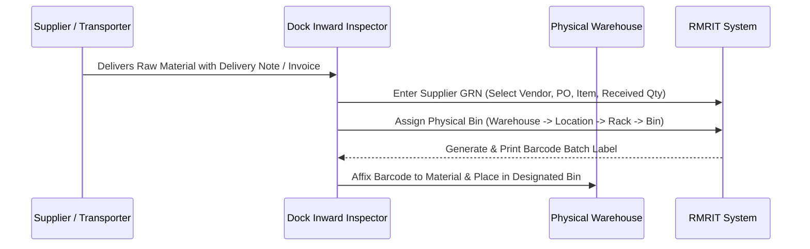
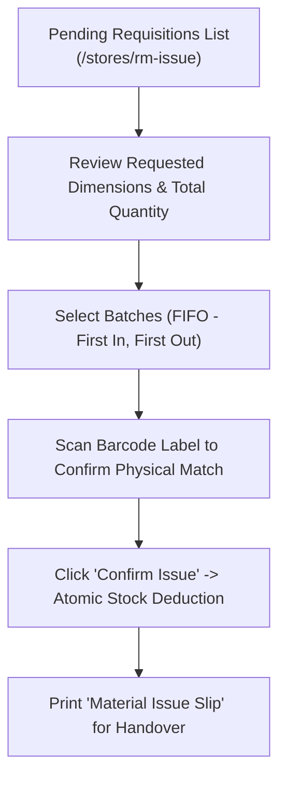

# RMRIT Factory Operator & Shop-Floor User Manual

> **Document Purpose**: Standard Operating Procedure (SOP) and practical, step-by-step user manual for shop-floor personnel, warehouse clerks, stores managers, dock inward inspectors, machine operators, and dispatch coordinators using the **RMRIT (Raw-Material Requirements & Inventory Traceability System)**.
>
> **System Access URL**: `http://localhost:5173` (or production factory domain)  
> **API Documentation**: `http://localhost:3000/api/docs`  
> **Target Audience**: Stores Clerks, Production Operators, Inward Inspectors, Dispatch Coordinators

---

## 1. Workstation Setup & System Access

### 1.1 Logging In
1. Open your factory browser (Google Chrome or Microsoft Edge recommended) and navigate to the application URL.
2. Enter your authorized factory email and password.
3. Click **Sign In**.
4. The system will automatically direct you to your designated role landing page:

| User Role | Default Starting Workspace | Direct URL |
| :--- | :--- | :--- |
| **STORES** | RM Issue Workspace | `/stores/rm-issue` |
| **PRODUCTION** | RM Receive & Verify | `/production/rm-verify` |
| **DESIGNER** | RM Creation | `/design/rm-creation` |
| **MANAGEMENT / ADMIN** | Operations Overview | `/overview` |

---

### 1.2 Barcode Scanner Hardware Setup
RMRIT features a native **Scan-First Warehouse Engine** supporting standard USB, Bluetooth, and 2.4GHz wireless handheld 1D/2D barcode scanners.

1. **Hardware Configuration**:
   - Ensure your scanner is configured in **USB HID Keyboard Emulation Mode** with an **"Enter" suffix** (standard factory default for Zebra, Honeywell, and Datalogic scanners).
2. **Audio Controls**:
   - Every warehouse and dispatch screen includes a **Scanner Sound Toggle** icon in the upper-right corner.
   - **Green High Tone**: Indicates a successful barcode match and verified batch allocation.
   - **Red Low Tone**: Warns of an invalid barcode, expired batch, or mismatched part number.
3. **Manual Entry Fallback**:
   - If a barcode label is soiled or torn, click the **Manual Search** button to type the part number or batch code manually.

---

## 2. Supplier Inward & Dock Receipt (GRN)

**Workspace**: `Inventory` $\rightarrow$ `Supplier Inward (GRN)` (`/inventory/grn`)  
**Authorized Roles**: `STORES`, `ADMIN`

### Step-by-Step Supplier Inward Procedure:
1. Navigate to **Supplier Inward (GRN)** from the left sidebar.
2. Click **+ New Inward Receipt**.
3. Select the **Vendor / Supplier Name** and corresponding **Purchase Order (PO)** number.
4. Select the **Raw Material Item** being received.
5. Enter the **Received Quantity** and verify against the physical delivery challan.
6. **Assign Physical Bin Storage**:
   - Select **Warehouse** (e.g., *Main Raw Material Stores*).
   - Select **Location** (e.g., *Ground Floor Aisle 2*).
   - Select **Rack** (e.g., *Rack R-04*).
   - Select **Bin** (e.g., *Bin B-12*).
7. Enter heat/lot number or supplier batch code (if applicable).
8. Click **Confirm Inward & Generate Barcode**.
9. The barcode printer will generate a physical tracking label:
   - Immediately peel and affix the label to the raw material bundle, drum, or box.
   - Physically transport and place the material into the allocated bin (`Warehouse -> Location -> Rack -> Bin`).

---

## 3. Stores Raw Material (RM) Issuance

**Workspace**: `RM Workflow` $\rightarrow$ `RM Issue` (`/stores/rm-issue`)  
**Authorized Roles**: `STORES`, `ADMIN`

Stores personnel issue physical raw materials to the production shop floor based on Designer Subcontracting (SC) Requisitions.

### Step-by-Step Issuance Procedure:
1. In the **RM Issue** workspace, review the list of **Pending Material Requests**.
2. Click **Issue Material** on the target Style Code (SC) row.
3. Review the **Calculated Required Quantity** (piece count, length, or weight).
4. In the batch selection section:
   - System displays available stock batches in **FIFO order** (oldest received batches first).
   - Allocate the required quantity from the oldest batch.
   - If one batch is insufficient, allocate across multiple batches (partial allocation).
5. **Scan Barcode**:
   - Point your scanner at the physical bin/batch barcode on the shelf.
   - The scanner audio confirms match (*High Beep*).
6. Click **Confirm & Issue Stock**.
7. Click **Print Issue Slip**:
   - Hand the physical Material Issue Slip together with the raw materials to the Production Operator.

---

## 4. Production Line Operations: Receiving, Consumption & Scrap

Production operators receive raw materials at the production line, record daily consumption against jobs, log scrap, and return leftovers to stores.

---

### 4.1 Acknowledging Received Material
**Workspace**: `RM Workflow` $\rightarrow$ `RM Receive & Verify` (`/production/rm-verify`)  
**Authorized Roles**: `PRODUCTION`, `ADMIN`

1. When materials arrive from Stores with an Issue Slip, open **RM Receive & Verify**.
2. Locate the matching SC number in the **Pending Receipt** queue.
3. Verify the physical piece count or weight against the screen.
4. Click **Acknowledge Receipt**.
5. The material status transitions to `IN_PRODUCTION`.

---

### 4.2 Recording Material Consumption & Scrap
**Workspace**: `RM Workflow` $\rightarrow$ `RM Request & Return` (`/production/request-return`)  
**Authorized Roles**: `PRODUCTION`, `ADMIN`

To maintain **Zero-Loss Mathematical Quantity Conservation**:
$$\text{Quantity Issued} = \text{Quantity Consumed} + \text{Quantity Returned} + \text{Quantity Scrap}$$

1. In the **RM Request & Return** workspace, select the active production job.
2. Enter the **Produced Good Units** and the corresponding **Raw Material Consumed**.
3. If defects occurred, enter the **Scrap Quantity** and select a scrap reason code:
   - *Setup Scrap*
   - *Machining Defect*
   - *Material Porosity / Raw Stock Flaw*
4. Click **Record Consumption**.
5. The system immediately updates the balance remaining in production custody.

---

### 4.3 Returning Unused Material to Stores
**Workspace**: `RM Workflow` $\rightarrow$ `RM Request & Return` (`/production/request-return`)  
**Authorized Roles**: `PRODUCTION`, `ADMIN`

1. When a job completes and uncut lengths, whole pieces, or recyclable off-cuts remain:
2. Select **Initiate Material Return**.
3. Enter the exact piece count or length being returned to stores.
4. Add remarks (e.g., *"Uncut 1200mm bar remainder from Job SC-104"*).
5. Click **Submit Return Request**.
6. The return appears instantly in the Stores verification queue.

---

## 5. Stores Return Verification & Additional Requests

**Workspaces**: 
* `RM Workflow` $\rightarrow$ `Return Verify` (`/stores/return-verify`)
* `RM Workflow` $\rightarrow$ `Extra Requests` (`/stores/extra-requests`)  
**Authorized Roles**: `STORES`, `ADMIN`

### 5.1 Verifying Returned Material
1. When production returns physical material to Stores, open **Return Verify**.
2. Click **Inspect Return** on the incoming line.
3. Physically measure and verify the returned stock.
4. Select the target destination bin (`Warehouse -> Location -> Rack -> Bin`).
5. Click **Confirm & Return to Inventory**.
6. The stock is atomically added back to warehouse inventory.

### 5.2 Processing Additional Material Requests (Exceptions)
1. If production ruined stock and requires extra raw material beyond the BOM quota:
2. Production submits an **Additional Material Request** with justification.
3. Stores reviews the request under **Extra Requests** (`/stores/extra-requests`).
4. Once governance approval is received, Stores issues extra stock following the standard issuance flow.

---

## 6. Delivery Challan (DC) Dispatches & Outside Processing

**Authorized Roles**: `STORES`, `ADMIN`, `DISPATCH`

RMRIT manages two distinct types of Delivery Challans:

| DC Type | Purpose | Workflow Path |
| :--- | :--- | :--- |
| **Type 1 (Process Dispatch)** | Subcontracting material sent to an external vendor for a manufacturing process (e.g., Heat Treatment, Electroplating, Anodizing, CNC Milling). | `/dispatch/delivery-challan/type-1` |
| **Type 2 (General Inventory Dispatch)** | Dispatch of general raw materials, tools, or parts to vendors, customers, or sister plants. | `/dispatch/delivery-challan/type-2` |

### 6.1 Creating a Type 1 Process Delivery Challan
1. Navigate to **DC Type 1 (Process)** (`/dispatch/delivery-challan/type-1`).
2. Click **+ New Process Challan**.
3. Select the **Subcontracting Style Code (SC)** and current **Production Process** (e.g., *Heat Treatment*).
4. Select the certified **Vendor** from the dropdown.
5. Enter the **Dispatched Quantity** and specify the **Expected Return Date** (sets SLA tracking).
6. Click **Generate Delivery Challan**.
7. Click **Print Challan** (`/dispatch/delivery-challan/:id/print`):
   - Print 3 physical copies (1 for Transporter/Gate, 1 for Vendor Ack, 1 for Stores File).

### 6.2 Receiving DC Returns at the Factory Gate
**Workspace**: `Delivery Challan` $\rightarrow$ `DC Returns` (`/dispatch/returns`)

1. When the vendor delivers processed goods back to the factory:
2. Open **DC Returns**.
3. Scan or type the DC Number printed on the vendor challan.
4. Perform physical quality inspection:
   - Enter **Accepted Quantity**.
   - Enter **Rejected Quantity** (if any defect occurred at vendor).
5. Click **Confirm Return & Close DC**.
6. Material custody transfers back to factory ownership.

---

## 7. Shop-Floor Troubleshooting & Error Resolution

| Error / Situation | Probable Cause | Operator Action to Resolve |
| :--- | :--- | :--- |
| **Barcode Scanner emits red low buzz** | Invalid barcode, unreadable label, or wrong part number scanned. | 1. Clean scanner glass lens. 2. Re-scan label directly. 3. If label is torn, click **Manual Search** and type the part number. |
| **"Insufficient Stock in Bin" alert** | Physical stock differs from system balance due to unrecorded scrap or missed inward. | 1. Do NOT force allocation. 2. Report to Stores Supervisor. 3. Perform stock count adjustment via `/inventory/movements`. |
| **Cannot issue material for SC** | SC has not been approved or is currently in DRAFT status. | 1. Contact Designer or Supervisor. 2. SC must reach `APPROVED` status before Stores can issue stock. |
| **"Over-Consumption Limit Exceeded"** | Production attempted to consume more raw material than issued by Stores. | 1. Verify entered numbers. 2. If genuine scrap occurred, submit an **Additional Material Request** under `/stores/extra-requests`. |
| **Page shows "Too Many Requests (429)"** | Someone mistyped their password 5+ times on the login screen. | 1. Wait 60 seconds for the security rolling window to reset. 2. Enter valid credentials carefully. |

---

## 8. Printable Daily Operator Checklists

### 🌅 Shift Opening Checklist (Stores & Warehouse)
- [ ] Log in and check the **MSL Alerts** workspace (`/inventory/msl-alerts`) for low-stock warnings.
- [ ] Verify barcode scanner connection and test audio beeps.
- [ ] Review pending Supplier GRNs awaiting bin placement at the inward dock.
- [ ] Review pending Material Issue Requests from Production.

### 🌆 Shift Closing Checklist (Production & Stores)
- [ ] Ensure all produced quantities and scrap for the shift are entered in `/production/request-return`.
- [ ] Hand over all returnable off-cuts and unused stock to Stores with physical issue slips.
- [ ] Stores confirms all incoming returns in `/stores/return-verify`.
- [ ] Check `/dispatch/movements` for overdue vendor Delivery Challans breaching SLA.
- [ ] Log out of your terminal before leaving workstation.
