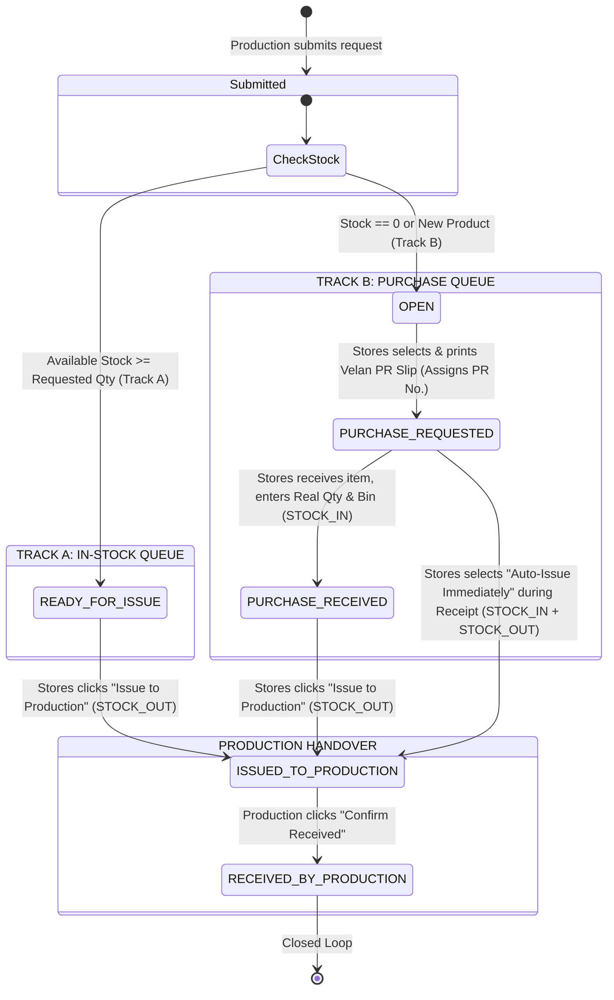

# Phase 24: Two-Module Consumable Request & Purchase/Store Fulfillment System
## Master Architecture & Phase-Wise Implementation Plan

---

### Executive Summary & Design Principles
This document defines the master implementation plan for **Phase 24: Consumable Management System**, providing synchronized, line-item-driven coordination between **Production** (the requester/consumer) and **Stores / Purchase** (fulfillment, procurement, and stock issuance).

#### Key Architectural Pillars
1. **Line-Item Granular State Machine**: Every request is split into independent line items. Each line item tracks its own lifecycle, allowing partial procurement, separate PR printing, staggered vendor deliveries, independent bin storage, and line-by-line issuance.
2. **Dual-Track Automatic Routing**:
   - **Track A (`STOCK_ITEM`)**: If warehouse balance has stock available at request time, routes immediately to Stores' **In-Stock Queue** with status `READY_FOR_ISSUE`.
   - **Track B (`NON_STOCK_OR_NEW`)**: If warehouse stock is zero, insufficient, or the item is a newly introduced product, routes to Stores/Purchase's **Purchase Queue** with status `OPEN`.
3. **Master Data Auto-Creation on Demand**:
   - Brand-new products are auto-created in `products` under category `CONSUMABLES` (initial stock = 0).
   - Brand-new vendors are auto-created in `vendors` with their contact and pricing details.
4. **Editable Real Quantity Stock-In**: Stores can override requested quantity with the actual physical delivery quantity received, updating warehouse inventory atomically (`STOCK_IN`) into a user-selected bin.
5. **Closed-Loop Production Receipt**: Final status `RECEIVED_BY_PRODUCTION` is only reached when the shop-floor operator explicitly acknowledges receipt.

---

## 1. No-Overlap & Codebase Integration Audit

| Existing Component | Status | Strategy |
| :--- | :--- | :--- |
| `products` (`Product` entity) | Core Master | **REUSE**: Consumables link directly to `Product.id`. Auto-creation creates rows with Category `CONSUMABLES` and initial stock 0. |
| `vendors` (`Vendor` entity) | Core Master | **REUSE**: Auto-creates vendor records with `name`, `address`, `phone`, and `category = 'CONSUMABLES'`. |
| `bins` (`Bin` entity) | Warehouse Master | **REUSE**: Bins are selected as targets for `STOCK_IN` and sources for `STOCK_OUT`. |
| `stock_balances` (`StockBalance`) | Inventory | **REUSE**: Atomic updates to `current_quantity` via pessimistic locking / SQL expressions. |
| `stock_transactions` (`StockTransaction`) | Ledger | **REUSE**: Logs immutable `STOCK_IN` and `STOCK_OUT` ledger entries. |
| `QuantityCalculator` | Utility | **REUSE**: Safe arithmetic and non-negative assertions. |
| `consumables_requests` | New Feature | **NEW**: Header entity for consumable request documents. |
| `consumable_request_items` | New Feature | **NEW**: Line-item entity with track routing, PR numbers, vendor details, and status progression. |
| RM & Delivery Challan Modules | Baseline | **DO NOT TOUCH**: Fully isolated from raw material lifecycle and DC tracking. |

---

## 2. Line-Item Lifecycle & State Machine

### Complete Line-Item Status Matrix

| Step | Status Code | Module Owner | Trigger Action | Inventory Ledger Impact |
| :--- | :--- | :--- | :--- | :--- |
| **1A** | `READY_FOR_ISSUE` | Module 2 (Stock Tab) | Auto-assigned if Available Stock $\ge$ Requested Qty | None |
| **1B** | `OPEN` | Module 2 (Purchase Tab) | Auto-assigned if Stock == 0 or Is New Product | Product auto-created (`stock = 0`) |
| **2** | `PURCHASE_REQUESTED` | Module 2 (Purchase Tab) | User selects `OPEN` items & clicks "Print PR Slip" | Assigns sequential `PR. No.` (e.g., 151) |
| **3** | `PURCHASE_RECEIVED` | Module 2 (Purchase Tab) | Stores clicks "Receive", enters Real Qty & Bin | **`STOCK_IN`** (+ Real Qty to Bin & Ledger) |
| **4** | `ISSUED_TO_PRODUCTION` | Module 2 (Both Tabs) | Stores clicks "Issue" (or auto-issue on receipt) | **`STOCK_OUT`** (- Issued Qty from Bin & Ledger) |
| **5** | `RECEIVED_BY_PRODUCTION`| Module 1 (Production) | Production clicks "Confirm Received" on shop floor | Handover locked & complete |

---

## 3. Sub-Phase Implementation Roadmap

### Phase 24.1: Database Schema & Entity Relational Architecture (`/backend`)
Create dedicated TypeORM entities in `backend/src/consumables/entities/`:

1. **`ConsumableRequest` (`consumable_requests`)**:
   - `id`: UUID Primary Key
   - `requestCode`: Unique identifier (e.g., `CR-2026-0001` with yearly sequence)
   - `paymentMode`: Enum `'CASH' | 'CREDIT'`
   - `endUserInVelan`: Text (Operator / Machine / Bay)
   - `requestedBy`: Text (Requester Name / Employee Code)
   - `preparedBy`: Text (Optional)
   - `verifiedBy`: Text (Optional)
   - `approvedBy`: Text (Optional)
   - `createdAt`, `updatedAt`: Timestamps
   - Relationship: `@OneToMany(() => ConsumableRequestItem, (item) => item.request)`

2. **`ConsumableRequestItem` (`consumable_request_items`)**:
   - `id`: UUID Primary Key
   - `requestId`: UUID Foreign Key to `consumable_requests`
   - `prNumber`: Nullable String (e.g., `'151'`, assigned upon printing PR)
   - `productId`: UUID (Foreign Key to `products`)
   - `productCode`: String (denormalized for rapid reporting)
   - `description`: Text (Product description)
   - `uom`: String (Default `'NOS'`)
   - `isNewProduct`: Boolean (flag indicating auto-creation)
   - `itemCategoryTrack`: Enum `'STOCK_ITEM' | 'NON_STOCK_OR_NEW'`
   - `stockAvailableAtRequest`: Decimal (captured at submission time)
   - `requestedQty`: Decimal (allows `0` for inquiry or specific quantity)
   - `realReceivedQty`: Decimal (default `0`, filled upon store receipt)
   - `issuedQty`: Decimal (default `0`, filled upon store issuance)
   - `vendorId`: UUID nullable (FK to `vendors`)
   - `vendorName`: String nullable
   - `unitPrice`: Decimal nullable
   - `isNewVendor`: Boolean (default `false`)
   - `newVendorName`, `newVendorAddress`, `newVendorMobile`: Text nullable
   - `newVendorPrice`: Decimal nullable
   - `endUserInVelan`: String (inherited or per-item)
   - `requestedBy`: String (inherited or per-item)
   - `binId`: UUID nullable (FK to `bins` for storage / issuance)
   - `status`: Enum `'READY_FOR_ISSUE' | 'OPEN' | 'PURCHASE_REQUESTED' | 'PURCHASE_RECEIVED' | 'ISSUED_TO_PRODUCTION' | 'RECEIVED_BY_PRODUCTION'`
   - `printedAt`, `purchaseReceivedAt`, `issuedAt`, `productionReceivedAt`: Timestamps
   - `productionReceivedById`: UUID nullable

---

### Phase 24.2: Backend Services, Concurrency, Stock Integration & REST APIs (`/backend`)
Create `ConsumablesModule`, `ConsumablesService`, and `ConsumablesController` with:

1. **Auto-Master Creation Service**:
   - Helper to find or create Product Category `'CONSUMABLES'` and default Family.
   - When `isNewProduct: true`, creates `Product` with code, name, uom, and category.
   - When `isNewVendor: true`, creates `Vendor` with name, address, phone.
2. **Live Stock Evaluation**:
   - Sums balances from `stock_balances` across active bins for the product.
   - Determines initial track (`STOCK_ITEM` vs `NON_STOCK_OR_NEW`) and initial status.
3. **Sequential Number Generators**:
   - `requestCode`: Format `CR-YYYY-XXXX` (atomic sequence).
   - `prNumber`: Sequential integer starting from `151` (e.g., `151`, `152`, ...).
4. **Atomic Stock-In & Stock-Out Transactions**:
   - **`POST /api/consumables/purchase/receive`**:
     - Locks `stock_balances` row (or inserts if absent).
     - Increments balance by `realReceivedQty`.
     - Inserts `stock_transactions` entry with `TransactionType.STOCK_IN` and reference `CONSUMABLE_PURCHASE`.
     - If `autoIssue === true`: immediately executes decrement and `STOCK_OUT` entry with reference `CONSUMABLE_ISSUE`.
   - **`POST /api/consumables/line-items/:id/issue-to-production`**:
     - Decrements `stock_balances` with guard `current_quantity >= issueQty`.
     - Inserts `stock_transactions` with `TransactionType.STOCK_OUT`.
     - Updates line item status to `ISSUED_TO_PRODUCTION`.
5. **Production Confirmation**:
   - **`PATCH /api/consumables/line-items/:id/production-receive`**:
     - Transitions status to `RECEIVED_BY_PRODUCTION`.

---

### Phase 24.3: Backend Automated Unit & Integration Testing (`/backend`)
Comprehensive Jest/Vitest test suites:
- `consumables.service.spec.ts`:
  - Test 1: Auto-creation of product master when `isNewProduct === true`.
  - Test 2: Auto-creation of vendor master when `isNewVendor === true`.
  - Test 3: Dual-track routing logic (in-stock $\ge$ requested $\to$ `READY_FOR_ISSUE`, zero stock $\to$ `OPEN`).
  - Test 4: Sequential PR numbering starting from `151`.
  - Test 5: Atomic `STOCK_IN` updating `stock_balances` and logging `stock_transactions`.
  - Test 6: Combined Receive + Auto-Issue atomic sequence.
  - Test 7: Concurrency & insufficient stock guard on manual issue.
  - Test 8: Production receipt state transition.
- Verify zero TypeScript compiler errors via `npm run build`.

---

### Phase 24.4: Module 1 Frontend — Consumable Request & Production Receipt (`/frontend`)
Workspace: `frontend/src/pages/ConsumableRequestsWorkspace.tsx`
Route: `/consumables/requests`

1. **Sub-View 1A: Multi-Line Consumable Request Builder**:
   - Header: `Payment Mode` (Cash / Credit toggle), `End User in Velan` (input), `Requested by` (input).
   - Interactive Line Item Table:
     - Selector: "Existing Catalog Product" (autocomplete dropdown with live warehouse stock badge) vs "+ New Product" (inline description, UOM input with badge *"Auto-creates in Product Master"*).
     - Requested Qty: numeric input (optional / default `0` for open-ended inquiries).
     - Inline Vendor Panel (shown if stock == 0 or new product):
       - "Existing Vendor" (dropdown + unit price) vs "New Vendor" (Name, Address, Mobile, Price).
     - Add Line Item / Delete Line Item controls.
     - "Submit Consumable Request" with validation & summary.
2. **Sub-View 1B: Production Tracking & "Receive Line Item" Queue**:
   - Filterable table displaying all requested line items:
     - Columns: Request Code, Item Description, Qty Requested, Qty Issued, Current Stage, Actions.
     - Live Stage Badges: `Open`, `PR Printed (Purchasing)`, `In Store`, `Issued by Store`, `Received by Production`.
     - Prominent action for items with `ISSUED_TO_PRODUCTION`: Green **"Mark as Received by Production"** button.

---

### Phase 24.5: Module 2 Frontend — Purchase & Store Fulfillment Workspace (`/frontend`)
Workspace: `frontend/src/pages/ConsumablePurchaseStoreWorkspace.tsx`
Route: `/consumables/purchase-store`

1. **Sub-Module 2A: TAB 1 — In-Stock Items Queue (`STOCK_ITEM` & `PURCHASE_RECEIVED`)**:
   - Lists all line items ready for shop-floor issuance.
   - Shows Request #, Product Description, End User, Requested Qty, Available Stock in Bins.
   - Action: **"Issue to Production"** modal:
     - Allows selecting Source Bin, confirming Issue Qty, and executing atomic `STOCK_OUT`.
2. **Sub-Module 2B: TAB 2 — Non-Stock & New Products Queue (`NON_STOCK_OR_NEW`)**:
   - Sub-filters: `All`, `Open (Unprinted)`, `Purchase Requested (Printed)`, `Purchase Received`.
   - **Step 1 (Select & Print PR)**:
     - Row checkboxes on `OPEN` items.
     - Top Action: **"Print Selected Line Items (PR)"**.
     - Generates PR No. and launches `VelanPrPrintModal`.
   - **Step 2 (Receive Purchase)**:
     - Button on `PURCHASE_REQUESTED` rows: **"Receive Purchase"**.
     - Launches `PurchaseReceiveModal`:
       - Shows original requested qty.
       - **Editable Real Qty Received** (number input).
       - Target Warehouse Bin selector.
       - Action A: **"Receive into Stock (`STOCK_IN`)"**.
       - Action B: **"Receive into Stock & Immediately Issue to Production"**.

---

### Phase 24.6: Printable VELAN METROLOGY Purchase Requisition Slip (`VelanPrPrintModal.tsx`)
Component: `frontend/src/components/consumables/VelanPrPrintModal.tsx`
- Exact physical pad recreation with print CSS (`@media print`):
  - Top Header: `VM` logo, `VELAN METROLOGY`, `PURCHASE REQUISITION (CASH / CREDIT)`.
  - Date and sequential `PR. No. : [ 151 ]`.
  - Ruled tabular columns:
    - S.No., Description of Goods, Qty, Stock Availability, Vendor Name, Approx Price.
    - New Vendor Section: (a) Name, (b) Address, (c) Mobile No., (d) Price.
    - End User in Velan, Requested By.
  - Footer Signature Block: `Prepared By`, `Verified By`, `Approved By`.
  - Prints exclusively the user-selected line items.

---

### Phase 24.7: Sidebar Integration, Build Verification & End-to-End Validation
1. **Sidebar & Route Configuration**:
   - Update `frontend/src/routeConfig.tsx`:
     - Module 1: `/consumables/requests` (`Consumable Requests`, icon: `ShoppingCart`, roles: `PRODUCTION`, `STORES`, `ADMIN`, `SENIOR_MANAGER`, `GENERAL_MANAGER`).
     - Module 2: `/consumables/purchase-store` (`Purchase & Store Consumables`, icon: `ClipboardList`, roles: `STORES`, `ADMIN`, `SENIOR_MANAGER`, `GENERAL_MANAGER`).
2. **Build Verification**:
   - `npm run build` in `/backend` (0 errors).
   - `npm run build` in `/frontend` (0 errors).
3. **End-to-End Workflow Verification**:
   - Execute mock request $\to$ auto-create product/vendor $\to$ print PR (assign #151) $\to$ receive into bin $\to$ issue to production $\to$ confirm receipt.

---

## 4. Execution Sequence Checkpoint

In accordance with RMRIT roadmap guidelines:
1. **Approval Gate**: Await user confirmation before writing code.
2. **Step 1**: Backend entities, migrations, and service logic (`Phase 24.1` & `Phase 24.2`).
3. **Step 2**: Backend automated tests & verification (`Phase 24.3`).
4. **Step 3**: Frontend UI and print components (`Phase 24.4`, `Phase 24.5`, `Phase 24.6`).
5. **Step 4**: Full application build & E2E certification (`Phase 24.7`).
