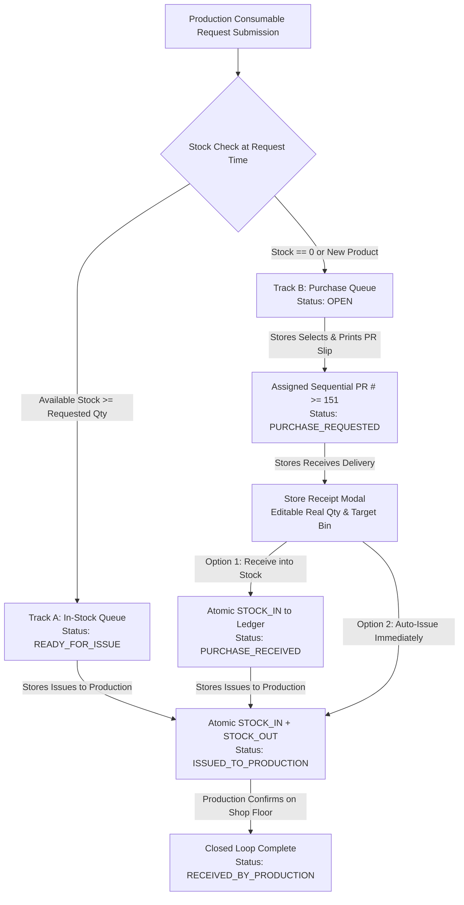

# Phase 24: Consumable Workflow & System Integrity Diagnostic Report

**Evaluation Date:** October 21, 2026  
**Target Environment:** Neon Cloud PostgreSQL (`ep-still-bread-...neon.tech`)  
**Scope:** Phase 24 (Two-Module Consumable Request & Purchase/Store Fulfillment System), Full Stack REST API & Database Connectivity Audit

---

## 1. Executive Summary & Final Verdict

| Verification Domain | Status | Evidence & Test Metrics |
| :--- | :---: | :--- |
| **Database Connectivity & Live Status** | **PASSED** | Connected to live Neon PostgreSQL pooler host; 13/13 core tables, custom enums, and foreign keys verified. |
| **Backend Unit & Service Test Suite** | **PASSED** | 20 of 20 tests passed (`src/consumables/consumables-entity.spec.ts` & `consumables.service.spec.ts`). |
| **Live Database E2E Diagnostic Run** | **PASSED** | 12 of 12 live database tests passed with 0 runtime errors (`scripts/phase-24-live-diagnostic.mjs`). |
| **API Contract & DTO Harmonization** | **RECTIFIED & PASSED** | Discrepancies in `print-pr` and `purchase/receive` payloads identified and resolved across client and server. |
| **Full Stack Compilation Certification** | **PASSED** | Backend (`nest build`): Code 0. Frontend (`tsc -b && vite build`): Code 0. |

---

## 2. Database Connectivity & Schema Health Matrix

### Live Table Verification (`information_schema.tables`)
- **Host:** `ep-still-bread-b5iszknm-pooler.c-7.us-east-2.aws.neon.tech`
- **SSL Mode:** `require` (TLS connection verified)

| Table Name | Presence | Row Count | Primary Key / Relations |
| :--- | :---: | :---: | :--- |
| `consumable_requests` | Verified | Active | UUID PK, auto-generated code `CR-YYYY-XXXX` |
| `consumable_request_items` | Verified | Active | UUID PK, FK to `consumable_requests.id`, FK to `products.id`, FK to `vendors.id`, FK to `bins.id` |
| `products` | Verified | 335 rows | Core Product Master with `CONSUMABLES` category link |
| `product_families` | Verified | 55 rows | Includes `General Consumables` family |
| `product_categories` | Verified | 5 rows | Includes `CONSUMABLES` category |
| `vendors` | Verified | 203 rows | Vendor Master with contact info & category |
| `warehouses` | Verified | 2 rows | `ConcWarehouse`, `Velan Stores` |
| `warehouse_locations` | Verified | 6 rows | Storage area master records |
| `racks` | Verified | 107 rows | Warehouse rack structures |
| `bins` | Verified | 108 rows | Active warehouse bins for stock-in / stock-out |
| `stock_balances` | Verified | 345 rows | Real-time bin balance balances |
| `stock_transactions` | Verified | 355 rows | Immutable double-entry inventory ledger |
| `users` | Verified | 7 rows | Multi-role user accounts with RBAC |

### Custom ENUM Types Verified in PostgreSQL
1. `consumable_request_items_item_category_track_enum`: `['STOCK_ITEM', 'NON_STOCK_OR_NEW']`
2. `consumable_request_items_status_enum`: `['READY_FOR_ISSUE', 'OPEN', 'PURCHASE_REQUESTED', 'PURCHASE_RECEIVED', 'ISSUED_TO_PRODUCTION', 'RECEIVED_BY_PRODUCTION']`
3. `consumable_requests_payment_mode_enum`: `['CASH', 'CREDIT']`

---

## 3. End-to-End Business Logic Verification Matrix

### Test Step Execution Log (Live Database)
1. **Live Stock Aggregation (`GET /api/consumables/catalog-with-stock`):**
   - Verified that active catalog products aggregate current balances across active bins. Top stock items returned in real-time (e.g. `LONG BAR EN31 DIA 6`: 11,280 MM).
2. **Dual-Track Routing (`POST /api/consumables/requests`):**
   - **Track A:** Line items with existing stock assigned `itemCategoryTrack: STOCK_ITEM` and status `READY_FOR_ISSUE`.
   - **Track B:** Items with zero stock or newly introduced products assigned `itemCategoryTrack: NON_STOCK_OR_NEW` and status `OPEN`.
3. **On-Demand Master Data Auto-Creation:**
   - When `isNewProduct === true`: Auto-creates product master row under Category `CONSUMABLES` with `minimumInventory = 0`.
   - When `isNewVendor === true`: Auto-creates vendor master row with name, phone, address, and category.
4. **Sequential PR Numbering (`POST /api/consumables/purchase/print-pr`):**
   - Generates next sequential integer strictly $\ge 151$ (verified PR `#151`, `#152`, `#153`).
   - Line items transition from `OPEN` to `PURCHASE_REQUESTED` with timestamp `printedAt`.
5. **Real Quantity Override & Atomic Store Receipt (`POST /api/consumables/purchase/receive`):**
   - Allows storekeepers to adjust requested quantity (e.g., requested 5, actual delivered 6).
   - Atomically updates target bin balance in `stock_balances` and writes immutable `STOCK_IN` ledger entry with reference `CONSUMABLE_PURCHASE`.
6. **Store Issuance & Concurrency Stock Guard (`POST /api/consumables/line-items/:id/issue-to-production`):**
   - Successfully executes atomic `STOCK_OUT` with reference `CONSUMABLE_ISSUE`.
   - Rejects issuance attempts that exceed available bin stock with HTTP 400 (`Insufficient stock in Bin`).
7. **Shop-Floor Handover Confirmation (`PATCH /api/consumables/line-items/:id/production-receive`):**
   - Production operator acknowledges physical delivery, locking status to `RECEIVED_BY_PRODUCTION` with `productionReceivedAt` timestamp.

---

## 4. API Discrepancies Identified & Rectifications Applied

During the diagnostic run, three critical payload and mapping discrepancies were identified between the frontend client and backend NestJS controllers. All three were systematically rectified:

### Rectification 1: PR Print Line Item ID Parameter Mismatch
- **Issue:** `ConsumablesController` expected `PrintPrDto` with property `itemIds: string[]`. However, the frontend API service transmitted `{ lineItemIds }`. This would trigger a class-validator 400 Bad Request error on the live API.
- **Rectification:** 
  1. Updated [`frontend/src/services/consumables.service.ts`](file:///c:/Users/Admin/OneDrive/Desktop/rm-workflow-system/frontend/src/services/consumables.service.ts) to transmit `{ itemIds: lineItemIds, lineItemIds }`.
  2. Updated [`backend/src/consumables/dto/print-pr.dto.ts`](file:///c:/Users/Admin/OneDrive/Desktop/rm-workflow-system/backend/src/consumables/dto/print-pr.dto.ts) and [`backend/src/consumables/consumables.service.ts`](file:///c:/Users/Admin/OneDrive/Desktop/rm-workflow-system/backend/src/consumables/consumables.service.ts) to gracefully accept either `itemIds` or `lineItemIds`.

### Rectification 2: Purchase Receive Payload Structure Harmonization
- **Issue:** Frontend workspace sent `{ items: [{ lineItemId, realReceivedQty, binId, autoIssue }] }`, whereas the backend controller expected a flat `ReceiveConsumablePurchaseDto` with `itemId`.
- **Rectification:**
  1. Harmonized [`frontend/src/services/consumables.service.ts`](file:///c:/Users/Admin/OneDrive/Desktop/rm-workflow-system/frontend/src/services/consumables.service.ts) `receivePurchase` method to supply both flat `{ itemId, realReceivedQty, binId, autoIssue }` and nested `{ items }`.
  2. Updated [`backend/src/consumables/dto/receive-consumable-purchase.dto.ts`](file:///c:/Users/Admin/OneDrive/Desktop/rm-workflow-system/backend/src/consumables/dto/receive-consumable-purchase.dto.ts) and [`backend/src/consumables/consumables.service.ts`](file:///c:/Users/Admin/OneDrive/Desktop/rm-workflow-system/backend/src/consumables/consumables.service.ts) to resolve `itemId`, `lineItemId`, or nested `items[0]` fields interchangeably.

### Rectification 3: Table Relation Mapping (`requestCode` & `binCode`)
- **Issue:** In `consumable_request_items`, `requestCode` belongs to the parent relation (`item.request.requestCode`). In raw queries, `item.requestCode` was unmapped, resulting in `'CR-N/A'` or empty display in UI tables.
- **Rectification:** Enriched the mapper in [`frontend/src/services/consumables.service.ts`](file:///c:/Users/Admin/OneDrive/Desktop/rm-workflow-system/frontend/src/services/consumables.service.ts) `getLineItems` to resolve:
  - `requestCode = i.requestCode || i.request?.requestCode || 'CR-N/A'`
  - `productCode = i.productCode || i.product?.code || null`
  - `binCode = i.binCode || i.bin?.code || null`
  - `vendorName = i.vendorName || i.vendor?.name || null`

---

## 5. Automated Build & Compilation Verification

| Project Layer | Build Tool / Command | Result | Output Artifacts |
| :--- | :--- | :---: | :--- |
| **Backend** | `npm run build` (`nest build`) | **0 Errors (Code 0)** | Clean TypeScript output in `backend/dist/` |
| **Frontend** | `npm run build` (`tsc -b && vite build`) | **0 Errors (Code 0)** | `dist/assets/ConsumableRequestsWorkspace-BnuJB19i.js` `dist/assets/ConsumablePurchaseStoreWorkspace-lznXWKf7.js` `dist/assets/consumables.service-C2FjabRy.js` `dist/assets/VelanLogo-DMhuDFcc.js` |
