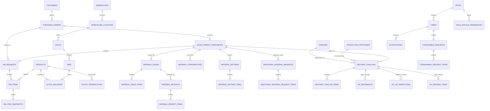

# RM Application (V-SMART) Technical & Functional Audit Report
## PART 2: Data Storage, Complete Schema Catalog & Shared Master Data

> **Document Context:** Part 2 of 5 of the comprehensive technical audit of the Raw Material (RM) Workflow & Traceability Application (**V-SMART / RMRIT**).  
> **Master Index:** [`docs/audit/RM_VSMART_FULL_REPORT.md`](file:///docs/audit/RM_VSMART_FULL_REPORT.md)  
> **Repository:** `c:/Users/Admin/OneDrive/Desktop/rm-workflow-system`  
> **Audit Date:** November 2026  
> **Mode:** Read-Only Static and Architectural Codebase Audit  

---

## 3. Data Storage

### 3.1 Database Engine & Connection Method
- **Database Engine:** PostgreSQL 16 (Targeted at PostgreSQL 14+ on AWS RDS / Neon Serverless Postgres / Render Managed Postgres).
- **Connection Method:** Native `pg` connection pool managed by TypeORM (`@nestjs/typeorm` / `AppDataSource`).
- **Connection Pooling & DNS Overrides:**
  - Standard connection string supplied via `DATABASE_URL` (pooled endpoint) or `DATABASE_URL_DIRECT` (unpooled endpoint for migrations).
  - Explicit custom DNS family override in [`backend/src/config/data-source.ts#L2-L23`](file:///backend/src/config/data-source.ts#L2-L23) forcing IPv4 resolution (`family: 4`) for `*.neon.tech` hostnames to avoid IPv6 connectivity hangs on certain Node.js OS runtimes.
  - Connection Pool Sizing (configured in [`backend/src/app.module.ts#L93-L97`](file:///backend/src/app.module.ts#L93-L97)):
    - Minimum idle connections (`min`): `0`
    - Maximum connections (`max`): `10`
    - Idle timeout (`idleTimeoutMillis`): `10000ms` (10 seconds) to permit Neon serverless compute suspend.

---

### 3.2 High-Level Entity-Relationship (ER) Architecture

---

### 3.3 Database Migration System & Execution History
- **Migration System:** TypeORM TypeScript Migration Framework (with custom runner [`backend/src/database/run-migrations.ts`](file:///backend/src/database/run-migrations.ts)).
- **Tracking Table:** `migrations` (`id` SERIAL PK, `timestamp` BIGINT NOT NULL, `name` VARCHAR NOT NULL).
- **Execution Mechanism:**
  - Automated Startup Migration: Executed during backend boot in `runStartupMigrations()` prior to NestJS module initialization (invoked in `main.ts#L42` and `start:prod` script `node dist/database/run-migrations.js && node dist/main.js`).
  - Transactional: Each migration runs wrapped in a database transaction (`BEGIN` -> `instance.up(queryRunner)` -> `INSERT INTO migrations` -> `COMMIT`).
- **Migration History (72 Migration Classes Applied):**
  1. `1700000000000-InitialSchema.ts` (Base database schema: roles, users, customers, purchase_orders, sales_order_components, rm_requests, rm_items)
  2. `1700000000001-Phase9Inventory.ts` (Inventory hierarchy: warehouses, locations, racks, bins, products, stock_balances, stock_transactions)
  3. `1700000000002-AddAdjustmentDirectionToStockTransactions.ts` (Added adjustment_direction to stock_transactions)
  4. `1700000000003-AddOpeningBalanceToStockBalances.ts` (Opening balance tracking)
  5. `1700000000004-Phase7MasterDataAndProducts.ts` (Product categories and families)
  6. `1700000000005-Phase17B31UniqueScUqConstraint.ts` (Enforced UQ_po_sc_number unique constraint)
  7. `1700000000006-Phase17B31AddProductForeignKeys.ts` (Added FKs linking rm_items to products)
  8. `1700000000010-Phase12_4_StoresReviewAndAudit.ts` (Stores audit columns)
  9. `1789988213370-Phase14_1_FileUploadStorage.ts` (uploaded_files table)
  10. `1789989683429-Phase14_2_AttachmentsEntity.ts` (attachments table)
  11. `1789989683430-Phase14_3_RmDocumentsSupport.ts` (RM documents support)
  12. `1790050110866-AddRemovedAtToFiles.ts` (Soft-delete support for files)
  13. `1790100000000-Phase15_2_EmailJobModel.ts` (email_jobs persistent queue table)
  14. `1790200000000-Phase15_3_AddPriorityAndAuditToEmail.ts` (Email priorities and logs)
  15. `1790300000000-Phase15_7_EmailAuditLogs.ts` (email_logs table)
  16. `1790400000000-Phase15_9_NotificationPreferences.ts` (user_notification_preferences)
  17. `1790500000000-Phase15_11_InAppNotifications.ts` (notifications table)
  18. `1790600000000-Phase16_9_NotificationsSystemSetting.ts` (system_settings table)
  19. `1790700000000-Phase16_10_RequestDetailsTracking.ts` (RM request metadata tracking)
  20. `1790833233642-Phase17GeneralIssue.ts` (general_issues and general_issue_items)
  21. `1790833300000-Phase17_2_GeneralIssueCancellation.ts` (General issue reversal support)
  22. `1790900000000-Phase18_1_ProductionProcessesTable.ts` (production_processes)
  23. `1790900100000-Phase18_2_ProcessSequenceValidation.ts` (Process sequence numbering)
  24. `1790900200000-Phase18_3_VendorsTable.ts` (vendors table)
  25. `1790900300000-Phase18_4_VendorProcessCapabilitiesTable.ts` (vendor_process_capabilities)
  26. `1790900400000-Phase18_5_VendorSlaTable.ts` (vendor_slas table)
  27. `1791002005636-Phase19DeliveryChallan.ts` (delivery_challans and delivery_challan_items)
  28. `1791004279878-Phase19_3_DcReturnDetails.ts` (DC return dates and remarks)
  29. `1791005680952-Phase19_5_DcReturnFields.ts` (Dock receipt verification columns)
  30. `1791006000000-SetDeliveryChallanSequence.ts` (DC numbering sequence support)
  31. `1791010000000-DcItemLevelData.ts` (Line-item returned/pending quantities)
  32. `1791352420659-Phase17B32PartialIssuanceAndTolerance.ts` (Partial issuance and tolerance rules)
  33. `1791353000000-Phase17B33NotificationsFixes.ts` (Notification triggers alignment)
  34. `1791450482793-AddInventoryGaps.ts` (Inventory missing column reconciliation)
  35. `1791450560947-AddInventoryGapsColumns.ts` (MSL and barcode attributes)
  36. `1791450600000-AddTransactionTypeEnums.ts` (Additional transaction types)
  37. `1791550000000-DynamicRoleUserModulePermissions.ts` (Dynamic RBAC permission tables)
  38: `1791560000000-VendorSlaGovernanceAndOverrides.ts` (vendor_sla_overrides table)
  39. `1791570000000-SyncRoleModulePermissions.ts` (Default module permission sync)
  40. `1791580000000-CreateDcMovementsAndQc.ts` (dc_movements and dc_qc_inspections)
  41. `1791600000000-CreateRefreshTokensTable.ts` (refresh_tokens table)
  42. `1791610000000-AddRequestReturnModulePermissions.ts` (Added permission keys for returns)
  43. `1791620000000-AddProcessNameToDeliveryChallans.ts` (Added process_name to delivery_challans)
  44. `1792220000000-BackfillProductBarcodes.ts` (CODE128 barcode backfill)
  45. `1792225000000-SeedProductMinimumStockLevels.ts` (MSL initial values seed)
  46. `1792300000000-Phase23DcQualityCheckAndRework.ts` (dc_rework_items table)
  47. `1792400000000-SupportViewFullAccessTiers.ts` (Multi-tier permission enhancements)
  48. `1792500000000-AddInitialExpectedQtyToDcReworkItems.ts` (Rework item expected quantity tracking)
  49. `1792600000000-MakeDcReworkItemsProductIdNullable.ts` (Made product_id nullable on rework items)
  50. `1792700000000-AddPurchaseQtyToConsumables.ts` (purchase_qty on consumable items)
  51. `1792800000000-MakeBinFkSetNullOnDelete.ts` (Bin FK deletion protection)
  52. `1792900000000-CreateEcrMaterialPendingTable.ts` (ecr_material_pending table)
  53. `1793000000000-CreateMercIndentPendingTables.ts` (merc_indent_pending and line items)
  54. `1793100000000-AddMercIndentIssueType.ts` (Added MERC_INDENT_ISSUE to StockTransactionType)
  55. `1793200000000-AddVendorAndSourceToMercIndentLineItems.ts` (Vendor mapping on MERC items)
  56. `1793300000000-AddSplDcSupport.ts` (Type 3 SPL Delivery Challan support)
  57. `1793400000000-RmSubstitutionAndOptionalFields.ts` (RM substitution & customer name support)
  58. `1793500000000-UpdateDcItemsPartNumberLength.ts` (Expanded part number string limits)
  59. `1793600000000-CreatePasswordResetTokensTable.ts` (password_reset_tokens table)
  60. `1793600000001-AddMissingProductionDocumentTypeEnum.ts` (Production document enum values)
  61. `1793600000002-AddMissingIndexes.ts` (Critical performance indexes)
  62. `1793700000000-Phase160EmailNotificationEvents.ts` (notification_events, role_email_settings, user_email_overrides)
  63. `1793800000000-Phase161EmailAlertWatch.ts` (email_alert_watch table)
  64. `1793900000000-Phase162EmailSkipLog.ts` (email_skip_log table)
  65. `1794000000000-AddRemarksToDeliveryChallans.ts` (Added remarks column to delivery_challans)
  66. `1794100000000-AddIsDeletedToMercIndents.ts` (Soft-delete support for MERC indents)
  67. `1794200000000-Phase162AlertDigestCooldownPriority.ts` (alert_notification_state, digest_shadow_log)
  68. `1794300000000-AddConsumableSmApprovalFields.ts` (SM approval status and timestamps on consumables)
  69. `1794300001000-AddConsumableRequestCreatedByUserId.ts` (Added created_by_user_id FK)
  70. `1794300002000-SeedConsumablesApprovalSystemModule.ts` (Seeded consumables_approval module)
  71. `1794400000000-SeedConsumableApprovalEmailEvents.ts` (Seeded CONSUMABLE_APPROVAL email events)
  72. `1794500000000-AddIsDeletedToEcrMaterialPending.ts` (Soft-delete on ECR material pending)
  73. `1794600000000-SeedMercAndEcrOverdueEmailEvents.ts` (Seeded MERC & ECR 24h overdue email events)

---

### 3.4 Seed Data
Initial reference data is seeded through dedicated scripts:
- **Roles & Base Users:** [`database/seeds/01-roles-and-users.seed.ts`](file:///database/seeds/01-roles-and-users.seed.ts) seeds 6 system roles (`ADMIN`, `DESIGNER`, `STORES`, `PRODUCTION`, `SENIOR_MANAGER`, `GENERAL_MANAGER`) and 6 default user accounts with encrypted passwords.
- **Sample Orders & SCs:** [`database/seeds/02-sample-po-sc.seed.ts`](file:///database/seeds/02-sample-po-sc.seed.ts) seeds realistic valve purchase orders (`PO-2026-VALVE-001`, `PO-2026-ACT-002`) and component SCs.
- **Delivery Challan Master Seed:** [`seed/dc_seed.json`](file:///seed/dc_seed.json) contains 110 KB of structured historical Delivery Challans extracted from production PDF records.
- **Warehouse Master Data:** Standardized rack and bin structures seeded via [`scripts/reseed_master_dataset_clean.cjs`](file:///scripts/reseed_master_dataset_clean.cjs) (Warehouse `CENTRAL-STORES`, Racks `RACK 0001` through `RACK 0025`, Bins `BIN 0001` through `BIN 0025`, and `BAR AREA`).

---

### 3.5 Database Stored Procedures, Triggers & Views Analysis
- **Stored Procedures:** **NOT FOUND** in codebase. All data mutations and business validations are handled exclusively within NestJS service transactions using TypeORM `QueryRunner` and pessimistic locking.
- **Database Triggers:** **NOT FOUND** in codebase. Temporal logging (`created_at`, `updated_at`) is performed via TypeORM decorators (`@CreateDateColumn`, `@UpdateDateColumn`).
- **Database Views:** **NOT FOUND** in physical schema. All analytical dashboards (e.g. SC Traceability View, PO Traceability View) execute dynamic SQL `SELECT ... JOIN` queries constructed in NestJS repositories.

---

### 3.6 File & Upload Storage
- **Storage Providers:**
  1. **Supabase Cloud Storage:** Activated when `SUPABASE_URL` and `SUPABASE_SERVICE_ROLE_KEY` are configured; stores blobs in bucket `rmrit-documents`.
  2. **Local Disk Storage:** Fallback provider storing files on local filesystem under `backend/.storage/` (or `./.storage/`).
- **File Metadata Ledger:** Table `uploaded_files` tracks `id`, `original_name`, `storage_key`, `mime_type`, `size`, `provider`, `created_by_id`, `created_at`, and `removed_at`.
- **Upload Constraints:** Max size `5 MB`, restricted to JPEG, PNG, PDF, XLS, XLSX. Executable extensions strictly rejected.

---

### 3.7 Backup Strategy & Data Retention
- **Backup Strategy:** Relies on managed PostgreSQL continuous WAL archiving and daily automated snapshots (Neon Point-in-Time Restore / Render Postgres automated daily backups).
- **Audit Log Retention:** Table `audit_logs` and `email_logs` are append-only.
- **Email Skip Log Retention:** Automated daily midnight purge (`purgeOld`) retains skip logs for `30 days` (configurable via `DEFAULT_SKIP_LOG_RETENTION_DAYS`; [`backend/src/notifications/email-skip-log.service.ts#L232`](file:///backend/src/notifications/email-skip-log.service.ts#L232)).

---

## 3.8 Complete Database Schema (All 67 Tables)

### 3.1. Table: `additional_material_request_items` (AdditionalMaterialRequestItem)

* **Entity Source File:** [`backend/src/additional-request/entities/additional-request-item.entity.ts`](file:///backend/src/additional-request/entities/additional-request-item.entity.ts)
* **Primary Key:** id
* **Indexes:** `'IDX_additional_material_request_items_request_created_at', [ 'requestId', 'createdAt', ]`, ``, ``

| Column | SQL Type | TS Type | Nullable | Default | PK | Notes |
| :--- | :--- | :--- | :---: | :--- | :---: | :--- |
| `quantity_approved` | `numeric` | `number` | YES | - | ❌ | - |
| `remarks` | `text` | `string` | YES | - | ❌ | - |

---

### 3.2. Table: `additional_material_requests` (AdditionalMaterialRequest)

* **Entity Source File:** [`backend/src/additional-request/entities/additional-request.entity.ts`](file:///backend/src/additional-request/entities/additional-request.entity.ts)
* **Primary Key:** id
* **Indexes:** `'idx_single_active_request', ['scId'], { unique: true, where: "status IN ('REQUESTED', 'APPROVED'`, `'IDX_additional_material_requests_status_created_at', [ 'status', 'createdAt', ]`, ``

| Column | SQL Type | TS Type | Nullable | Default | PK | Notes |
| :--- | :--- | :--- | :---: | :--- | :---: | :--- |
| `remarks` | `text` | `string` | YES | - | ❌ | - |
| `approved_at` | `timestamp with time zone` | `Date` | YES | - | ❌ | - |
| `approved_by_id` | `varchar/inferred` | `string` | YES | - | ❌ | - |

**Foreign Key / Model Relations:**
- `approvedBy` (ManyToOne -> `User`): `@ManyToOne(() => User, { nullable: true, onDelete: 'RESTRICT' }) @JoinColumn({ name: 'approved_by_id' })`

---

### 3.3. Table: `email_alert_watch` (EmailAlertWatch)

* **Entity Source File:** [`backend/src/alert-sweeps/entities/email-alert-watch.entity.ts`](file:///backend/src/alert-sweeps/entities/email-alert-watch.entity.ts)
* **Primary Key:** id
* **Unique Constraints:** `'UQ_email_alert_watch_alert_entity', ['alertCode', 'entityId']`
* **Indexes:** `'IDX_email_alert_watch_alert_code'`, `'IDX_email_alert_watch_entity_id'`, `'IDX_email_alert_watch_first_seen_at'`

| Column | SQL Type | TS Type | Nullable | Default | PK | Notes |
| :--- | :--- | :--- | :---: | :--- | :---: | :--- |

---

### 3.4. Table: `attachments` (Attachment)

* **Entity Source File:** [`backend/src/attachments/entities/attachment.entity.ts`](file:///backend/src/attachments/entities/attachment.entity.ts)
* **Primary Key:** id
* **Indexes:** `'IDX_ATTACHMENTS_UNIQUE_ACTIVE', ['fileId', 'context', 'recordId'], { unique: true, where: 'is_active = true' }`, ``

| Column | SQL Type | TS Type | Nullable | Default | PK | Notes |
| :--- | :--- | :--- | :---: | :--- | :---: | :--- |
| `document_type` | `varchar` | `string` | YES | - | ❌ | - |

---

### 3.5. Table: `audit_logs` (AuditLog)

* **Entity Source File:** [`backend/src/audit/entities/audit-log.entity.ts`](file:///backend/src/audit/entities/audit-log.entity.ts)
* **Primary Key:** id
* **Indexes:** ``, ``, ``

| Column | SQL Type | TS Type | Nullable | Default | PK | Notes |
| :--- | :--- | :--- | :---: | :--- | :---: | :--- |
| `actor_id` | `varchar/inferred` | `string` | YES | - | ❌ | - |
| `old_values` | `jsonb` | `Record<string, any>` | YES | - | ❌ | - |
| `new_values` | `jsonb` | `Record<string, any>` | YES | - | ❌ | - |
| `metadata` | `jsonb` | `Record<string, any>` | YES | - | ❌ | - |

**Foreign Key / Model Relations:**
- `actor` (ManyToOne -> `User`): `@ManyToOne(() => User, { nullable: true, onDelete: 'SET NULL' }) @JoinColumn({ name: 'actor_id' })`

---

### 3.6. Table: `password_reset_tokens` (PasswordResetToken)

* **Entity Source File:** [`backend/src/auth/entities/password-reset-token.entity.ts`](file:///backend/src/auth/entities/password-reset-token.entity.ts)
* **Primary Key:** id
* **Indexes:** `'idx_password_reset_tokens_user_id'`, `'uq_password_reset_tokens_token_hash', { unique: true }`, `'idx_password_reset_tokens_expires_at'`

| Column | SQL Type | TS Type | Nullable | Default | PK | Notes |
| :--- | :--- | :--- | :---: | :--- | :---: | :--- |

---

### 3.7. Table: `refresh_tokens` (RefreshToken)

* **Entity Source File:** [`backend/src/auth/entities/refresh-token.entity.ts`](file:///backend/src/auth/entities/refresh-token.entity.ts)
* **Primary Key:** id
* **Indexes:** `'IDX_refresh_tokens_user_id'`, `'UQ_refresh_tokens_token_hash', { unique: true }`, `'IDX_refresh_tokens_expires_at'`

| Column | SQL Type | TS Type | Nullable | Default | PK | Notes |
| :--- | :--- | :--- | :---: | :--- | :---: | :--- |
| `replaced_by_token` | `varchar` | `string | null` | YES | - | ❌ | - |
| `device_info` | `varchar` | `string | null` | YES | - | ❌ | - |

---

### 3.8. Table: `consumable_request_items` (ConsumableRequestItem)

* **Entity Source File:** [`backend/src/consumables/entities/consumable-request-item.entity.ts`](file:///backend/src/consumables/entities/consumable-request-item.entity.ts)
* **Primary Key:** id
* **Indexes:** ``, ``, ``, ``, ``, ``, ``, `'idx_cri_approval_status'`, `'idx_cri_approved_at'`, `'idx_cri_approval_batch_id'`

| Column | SQL Type | TS Type | Nullable | Default | PK | Notes |
| :--- | :--- | :--- | :---: | :--- | :---: | :--- |
| `pr_number` | `varchar` | `string | null` | YES | - | ❌ | Indexed;  |
| `product_code` | `varchar` | `string | null` | YES | - | ❌ | - |
| `purchase_qty` | `numeric` | `number | null` | YES | - | ❌ | - |
| `vendor_id` | `uuid` | `string | null` | YES | - | ❌ | Indexed;  |
| `vendor_name` | `varchar` | `string | null` | YES | - | ❌ | - |
| `unit_price` | `numeric` | `number | null` | YES | - | ❌ | - |
| `new_vendor_name` | `varchar` | `string | null` | YES | - | ❌ | - |
| `new_vendor_address` | `text` | `string | null` | YES | - | ❌ | - |
| `new_vendor_mobile` | `varchar` | `string | null` | YES | - | ❌ | - |
| `new_vendor_price` | `numeric` | `number | null` | YES | - | ❌ | - |
| `end_user_in_velan` | `varchar` | `string | null` | YES | - | ❌ | - |
| `requested_by` | `varchar` | `string | null` | YES | - | ❌ | - |
| `bin_id` | `uuid` | `string | null` | YES | - | ❌ | Indexed;  |
| `printed_at` | `timestamp with time zone` | `Date | null` | YES | - | ❌ | - |
| `purchase_received_at` | `timestamp with time zone` | `Date | null` | YES | - | ❌ | - |
| `issued_at` | `timestamp with time zone` | `Date | null` | YES | - | ❌ | - |
| `production_received_at` | `timestamp with time zone` | `Date | null` | YES | - | ❌ | - |
| `production_received_by_id` | `uuid` | `string | null` | YES | - | ❌ | - |
| `approval_status` | `enum` | `ConsumableApprovalStatus | null` | YES | - | ❌ | Indexed;  |
| `approved_by_id` | `uuid` | `string | null` | YES | - | ❌ | - |
| `approved_at` | `timestamp with time zone` | `Date | null` | YES | - | ❌ | Indexed;  |
| `rejected_by_id` | `uuid` | `string | null` | YES | - | ❌ | - |
| `rejected_at` | `timestamp with time zone` | `Date | null` | YES | - | ❌ | - |
| `rejection_reason` | `text` | `string | null` | YES | - | ❌ | - |
| `approval_batch_id` | `uuid` | `string | null` | YES | - | ❌ | Indexed;  |

**Foreign Key / Model Relations:**
- `vendor` (ManyToOne -> `Vendor | null`): `@ManyToOne(() => Vendor, { onDelete: 'SET NULL', nullable: true }) @JoinColumn({ name: 'vendor_id' })`
- `bin` (ManyToOne -> `Bin | null`): `@ManyToOne(() => Bin, { onDelete: 'SET NULL', nullable: true }) @JoinColumn({ name: 'bin_id' })`
- `approvedBy` (ManyToOne -> `User | null`): `@ManyToOne(() => User, { onDelete: 'SET NULL', nullable: true }) @JoinColumn({ name: 'approved_by_id' })`
- `rejectedBy` (ManyToOne -> `User | null`): `@ManyToOne(() => User, { onDelete: 'SET NULL', nullable: true }) @JoinColumn({ name: 'rejected_by_id' })`

---

### 3.9. Table: `consumable_requests` (ConsumableRequest)

* **Entity Source File:** [`backend/src/consumables/entities/consumable-request.entity.ts`](file:///backend/src/consumables/entities/consumable-request.entity.ts)
* **Primary Key:** id
* **Indexes:** `{ unique: true }`

| Column | SQL Type | TS Type | Nullable | Default | PK | Notes |
| :--- | :--- | :--- | :---: | :--- | :---: | :--- |
| `end_user_in_velan` | `varchar` | `string | null` | YES | - | ❌ | - |
| `created_by_user_id` | `uuid` | `string | null` | YES | - | ❌ | - |
| `prepared_by` | `varchar` | `string | null` | YES | - | ❌ | - |
| `verified_by` | `varchar` | `string | null` | YES | - | ❌ | - |
| `approved_by` | `varchar` | `string | null` | YES | - | ❌ | - |
| `remarks` | `text` | `string | null` | YES | - | ❌ | - |

**Foreign Key / Model Relations:**
- `createdByUser` (ManyToOne -> `User | null`): `@ManyToOne(() => User, { onDelete: 'SET NULL', nullable: true }) @JoinColumn({ name: 'created_by_user_id' })`

---

### 3.10. Table: `customers` (Customer)

* **Entity Source File:** [`backend/src/customers/entities/customer.entity.ts`](file:///backend/src/customers/entities/customer.entity.ts)
* **Primary Key:** id
* **Indexes:** ``, `{ unique: true }`

| Column | SQL Type | TS Type | Nullable | Default | PK | Notes |
| :--- | :--- | :--- | :---: | :--- | :---: | :--- |
| `contact_person` | `varchar/inferred` | `string` | YES | - | ❌ | - |
| `email` | `varchar/inferred` | `string` | YES | - | ❌ | - |
| `phone` | `varchar/inferred` | `string` | YES | - | ❌ | - |

---

### 3.11. Table: `dc_movements` (DcMovement)

* **Entity Source File:** [`backend/src/delivery-challan/entities/dc-movement.entity.ts`](file:///backend/src/delivery-challan/entities/dc-movement.entity.ts)
* **Primary Key:** id
* **Indexes:** `'IDX_dc_movements_sc_product', ['scId', 'dispatchedProductId']`, `'IDX_dc_movements_challan_id', ['challanId']`, `'IDX_dc_movements_challan_item_id', ['challanItemId']`, `'IDX_dc_movements_status', ['status']`

| Column | SQL Type | TS Type | Nullable | Default | PK | Notes |
| :--- | :--- | :--- | :---: | :--- | :---: | :--- |
| `id` | `uuid` | `string` | NO | - | ✅ | - |
| `challan_id` | `uuid` | `string` | NO | - | ❌ | - |
| `challan_item_id` | `uuid` | `string` | NO | - | ❌ | - |
| `sc_id` | `uuid` | `string` | NO | - | ❌ | - |
| `process_id` | `uuid` | `string | null` | YES | - | ❌ | - |
| `dispatched_product_id` | `uuid` | `string` | NO | - | ❌ | - |
| `dispatched_qty` | `numeric` | `number` | NO | - | ❌ | - |
| `returned_product_id` | `uuid` | `string | null` | YES | - | ❌ | - |
| `returned_qty` | `numeric` | `number` | NO | `0` | ❌ | - |
| `status` | `varchar` | `DcMovementStatus` | NO | `DcMovementStatus.DISPATCHED` | ❌ | - |
| `createdAt` | `timestamptz` | `Date` | NO | - | ❌ | Auto CreatedAt;  |
| `updatedAt` | `timestamptz` | `Date` | NO | - | ❌ | Auto UpdatedAt;  |

**Foreign Key / Model Relations:**
- `challan` (ManyToOne -> `Relation<DeliveryChallan>`): `@ManyToOne(() => DeliveryChallan, { onDelete: 'CASCADE' }) @JoinColumn({ name: 'challan_id' })`
- `challanItem` (ManyToOne -> `Relation<DeliveryChallanItem>`): `@ManyToOne(() => DeliveryChallanItem, (item) => item.movements, { onDelete: 'CASCADE' }) @JoinColumn({ name: 'challan_item_id' })`
- `sc` (ManyToOne -> `Relation<SalesOrderComponent>`): `@ManyToOne(() => SalesOrderComponent) @JoinColumn({ name: 'sc_id' })`
- `process` (ManyToOne -> `Relation<ProductionProcess>`): `@ManyToOne(() => ProductionProcess, { nullable: true }) @JoinColumn({ name: 'process_id' })`
- `dispatchedProduct` (ManyToOne -> `Relation<Product>`): `@ManyToOne(() => Product) @JoinColumn({ name: 'dispatched_product_id' })`
- `returnedProduct` (ManyToOne -> `Relation<Product>`): `@ManyToOne(() => Product, { nullable: true }) @JoinColumn({ name: 'returned_product_id' })`

---

### 3.12. Table: `dc_qc_inspections` (DcQcInspection)

* **Entity Source File:** [`backend/src/delivery-challan/entities/dc-qc-inspection.entity.ts`](file:///backend/src/delivery-challan/entities/dc-qc-inspection.entity.ts)
* **Primary Key:** id
* **Indexes:** `'IDX_dc_qc_inspections_challan_id', ['challanId']`, `'IDX_dc_qc_inspections_item_id', ['challanItemId']`

| Column | SQL Type | TS Type | Nullable | Default | PK | Notes |
| :--- | :--- | :--- | :---: | :--- | :---: | :--- |
| `id` | `uuid` | `string` | NO | - | ✅ | - |
| `challan_id` | `uuid` | `string` | NO | - | ❌ | - |
| `challan_item_id` | `uuid` | `string` | NO | - | ❌ | - |
| `batch_received_qty` | `numeric` | `number` | NO | - | ❌ | - |
| `passed_qty` | `numeric` | `number` | NO | `0` | ❌ | - |
| `rejected_qty` | `numeric` | `number` | NO | `0` | ❌ | - |
| `actual_inward_qty` | `numeric` | `number | null` | YES | - | ❌ | - |
| `remarks` | `text` | `string | null` | YES | - | ❌ | - |
| `inspected_by_id` | `uuid` | `string | null` | YES | - | ❌ | - |
| `inspected_at` | `timestamptz` | `Date` | NO | `(` | ❌ | - |
| `createdAt` | `timestamptz` | `Date` | NO | - | ❌ | Auto CreatedAt;  |

**Foreign Key / Model Relations:**
- `challan` (ManyToOne -> `Relation<DeliveryChallan>`): `@ManyToOne(() => DeliveryChallan, { onDelete: 'CASCADE' }) @JoinColumn({ name: 'challan_id' })`
- `challanItem` (ManyToOne -> `Relation<DeliveryChallanItem>`): `@ManyToOne(() => DeliveryChallanItem, { onDelete: 'CASCADE' }) @JoinColumn({ name: 'challan_item_id' })`
- `inspectedBy` (ManyToOne -> `Relation<User> | null`): `@ManyToOne(() => User, { nullable: true }) @JoinColumn({ name: 'inspected_by_id' })`

---

### 3.13. Table: `dc_rework_items` (DcReworkItem)

* **Entity Source File:** [`backend/src/delivery-challan/entities/dc-rework-item.entity.ts`](file:///backend/src/delivery-challan/entities/dc-rework-item.entity.ts)
* **Primary Key:** id
* **Indexes:** `'IDX_dc_rework_items_source_dc', ['sourceDcId']`, `'IDX_dc_rework_items_sc_id', ['scId']`, `'IDX_dc_rework_items_status', ['reworkStatus']`, `'IDX_dc_rework_items_vendor', ['originalVendorId']`

| Column | SQL Type | TS Type | Nullable | Default | PK | Notes |
| :--- | :--- | :--- | :---: | :--- | :---: | :--- |
| `id` | `uuid` | `string` | NO | - | ✅ | - |
| `source_dc_id` | `uuid` | `string` | NO | - | ❌ | - |
| `source_dc_number` | `varchar` | `string` | NO | - | ❌ | - |
| `dc_type` | `varchar` | `string` | NO | - | ❌ | - |
| `sc_id` | `uuid` | `string | null` | YES | - | ❌ | - |
| `sc_number` | `varchar` | `string | null` | YES | - | ❌ | - |
| `po_id` | `uuid` | `string | null` | YES | - | ❌ | - |
| `po_number` | `varchar` | `string | null` | YES | - | ❌ | - |
| `product_id` | `uuid` | `string | null` | YES | - | ❌ | - |
| `product_name` | `varchar` | `string` | NO | - | ❌ | - |
| `part_number` | `varchar` | `string | null` | YES | - | ❌ | - |
| `uom` | `varchar` | `string` | NO | `'PCS'` | ❌ | - |
| `original_vendor_id` | `uuid` | `string` | NO | - | ❌ | - |
| `original_vendor_name` | `varchar` | `string` | NO | - | ❌ | - |
| `rejected_qty` | `numeric` | `number` | NO | - | ❌ | - |
| `qc_remarks` | `text` | `string | null` | YES | - | ❌ | - |
| `rework_status` | `varchar` | `ReworkItemStatus` | NO | `ReworkItemStatus.PENDING_ACK` | ❌ | - |
| `rework_dc_id` | `uuid` | `string | null` | YES | - | ❌ | - |
| `rework_dc_number` | `varchar` | `string | null` | YES | - | ❌ | - |
| `createdAt` | `timestamptz` | `Date` | NO | - | ❌ | Auto CreatedAt;  |
| `updatedAt` | `timestamptz` | `Date` | NO | - | ❌ | Auto UpdatedAt;  |

**Foreign Key / Model Relations:**
- `sourceDc` (ManyToOne -> `Relation<DeliveryChallan>`): `@ManyToOne(() => DeliveryChallan, { onDelete: 'CASCADE' }) @JoinColumn({ name: 'source_dc_id' })`
- `sc` (ManyToOne -> `Relation<SalesOrderComponent> | null`): `@ManyToOne(() => SalesOrderComponent, { nullable: true, onDelete: 'SET NULL' }) @JoinColumn({ name: 'sc_id' })`
- `po` (ManyToOne -> `Relation<PurchaseOrder> | null`): `@ManyToOne(() => PurchaseOrder, { nullable: true, onDelete: 'SET NULL' }) @JoinColumn({ name: 'po_id' })`
- `product` (ManyToOne -> `Relation<Product> | null`): `@ManyToOne(() => Product, { nullable: true, onDelete: 'SET NULL' }) @JoinColumn({ name: 'product_id' })`
- `originalVendor` (ManyToOne -> `Relation<Vendor>`): `@ManyToOne(() => Vendor, { onDelete: 'RESTRICT' }) @JoinColumn({ name: 'original_vendor_id' })`
- `reworkDc` (ManyToOne -> `Relation<DeliveryChallan> | null`): `@ManyToOne(() => DeliveryChallan, { nullable: true, onDelete: 'SET NULL' }) @JoinColumn({ name: 'rework_dc_id' })`

---

### 3.14. Table: `delivery_challan_items` (DeliveryChallanItem)

* **Entity Source File:** [`backend/src/delivery-challan/entities/delivery-challan-item.entity.ts`](file:///backend/src/delivery-challan/entities/delivery-challan-item.entity.ts)
* **Primary Key:** id
* **Indexes:** `'IDX_dci_challan_id', ['challanId']`, `'IDX_dci_product_id', ['productId']`, `'IDX_dci_output_product_id', ['outputProductId']`, `'IDX_dci_bin_id', ['binId']`, `'IDX_dci_output_bin_id', ['outputBinId']`, `'IDX_dci_sc_id', ['scId']`, `'IDX_dci_process_id', ['processId']`, `'IDX_dci_return_target_bin_id', ['returnTargetBinId']`

| Column | SQL Type | TS Type | Nullable | Default | PK | Notes |
| :--- | :--- | :--- | :---: | :--- | :---: | :--- |
| `id` | `uuid` | `string` | NO | - | ✅ | - |
| `sc_id` | `uuid` | `string | null` | YES | - | ❌ | - |
| `process_id` | `uuid` | `string | null` | YES | - | ❌ | - |
| `process_name` | `varchar` | `string | null` | YES | - | ❌ | - |
| `part_number` | `varchar` | `string | null` | YES | - | ❌ | - |
| `part_name` | `varchar` | `string | null` | YES | - | ❌ | - |
| `description` | `text` | `string | null` | YES | - | ❌ | - |
| `batch_number` | `varchar` | `string | null` | YES | - | ❌ | - |
| `po_part_label` | `varchar` | `string | null` | YES | - | ❌ | - |
| `merc_item_id` | `varchar` | `string | null` | YES | - | ❌ | - |
| `challan_id` | `uuid` | `string` | NO | - | ❌ | - |
| `product_id` | `uuid` | `string | null` | YES | - | ❌ | - |
| `bin_id` | `uuid` | `string | null` | YES | - | ❌ | - |
| `output_product_id` | `uuid` | `string | null` | YES | - | ❌ | - |
| `expected_output_quantity` | `numeric` | `number | null` | YES | - | ❌ | - |
| `output_bin_id` | `uuid` | `string | null` | YES | - | ❌ | - |
| `quantity_dispatched` | `numeric` | `number` | NO | - | ❌ | - |
| `quantity_returned` | `numeric` | `number` | NO | `0` | ❌ | - |
| `qc_pending_qty` | `numeric` | `number` | NO | `0` | ❌ | - |
| `qc_passed_qty` | `numeric` | `number` | NO | `0` | ❌ | - |
| `qc_rejected_qty` | `numeric` | `number` | NO | `0` | ❌ | - |
| `initial_expected_qty` | `numeric` | `number | null` | YES | - | ❌ | - |
| `expected_return_qty` | `numeric` | `number | null` | YES | - | ❌ | - |
| `actual_received_qty` | `numeric` | `number` | NO | `0` | ❌ | - |
| `return_target_bin_id` | `uuid` | `string | null` | YES | - | ❌ | - |
| `createdAt` | `timestamptz` | `Date` | NO | - | ❌ | Auto CreatedAt;  |
| `updatedAt` | `timestamptz` | `Date` | NO | - | ❌ | Auto UpdatedAt;  |

**Foreign Key / Model Relations:**
- `sc` (ManyToOne -> `any`): `@ManyToOne('SalesOrderComponent', { nullable: true }) @JoinColumn({ name: 'sc_id', foreignKeyConstraintName: 'FK_dci_sc_id' })`
- `process` (ManyToOne -> `any`): `@ManyToOne('ProductionProcess', { nullable: true }) @JoinColumn({ name: 'process_id', foreignKeyConstraintName: 'FK_dci_process_id' })`
- `challan` (ManyToOne -> `Relation<DeliveryChallan>`): `@ManyToOne(() => DeliveryChallan, (challan) => challan.items, { onDelete: 'CASCADE' }) @JoinColumn({ name: 'challan_id' })`
- `product` (ManyToOne -> `Product`): `@ManyToOne(() => Product, { nullable: true }) @JoinColumn({ name: 'product_id' })`
- `bin` (ManyToOne -> `Bin`): `@ManyToOne(() => Bin, { nullable: true, onDelete: 'SET NULL' }) @JoinColumn({ name: 'bin_id' })`
- `outputProduct` (ManyToOne -> `Product`): `@ManyToOne(() => Product, { nullable: true }) @JoinColumn({ name: 'output_product_id' })`
- `outputBin` (ManyToOne -> `Bin`): `@ManyToOne(() => Bin, { nullable: true }) @JoinColumn({ name: 'output_bin_id' })`
- `returnTargetBin` (ManyToOne -> `Relation<Bin> | null`): `@ManyToOne(() => Bin, { nullable: true }) @JoinColumn({ name: 'return_target_bin_id' })`
- `movements` (OneToMany -> `Relation<DcMovement[]>`): `@OneToMany(() => DcMovement, (movement) => movement.challanItem)`
- `qcInspections` (OneToMany -> `Relation<DcQcInspection[]>`): `@OneToMany(() => DcQcInspection, (qc) => qc.challanItem)`

---

### 3.15. Table: `delivery_challans` (DeliveryChallan)

* **Entity Source File:** [`backend/src/delivery-challan/entities/delivery-challan.entity.ts`](file:///backend/src/delivery-challan/entities/delivery-challan.entity.ts)
* **Primary Key:** id
* **Indexes:** `'IDX_dc_challan_number', ['challanNumber'], { unique: true }`, `'IDX_dc_vendor_id', ['vendorId']`, `'IDX_dc_sc_id', ['scId']`, `'IDX_dc_status', ['status']`, `'idx_delivery_challans_po_number', ['poNumber']`

| Column | SQL Type | TS Type | Nullable | Default | PK | Notes |
| :--- | :--- | :--- | :---: | :--- | :---: | :--- |
| `id` | `uuid` | `string` | NO | - | ✅ | - |
| `challan_number` | `varchar` | `string` | NO | - | ❌ | - |
| `type` | `varchar` | `string` | NO | - | ❌ | - |
| `vendor_id` | `uuid` | `string` | NO | - | ❌ | - |
| `sc_id` | `uuid` | `string | null` | YES | - | ❌ | - |
| `process_id` | `uuid` | `string | null` | YES | - | ❌ | - |
| `process_name` | `varchar` | `string | null` | YES | - | ❌ | - |
| `dispatch_date` | `timestamptz` | `Date` | NO | - | ❌ | - |
| `expected_return_date` | `timestamptz` | `Date | null` | YES | - | ❌ | - |
| `status` | `varchar` | `string` | NO | `DeliveryChallanStatus.DISPATCHED` | ❌ | - |
| `notes` | `text` | `string | null` | YES | - | ❌ | - |
| `remarks` | `text` | `string | null` | YES | - | ❌ | - |
| `created_by_id` | `uuid` | `string | null` | YES | - | ❌ | - |
| `actual_return_date` | `timestamptz` | `Date | null` | YES | - | ❌ | - |
| `verified_by_id` | `uuid` | `string | null` | YES | - | ❌ | - |
| `verification_remarks` | `text` | `string | null` | YES | - | ❌ | - |
| `po_number` | `varchar` | `string | null` | YES | - | ❌ | - |
| `layout_number` | `varchar` | `string | null` | YES | - | ❌ | - |
| `merc_indent_id` | `varchar` | `string | null` | YES | - | ❌ | - |
| `merc_indent_number` | `varchar` | `string | null` | YES | - | ❌ | - |
| `createdAt` | `timestamptz` | `Date` | NO | - | ❌ | Auto CreatedAt;  |
| `updatedAt` | `timestamptz` | `Date` | NO | - | ❌ | Auto UpdatedAt;  |

**Foreign Key / Model Relations:**
- `vendor` (ManyToOne -> `Vendor`): `@ManyToOne(() => Vendor) @JoinColumn({ name: 'vendor_id' })`
- `sc` (ManyToOne -> `SalesOrderComponent | null`): `@ManyToOne(() => SalesOrderComponent) @JoinColumn({ name: 'sc_id' })`
- `process` (ManyToOne -> `ProductionProcess | null`): `@ManyToOne(() => ProductionProcess) @JoinColumn({ name: 'process_id' })`
- `createdBy` (ManyToOne -> `User | null`): `@ManyToOne(() => User) @JoinColumn({ name: 'created_by_id' })`
- `verifiedBy` (ManyToOne -> `User | null`): `@ManyToOne(() => User) @JoinColumn({ name: 'verified_by_id' })`
- `items` (OneToMany -> `Relation<DeliveryChallanItem>[]`): `@OneToMany(() => DeliveryChallanItem, (item) => item.challan, { cascade: true })`
- `qcInspections` (OneToMany -> `Relation<DcQcInspection[]>`): `@OneToMany(() => DcQcInspection, (qc) => qc.challan)`
- `reworkItems` (OneToMany -> `Relation<DcReworkItem[]>`): `@OneToMany(() => DcReworkItem, (rework) => rework.sourceDc)`

---

### 3.16. Table: `ecr_material_pending` (EcrMaterialPending)

* **Entity Source File:** [`backend/src/ecr-issues/entities/ecr-material-pending.entity.ts`](file:///backend/src/ecr-issues/entities/ecr-material-pending.entity.ts)
* **Primary Key:** id

| Column | SQL Type | TS Type | Nullable | Default | PK | Notes |
| :--- | :--- | :--- | :---: | :--- | :---: | :--- |
| `issued_at` | `timestamp` | `Date | null` | YES | - | ❌ | - |
| `issued_by_id` | `uuid` | `string | null` | YES | - | ❌ | - |
| `stock_transaction_id` | `uuid` | `string | null` | YES | - | ❌ | - |
| `approved_at` | `timestamp` | `Date | null` | YES | - | ❌ | - |

**Foreign Key / Model Relations:**
- `issuedBy` (ManyToOne -> `Relation<User> | null`): `@ManyToOne(() => User, { nullable: true, onDelete: 'SET NULL' }) @JoinColumn({ name: 'issued_by_id' })`
- `stockTransaction` (ManyToOne -> `Relation<StockTransaction> | null`): `@ManyToOne(() => StockTransaction, { nullable: true, onDelete: 'SET NULL' }) @JoinColumn({ name: 'stock_transaction_id' })`

---

### 3.17. Table: `alert_notification_state` (AlertNotificationState)

* **Entity Source File:** [`backend/src/email/entities/alert-notification-state.entity.ts`](file:///backend/src/email/entities/alert-notification-state.entity.ts)
* **Primary Key:** id
* **Unique Constraints:** `'UQ_alert_notification_state', ['eventCode', 'entityType', 'entityId', 'recipientUserId']`
* **Indexes:** `'IDX_alert_state_lookup', ['eventCode', 'recipientUserId', 'entityId']`, `'IDX_alert_state_last_alerted', ['lastAlertedAt']`

| Column | SQL Type | TS Type | Nullable | Default | PK | Notes |
| :--- | :--- | :--- | :---: | :--- | :---: | :--- |

---

### 3.18. Table: `digest_shadow_log` (DigestShadowLog)

* **Entity Source File:** [`backend/src/email/entities/digest-shadow-log.entity.ts`](file:///backend/src/email/entities/digest-shadow-log.entity.ts)
* **Primary Key:** id
* **Indexes:** `'IDX_digest_shadow_log_event_created', ['eventCode', 'createdAt']`

| Column | SQL Type | TS Type | Nullable | Default | PK | Notes |
| :--- | :--- | :--- | :---: | :--- | :---: | :--- |

---

### 3.19. Table: `email_jobs` (EmailJob)

* **Entity Source File:** [`backend/src/email/entities/email-job.entity.ts`](file:///backend/src/email/entities/email-job.entity.ts)
* **Primary Key:** id
* **Indexes:** `'IDX_email_jobs_status_next_retry', ['status', 'nextRetryAt']`, `'IDX_email_jobs_queue_claim', ['status', 'nextRetryAt', 'priority', 'createdAt']`, `'IDX_email_jobs_recipient_user_id'`, `'UQ_email_jobs_idempotency_key', { unique: true }`

| Column | SQL Type | TS Type | Nullable | Default | PK | Notes |
| :--- | :--- | :--- | :---: | :--- | :---: | :--- |
| `recipient_user_id` | `uuid` | `string | null` | YES | - | ❌ | Indexed;  |
| `recipient_name` | `varchar` | `string | null` | YES | - | ❌ | - |
| `last_error` | `text` | `string | null` | YES | - | ❌ | - |
| `next_retry_at` | `timestamptz` | `Date | null` | YES | - | ❌ | - |
| `locked_at` | `timestamptz` | `Date | null` | YES | - | ❌ | - |
| `locked_by` | `varchar` | `string | null` | YES | - | ❌ | - |
| `sent_at` | `timestamptz` | `Date | null` | YES | - | ❌ | - |
| `provider_message_id` | `varchar` | `string | null` | YES | - | ❌ | - |
| `payload` | `jsonb` | `Record<string, any> | null` | YES | - | ❌ | - |

**Foreign Key / Model Relations:**
- `user` (ManyToOne -> `User | null`): `@ManyToOne(() => User, { onDelete: 'SET NULL', nullable: true }) @JoinColumn({ name: 'recipient_user_id' })`

---

### 3.20. Table: `email_logs` (EmailLog)

* **Entity Source File:** [`backend/src/email/entities/email-log.entity.ts`](file:///backend/src/email/entities/email-log.entity.ts)
* **Primary Key:** id
* **Indexes:** `'IDX_email_logs_job_id', ['jobId']`, `'IDX_email_logs_created_at', ['createdAt']`, `'IDX_email_logs_provider_message_id', ['providerMessageId']`, `'IDX_email_logs_status', ['status']`

| Column | SQL Type | TS Type | Nullable | Default | PK | Notes |
| :--- | :--- | :--- | :---: | :--- | :---: | :--- |
| `job_id` | `uuid` | `string | null` | YES | - | ❌ | - |
| `recipient_user_id` | `uuid` | `string | null` | YES | - | ❌ | - |
| `recipient_name` | `varchar` | `string | null` | YES | - | ❌ | - |
| `provider_message_id` | `varchar` | `string | null` | YES | - | ❌ | - |
| `error_code` | `varchar` | `string | null` | YES | - | ❌ | - |
| `error_message` | `text` | `string | null` | YES | - | ❌ | - |

**Foreign Key / Model Relations:**
- `job` (ManyToOne -> `EmailJob | null`): `@ManyToOne(() => EmailJob, { onDelete: 'RESTRICT', nullable: true }) @JoinColumn({ name: 'job_id' })`
- `user` (ManyToOne -> `User | null`): `@ManyToOne(() => User, { onDelete: 'SET NULL', nullable: true }) @JoinColumn({ name: 'recipient_user_id' })`

---

### 3.21. Table: `uploaded_files` (UploadedFile)

* **Entity Source File:** [`backend/src/files/entities/uploaded-file.entity.ts`](file:///backend/src/files/entities/uploaded-file.entity.ts)
* **Primary Key:** id
* **Indexes:** ``

| Column | SQL Type | TS Type | Nullable | Default | PK | Notes |
| :--- | :--- | :--- | :---: | :--- | :---: | :--- |
| `removed_by_id` | `uuid` | `string` | YES | - | ❌ | - |
| `removed_at` | `timestamp` | `Date` | YES | - | ❌ | - |

**Foreign Key / Model Relations:**
- `removedBy` (ManyToOne -> `User`): `@ManyToOne(() => User, { onDelete: 'RESTRICT' }) @JoinColumn({ name: 'removed_by_id' })`

---

### 3.22. Table: `general_issue_items` (GeneralIssueItem)

* **Entity Source File:** [`backend/src/general-issue/entities/general-issue-item.entity.ts`](file:///backend/src/general-issue/entities/general-issue-item.entity.ts)
* **Primary Key:** id

| Column | SQL Type | TS Type | Nullable | Default | PK | Notes |
| :--- | :--- | :--- | :---: | :--- | :---: | :--- |
| `bin_id` | `uuid` | `string | null` | YES | - | ❌ | - |
| `remarks` | `text` | `string` | YES | - | ❌ | - |

**Foreign Key / Model Relations:**
- `bin` (ManyToOne -> `Bin | null`): `@ManyToOne(() => Bin, { onDelete: 'SET NULL', nullable: true }) @JoinColumn({ name: 'bin_id' })`

---

### 3.23. Table: `general_issues` (GeneralIssue)

* **Entity Source File:** [`backend/src/general-issue/entities/general-issue.entity.ts`](file:///backend/src/general-issue/entities/general-issue.entity.ts)
* **Primary Key:** id
* **Indexes:** `{ unique: true }`, ``, ``

| Column | SQL Type | TS Type | Nullable | Default | PK | Notes |
| :--- | :--- | :--- | :---: | :--- | :---: | :--- |
| `sc_id` | `uuid` | `string | null` | YES | - | ❌ | Indexed;  |
| `po_id` | `uuid` | `string | null` | YES | - | ❌ | Indexed;  |
| `department` | `varchar/inferred` | `string` | YES | - | ❌ | - |
| `requester` | `varchar/inferred` | `string` | YES | - | ❌ | - |
| `reason` | `varchar/inferred` | `string` | YES | - | ❌ | - |
| `external_reference` | `varchar/inferred` | `string` | YES | - | ❌ | - |
| `remarks` | `text` | `string` | YES | - | ❌ | - |

**Foreign Key / Model Relations:**
- `salesOrderComponent` (ManyToOne -> `SalesOrderComponent | null`): `@ManyToOne(() => SalesOrderComponent, { nullable: true, onDelete: 'SET NULL' }) @JoinColumn({ name: 'sc_id' })`
- `purchaseOrder` (ManyToOne -> `PurchaseOrder | null`): `@ManyToOne(() => PurchaseOrder, { nullable: true, onDelete: 'SET NULL' }) @JoinColumn({ name: 'po_id' })`

---

### 3.24. Table: `bins` (Bin)

* **Entity Source File:** [`backend/src/inventory/entities/bin.entity.ts`](file:///backend/src/inventory/entities/bin.entity.ts)
* **Primary Key:** id
* **Unique Constraints:** `['rackId', 'code']`

| Column | SQL Type | TS Type | Nullable | Default | PK | Notes |
| :--- | :--- | :--- | :---: | :--- | :---: | :--- |

**Foreign Key / Model Relations:**
- `stockBalances` (OneToMany -> `StockBalance[]`): `@OneToMany('StockBalance', (balance: any) => balance.bin)`
- `destinationTransactions` (OneToMany -> `StockTransaction[]`): `@OneToMany('StockTransaction', (tx: any) => tx.destinationBin)`
- `sourceTransactions` (OneToMany -> `StockTransaction[]`): `@OneToMany('StockTransaction', (tx: any) => tx.sourceBin)`

---

### 3.25. Table: `inventory_items` (InventoryItem)

* **Entity Source File:** [`backend/src/inventory/entities/inventory-item.entity.ts`](file:///backend/src/inventory/entities/inventory-item.entity.ts)
* **Primary Key:** id
* **Unique Constraints:** `['material', 'materialType', 'grade', 'size']`

| Column | SQL Type | TS Type | Nullable | Default | PK | Notes |
| :--- | :--- | :--- | :---: | :--- | :---: | :--- |

**Foreign Key / Model Relations:**
- `stockBalance` (OneToOne -> `StockBalance`): `@OneToOne('StockBalance', (balance: StockBalance) => balance.inventoryItem)`

---

### 3.26. Table: `msl_alerts` (MslAlert)

* **Entity Source File:** [`backend/src/inventory/entities/msl-alert.entity.ts`](file:///backend/src/inventory/entities/msl-alert.entity.ts)
* **Primary Key:** id
* **Indexes:** ``

| Column | SQL Type | TS Type | Nullable | Default | PK | Notes |
| :--- | :--- | :--- | :---: | :--- | :---: | :--- |
| `resolved_at` | `timestamp with time zone` | `Date` | YES | - | ❌ | - |

---

### 3.27. Table: `product_categories` (ProductCategory)

* **Entity Source File:** [`backend/src/inventory/entities/product-category.entity.ts`](file:///backend/src/inventory/entities/product-category.entity.ts)
* **Primary Key:** id

| Column | SQL Type | TS Type | Nullable | Default | PK | Notes |
| :--- | :--- | :--- | :---: | :--- | :---: | :--- |

**Foreign Key / Model Relations:**
- `families` (OneToMany -> `ProductFamily[]`): `@OneToMany('ProductFamily', (family: ProductFamily) => family.category)`

---

### 3.28. Table: `product_families` (ProductFamily)

* **Entity Source File:** [`backend/src/inventory/entities/product-family.entity.ts`](file:///backend/src/inventory/entities/product-family.entity.ts)
* **Primary Key:** id
* **Unique Constraints:** `['categoryId', 'name']`

| Column | SQL Type | TS Type | Nullable | Default | PK | Notes |
| :--- | :--- | :--- | :---: | :--- | :---: | :--- |

**Foreign Key / Model Relations:**
- `products` (OneToMany -> `Product[]`): `@OneToMany('Product', (product: Product) => product.family)`

---

### 3.29. Table: `products` (Product)

* **Entity Source File:** [`backend/src/inventory/entities/product.entity.ts`](file:///backend/src/inventory/entities/product.entity.ts)
* **Primary Key:** id
* **Indexes:** `'IDX_products_barcode'`

| Column | SQL Type | TS Type | Nullable | Default | PK | Notes |
| :--- | :--- | :--- | :---: | :--- | :---: | :--- |
| `code` | `varchar/inferred` | `string` | YES | - | ❌ | - |
| `barcode` | `varchar/inferred` | `string` | YES | - | ❌ | Indexed;  |
| `maximum_inventory` | `numeric` | `number` | YES | - | ❌ | - |
| `uom` | `varchar/inferred` | `string` | YES | `'NOS'` | ❌ | - |

**Foreign Key / Model Relations:**
- `stockBalances` (OneToMany -> `StockBalance[]`): `@OneToMany('StockBalance', (balance: any) => balance.product)`
- `stockTransactions` (OneToMany -> `StockTransaction[]`): `@OneToMany('StockTransaction', (tx: any) => tx.product)`
- `mslAlerts` (OneToMany -> `MslAlert[]`): `@OneToMany('MslAlert', (alert: any) => alert.product)`

---

### 3.30. Table: `racks` (Rack)

* **Entity Source File:** [`backend/src/inventory/entities/rack.entity.ts`](file:///backend/src/inventory/entities/rack.entity.ts)
* **Primary Key:** id
* **Unique Constraints:** `['locationId', 'code']`

| Column | SQL Type | TS Type | Nullable | Default | PK | Notes |
| :--- | :--- | :--- | :---: | :--- | :---: | :--- |

**Foreign Key / Model Relations:**
- `bins` (OneToMany -> `Bin[]`): `@OneToMany('Bin', (bin: Bin) => bin.rack)`

---

### 3.31. Table: `stock_balances` (StockBalance)

* **Entity Source File:** [`backend/src/inventory/entities/stock-balance.entity.ts`](file:///backend/src/inventory/entities/stock-balance.entity.ts)
* **Primary Key:** id
* **Unique Constraints:** `['productId', 'binId']`

| Column | SQL Type | TS Type | Nullable | Default | PK | Notes |
| :--- | :--- | :--- | :---: | :--- | :---: | :--- |
| `product_id` | `uuid` | `string` | YES | - | ❌ | - |
| `bin_id` | `uuid` | `string` | YES | - | ❌ | - |
| `inventory_item_id` | `uuid` | `string` | YES | - | ❌ | - |
| `opening_balance` | `numeric` | `number` | YES | - | ❌ | - |
| `last_transaction_id` | `uuid` | `string` | YES | - | ❌ | - |

**Foreign Key / Model Relations:**
- `product` (ManyToOne -> `Product`): `@ManyToOne(() => Product, (product) => product.stockBalances, { nullable: true, onDelete: 'RESTRICT', }) @JoinColumn({ name: 'product_id' })`
- `bin` (ManyToOne -> `Bin`): `@ManyToOne(() => Bin, (bin) => bin.stockBalances, { nullable: true, onDelete: 'RESTRICT', }) @JoinColumn({ name: 'bin_id' })`
- `inventoryItem` (OneToOne -> `InventoryItem`): `@OneToOne('InventoryItem', (item: InventoryItem) => item.stockBalance, { nullable: true, onDelete: 'RESTRICT', }) @JoinColumn({ name: 'inventory_item_id' })`
- `lastTransaction` (ManyToOne -> `StockTransaction`): `@ManyToOne(() => StockTransaction, { nullable: true, onDelete: 'SET NULL' }) @JoinColumn({ name: 'last_transaction_id' })`

---

### 3.32. Table: `stock_transactions` (StockTransaction)

* **Entity Source File:** [`backend/src/inventory/entities/stock-transaction.entity.ts`](file:///backend/src/inventory/entities/stock-transaction.entity.ts)
* **Primary Key:** id

| Column | SQL Type | TS Type | Nullable | Default | PK | Notes |
| :--- | :--- | :--- | :---: | :--- | :---: | :--- |
| `product_id` | `uuid` | `string` | YES | - | ❌ | - |
| `inventory_item_id` | `varchar/inferred` | `string` | YES | - | ❌ | - |
| `source_bin_id` | `uuid` | `string` | YES | - | ❌ | - |
| `destination_bin_id` | `uuid` | `string` | YES | - | ❌ | - |
| `adjustment_direction` | `enum` | `AdjustmentDirection` | YES | - | ❌ | - |
| `reference_id` | `varchar/inferred` | `string` | YES | - | ❌ | - |
| `reason` | `text` | `string` | YES | - | ❌ | - |
| `remarks` | `text` | `string` | YES | - | ❌ | - |
| `lot_batch_number` | `varchar/inferred` | `string` | YES | - | ❌ | - |
| `cost` | `numeric` | `number` | YES | - | ❌ | - |

**Foreign Key / Model Relations:**
- `product` (ManyToOne -> `Product`): `@ManyToOne(() => Product, (product) => product.stockTransactions, { nullable: true, onDelete: 'RESTRICT', }) @JoinColumn({ name: 'product_id' })`
- `inventoryItem` (ManyToOne -> `InventoryItem`): `@ManyToOne(() => InventoryItem, { nullable: true, onDelete: 'RESTRICT' }) @JoinColumn({ name: 'inventory_item_id' })`
- `sourceBin` (ManyToOne -> `Bin`): `@ManyToOne(() => Bin, (bin) => bin.sourceTransactions, { nullable: true, onDelete: 'RESTRICT', }) @JoinColumn({ name: 'source_bin_id' })`
- `destinationBin` (ManyToOne -> `Bin`): `@ManyToOne(() => Bin, (bin) => bin.destinationTransactions, { nullable: true, onDelete: 'RESTRICT', }) @JoinColumn({ name: 'destination_bin_id' })`

---

### 3.33. Table: `warehouse_locations` (WarehouseLocation)

* **Entity Source File:** [`backend/src/inventory/entities/warehouse-location.entity.ts`](file:///backend/src/inventory/entities/warehouse-location.entity.ts)
* **Primary Key:** id
* **Unique Constraints:** `['warehouseId', 'code']`

| Column | SQL Type | TS Type | Nullable | Default | PK | Notes |
| :--- | :--- | :--- | :---: | :--- | :---: | :--- |

**Foreign Key / Model Relations:**
- `racks` (OneToMany -> `Rack[]`): `@OneToMany('Rack', (rack: Rack) => rack.location)`

---

### 3.34. Table: `warehouses` (Warehouse)

* **Entity Source File:** [`backend/src/inventory/entities/warehouse.entity.ts`](file:///backend/src/inventory/entities/warehouse.entity.ts)
* **Primary Key:** id

| Column | SQL Type | TS Type | Nullable | Default | PK | Notes |
| :--- | :--- | :--- | :---: | :--- | :---: | :--- |

**Foreign Key / Model Relations:**
- `locations` (OneToMany -> `WarehouseLocation[]`): `@OneToMany( 'WarehouseLocation', (location: WarehouseLocation) => location.warehouse, )`

---

### 3.35. Table: `material_issue_items` (MaterialIssueItem)

* **Entity Source File:** [`backend/src/material-issue/entities/material-issue-item.entity.ts`](file:///backend/src/material-issue/entities/material-issue-item.entity.ts)
* **Primary Key:** id
* **Indexes:** ``, ``, ``

| Column | SQL Type | TS Type | Nullable | Default | PK | Notes |
| :--- | :--- | :--- | :---: | :--- | :---: | :--- |
| `heat_number` | `varchar/inferred` | `string` | YES | - | ❌ | - |
| `batch_number` | `varchar/inferred` | `string` | YES | - | ❌ | - |
| `remarks` | `text` | `string` | YES | - | ❌ | - |
| `issued_product_id` | `varchar/inferred` | `string` | YES | - | ❌ | Indexed;  |
| `issued_product_name` | `varchar/inferred` | `string` | YES | - | ❌ | - |

---

### 3.36. Table: `material_issues` (MaterialIssue)

* **Entity Source File:** [`backend/src/material-issue/entities/material-issue.entity.ts`](file:///backend/src/material-issue/entities/material-issue.entity.ts)
* **Primary Key:** id
* **Indexes:** ``, `{ unique: true }`, ``

| Column | SQL Type | TS Type | Nullable | Default | PK | Notes |
| :--- | :--- | :--- | :---: | :--- | :---: | :--- |
| `additional_request_id` | `varchar/inferred` | `string` | YES | - | ❌ | Indexed;  |
| `remarks` | `text` | `string` | YES | - | ❌ | - |

**Foreign Key / Model Relations:**
- `additionalRequest` (ManyToOne -> `AdditionalMaterialRequest`): `@ManyToOne(() => AdditionalMaterialRequest, { nullable: true, onDelete: 'SET NULL', }) @JoinColumn({ name: 'additional_request_id' })`

---

### 3.37. Table: `merc_indent_line_items` (MercIndentLineItem)

* **Entity Source File:** [`backend/src/merc-indent/entities/merc-indent-line-item.entity.ts`](file:///backend/src/merc-indent/entities/merc-indent-line-item.entity.ts)
* **Primary Key:** id

| Column | SQL Type | TS Type | Nullable | Default | PK | Notes |
| :--- | :--- | :--- | :---: | :--- | :---: | :--- |
| `material` | `varchar` | `string | null` | YES | - | ❌ | - |
| `shape` | `varchar` | `string | null` | YES | - | ❌ | - |
| `length_mm` | `decimal` | `number | null` | YES | - | ❌ | - |
| `width_mm` | `decimal` | `number | null` | YES | - | ❌ | - |
| `height_mm` | `decimal` | `number | null` | YES | - | ❌ | - |
| `diameter_mm` | `decimal` | `number | null` | YES | - | ❌ | - |
| `unit` | `varchar` | `string | null` | YES | - | ❌ | - |
| `vendor_name` | `varchar` | `string | null` | YES | - | ❌ | - |
| `source` | `varchar` | `string | null` | YES | - | ❌ | - |
| `rm_product_id` | `uuid` | `string | null` | YES | - | ❌ | - |
| `rm_bin_id` | `uuid` | `string | null` | YES | - | ❌ | - |
| `issued_at` | `timestamp` | `Date | null` | YES | - | ❌ | - |
| `issued_by_id` | `uuid` | `string | null` | YES | - | ❌ | - |

**Foreign Key / Model Relations:**
- `mercIndentPending` (ManyToOne -> `Relation<MercIndentPending>`): `@ManyToOne(() => MercIndentPending, (pending) => pending.lineItems, { onDelete: 'CASCADE', }) @JoinColumn({ name: 'merc_indent_pending_id' })`
- `rmProduct` (ManyToOne -> `Relation<Product> | null`): `@ManyToOne(() => Product, { nullable: true, onDelete: 'SET NULL' }) @JoinColumn({ name: 'rm_product_id' })`
- `rmBin` (ManyToOne -> `Relation<Bin> | null`): `@ManyToOne(() => Bin, { nullable: true, onDelete: 'SET NULL' }) @JoinColumn({ name: 'rm_bin_id' })`
- `issuedBy` (ManyToOne -> `Relation<User> | null`): `@ManyToOne(() => User, { nullable: true, onDelete: 'SET NULL' }) @JoinColumn({ name: 'issued_by_id' })`

---

### 3.38. Table: `merc_indent_pending` (MercIndentPending)

* **Entity Source File:** [`backend/src/merc-indent/entities/merc-indent-pending.entity.ts`](file:///backend/src/merc-indent/entities/merc-indent-pending.entity.ts)
* **Primary Key:** id

| Column | SQL Type | TS Type | Nullable | Default | PK | Notes |
| :--- | :--- | :--- | :---: | :--- | :---: | :--- |
| `po_number` | `varchar` | `string | null` | YES | - | ❌ | - |
| `customer_name` | `varchar` | `string | null` | YES | - | ❌ | - |
| `layout_number` | `varchar` | `string | null` | YES | - | ❌ | - |

---

### 3.39. Table: `email_setting_audit` (EmailSettingAudit)

* **Entity Source File:** [`backend/src/notifications/entities/email-setting-audit.entity.ts`](file:///backend/src/notifications/entities/email-setting-audit.entity.ts)
* **Primary Key:** id
* **Indexes:** `'IDX_email_setting_audit_target_id'`, `'IDX_email_setting_audit_changed_at'`

| Column | SQL Type | TS Type | Nullable | Default | PK | Notes |
| :--- | :--- | :--- | :---: | :--- | :---: | :--- |
| `old_value` | `varchar` | `string | null` | YES | - | ❌ | - |

---

### 3.40. Table: `email_skip_log` (EmailSkipLog)

* **Entity Source File:** [`backend/src/notifications/entities/email-skip-log.entity.ts`](file:///backend/src/notifications/entities/email-skip-log.entity.ts)
* **Primary Key:** id
* **Indexes:** `'IDX_email_skip_log_event_code'`, `'IDX_email_skip_log_recipient_user_id'`, `'IDX_email_skip_log_created_at'`

| Column | SQL Type | TS Type | Nullable | Default | PK | Notes |
| :--- | :--- | :--- | :---: | :--- | :---: | :--- |
| `id` | `uuid` | `string` | NO | - | ✅ | - |
| `event_code` | `varchar` | `string` | NO | - | ❌ | Indexed;  |
| `recipient_user_id` | `uuid` | `string | null` | YES | - | ❌ | Indexed;  |
| `recipient_name` | `varchar` | `string | null` | YES | - | ❌ | - |
| `recipient_email` | `varchar` | `string | null` | YES | - | ❌ | - |
| `reason` | `varchar` | `EmailSkipReason | string` | NO | - | ❌ | - |
| `entity_id` | `varchar` | `string | null` | YES | - | ❌ | - |
| `mode` | `varchar` | `string` | NO | - | ❌ | - |
| `dedupe_key` | `varchar` | `string` | NO | - | ❌ | - |
| `createdAt` | `timestamptz` | `Date` | NO | - | ❌ | Indexed; Auto CreatedAt;  |

---

### 3.41. Table: `notification_events` (NotificationEvent)

* **Entity Source File:** [`backend/src/notifications/entities/notification-event.entity.ts`](file:///backend/src/notifications/entities/notification-event.entity.ts)
* **Primary Key:** id

| Column | SQL Type | TS Type | Nullable | Default | PK | Notes |
| :--- | :--- | :--- | :---: | :--- | :---: | :--- |

**Foreign Key / Model Relations:**
- `roleSettings` (OneToMany -> `RoleEmailSetting[]`): `@OneToMany('RoleEmailSetting', (setting: RoleEmailSetting) => setting.notificationEvent)`
- `userOverrides` (OneToMany -> `UserEmailOverride[]`): `@OneToMany('UserEmailOverride', (override: UserEmailOverride) => override.notificationEvent)`

---

### 3.42. Table: `notifications` (Notification)

* **Entity Source File:** [`backend/src/notifications/entities/notification.entity.ts`](file:///backend/src/notifications/entities/notification.entity.ts)
* **Primary Key:** id
* **Indexes:** ``, `'UQ_notifications_idempotency_key', { unique: true }`, ``

| Column | SQL Type | TS Type | Nullable | Default | PK | Notes |
| :--- | :--- | :--- | :---: | :--- | :---: | :--- |
| `target_entity` | `varchar` | `string` | YES | - | ❌ | - |
| `target_id` | `varchar` | `string` | YES | - | ❌ | - |
| `idempotency_key` | `varchar` | `string` | YES | - | ❌ | Indexed;  |

---

### 3.43. Table: `role_email_settings` (RoleEmailSetting)

* **Entity Source File:** [`backend/src/notifications/entities/role-email-setting.entity.ts`](file:///backend/src/notifications/entities/role-email-setting.entity.ts)
* **Primary Key:** id
* **Unique Constraints:** `['roleId', 'eventCode']`
* **Indexes:** `'IDX_role_email_settings_role_id'`, `'IDX_role_email_settings_event_code'`

| Column | SQL Type | TS Type | Nullable | Default | PK | Notes |
| :--- | :--- | :--- | :---: | :--- | :---: | :--- |
| `updated_by` | `varchar` | `string | null` | YES | - | ❌ | - |

---

### 3.44. Table: `system_settings` (SystemSetting)

* **Entity Source File:** [`backend/src/notifications/entities/system-setting.entity.ts`](file:///backend/src/notifications/entities/system-setting.entity.ts)
* **Primary Key:** id
* **Indexes:** `{ unique: true }`

| Column | SQL Type | TS Type | Nullable | Default | PK | Notes |
| :--- | :--- | :--- | :---: | :--- | :---: | :--- |
| `updated_by` | `varchar/inferred` | `string` | YES | - | ❌ | - |

---

### 3.45. Table: `user_email_overrides` (UserEmailOverride)

* **Entity Source File:** [`backend/src/notifications/entities/user-email-override.entity.ts`](file:///backend/src/notifications/entities/user-email-override.entity.ts)
* **Primary Key:** id
* **Unique Constraints:** `['userId', 'eventCode']`
* **Indexes:** `'IDX_user_email_overrides_user_id'`, `'IDX_user_email_overrides_event_code'`

| Column | SQL Type | TS Type | Nullable | Default | PK | Notes |
| :--- | :--- | :--- | :---: | :--- | :---: | :--- |
| `updated_by` | `varchar` | `string | null` | YES | - | ❌ | - |

---

### 3.46. Table: `user_notification_preferences` (UserNotificationPreference)

* **Entity Source File:** [`backend/src/notifications/entities/user-notification-preference.entity.ts`](file:///backend/src/notifications/entities/user-notification-preference.entity.ts)
* **Primary Key:** id
* **Indexes:** `{ unique: true }`

| Column | SQL Type | TS Type | Nullable | Default | PK | Notes |
| :--- | :--- | :--- | :---: | :--- | :---: | :--- |

**Foreign Key / Model Relations:**
- `user` (OneToOne -> `User`): `@OneToOne('User', { onDelete: 'CASCADE' }) @JoinColumn({ name: 'user_id' })`

---

### 3.47. Table: `role_module_permissions` (RoleModulePermission)

* **Entity Source File:** [`backend/src/permissions/entities/role-module-permission.entity.ts`](file:///backend/src/permissions/entities/role-module-permission.entity.ts)
* **Primary Key:** id
* **Unique Constraints:** `['roleId', 'moduleKey']`

| Column | SQL Type | TS Type | Nullable | Default | PK | Notes |
| :--- | :--- | :--- | :---: | :--- | :---: | :--- |

---

### 3.48. Table: `system_modules` (SystemModule)

* **Entity Source File:** [`backend/src/permissions/entities/system-module.entity.ts`](file:///backend/src/permissions/entities/system-module.entity.ts)
* **Primary Key:** id

| Column | SQL Type | TS Type | Nullable | Default | PK | Notes |
| :--- | :--- | :--- | :---: | :--- | :---: | :--- |
| `description` | `varchar/inferred` | `string` | YES | - | ❌ | - |

---

### 3.49. Table: `user_module_permissions` (UserModulePermission)

* **Entity Source File:** [`backend/src/permissions/entities/user-module-permission.entity.ts`](file:///backend/src/permissions/entities/user-module-permission.entity.ts)
* **Primary Key:** id
* **Unique Constraints:** `['userId', 'moduleKey']`

| Column | SQL Type | TS Type | Nullable | Default | PK | Notes |
| :--- | :--- | :--- | :---: | :--- | :---: | :--- |

---

### 3.50. Table: `purchase_orders` (PurchaseOrder)

* **Entity Source File:** [`backend/src/po/entities/po.entity.ts`](file:///backend/src/po/entities/po.entity.ts)
* **Primary Key:** id
* **Indexes:** `{ unique: true }`

| Column | SQL Type | TS Type | Nullable | Default | PK | Notes |
| :--- | :--- | :--- | :---: | :--- | :---: | :--- |
| `customer_id` | `uuid` | `string | null` | YES | - | ❌ | - |
| `external_reference` | `varchar/inferred` | `string` | YES | - | ❌ | - |
| `reference_date` | `date` | `Date` | YES | - | ❌ | - |
| `remarks` | `varchar/inferred` | `string` | YES | - | ❌ | - |

**Foreign Key / Model Relations:**
- `customer` (ManyToOne -> `Customer | null`): `@ManyToOne('Customer', (customer: Customer) => customer.purchaseOrders, { onDelete: 'SET NULL', nullable: true, }) @JoinColumn({ name: 'customer_id' })`

---

### 3.51. Table: `material_consumptions` (MaterialConsumption)

* **Entity Source File:** [`backend/src/production/entities/material-consumption.entity.ts`](file:///backend/src/production/entities/material-consumption.entity.ts)
* **Primary Key:** id
* **Indexes:** ``, ``

| Column | SQL Type | TS Type | Nullable | Default | PK | Notes |
| :--- | :--- | :--- | :---: | :--- | :---: | :--- |
| `remarks` | `text` | `string` | YES | - | ❌ | - |

---

### 3.52. Table: `material_receipt_items` (MaterialReceiptItem)

* **Entity Source File:** [`backend/src/production/entities/material-receipt-item.entity.ts`](file:///backend/src/production/entities/material-receipt-item.entity.ts)
* **Primary Key:** id
* **Indexes:** ``, ``

| Column | SQL Type | TS Type | Nullable | Default | PK | Notes |
| :--- | :--- | :--- | :---: | :--- | :---: | :--- |
| `remarks` | `text` | `string` | YES | - | ❌ | - |

---

### 3.53. Table: `material_return_items` (MaterialReturnItem)

* **Entity Source File:** [`backend/src/production/entities/material-return-item.entity.ts`](file:///backend/src/production/entities/material-return-item.entity.ts)
* **Primary Key:** id
* **Indexes:** ``, ``

| Column | SQL Type | TS Type | Nullable | Default | PK | Notes |
| :--- | :--- | :--- | :---: | :--- | :---: | :--- |
| `remarks` | `text` | `string` | YES | - | ❌ | - |

---

### 3.54. Table: `material_returns` (MaterialReturn)

* **Entity Source File:** [`backend/src/production/entities/material-return.entity.ts`](file:///backend/src/production/entities/material-return.entity.ts)
* **Primary Key:** id
* **Indexes:** ``

| Column | SQL Type | TS Type | Nullable | Default | PK | Notes |
| :--- | :--- | :--- | :---: | :--- | :---: | :--- |
| `confirmed_by_id` | `varchar/inferred` | `string` | YES | - | ❌ | - |
| `confirmed_at` | `timestamp with time zone` | `Date` | YES | - | ❌ | - |
| `remarks` | `text` | `string` | YES | - | ❌ | - |

**Foreign Key / Model Relations:**
- `confirmedBy` (ManyToOne -> `User`): `@ManyToOne(() => User, { nullable: true, onDelete: 'RESTRICT' }) @JoinColumn({ name: 'confirmed_by_id' })`

---

### 3.55. Table: `material_receipts` (MaterialReceipt)

* **Entity Source File:** [`backend/src/production/entities/production-receipt.entity.ts`](file:///backend/src/production/entities/production-receipt.entity.ts)
* **Primary Key:** id
* **Indexes:** ``, `{ unique: true, where: "idempotency_key IS NOT NULL" }`

| Column | SQL Type | TS Type | Nullable | Default | PK | Notes |
| :--- | :--- | :--- | :---: | :--- | :---: | :--- |
| `idempotency_key` | `varchar/inferred` | `string` | YES | - | ❌ | Indexed;  |
| `remarks` | `text` | `string` | YES | - | ❌ | - |

---

### 3.56. Table: `production_processes` (ProductionProcess)

* **Entity Source File:** [`backend/src/production-process/entities/production-process.entity.ts`](file:///backend/src/production-process/entities/production-process.entity.ts)
* **Primary Key:** id
* **Indexes:** `'IDX_production_processes_code', ['code'], { unique: true }`, `'IDX_production_processes_sequence', ['sequenceNumber'], { unique: true }`

| Column | SQL Type | TS Type | Nullable | Default | PK | Notes |
| :--- | :--- | :--- | :---: | :--- | :---: | :--- |
| `id` | `uuid` | `string` | NO | - | ✅ | - |
| `code` | `varchar` | `string` | NO | - | ❌ | - |
| `name` | `varchar` | `string` | NO | - | ❌ | - |
| `sequence_number` | `integer` | `number` | NO | - | ❌ | - |
| `category` | `varchar` | `string | null` | YES | - | ❌ | - |
| `is_active` | `boolean` | `boolean` | NO | `true` | ❌ | - |
| `is_skippable` | `boolean` | `boolean` | NO | `false` | ❌ | - |
| `is_repeatable` | `boolean` | `boolean` | NO | `false` | ❌ | - |
| `allows_outside_vendor` | `boolean` | `boolean` | NO | `false` | ❌ | - |
| `description` | `text` | `string | null` | YES | - | ❌ | - |
| `createdAt` | `timestamptz` | `Date` | NO | - | ❌ | Auto CreatedAt;  |
| `updatedAt` | `timestamptz` | `Date` | NO | - | ❌ | Auto UpdatedAt;  |

---

### 3.57. Table: `rm_form_scs` (RmFormSc)

* **Entity Source File:** [`backend/src/rm/entities/rm-form-sc.entity.ts`](file:///backend/src/rm/entities/rm-form-sc.entity.ts)
* **Primary Key:** id
* **Unique Constraints:** `['rmFormId', 'scId']`
* **Indexes:** ``, ``

| Column | SQL Type | TS Type | Nullable | Default | PK | Notes |
| :--- | :--- | :--- | :---: | :--- | :---: | :--- |

---

### 3.58. Table: `rm_item_snapshots` (RmItemSnapshot)

* **Entity Source File:** [`backend/src/rm/entities/rm-item-snapshot.entity.ts`](file:///backend/src/rm/entities/rm-item-snapshot.entity.ts)
* **Primary Key:** id
* **Indexes:** ``, ``

| Column | SQL Type | TS Type | Nullable | Default | PK | Notes |
| :--- | :--- | :--- | :---: | :--- | :---: | :--- |
| `length` | `numeric` | `number` | YES | - | ❌ | - |
| `width` | `numeric` | `number` | YES | - | ❌ | - |
| `thickness` | `numeric` | `number` | YES | - | ❌ | - |
| `diameter` | `numeric` | `number` | YES | - | ❌ | - |
| `weight` | `numeric` | `number` | YES | - | ❌ | - |
| `revision_reason` | `text` | `string` | YES | - | ❌ | - |

---

### 3.59. Table: `rm_items` (RmItem)

* **Entity Source File:** [`backend/src/rm/entities/rm-item.entity.ts`](file:///backend/src/rm/entities/rm-item.entity.ts)
* **Primary Key:** id
* **Indexes:** ``, ``, ``

| Column | SQL Type | TS Type | Nullable | Default | PK | Notes |
| :--- | :--- | :--- | :---: | :--- | :---: | :--- |
| `sc_id` | `varchar/inferred` | `string` | YES | - | ❌ | Indexed;  |
| `grade` | `varchar/inferred` | `string` | YES | - | ❌ | - |
| `size` | `varchar/inferred` | `string` | YES | - | ❌ | - |
| `description` | `text` | `string` | YES | - | ❌ | - |
| `original_material` | `varchar/inferred` | `string` | YES | - | ❌ | - |
| `original_grade` | `varchar/inferred` | `string` | YES | - | ❌ | - |
| `original_size` | `varchar/inferred` | `string` | YES | - | ❌ | - |
| `original_quantity` | `numeric` | `number` | YES | - | ❌ | - |
| `length` | `numeric` | `number` | YES | - | ❌ | - |
| `width` | `numeric` | `number` | YES | - | ❌ | - |
| `thickness` | `numeric` | `number` | YES | - | ❌ | - |
| `diameter` | `numeric` | `number` | YES | - | ❌ | - |
| `weight` | `numeric` | `number` | YES | - | ❌ | - |
| `part_number` | `varchar/inferred` | `string` | YES | - | ❌ | - |
| `part_name` | `varchar/inferred` | `string` | YES | - | ❌ | - |
| `remarks` | `text` | `string` | YES | - | ❌ | - |
| `mapped_product_id` | `varchar/inferred` | `string` | YES | - | ❌ | - |
| `availability_status` | `varchar` | `AvailabilityStatus` | YES | - | ❌ | - |
| `available_quantity_snapshot` | `numeric` | `number` | YES | - | ❌ | - |

**Foreign Key / Model Relations:**
- `salesOrderComponent` (ManyToOne -> `SalesOrderComponent`): `@ManyToOne('SalesOrderComponent', (sc: SalesOrderComponent) => sc.rmItems, { nullable: true, onDelete: 'CASCADE', }) @JoinColumn({ name: 'sc_id' })`
- `mappedProduct` (ManyToOne -> `Product`): `@ManyToOne('Product', { nullable: true, onDelete: 'RESTRICT' }) @JoinColumn({ name: 'mapped_product_id' })`

---

### 3.60. Table: `rm_requests` (RmRequest)

* **Entity Source File:** [`backend/src/rm/entities/rm-request.entity.ts`](file:///backend/src/rm/entities/rm-request.entity.ts)
* **Primary Key:** id
* **Indexes:** `'IDX_rm_requests_status_created_at', ['status', 'createdAt']`, ``, `{ unique: true }`, ``

| Column | SQL Type | TS Type | Nullable | Default | PK | Notes |
| :--- | :--- | :--- | :---: | :--- | :---: | :--- |
| `po_id` | `varchar/inferred` | `string` | YES | - | ❌ | Indexed;  |
| `sc_id` | `varchar/inferred` | `string` | YES | - | ❌ | Indexed;  |
| `submitted_at` | `timestamp with time zone` | `Date` | YES | - | ❌ | - |
| `completed_at` | `timestamp with time zone` | `Date` | YES | - | ❌ | - |
| `reviewed_at` | `timestamp with time zone` | `Date` | YES | - | ❌ | - |
| `reviewed_by_id` | `varchar/inferred` | `string` | YES | - | ❌ | - |
| `remarks` | `text` | `string` | YES | - | ❌ | - |

**Foreign Key / Model Relations:**
- `purchaseOrder` (ManyToOne -> `PurchaseOrder`): `@ManyToOne('PurchaseOrder', { nullable: true, onDelete: 'RESTRICT' }) @JoinColumn({ name: 'po_id' })`
- `salesOrderComponent` (OneToOne -> `SalesOrderComponent`): `@OneToOne('SalesOrderComponent', (sc: SalesOrderComponent) => sc.rmRequest, { nullable: true, onDelete: 'CASCADE', }) @JoinColumn({ name: 'sc_id' })`
- `reviewedBy` (ManyToOne -> `User`): `@ManyToOne(() => User, { nullable: true, onDelete: 'RESTRICT' }) @JoinColumn({ name: 'reviewed_by_id' })`

---

### 3.61. Table: `roles` (Role)

* **Entity Source File:** [`backend/src/roles/entities/role.entity.ts`](file:///backend/src/roles/entities/role.entity.ts)
* **Primary Key:** id

| Column | SQL Type | TS Type | Nullable | Default | PK | Notes |
| :--- | :--- | :--- | :---: | :--- | :---: | :--- |
| `description` | `varchar/inferred` | `string` | YES | - | ❌ | - |

---

### 3.62. Table: `sales_order_components` (SalesOrderComponent)

* **Entity Source File:** [`backend/src/sc/entities/sc.entity.ts`](file:///backend/src/sc/entities/sc.entity.ts)
* **Primary Key:** id
* **Unique Constraints:** `'UQ_po_sc_number', ['poId', 'scNumber']`
* **Indexes:** ``, ``

| Column | SQL Type | TS Type | Nullable | Default | PK | Notes |
| :--- | :--- | :--- | :---: | :--- | :---: | :--- |
| `description` | `varchar/inferred` | `string` | YES | - | ❌ | - |
| `drawing_number` | `varchar/inferred` | `string` | YES | - | ❌ | - |
| `completed_at` | `timestamp with time zone` | `Date` | YES | - | ❌ | - |
| `completed_by_id` | `varchar/inferred` | `string` | YES | - | ❌ | - |
| `completion_remarks` | `text` | `string` | YES | - | ❌ | - |

**Foreign Key / Model Relations:**
- `rmRequest` (OneToOne -> `RmRequest`): `@OneToOne(() => RmRequest, (rm) => rm.salesOrderComponent)`
- `completedBy` (ManyToOne -> `User`): `@ManyToOne(() => User, { nullable: true, onDelete: 'RESTRICT' }) @JoinColumn({ name: 'completed_by_id' })`

---

### 3.63. Table: `users` (User)

* **Entity Source File:** [`backend/src/users/entities/user.entity.ts`](file:///backend/src/users/entities/user.entity.ts)
* **Primary Key:** id
* **Indexes:** `{ unique: true }`

| Column | SQL Type | TS Type | Nullable | Default | PK | Notes |
| :--- | :--- | :--- | :---: | :--- | :---: | :--- |
| `department` | `varchar/inferred` | `string` | YES | - | ❌ | - |

---

### 3.64. Table: `vendor_process_capabilities` (VendorProcessCapability)

* **Entity Source File:** [`backend/src/vendor/entities/vendor-process-capability.entity.ts`](file:///backend/src/vendor/entities/vendor-process-capability.entity.ts)
* **Primary Key:** id
* **Unique Constraints:** `'UQ_vendor_process', ['vendorId', 'processId']`
* **Indexes:** `'IDX_vpc_vendor_id', ['vendorId']`, `'IDX_vpc_process_id', ['processId']`, `'IDX_vpc_is_approved', ['isApproved']`

| Column | SQL Type | TS Type | Nullable | Default | PK | Notes |
| :--- | :--- | :--- | :---: | :--- | :---: | :--- |
| `id` | `uuid` | `string` | NO | - | ✅ | - |
| `vendor_id` | `uuid` | `string` | NO | - | ❌ | - |
| `process_id` | `uuid` | `string` | NO | - | ❌ | - |
| `is_approved` | `boolean` | `boolean` | NO | `true` | ❌ | - |
| `lead_time_days` | `integer` | `number | null` | YES | - | ❌ | - |
| `notes` | `text` | `string | null` | YES | - | ❌ | - |
| `createdAt` | `timestamptz` | `Date` | NO | - | ❌ | Auto CreatedAt;  |
| `updatedAt` | `timestamptz` | `Date` | NO | - | ❌ | Auto UpdatedAt;  |

**Foreign Key / Model Relations:**
- `vendor` (ManyToOne -> `Vendor`): `@ManyToOne(() => Vendor, { onDelete: 'CASCADE' }) @JoinColumn({ name: 'vendor_id' })`
- `process` (ManyToOne -> `ProductionProcess`): `@ManyToOne(() => ProductionProcess, { onDelete: 'CASCADE' }) @JoinColumn({ name: 'process_id' })`

---

### 3.65. Table: `vendor_sla_overrides` (VendorSlaOverride)

* **Entity Source File:** [`backend/src/vendor/entities/vendor-sla-override.entity.ts`](file:///backend/src/vendor/entities/vendor-sla-override.entity.ts)
* **Primary Key:** id
* **Indexes:** `'idx_vendor_sla_overrides_sla_id', ['slaId']`, `'idx_vendor_sla_overrides_authorized_by', ['authorizedById']`

| Column | SQL Type | TS Type | Nullable | Default | PK | Notes |
| :--- | :--- | :--- | :---: | :--- | :---: | :--- |
| `id` | `uuid` | `string` | NO | - | ✅ | - |
| `sla_id` | `uuid` | `string` | NO | - | ❌ | - |
| `dc_id` | `uuid` | `string | null` | YES | - | ❌ | - |
| `authorized_by_id` | `uuid` | `string` | NO | - | ❌ | - |
| `original_target_date` | `timestamptz` | `Date | null` | YES | - | ❌ | - |
| `new_target_date` | `timestamptz` | `Date` | NO | - | ❌ | - |
| `justification_code` | `varchar` | `string` | NO | - | ❌ | - |
| `justification_notes` | `text` | `string` | NO | - | ❌ | - |
| `createdAt` | `timestamptz` | `Date` | NO | - | ❌ | Auto CreatedAt;  |

**Foreign Key / Model Relations:**
- `sla` (ManyToOne -> `VendorSla`): `@ManyToOne(() => VendorSla, { onDelete: 'CASCADE' }) @JoinColumn({ name: 'sla_id' })`
- `deliveryChallan` (ManyToOne -> `DeliveryChallan | null`): `@ManyToOne(() => DeliveryChallan, { onDelete: 'SET NULL', nullable: true }) @JoinColumn({ name: 'dc_id' })`
- `authorizedBy` (ManyToOne -> `User`): `@ManyToOne(() => User, { onDelete: 'RESTRICT' }) @JoinColumn({ name: 'authorized_by_id' })`

---

### 3.66. Table: `vendor_slas` (VendorSla)

* **Entity Source File:** [`backend/src/vendor/entities/vendor-sla.entity.ts`](file:///backend/src/vendor/entities/vendor-sla.entity.ts)
* **Primary Key:** id
* **Unique Constraints:** `'UQ_vendor_process_sla', ['vendorId', 'processId']`
* **Indexes:** `'IDX_vendor_slas_vendor_id', ['vendorId']`, `'IDX_vendor_slas_process_id', ['processId']`, `'IDX_vendor_slas_is_active', ['isActive']`

| Column | SQL Type | TS Type | Nullable | Default | PK | Notes |
| :--- | :--- | :--- | :---: | :--- | :---: | :--- |
| `id` | `uuid` | `string` | NO | - | ✅ | - |
| `vendor_id` | `uuid` | `string` | NO | - | ❌ | - |
| `process_id` | `uuid` | `string` | NO | - | ❌ | - |
| `sla_days` | `integer` | `number` | NO | - | ❌ | - |
| `effective_date` | `timestamptz` | `Date` | NO | - | ❌ | - |
| `is_active` | `boolean` | `boolean` | NO | `true` | ❌ | - |
| `notes` | `text` | `string | null` | YES | - | ❌ | - |
| `lead_time_multiplier` | `numeric` | `number` | NO | `1.00` | ❌ | - |
| `tolerance_buffer_days` | `integer` | `number` | NO | `1` | ❌ | - |
| `alert_72h` | `boolean` | `boolean` | NO | `false` | ❌ | - |
| `alert_48h` | `boolean` | `boolean` | NO | `false` | ❌ | - |
| `alert_24h` | `boolean` | `boolean` | NO | `true` | ❌ | - |
| `email_alerts_enabled` | `boolean` | `boolean` | NO | `true` | ❌ | - |
| `sms_alerts_enabled` | `boolean` | `boolean` | NO | `false` | ❌ | - |
| `createdAt` | `timestamptz` | `Date` | NO | - | ❌ | Auto CreatedAt;  |
| `updatedAt` | `timestamptz` | `Date` | NO | - | ❌ | Auto UpdatedAt;  |

**Foreign Key / Model Relations:**
- `vendor` (ManyToOne -> `Vendor`): `@ManyToOne(() => Vendor, { onDelete: 'CASCADE' }) @JoinColumn({ name: 'vendor_id' })`
- `process` (ManyToOne -> `ProductionProcess`): `@ManyToOne(() => ProductionProcess, { onDelete: 'CASCADE' }) @JoinColumn({ name: 'process_id' })`

---

### 3.67. Table: `vendors` (Vendor)

* **Entity Source File:** [`backend/src/vendor/entities/vendor.entity.ts`](file:///backend/src/vendor/entities/vendor.entity.ts)
* **Primary Key:** id
* **Indexes:** `'IDX_vendors_code', ['code'], { unique: true }`, `'IDX_vendors_name', ['name']`, `'IDX_vendors_is_active', ['isActive']`, `'IDX_vendors_category', ['category']`

| Column | SQL Type | TS Type | Nullable | Default | PK | Notes |
| :--- | :--- | :--- | :---: | :--- | :---: | :--- |
| `id` | `uuid` | `string` | NO | - | ✅ | - |
| `code` | `varchar` | `string` | NO | - | ❌ | - |
| `name` | `varchar` | `string` | NO | - | ❌ | - |
| `category` | `varchar` | `string | null` | YES | - | ❌ | - |
| `contact_person` | `varchar` | `string | null` | YES | - | ❌ | - |
| `email` | `varchar` | `string | null` | YES | - | ❌ | - |
| `phone` | `varchar` | `string | null` | YES | - | ❌ | - |
| `address` | `text` | `string | null` | YES | - | ❌ | - |
| `is_active` | `boolean` | `boolean` | NO | `true` | ❌ | - |
| `notes` | `text` | `string | null` | YES | - | ❌ | - |
| `createdAt` | `timestamptz` | `Date` | NO | - | ❌ | Auto CreatedAt;  |
| `updatedAt` | `timestamptz` | `Date` | NO | - | ❌ | Auto UpdatedAt;  |

---

---

## 13. Shared Master Data & Numbering Series

### 13.1 Master Data Definitions & Formats

| Master Entity | Primary Key Format | Natural / Business Identifier | Key Attributes | Table Name & Entity Source |
| :--- | :--- | :--- | :--- | :--- |
| **Sales Order Component (SC)** | UUID v4 | `sc_number` (e.g. `SC-001`, `SC12`, unique per PO) | `product_name`, `target_quantity`, `status`, `po_id` | `sales_order_components` ([`sc.entity.ts`](file:///backend/src/sc/entities/sc.entity.ts)) |
| **Purchase Order (PO)** | UUID v4 | `po_number` (e.g. `PO-2026-VALVE-001`, globally unique) | `customer_id`, `external_reference`, `reference_date`, `remarks` | `purchase_orders` ([`po.entity.ts`](file:///backend/src/po/entities/po.entity.ts)) |
| **Product** | UUID v4 | `product_code` / `barcode` (e.g. `PRD-001`, CODE128) | `name`, `part_number`, `spec`, `category_id`, `family_id`, `minimum_stock_level` | `products` ([`product.entity.ts`](file:///backend/src/inventory/entities/product.entity.ts)) |
| **Customer** | UUID v4 | `name` (e.g. `Stellantis`, `General Electric`) | `email`, `phone`, `address`, `gstin`, `is_active` | `customers` ([`customer.entity.ts`](file:///backend/src/customers/entities/customer.entity.ts)) |
| **Vendor** | UUID v4 | `name` / `code` (e.g. `Micro Precision`) | `contact_person`, `email`, `phone`, `address`, `gstin`, `is_active` | `vendors` ([`vendor.entity.ts`](file:///backend/src/vendor/entities/vendor.entity.ts)) |
| **User** | UUID v4 | `email` (unique corporate email) | `name`, `password_hash`, `role_id`, `department`, `is_active` | `users` ([`user.entity.ts`](file:///backend/src/users/entities/user.entity.ts)) |
| **Role** | UUID v4 | `name` (`ADMIN`, `STORES`, `PRODUCTION`, etc.) | `description` | `roles` ([`role.entity.ts`](file:///backend/src/roles/entities/role.entity.ts)) |
| **Department** | String Column | Plain text string (length 100) on `users.department` | *NOT A SEPARATE TABLE* (stored as column on `User`) | `users.department` ([`user.entity.ts#L36`](file:///backend/src/users/entities/user.entity.ts#L36)) |

---

### 13.2 Sequential Numbering Series Generators

| Series Description | Generation Format / Pattern | Generating Function & Algorithm | Source Citation |
| :--- | :--- | :--- | :--- |
| **Delivery Challan Number (Type 1, 2, 3)** | `SDC/YY-YY/XXXX` (e.g. `SDC/2627/0001`) | Calculates Indian Financial Year (April 1 to March 31). Queries highest existing sequence using pessimistic write lock and increments by 1 formatted to 4 digits. | [`backend/src/delivery-challan/delivery-challan.service.ts#L103-L131`](file:///backend/src/delivery-challan/delivery-challan.service.ts#L103-L131) |
| **Stores Material Issue Slip Number** | `ISS-{timestamp}-{rand4}` (e.g. `ISS-1732001234567-4821`) | Concatenates `ISS-` prefix with epoch millisecond timestamp and random 4-digit salt. | [`backend/src/material-issue/material-issue.service.ts#L133`](file:///backend/src/material-issue/material-issue.service.ts#L133) |
| **General Material Issue Number** | `GEN-ISS-{timestamp}-{rand4}` | Concatenates `GEN-ISS-` prefix with epoch millisecond timestamp and random 4-digit salt. | [`backend/src/general-issue/general-issue.service.ts#L87`](file:///backend/src/general-issue/general-issue.service.ts#L87) |
| **Consumable Request Code** | `CR-YYYY-XXXX` (e.g. `CR-2026-0001`) | Formats current calendar year and queries highest sequence for the year, incrementing by 1 formatted to 4 digits. | [`backend/src/consumables/consumables.service.ts#L364-L389`](file:///backend/src/consumables/consumables.service.ts#L364-L389) |
| **Purchase Requisition (PR) Number** | Sequential Integer string: `1`, `2`, `3`... | Queries highest `pr_number` assigned to consumable purchase items, parses integer, and increments by 1. | [`backend/src/consumables/consumables.service.ts#L393-L417`](file:///backend/src/consumables/consumables.service.ts#L393-L417) |
