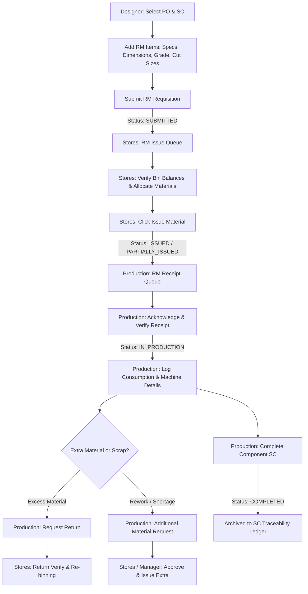
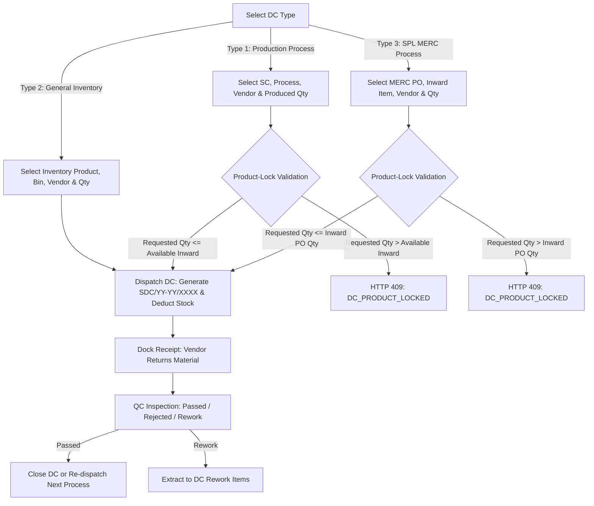

# RM Application (V-SMART) Technical & Functional Audit Report
## PART 3: Email Engine, Background Schedulers, Business Workflows, Frontend & Integrations

> **Document Context:** Part 3 of 5 of the comprehensive technical audit of the Raw Material (RM) Workflow & Traceability Application (**V-SMART / RMRIT**).  
> **Master Index:** [`docs/audit/RM_VSMART_FULL_REPORT.md`](file:///docs/audit/RM_VSMART_FULL_REPORT.md)  
> **Repository:** `c:/Users/Admin/OneDrive/Desktop/rm-workflow-system`  
> **Audit Date:** November 2026  
> **Mode:** Read-Only Static and Architectural Codebase Audit  

---

## 7. Email / SMTP & Notifications Engine

### 7.1 Email Provider & Transport Architecture
- **Provider Mechanism:** Official **Google OAuth2 Gmail API** via `googleapis` npm package (`version 181.0.0`; [`backend/src/email/providers/gmail-api.provider.ts`](file:///backend/src/email/providers/gmail-api.provider.ts)).
- **Transport Protocol:** HTTPS REST API calls (`POST https://gmail.googleapis.com/gmail/v1/users/{userId}/messages/send`) over **TLS Port 443**.
  - *SMTP Transport Status:* Classic SMTP (`nodemailer`, port `587` / `465`, app passwords) is **NOT USED** in this application. The environment template comments out legacy SMTP parameters in favor of Gmail OAuth2.
- **Authentication Method:** OAuth 2.0 Refresh Token workflow.
  - Authorized Google Client ID: `GMAIL_CLIENT_ID`
  - Authorized Google Client Secret: `GMAIL_CLIENT_SECRET` (masked as `****`)
  - Authorized Google Refresh Token: `GMAIL_REFRESH_TOKEN` (masked as `****`)
  - Authorized Sender Address: `posuppportairtronic@gmail.com` (`GMAIL_SENDER_EMAIL`)
- **Proactive Token Refresh:** An automated cron job runs every 45 minutes (`@Cron('0 */45 * * * *')` in [`gmail-api.provider.ts#L96`](file:///backend/src/email/providers/gmail-api.provider.ts#L96)) to refresh the Google OAuth2 access token before its 60-minute expiry.
- **Message Construction:** Programmatic RFC 2822 multipart/alternative MIME message builder ([`gmail-api.provider.ts#L142-L182`](file:///backend/src/email/providers/gmail-api.provider.ts#L142-L182)) encoded in RFC 4648 Base64URL safe strings.
- **Dev / Test Provider:** In non-production environments without explicit `EMAIL_PROVIDER_TYPE=gmail`, the system automatically resolves to `TestEmailProvider` ([`backend/src/email/providers/test-email.provider.ts`](file:///backend/src/email/providers/test-email.provider.ts)), an in-memory queue preventing accidental customer email dispatch during development.

---

### 7.2 Queue, Retry & Rate-Limiting Engine
The background email engine operates via an asynchronous, persistent database queue table `email_jobs` ([`backend/src/email/entities/email-job.entity.ts`](file:///backend/src/email/entities/email-job.entity.ts)):
1. **Worker Service (`EmailWorkerService`):** Autonomous polling worker ([`backend/src/email/email-worker.service.ts`](file:///backend/src/email/email-worker.service.ts)) running on a default 5000ms polling interval (`EMAIL_WORKER_POLL_INTERVAL_MS`).
2. **Pacing Delay:** Enforces a mandatory minimum spacing of **3000ms** (`EMAIL_SEND_INTERVAL_MS`) between consecutive email deliveries to eliminate Google API burst limits.
3. **Daily Quota Ceiling & Priority Lane:**
   - **Daily Limit:** Hard cap of **400 emails / rolling 24 hours** (`EMAIL_DAILY_LIMIT`), safeguarding the free-tier personal Gmail cap of 500/day.
   - **Priority Reserve:** **100 emails** (`EMAIL_PRIORITY_RESERVE`) reserved strictly for `CRITICAL` and `HIGH` priority alerts (e.g. MSL Out of Stock, Password Reset). Lower priority emails are deferred when available quota falls below 100.
4. **Stale Job Reclaim:** If a node crashes mid-send, in-flight jobs in `PROCESSING` status older than 300 seconds (`EMAIL_WORKER_STALE_THRESHOLD_SECONDS`) are automatically reclaimed and reset to `PENDING`.
5. **Exponential Retry Backoff:** Failed attempts back off exponentially (`5s`, `10s`, `20s`... up to max `3600s` / 1 hour; `EMAIL_RETRY_MAX_DELAY`).
6. **Gmail 429 Rate Limit Handling:** Parses Google `Retry-After` HTTP headers or error strings (`Retry after 2026-11-19T...`) and pauses queue processing (`pausedUntil`) until the specified timestamp.
7. **Graceful Shutdown:** Implements NestJS `OnApplicationShutdown` with a 10-second drain window (`EMAIL_WORKER_SHUTDOWN_TIMEOUT_MS`).

---

### 7.3 Complete Email Template Registry (All 33 Templates)

| # | Template Key | Subject Line | Required Variables | Trigger Event & Recipient Logic | Source Citation |
| :---: | :--- | :--- | :--- | :--- | :--- |
| 1 | `LOGIN_NOTIFICATION` | Security Notice: Account Login | `recipientName` | **Trigger:** User logs into account via web<br/>**Recipients:** Authenticated user | [`backend/src/email/template.service.ts#L67`](file:///backend/src/email/template.service.ts) |
| 2 | `PASSWORD_RESET` | [V-SMART] Password Reset Request | `resetUrl` | **Trigger:** User requests password reset link<br/>**Recipients:** Requesting user email | [`backend/src/email/template.service.ts#L82`](file:///backend/src/email/template.service.ts) |
| 3 | `RM_SUBMITTED` | [V-SMART Notification] RM Request Submitted: ${rmNum} | `rmNumber` | **Trigger:** Designer submits new RM BOM request for SC/PO<br/>**Recipients:** Stores team (STORES role) | [`backend/src/email/template.service.ts#L104`](file:///backend/src/email/template.service.ts) |
| 4 | `MATERIAL_ISSUED` | [V-SMART Notification] Material Issued for RM: ${rmNum} | `rmNumber` | **Trigger:** Stores issues raw materials from warehouse<br/>**Recipients:** Production team (PRODUCTION role) | [`backend/src/email/template.service.ts#L125`](file:///backend/src/email/template.service.ts) |
| 5 | `ADDITIONAL_MATERIAL_REQUESTED` | [V-SMART Notification] Additional Material Request: ${rmNum} | `rmNumber` | **Trigger:** Production requests additional material<br/>**Recipients:** Stores team (STORES role) | [`backend/src/email/template.service.ts#L146`](file:///backend/src/email/template.service.ts) |
| 6 | `SC_COMPLETED` | [V-SMART Notification] SC Completed: ${scNum} | `scNumber` | **Trigger:** Production completes component manufacturing<br/>**Recipients:** Stores & Quality teams | [`backend/src/email/template.service.ts#L167`](file:///backend/src/email/template.service.ts) |
| 7 | `MSL_LOW_STOCK` | Dynamic | `productName` | **Trigger:** Stock balance reaches or drops below minimum stock level<br/>**Recipients:** Stores team (STORES role) | [`backend/src/email/template.service.ts#L188`](file:///backend/src/email/template.service.ts) |
| 8 | `MSL_OUT_OF_STOCK` | Dynamic | `productName` | **Trigger:** Stock balance completely depleted to 0<br/>**Recipients:** Stores & Production management | [`backend/src/email/template.service.ts#L225`](file:///backend/src/email/template.service.ts) |
| 9 | `MSL_RESOLVED` | Dynamic | `productName` | **Trigger:** New stock inwarded, resolving low stock state<br/>**Recipients:** Stores team | [`backend/src/email/template.service.ts#L262`](file:///backend/src/email/template.service.ts) |
| 10 | `MATERIAL_RECEIVED` | [V-SMART Notification] Material Received: ${scNum} | `scNumber` | **Trigger:** Production acknowledges receipt of issued RM<br/>**Recipients:** Stores team | [`backend/src/email/template.service.ts#L299`](file:///backend/src/email/template.service.ts) |
| 11 | `MATERIAL_RETURNED` | [V-SMART Notification] Material Return Submitted: ${scNum} | `scNumber` | **Trigger:** Production initiates return of scrap or excess material<br/>**Recipients:** Stores team | [`backend/src/email/template.service.ts#L320`](file:///backend/src/email/template.service.ts) |
| 12 | `RETURN_VERIFIED` | [V-SMART Notification] Material Return Acknowledged: ${scNum} | `scNumber` | **Trigger:** Stores acknowledges and re-bins returned material<br/>**Recipients:** Production team | [`backend/src/email/template.service.ts#L341`](file:///backend/src/email/template.service.ts) |
| 13 | `EXTRA_MATERIAL_APPROVED` | [V-SMART Notification] Additional Material Approved: ${scNum} | `scNumber` | **Trigger:** Stores / Management approves additional material request<br/>**Recipients:** Production requester | [`backend/src/email/template.service.ts#L362`](file:///backend/src/email/template.service.ts) |
| 14 | `EXTRA_MATERIAL_REJECTED` | [V-SMART Notification] Additional Material Rejected: ${scNum} | `scNumber` | **Trigger:** Stores / Management rejects additional material request<br/>**Recipients:** Production requester | [`backend/src/email/template.service.ts#L383`](file:///backend/src/email/template.service.ts) |
| 15 | `EXTRA_MATERIAL_ISSUED` | [V-SMART Notification] Additional Material Issued: ${scNum} | `scNumber` | **Trigger:** Stores physically issues approved extra material<br/>**Recipients:** Production team | [`backend/src/email/template.service.ts#L404`](file:///backend/src/email/template.service.ts) |
| 16 | `DC_CREATED` | [V-SMART] Delivery Challan Created: ${vars.challanNumber || | `challanNumber` | **Trigger:** Delivery Challan created in draft<br/>**Recipients:** Stores team | [`backend/src/email/template.service.ts#L425`](file:///backend/src/email/template.service.ts) |
| 17 | `DC_DISPATCHED` | [V-SMART] Delivery Challan Dispatched: ${vars.challanNumber || | `challanNumber` | **Trigger:** Delivery Challan dispatched to external vendor<br/>**Recipients:** Stores & Production supervisors | [`backend/src/email/template.service.ts#L460`](file:///backend/src/email/template.service.ts) |
| 18 | `DC_APPROACHING_SLA` | Dynamic | `challanNumber, expectedReturnDate` | **Trigger:** Delivery Challan reaches expected return date<br/>**Recipients:** Stores & Senior Management | [`backend/src/email/template.service.ts#L495`](file:///backend/src/email/template.service.ts) |
| 19 | `DC_OVERDUE` | Dynamic | `challanNumber, expectedReturnDate` | **Trigger:** Delivery Challan crosses expected return date without return<br/>**Recipients:** Stores & Senior Management | [`backend/src/email/template.service.ts#L532`](file:///backend/src/email/template.service.ts) |
| 20 | `DC_PARTIALLY_RETURNED` | [V-SMART] Partial Return Received: Challan ${vars.challanNumber || | `challanNumber` | **Trigger:** Partial quantity received back from vendor<br/>**Recipients:** Stores & Production supervisors | [`backend/src/email/template.service.ts#L569`](file:///backend/src/email/template.service.ts) |
| 21 | `DC_RETURNED` | [V-SMART] Challan Fully Returned: ${vars.challanNumber || | `challanNumber` | **Trigger:** Full quantity received back from vendor<br/>**Recipients:** Stores & Production supervisors | [`backend/src/email/template.service.ts#L606`](file:///backend/src/email/template.service.ts) |
| 22 | `DC_CLOSED` | [V-SMART] Delivery Challan Closed: ${vars.challanNumber || | `challanNumber` | **Trigger:** Delivery Challan completed and closed<br/>**Recipients:** Stores team | [`backend/src/email/template.service.ts#L643`](file:///backend/src/email/template.service.ts) |
| 23 | `CONSUMABLE_RECEIPT_OVERDUE` | Dynamic | `description` | **Trigger:** Consumable purchase order not received within expected SLA<br/>**Recipients:** Stores & Admin | [`backend/src/email/template.service.ts#L678`](file:///backend/src/email/template.service.ts) |
| 24 | `CONSUMABLE_PARTIALLY_ISSUED_OVERDUE` | Dynamic | `description` | **Trigger:** Consumable request partially issued and pending over SLA<br/>**Recipients:** Stores & Production | [`backend/src/email/template.service.ts#L715`](file:///backend/src/email/template.service.ts) |
| 25 | `MATERIAL_ISSUE_OVERDUE_24H` | Dynamic | `rmNumber` | **Trigger:** Approved RM request unissued in stores for > 24 hours<br/>**Recipients:** Stores & General Manager | [`backend/src/email/template.service.ts#L752`](file:///backend/src/email/template.service.ts) |
| 26 | `DC_PENDING_2_DAYS` | Dynamic | `challanNumber` | **Trigger:** Dispatched DC pending vendor return for > 2 days past SLA<br/>**Recipients:** Stores & Senior Manager | [`backend/src/email/template.service.ts#L790`](file:///backend/src/email/template.service.ts) |
| 27 | `CONSUMABLE_PENDING_2_DAYS` | Dynamic | `requestCode` | **Trigger:** Consumable indent pending fulfillment for > 2 days<br/>**Recipients:** Stores & Admin | [`backend/src/email/template.service.ts#L828`](file:///backend/src/email/template.service.ts) |
| 28 | `DC_QC_PENDING_24H` | Dynamic | `challanNumber` | **Trigger:** Vendor return arrived but QC inspection uncompleted > 24h<br/>**Recipients:** Stores & Senior Manager | [`backend/src/email/template.service.ts#L866`](file:///backend/src/email/template.service.ts) |
| 29 | `CONSUMABLE_APPROVAL_REQUESTED` | Dynamic | `requestCode` | **Trigger:** Consumable indent submitted requiring Senior Manager approval<br/>**Recipients:** Senior Manager & Admin | [`backend/src/email/template.service.ts#L904`](file:///backend/src/email/template.service.ts) |
| 30 | `CONSUMABLE_APPROVED` | Dynamic | `itemsCount` | **Trigger:** Senior Manager approves consumable indent<br/>**Recipients:** Stores team (purchase queue) | [`backend/src/email/template.service.ts#L942`](file:///backend/src/email/template.service.ts) |
| 31 | `CONSUMABLE_REJECTED` | Dynamic | `itemsCount` | **Trigger:** Senior Manager rejects consumable indent<br/>**Recipients:** Indent creator user | [`backend/src/email/template.service.ts#L980`](file:///backend/src/email/template.service.ts) |
| 32 | `MERC_INDENT_ISSUE_OVERDUE_24H` | Dynamic | `indentNumber` | **Trigger:** MERC ERP indent unissued in stores for > 24 hours<br/>**Recipients:** Stores, Senior Manager, Admin | [`backend/src/email/template.service.ts#L1018`](file:///backend/src/email/template.service.ts) |
| 33 | `ECR_MATERIAL_ISSUE_OVERDUE_24H` | Dynamic | `reportNumber` | **Trigger:** ECR rework/rejection report unissued in stores for > 24 hours<br/>**Recipients:** Stores, Senior Manager, Admin | [`backend/src/email/template.service.ts#L1056`](file:///backend/src/email/template.service.ts) |

---

### 7.4 Role x Event Notification & Allowed Recipient Matrix

Governed by `PERMITTED_EMAIL_CONFIG` in [`backend/src/notifications/communication.service.ts#L51-L94`](file:///backend/src/notifications/communication.service.ts#L51-L94):

| Event Code | Recipient Target Type | Permitted Recipient Roles | Event Classification |
| :--- | :---: | :--- | :--- |
| `RM_SUBMITTED` | Roles | `STORES` | Workflow Milestone |
| `MATERIAL_ISSUED` | Roles | `PRODUCTION` | Workflow Milestone |
| `ADDITIONAL_REQUEST` | Roles | `STORES` | Material Exception |
| `ADDITIONAL_MATERIAL_REQUESTED` | Roles | `STORES` | Material Exception |
| `MATERIAL_RETURNED` | Roles | `STORES` | Material Reconciliation |
| `EXTRA_MATERIAL_ISSUED` | Roles | `PRODUCTION` | Stores Issuance |
| `MSL_LOW_STOCK` | Roles | `STORES` | Inventory SLA |
| `MSL_CRITICAL` | Roles | `STORES` | Inventory SLA |
| `MSL_OUT_OF_STOCK` | Roles | `STORES` | Critical Inventory SLA |
| `DC_APPROACHING_SLA` | Roles | `STORES` | Dispatch Logistics |
| `DC_OVERDUE` | Roles | `STORES` | Dispatch Logistics |
| `PASSWORD_RESET` | User | Requesting User Email Only | Security |
| `CONSUMABLE_RECEIPT_OVERDUE` | Roles | `STORES`, `ADMIN` | Consumable SLA |
| `CONSUMABLE_PARTIALLY_ISSUED_OVERDUE`| Roles | `STORES`, `ADMIN`, `PRODUCTION` | Consumable SLA |
| `MATERIAL_ISSUE_OVERDUE_24H` | Roles | `STORES`, `GENERAL_MANAGER` | Overdue Sweep (24h) |
| `DC_PENDING_2_DAYS` | Roles | `STORES`, `SENIOR_MANAGER` | Overdue Sweep (48h) |
| `DC_QC_PENDING_24H` | Roles | `STORES`, `SENIOR_MANAGER` | Overdue Sweep (24h) |
| `CONSUMABLE_PENDING_2_DAYS` | Roles | `STORES`, `ADMIN` | Overdue Sweep (48h) |
| `CONSUMABLE_APPROVAL_REQUESTED` | Roles | `SENIOR_MANAGER`, `ADMIN` | Consumable Governance |
| `CONSUMABLE_APPROVED` | Roles | `STORES` | Consumable Governance |
| `CONSUMABLE_REJECTED` | User | Requesting User Email Only | Consumable Governance |
| `MERC_INDENT_ISSUE_OVERDUE_24H` | Roles | `STORES`, `SENIOR_MANAGER`, `ADMIN` | Integration Governance (24h) |
| `ECR_MATERIAL_ISSUE_OVERDUE_24H` | Roles | `STORES`, `SENIOR_MANAGER`, `ADMIN` | Integration Governance (24h) |

---

### 7.5 Per-User and System Notification Preference Storage
- **Global Toggle:** Stored in `system_settings` table under key `WORKFLOW_EMAIL_ENABLED` (`true` / `false`).
- **Role Preferences:** Stored in `role_email_settings` table (`role_id`, `event_id`, `is_enabled`, `updated_by_user_id`).
- **User Specific Overrides:** Stored in `user_email_overrides` table (`user_id`, `event_id`, `override_state`: `ALLOW` / `MUTE`, `reason`).
- **Preference Evaluation Order:**
  1. System Mode Check: `OFF` (suppress all), `SHADOW` (log to `digest_shadow_log` without sending), `ON` (proceed).
  2. Role Event Check: Verifies if event is enabled for the recipient's role in `role_email_settings`.
  3. User Override Check: Specific user override in `user_email_overrides` supersedes role settings.
  4. Skip Logging: If email is suppressed, an immutable entry is recorded in `email_skip_log` documenting `reason`, `event_code`, `user_id`, and `recipient_email`.

---

## 8. Background Jobs & Scheduled Workers

The backend hosts 7 distinct cron schedulers and 1 continuous worker loop:

| # | Scheduler / Worker Name | Cron Schedule / Interval | Functional Purpose | File Citation | Tables Read & Written | Error Handling & Isolation |
| :---: | :--- | :--- | :--- | :--- | :--- | :--- |
| 1 | **Email Queue Worker** | `5000ms` polling interval (`EMAIL_WORKER_POLL_INTERVAL_MS`) | Dequeues pending email jobs, checks daily limits, respects pacing delays, executes Gmail API sends, updates job status. | [`backend/src/email/email-worker.service.ts#L140-L380`](file:///backend/src/email/email-worker.service.ts#L140-L380) | **Read:** `email_jobs`<br/>**Write:** `email_jobs`, `email_logs`, `alert_notification_state` | Individual try-catch per job. Stale job recovery. Exponential backoff up to 3600s. Rate limit pause. |
| 2 | **Alert Sweeps Engine** | `0 * * * *` (Hourly, `ALERT_SWEEP_CRON_SCHEDULE`) | Runs 6 overdue alert sweeps: Stores issue overdue (>24h), DC return pending (>48h), Consumables pending (>48h), DC QC pending (>24h), MERC indent issue overdue (>24h), ECR material issue overdue (>24h). | [`backend/src/alert-sweeps/alert-sweeps.service.ts#L159-L210`](file:///backend/src/alert-sweeps/alert-sweeps.service.ts#L159-L210) | **Read:** `material_issues`, `delivery_challans`, `consumable_requests`, `dc_qc_inspections`, `merc_indent_pending`, `ecr_material_pending`<br/>**Write:** `notifications`, `email_jobs`, `email_alert_watch` | Each sweep is completely isolated with its own try-catch block; failure in one sweep does not halt others. |
| 3 | **Consumable SLA Reconciliation** | `0 * * * *` (Hourly, `CONSUMABLE_SLA_CRON_SCHEDULE`) | Audits purchase orders and partial issues against consumable SLA thresholds, generating automated reminder notifications. | [`backend/src/consumables/consumables.service.ts#L2047-L2120`](file:///backend/src/consumables/consumables.service.ts#L2047-L2120) | **Read:** `consumable_requests`, `consumable_request_items`<br/>**Write:** `notifications`, `email_jobs` | Wrapped in try-catch logging errors via NestJS Logger. |
| 4 | **DC Return Date Reconciliation** | `0 * * * *` (Hourly, `DC_SLA_CRON_SCHEDULE`) | Checks dispatched Delivery Challans approaching return date (within SLA warning window) and overdue challans past expected return date. | [`backend/src/delivery-challan/delivery-challan.service.ts#L3784-L3890`](file:///backend/src/delivery-challan/delivery-challan.service.ts#L3784-L3890) | **Read:** `delivery_challans`, `vendor_slas`<br/>**Write:** `notifications`, `email_jobs` | Errors caught and logged without crashing application process. |
| 5 | **Google OAuth Token Refresh** | `0 */45 * * * *` (Every 45 minutes) | Proactively calls Google OAuth2 token refresh endpoint to maintain valid access token in memory before 60-minute expiry. | [`backend/src/email/providers/gmail-api.provider.ts#L96-L118`](file:///backend/src/email/providers/gmail-api.provider.ts#L96-L118) | **Memory:** Updates `oauth2Client.credentials` | Caught and logged; flags critical invalid_grant alerts if refresh token is revoked. |
| 6 | **MSL Stock Calculation Sweep** | `0 * * * *` (Hourly, `MSL_CRON_SCHEDULE`) | Audits all active products across warehouse bins against `minimum_stock_level`, creating or resolving `msl_alerts` records. | [`backend/src/inventory/msl-trigger.service.ts#L135-L160`](file:///backend/src/inventory/msl-trigger.service.ts#L135-L160) | **Read:** `products`, `stock_balances`<br/>**Write:** `msl_alerts`, `notifications`, `email_jobs` | Isolated execution with batch processing. |
| 7 | **MERC Indent Scheduled Sync** | `0 * * * *` (Hourly, `MERC_SYNC_CRON_SCHEDULE`) | Synchronizes pending indents from MERC ERP bridge. Gated by `ENABLE_MERC_CRON === 'true'` to avoid waking Neon compute unnecessarily. | [`backend/src/merc-indent/merc-indent.service.ts#L1274-L1340`](file:///backend/src/merc-indent/merc-indent.service.ts#L1274-L1340) | **Read:** External MERC API<br/>**Write:** `merc_indent_pending`, `merc_indent_line_items` | HTTP timeouts and fetch error boundaries. |
| 8 | **Email Skip Log Purge** | `0 0 * * *` (Midnight Daily) | Deletes skip logs older than 30 days to prevent unbounded database table growth. | [`backend/src/notifications/email-skip-log.service.ts#L232-L255`](file:///backend/src/notifications/email-skip-log.service.ts#L232-L255) | **Write:** Deletes rows from `email_skip_log` | Logged via Logger. |

---

## 9. End-to-End Business Workflows

### 9.1 Loop 1: RM Engineering BOM, Stores Issuance & Production Lifecycle



#### Step-by-Step Technical Trace:
1. **RM Requisition Submission (Designer):**
   - **UI Route:** `/design/rm-creation` ([`RmCreationWorkspace.tsx`](file:///frontend/src/pages/RmCreationWorkspace.tsx))
   - **API Endpoints:** `POST /api/rm/save-sc-items`, `POST /api/rm/submit-form` ([`rm.controller.ts`](file:///backend/src/rm/rm.controller.ts))
   - **DB Tables Touched:** `rm_requests`, `rm_items`, `rm_item_snapshots`, `sales_order_components`
   - **Validations:** SC must exist; quantities must be `> 0`; status transitioned from `DRAFT` to `SUBMITTED`.
   - **Notifications Fired:** Real-time in-app notification and email event `RM_SUBMITTED` to `STORES` role.
2. **Stores Issuance (Storekeeper):**
   - **UI Route:** `/stores/rm-issue` ([`StoresRmIssueWorkspace.tsx`](file:///frontend/src/pages/StoresRmIssueWorkspace.tsx))
   - **API Endpoints:** `POST /api/material-issue` ([`material-issue.controller.ts`](file:///backend/src/material-issue/material-issue.controller.ts))
   - **DB Tables Touched:** `material_issues`, `material_issue_items`, `stock_balances`, `stock_transactions`, `sales_order_components`
   - **Validations:** Row-level pessimistic locking on `stock_balances`; balance must satisfy issue quantity; generates `ISS-...` slip; transitions SC status to `ISSUED` or `PARTIALLY_ISSUED`.
   - **Notifications Fired:** Real-time push and email event `MATERIAL_ISSUED` to `PRODUCTION` role.
3. **Production Receipt (Shop-Floor Supervisor):**
   - **UI Route:** `/production/rm-receipt` ([`ProductionRmVerifyWorkspace.tsx`](file:///frontend/src/pages/ProductionRmVerifyWorkspace.tsx))
   - **API Endpoints:** `POST /api/production/receipts` ([`production.controller.ts`](file:///backend/src/production/production.controller.ts))
   - **DB Tables Touched:** `material_receipts`, `material_receipt_items`, `sales_order_components`
   - **Validations:** Matches issued quantity; transitions SC status to `IN_PRODUCTION`.
   - **Notifications Fired:** Email event `MATERIAL_RECEIVED` to `STORES`.
4. **Additional Material Request & Return:**
   - **UI Route:** `/production/request-return` ([`ProductionRequestReturnWorkspace.tsx`](file:///frontend/src/pages/ProductionRequestReturnWorkspace.tsx))
   - **Verification Route:** `/stores/request-return-verify` ([`StoresRequestReturnVerifyWorkspace.tsx`](file:///frontend/src/pages/StoresRequestReturnVerifyWorkspace.tsx))
   - **API Endpoints:** `POST /api/additional-requests`, `POST /api/production/returns`, `POST /api/stores/returns/:id/verify`
   - **DB Tables Touched:** `additional_material_requests`, `material_returns`, `stock_balances`, `stock_transactions`
   - **Notifications Fired:** `ADDITIONAL_REQUEST`, `EXTRA_MATERIAL_APPROVED`, `EXTRA_MATERIAL_ISSUED`, `MATERIAL_RETURNED`, `RETURN_VERIFIED`.

---

### 9.2 Loop 2: Inventory Governance, Movement & MSL Monitoring
1. **Stock Overview & Balance Tracking:**
   - **UI Route:** `/inventory/stock` ([`InventoryStockWorkspace.tsx`](file:///frontend/src/pages/InventoryStockWorkspace.tsx))
   - **API Endpoints:** `GET /api/inventory/stock-overview`, `GET /api/inventory/balances` ([`inventory.controller.ts`](file:///backend/src/inventory/inventory.controller.ts))
   - **DB Tables Touched:** `stock_balances`, `products`, `bins`, `racks`, `warehouse_locations`, `warehouses`
2. **Inter-Bin Transfers & Physical Adjustments:**
   - **UI Route:** `/inventory/movements` ([`StockMovementWorkspace.tsx`](file:///frontend/src/pages/StockMovementWorkspace.tsx))
   - **API Endpoints:** `POST /api/material-movements/transfer`, `POST /api/inventory/adjust` ([`material-movement.controller.ts`](file:///backend/src/material-movement/material-movement.controller.ts))
   - **DB Tables Touched:** `stock_balances` (source deducted, target credited), `stock_transactions` (audit record)
   - **Validations:** Source bin must have sufficient stock; atomic database transaction.
3. **Supplier Inward (GRN):**
   - **UI Route:** `/inventory/grn` ([`SupplierInwardWorkspace.tsx`](file:///frontend/src/pages/SupplierInwardWorkspace.tsx))
   - **API Endpoints:** `POST /api/inventory/inward` ([`inventory.controller.ts`](file:///backend/src/inventory/inventory.controller.ts))
   - **DB Tables Touched:** `stock_balances`, `stock_transactions` (type `INWARD_PURCHASE`)
4. **Minimum Stock Level (MSL) Automation:**
   - **UI Route:** `/inventory/msl-alerts` ([`MslAlertsWorkspace.tsx`](file:///frontend/src/pages/MslAlertsWorkspace.tsx))
   - **Engine:** Triggered both synchronously on stock-deducting transactions and hourly via scheduled sweep ([`msl-trigger.service.ts`](file:///backend/src/inventory/msl-trigger.service.ts)).
   - **Threshold Logic:** Compares total active stock across all bins against `products.minimum_stock_level`.
   - **Status Transitions:** `OK` -> `LOW_STOCK` (stock <= MSL) -> `OUT_OF_STOCK` (stock = 0) -> `RESOLVED` (stock replenished).
   - **Notifications Fired:** `MSL_LOW_STOCK`, `MSL_OUT_OF_STOCK`, `MSL_RESOLVED` dispatched to Stores and Management.

---

### 9.3 Loop 3: Delivery Challan (DC) Operations & Product-Lock Rules



#### DC Product-Lock Rules (Strictly Enforced in [`delivery-challan.service.ts#L1060-L1202`](file:///backend/src/delivery-challan/delivery-challan.service.ts#L1060-L1202)):
1. **Type 1 (Production Process Outward) Lock Rules:**
   - **Target:** Outside operations on SC components (e.g. Heat Treatment, Phosphating, CNC Machining).
   - **Lock Mechanism:** Evaluates `pg_advisory_xact_lock(hashtext(lockKey))` where `lockKey` is derived from `scId` and `productId/partName`.
   - **Calculation:** Compares requested quantity against **Available Quantity** (`producedQuantity - outstandingDispatchedQuantity`).
   - **Violation Behavior:** If requested quantity exceeds available produced quantity, throws **HTTP 409 Conflict** with code `DC_PRODUCT_LOCKED`, message `"Product not yet inwarded"`, and lists all conflicting active challans (`blockingDcs`).
2. **Type 3 (Special Project / MERC PO) Lock Rules:**
   - **Target:** Outward processing of MERC customer purchase order components.
   - **Lock Mechanism:** Lock key constructed from normalized `poNumber` and `mercItemId`.
   - **Calculation:** Verifies that items have been previously inwarded into stock against that MERC PO item.
   - **Exemption:** Extra items (`isExtraItem === true` or missing `mercItemId`) are explicitly exempt from product lock.
3. **Type 2 (General Inventory) Rules:**
   - Completely exempt from product-lock validation; enforces physical stock balance deduction from specified warehouse bin.
4. **Dock Receipt & Quality Check (QC):**
   - **UI Route:** `/dispatch/returns` ([`DockReceiptWorkspace.tsx`](file:///frontend/src/pages/DockReceiptWorkspace.tsx))
   - **API Endpoints:** `POST /api/delivery-challans/:id/return`, `POST /api/delivery-challans/:id/qc`
   - **DB Tables Touched:** `delivery_challans`, `delivery_challan_items`, `dc_movements`, `dc_qc_inspections`, `dc_rework_items`
   - **Outcomes:** Accepted quantities returned to stock; rejected/rework items flagged in `dc_rework_items`.

---

### 9.4 Loop 4: Consumables Indenting, SM Approval & Purchasing
1. **Consumable Indent Creation:**
   - **UI Route:** `/consumables/requests` ([`ConsumableRequestsWorkspace.tsx`](file:///frontend/src/pages/ConsumableRequestsWorkspace.tsx))
   - **API Endpoints:** `POST /api/consumables/requests` ([`consumables.controller.ts`](file:///backend/src/consumables/consumables.controller.ts))
   - **DB Tables Touched:** `consumable_requests` (generates `CR-YYYY-XXXX`), `consumable_request_items`
2. **Senior Manager (SM) Approval Gate:**
   - **UI Route:** `/consumables/approvals` ([`ConsumableApprovalsWorkspace.tsx`](file:///frontend/src/pages/ConsumableApprovalsWorkspace.tsx))
   - **Configuration:** Governed by `CONSUMABLE_SM_APPROVAL_MODE` (`ON` / `OFF`) and `CONSUMABLE_SM_APPROVAL_SCOPE` (`ALL` / `PURCHASE_ONLY`).
   - **API Endpoints:** `POST /api/consumables/items/bulk-approve`, `POST /api/consumables/items/bulk-reject`
   - **Approval Logic:** Implements an in-batch running stock tally. If live inventory satisfies the request, the line item is routed to Stores Issue; if inventory is depleted, it is automatically routed to the Purchase Queue.
   - **Notifications Fired:** `CONSUMABLE_APPROVAL_REQUESTED` to Senior Managers; `CONSUMABLE_APPROVED` to Stores; `CONSUMABLE_REJECTED` to Requester.
3. **Purchase Queue, PR Slip & Stores Receipt:**
   - **UI Route:** `/consumables/purchase-store` ([`ConsumablePurchaseStoreWorkspace.tsx`](file:///frontend/src/pages/ConsumablePurchaseStoreWorkspace.tsx))
   - **API Endpoints:** `POST /api/consumables/purchase/create-batch`, `POST /api/consumables/purchase/:id/receive`
   - **PR Slip Generation:** Assigns sequential `PR-XXXX` number and formats printable A4 requisition sheets with dynamic verifier attribution and Amritha vector signature component.
   - **Receipt Modes:** Supports `autoIssue === true` (immediately decrements inventory to the requester) or `autoIssue === false` (adds items directly into warehouse bin stock).

---

### 9.5 Inspector Rework Tab & ECR Integration
- **UI Route:** `/governance/rework` ([`ReworkWorkspace.tsx`](file:///frontend/src/pages/ReworkWorkspace.tsx))
- **Workflow:**
  1. Inspector selects Sales Order Component (SC) or DC Rework line item.
  2. Submits component, affected quantity, failure description, and root cause.
  3. Dispatches payload to external ECR Application via `POST ${ECR_API_URL}/api/internal/reports`.
  4. Stores issues replacement raw material via `/governance/ecr-issues` ([`EcrMaterialIssue.tsx`](file:///frontend/src/pages/governance/EcrMaterialIssue.tsx)).

---

### 9.6 Analytical & Report Modules
- **UI Route:** `/reports/generation` ([`ReportGeneratorWorkspace.tsx`](file:///frontend/src/pages/ReportGeneratorWorkspace.tsx)), `/governance/traceability` ([`TraceabilityWorkspace.tsx`](file:///frontend/src/pages/TraceabilityWorkspace.tsx)), `/governance/po-traceability` ([`PoTraceabilityWorkspace.tsx`](file:///frontend/src/pages/PoTraceabilityWorkspace.tsx))
- **Capabilities:**
  - Consolidated SC Traceability: Complete tree of PO -> SC -> RM BOM -> Stores Issue Slips -> Receipts -> Consumption -> DCs -> Returns.
  - PO Traceability: Cross-SC component completion and material reconciliation.
  - Vendor Performance: Turnaround time vs SLA, defect rates, open challan aging.
  - Multi-tab Excel export via `exceljs` and printable PDF reports via `pdfmake`.

---

## 11. Frontend Architecture & Client Workspaces

### 11.1 Route & Layout Hierarchy
The client single-page application is structured with declarative routing in [`frontend/src/App.tsx`](file:///frontend/src/App.tsx) and lazy-loaded routes in [`frontend/src/routeConfig.tsx`](file:///frontend/src/routeConfig.tsx):
- **Unprotected Routes:** `/login` ([`LoginView.tsx`](file:///frontend/src/pages/LoginView.tsx)), `/forgot-password` ([`ForgotPasswordPage.tsx`](file:///frontend/src/pages/ForgotPasswordPage.tsx)), `/reset-password` ([`ResetPasswordPage.tsx`](file:///frontend/src/pages/ResetPasswordPage.tsx)), `/unauthorized` ([`UnauthorizedView.tsx`](file:///frontend/src/pages/UnauthorizedView.tsx)).
- **Layout Shells:**
  - `AppLayout` ([`frontend/src/layouts/AppLayout.tsx`](file:///frontend/src/layouts/AppLayout.tsx)): Standard corporate application shell with responsive collapsible sidebar, top navigation bar, real-time notification drawer, and theme selector.
  - `PrintableDocumentLayout` ([`frontend/src/components/layout/PrintableDocumentLayout.tsx`](file:///frontend/src/components/layout/PrintableDocumentLayout.tsx)): Minimalist white-background layout stripped of navigation headers, styled for exact A4 physical printing.

---

### 11.2 State Management & Client Infrastructure
1. **Server State (TanStack React Query 5):**
   - Single global `QueryClient` instance ([`App.tsx#L17`](file:///frontend/src/App.tsx#L17)).
   - Declarative data fetching, automatic background cache invalidation on mutations (e.g. invalidating `['stock-balances']` after material issuance).
2. **Authentication Context (`AuthContext`):**
   - Manages `currentUser`, access token storage in memory/session, token decode, and role checking.
   - Provides `login()`, `logout()`, `refreshToken()`.
3. **Axios API Client Interceptors:**
   - Configured in [`frontend/src/services/api.ts`](file:///frontend/src/services/api.ts).
   - Automatically injects `Authorization: Bearer <token>` on every outgoing HTTP request.
   - Global 401 response interceptor handles silent refresh token rotation or triggers redirection to `/login`.
4. **Real-time Notifications Context (`NotificationContext`):**
   - Connects to backend WebSocket gateway (`NotificationsGateway`).
   - Listens on user-specific (`user:{id}`) and role-specific (`role:{role}`) socket channels, firing instant toast alerts and incrementing the unread badge counter.

---

## 12. External Integrations Architecture

### 12.1 Existing RM-to-ECR Integration Bridge
The application features a dedicated bi-directional integration bridge with the **Error Correction Report (ECR)** application ([`backend/src/ecr-issues/ecr-issues.service.ts`](file:///backend/src/ecr-issues/ecr-issues.service.ts)):

1. **Inbound Webhook (ECR -> RM):**
   - **Endpoint:** `POST /api/internal/ecr-pending`
   - **Security Guard:** `InternalSecretGuard` ([`backend/src/ecr-issues/guards/internal-secret.guard.ts`](file:///backend/src/ecr-issues/guards/internal-secret.guard.ts)). Requires header `x-internal-secret` matching `RM_INTERNAL_SECRET` or `ECR_INTERNAL_SECRET`.
   - **Payload Schema (`ReceiveEcrPendingDto`):**
     ```json
     {
       "reportNumber": "ECR-2026-0042",
       "type": "REWORK",
       "scNumber": "SC-101",
       "poNumber": "PO-9901",
       "component": "Body Flange",
       "quantityAffected": 2,
       "approvedAt": "2026-11-19T10:00:00Z",
       "description": "Dimensional deviation on bore diameter"
     }
     ```
   - **Processing:** Upserts into table `ecr_material_pending` with initial status `PENDING`. Emits real-time notification to Stores.
2. **Direct Database / Polling Fallback:**
   - If webhook delivery fails, `EcrIssuesService.syncFromEcr()` periodically polls `GET ${ECR_API_URL}/api/internal/approved-reports` or directly queries `ECR_DATABASE_URL` if configured.
3. **Outbound Material Issuance Webhook (RM -> ECR):**
   - **Trigger:** When Storekeeper issues replacement material for an ECR item (`POST /api/ecr-issues/:id/issue`).
   - **Target URL:** `POST ${ECR_API_URL}/api/internal/material-issued`
   - **Header:** `x-internal-secret: <ECR_INTERNAL_SECRET>`
   - **Payload:**
     ```json
     {
       "reportNumber": "ECR-2026-0042",
       "status": "MATERIAL_ISSUED",
       "issuedAt": "2026-11-19T14:30:00Z",
       "issuedBy": "Anil Kumar (Stores)",
       "quantityIssued": 2,
       "stockTransactionId": "uuid-...",
       "materialIssueId": "uuid-..."
     }
     ```
   - **Failure Handling:** If the ECR webhook call fails, the error is logged as a warning; the local RM material issue transaction is **NOT** rolled back to ensure physical inventory accuracy.

---

### 12.2 MERC ERP Integration Bridge
Located in [`backend/src/merc-indent/merc-indent.service.ts`](file:///backend/src/merc-indent/merc-indent.service.ts):
1. **Inbound MERC Indent Webhook:** `POST /api/internal/merc/indent` protected by `InternalSecretGuard` matching `MERC_INTERNAL_SECRET`. Ingests into `merc_indent_pending` and `merc_indent_line_items`.
2. **Scheduled Sync:** `@Cron(process.env.MERC_SYNC_CRON_SCHEDULE || '0 * * * *')` polls `GET ${MERC_API_URL}/api/internal/indents/pending` (strictly disabled unless `ENABLE_MERC_CRON === 'true'`).
3. **Specialized Item Dimension Mapping:** MERC raw materials frequently specify dimensions as Diameter x Length (e.g. `DIA 45 X 120 MM`). The service implements a regex tokenizer extracting numerical diameter and cut length to perform fuzzy matching against the internal product catalog.
4. **Outbound Issuance Webhook:** Calls `POST ${MERC_API_URL}/api/internal/rm/item-issued` upon storekeeper fulfillment. Retries unacknowledged deliveries via `${MERC_API_URL}/api/internal/rm/retry-outbox`.

---

### 12.3 Status of Other External Integrations
- **WhatsApp:** **NOT FOUND** in codebase. No SDK, webhook, or configuration parameters exist.
- **SMS Gateway:** **PARTIALLY FOUND / STUB ONLY**.
  - A database column `sms_alerts_enabled` exists on `vendor_slas` table ([`backend/src/vendor/entities/vendor-sla.entity.ts#L71`](file:///backend/src/vendor/entities/vendor-sla.entity.ts#L71)) and is exposed on the frontend SLA form ([`frontend/src/pages/VendorSlaWorkspace.tsx#L63`](file:///frontend/src/pages/VendorSlaWorkspace.tsx#L63)).
  - However, **NO active SMS provider** (Twilio, AWS SNS, MSG91) is implemented in the backend. Setting this flag has no operational effect.
- **ecerp / SAP / Tally:** **NOT FOUND** in codebase.
