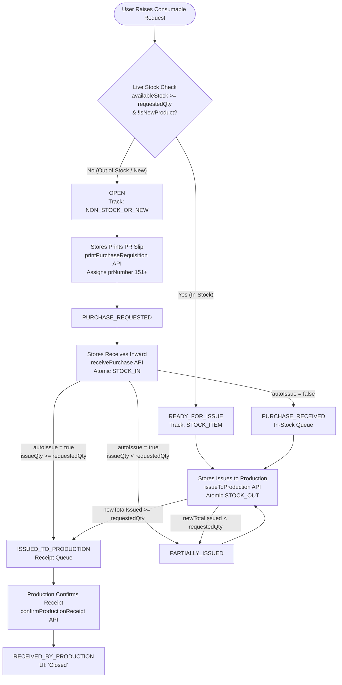

# V-SMART RM — Consumables Workflow Audit (Step 0)

**Document Version:** 1.0.0  
**Audit Date:** November 18, 2026  
**Auditor:** DeepMind Antigravity Engine  
**System Mode:** Strict Read-Only Audit  
**Target Module:** Consumables Procurement, Inventory Inward & Shop-Floor Issuance  

---

## 1. Executive Summary & Audit Scope

This document provides an exhaustive, line-by-line audit of the existing Consumables module in the **V-SMART RM** production codebase. It establishes the authoritative baseline required before designing and introducing the Senior Manager (SM) Approval Module.

### Key Audit Findings
1. **Dual-Track Evaluation Point:** Dual-track classification (`STOCK_ITEM` vs `NON_STOCK_OR_NEW`) is determined **server-side at request creation time** inside [consumables.service.ts](file:///c:/Users/Admin/OneDrive/Desktop/rm-workflow-system/backend/src/consumables/consumables.service.ts#L421-L436). It is not deferred to stores.
2. **Status Enum Nomenclature:** The code does **not** have a `CLOSED` item status. The terminal state is `RECEIVED_BY_PRODUCTION` (defined in [consumable-request-item.entity.ts](file:///c:/Users/Admin/OneDrive/Desktop/rm-workflow-system/backend/src/consumables/entities/consumable-request-item.entity.ts#L21-L29)). The UI renders this status as `"Closed"`.
3. **Store Inward Auto-Issue Bypass:** In [consumables.service.ts](file:///c:/Users/Admin/OneDrive/Desktop/rm-workflow-system/backend/src/consumables/consumables.service.ts#L735-L786), when a purchase is received with `autoIssue: true` (the default option in the frontend modal), the item is **immediately issued to production** (`ISSUED_TO_PRODUCTION` / `PARTIALLY_ISSUED`), completely bypassing the In-Stock Store Queue. Only items received with `autoIssue: false` enter the `PURCHASE_RECEIVED` status and sit in the In-Stock Store Queue.
4. **Current In-Flight Inventory Count:** As verified across the live workspaces, there are active in-flight items (~26 open purchase line items, 15 ready to receive on floor, 17 dispatched). All future changes must strictly guarantee zero regression to these active workflows.
5. **No Existing Transactional Events:** Unlike RM Requisitions, the consumables service does **not** fire any transactional emails on `createRequest`, `receivePurchase`, or `issueToProduction`. Only scheduled hourly sweeps fire alert notifications (`CONSUMABLE_RECEIPT_OVERDUE`, `CONSUMABLE_PARTIALLY_ISSUED_OVERDUE`, `CONSUMABLE_PENDING_2_DAYS`).

---

## 2. Real Flow Architecture (End-to-End Trace)

### 2.1 Database Entities & Tables

| Entity Class | Database Table | Primary Key | Key Columns / Relations | Source File |
| :--- | :--- | :--- | :--- | :--- |
| `ConsumableRequest` | `consumable_requests` | `id` (UUID) | `requestCode`, `paymentMode`, `endUserInVelan`, `requestedBy`, `preparedBy`, `verifiedBy`, `approvedBy`, `requestDate`, `items` (OneToMany) | [consumable-request.entity.ts](file:///c:/Users/Admin/OneDrive/Desktop/rm-workflow-system/backend/src/consumables/entities/consumable-request.entity.ts#L17-L69) |
| `ConsumableRequestItem` | `consumable_request_items` | `id` (UUID) | `requestId` (FK), `productId` (FK), `itemCategoryTrack` (Enum), `status` (Enum), `prNumber`, `stockAvailableAtRequest`, `requestedQty`, `purchaseQty`, `realReceivedQty`, `issuedQty`, `vendorId` (FK), `binId` (FK), `printedAt`, `purchaseReceivedAt`, `issuedAt`, `productionReceivedAt` | [consumable-request-item.entity.ts](file:///c:/Users/Admin/OneDrive/Desktop/rm-workflow-system/backend/src/consumables/entities/consumable-request-item.entity.ts#L31-L227) |
| `StockBalance` | `stock_balances` | `id` (UUID) | `productId`, `binId`, `currentQuantity` (Composite Unique) | [stock-balance.entity.ts](file:///c:/Users/Admin/OneDrive/Desktop/rm-workflow-system/backend/src/inventory/entities/stock-balance.entity.ts) |
| `StockTransaction` | `stock_transactions` | `id` (UUID) | `productId`, `sourceBinId`, `destinationBinId`, `transactionType`, `quantity`, `referenceType`, `referenceId` | [stock-transaction.entity.ts](file:///c:/Users/Admin/OneDrive/Desktop/rm-workflow-system/backend/src/inventory/entities/stock-transaction.entity.ts) |

---

### 2.2 Status Enums & Data Types

#### `ConsumableItemTrack`
File: [consumable-request-item.entity.ts](file:///c:/Users/Admin/OneDrive/Desktop/rm-workflow-system/backend/src/consumables/entities/consumable-request-item.entity.ts#L16-L19)
- `STOCK_ITEM`: Sufficient stock is in warehouse bins at request creation. Routed to In-Stock Store Queue.
- `NON_STOCK_OR_NEW`: Insufficient stock, zero stock, or new product. Routed to Purchase Queue.

#### `ConsumableItemStatus`
File: [consumable-request-item.entity.ts](file:///c:/Users/Admin/OneDrive/Desktop/rm-workflow-system/backend/src/consumables/entities/consumable-request-item.entity.ts#L21-L29)
- `READY_FOR_ISSUE`: Initial state for `STOCK_ITEM`. Ready for stores to physically issue to shop floor.
- `OPEN`: Initial state for `NON_STOCK_OR_NEW`. Awaiting stores to group and print Purchase Requisition (PR) slip.
- `PURCHASE_REQUESTED`: PR slip printed; sequential `prNumber` assigned; awaiting external procurement and physical vendor delivery.
- `PURCHASE_RECEIVED`: Vendor delivered goods to stores; inwarded into warehouse bin via atomic `STOCK_IN`; sitting in stores without auto-issue.
- `PARTIALLY_ISSUED`: Material issued to shop floor, but `issuedQty < requestedQty`. Remains active in queues for balance issuance.
- `ISSUED_TO_PRODUCTION`: Requested quantity completely issued (`issuedQty >= requestedQty`); material physically in transit or delivered to machine bay.
- `RECEIVED_BY_PRODUCTION`: Closed loop confirmed; production operator acknowledged receipt on shop floor. Terminal state.

---

### 2.3 State Machine Diagram (Current System)



---

## 3. Comprehensive Code Inspection: Status Readers and Writers

### 3.1 Status Writers (Backend State Transitions)

| # | Action / Method | File & Line Range | HTTP Route | Allowed Roles | Preconditions | Resulting Status & Side Effects |
| :--- | :--- | :--- | :--- | :--- | :--- | :--- |
| 1 | **Create Request**<br/>`createRequest()` | [consumables.service.ts#L301-L472](file:///c:/Users/Admin/OneDrive/Desktop/rm-workflow-system/backend/src/consumables/consumables.service.ts#L301-L472) | `POST /api/consumables/requests` | `PRODUCTION`, `STORES`, `ADMIN`, `SENIOR_MANAGER`, `GENERAL_MANAGER` | Valid line items; auto-creates missing Product/Vendor masters | - If stock $\ge$ requested: `READY_FOR_ISSUE`, track `STOCK_ITEM`<br/>- Else: `OPEN`, track `NON_STOCK_OR_NEW` |
| 2 | **Print PR Slip**<br/>`printPurchaseRequisition()` | [consumables.service.ts#L477-L587](file:///c:/Users/Admin/OneDrive/Desktop/rm-workflow-system/backend/src/consumables/consumables.service.ts#L477-L587) | `POST /api/consumables/purchase/print-pr` | `STORES`, `ADMIN`, `GENERAL_MANAGER`, `PRODUCTION`, `SENIOR_MANAGER`, `DESIGNER` | Status must be `OPEN` or already have PR assigned | Sets `status = PURCHASE_REQUESTED`, assigns sequential `prNumber`, sets `printedAt = NOW()`. Supports re-printing. |
| 3 | **Receive Purchase**<br/>`receivePurchase()` | [consumables.service.ts#L643-L809](file:///c:/Users/Admin/OneDrive/Desktop/rm-workflow-system/backend/src/consumables/consumables.service.ts#L643-L809) | `POST /api/consumables/purchase/receive` | `STORES`, `ADMIN`, `GENERAL_MANAGER` | Status must be `OPEN` or `PURCHASE_REQUESTED`; `realReceivedQty > 0` | - Atomic `STOCK_IN` to `StockBalance`<br/>- If `autoIssue = true`: atomic `STOCK_OUT`, transitions to `PARTIALLY_ISSUED` or `ISSUED_TO_PRODUCTION`<br/>- If `autoIssue = false`: transitions to `PURCHASE_RECEIVED` |
| 4 | **Issue to Production**<br/>`issueToProduction()` | [consumables.service.ts#L816-L921](file:///c:/Users/Admin/OneDrive/Desktop/rm-workflow-system/backend/src/consumables/consumables.service.ts#L816-L921) | `POST /api/consumables/line-items/:id/issue-to-production` | `STORES`, `ADMIN`, `GENERAL_MANAGER` | Status in `[READY_FOR_ISSUE, PURCHASE_RECEIVED, PARTIALLY_ISSUED]`; bin has sufficient stock | - Atomic `STOCK_OUT` ledger entry<br/>- If `newIssued < requestedQty`: `PARTIALLY_ISSUED`<br/>- If `newIssued >= requestedQty`: `ISSUED_TO_PRODUCTION` |
| 5 | **Confirm Production Receipt**<br/>`confirmProductionReceipt()` | [consumables.service.ts#L926-L955](file:///c:/Users/Admin/OneDrive/Desktop/rm-workflow-system/backend/src/consumables/consumables.service.ts#L926-L955) | `PATCH /api/consumables/line-items/:id/production-receive` | `PRODUCTION`, `ADMIN`, `GENERAL_MANAGER` | Status must be `ISSUED_TO_PRODUCTION` | Transitions to `RECEIVED_BY_PRODUCTION`, records `productionReceivedAt` and `productionReceivedById`. |
| 6 | **Delete Line Item**<br/>`deleteLineItem()` | [consumables.service.ts#L964-L1055](file:///c:/Users/Admin/OneDrive/Desktop/rm-workflow-system/backend/src/consumables/consumables.service.ts#L964-L1055) | `DELETE /api/consumables/line-items/:id` | `PRODUCTION`, `STORES`, `ADMIN`, `SENIOR_MANAGER`, `GENERAL_MANAGER` | `issuedQty === 0`; reverses bin stock balance if inwarded | Deletes item row from DB. If last item, deletes parent `ConsumableRequest`. |

---

### 3.2 Status Readers (Queues, Dashboards, Sweeps & Exports)

#### 1. In-Stock Store Queue Query
- **File:** [ConsumablePurchaseStoreWorkspace.tsx#L552-L575](file:///c:/Users/Admin/OneDrive/Desktop/rm-workflow-system/frontend/src/pages/ConsumablePurchaseStoreWorkspace.tsx#L552-L575)
- **Predicate:**
  ```typescript
  const isStockTrack =
    item.itemCategoryTrack === 'STOCK_ITEM' ||
    item.status === 'PURCHASE_RECEIVED' ||
    item.status === 'READY_FOR_ISSUE' ||
    item.status === 'PARTIALLY_ISSUED';
  ```
- **Purpose:** Surfaces line items available in stores for storekeeper to issue directly to shop floor.

#### 2. Non-Stock / Purchase Queue Query
- **File:** [ConsumablePurchaseStoreWorkspace.tsx#L578-L621](file:///c:/Users/Admin/OneDrive/Desktop/rm-workflow-system/frontend/src/pages/ConsumablePurchaseStoreWorkspace.tsx#L578-L621)
- **Predicate:**
  - Base Track: `item.itemCategoryTrack === 'NON_STOCK_OR_NEW'`
  - Sub-Filter `OPEN`: `!isFull` (where `isFull = (status === 'ISSUED_TO_PRODUCTION' || status === 'RECEIVED_BY_PRODUCTION') && issuedQty >= requestedQty`)
  - Sub-Filter `PARTIALLY_ISSUED`: `isPart` (where `isPart = status === 'PARTIALLY_ISSUED' || (issuedQty > 0 && issuedQty < requestedQty)`)
  - Sub-Filter `DISPATCHED`: `isFull`
- **Purpose:** Surfaces external purchase requisitions for procurement, PR slip generation, and store inward.

#### 3. Production Receipt Queue Query
- **File:** [ConsumableRequestsWorkspace.tsx#L355-L382](file:///c:/Users/Admin/OneDrive/Desktop/rm-workflow-system/frontend/src/pages/ConsumableRequestsWorkspace.tsx#L355-L382)
- **Predicate:**
  - Sub-Filter `READY_FOR_RECEIPT`: `item.status === 'ISSUED_TO_PRODUCTION'`
  - Sub-Filter `OPEN`: `item.status !== 'RECEIVED_BY_PRODUCTION' && item.status !== 'ISSUED_TO_PRODUCTION'`
  - Sub-Filter `CLOSED`: `item.status === 'RECEIVED_BY_PRODUCTION'`
- **Purpose:** Shop-floor receipt acknowledgment queue for production operators.

#### 4. KPI Counters Breakdown

| Screen | KPI Card Label | Exact Code Calculation | Current Production Baseline | File & Line |
| :--- | :--- | :--- | :--- | :--- |
| **Consumable Requests** | **Total Requests** | `lineItems.length` | 43 | [ConsumableRequestsWorkspace.tsx#L435-L445](file:///c:/Users/Admin/OneDrive/Desktop/rm-workflow-system/frontend/src/pages/ConsumableRequestsWorkspace.tsx#L435-L445) |
| **Consumable Requests** | **In-Stock Track** | `lineItems.filter(i => i.itemCategoryTrack === 'STOCK_ITEM').length` | 0 | [ConsumableRequestsWorkspace.tsx#L389-L391](file:///c:/Users/Admin/OneDrive/Desktop/rm-workflow-system/frontend/src/pages/ConsumableRequestsWorkspace.tsx#L389-L391) |
| **Consumable Requests** | **Purchase Track** | `lineItems.filter(i => i.itemCategoryTrack === 'NON_STOCK_OR_NEW').length` | 43 | [ConsumableRequestsWorkspace.tsx#L393-L395](file:///c:/Users/Admin/OneDrive/Desktop/rm-workflow-system/frontend/src/pages/ConsumableRequestsWorkspace.tsx#L393-L395) |
| **Consumable Requests** | **Ready to Receive** | `lineItems.filter(i => i.status === 'ISSUED_TO_PRODUCTION').length` | 15 | [ConsumableRequestsWorkspace.tsx#L385-L387](file:///c:/Users/Admin/OneDrive/Desktop/rm-workflow-system/frontend/src/pages/ConsumableRequestsWorkspace.tsx#L385-L387) |
| **Consumable Requests** | **Closed** | `lineItems.filter(i => i.status === 'RECEIVED_BY_PRODUCTION').length` | - | [ConsumableRequestsWorkspace.tsx#L397-L399](file:///c:/Users/Admin/OneDrive/Desktop/rm-workflow-system/frontend/src/pages/ConsumableRequestsWorkspace.tsx#L397-L399) |
| **Purchase & Store** | **Ready for issue** | `allItems.filter(i => isStockTrack && !isFull).length` | - | [ConsumablePurchaseStoreWorkspace.tsx#L624-L635](file:///c:/Users/Admin/OneDrive/Desktop/rm-workflow-system/frontend/src/pages/ConsumablePurchaseStoreWorkspace.tsx#L624-L635) |
| **Purchase & Store** | **Open purchase** | `allItems.filter(i => i.itemCategoryTrack === 'NON_STOCK_OR_NEW' && !isFull).length` | 26 | [ConsumablePurchaseStoreWorkspace.tsx#L637-L644](file:///c:/Users/Admin/OneDrive/Desktop/rm-workflow-system/frontend/src/pages/ConsumablePurchaseStoreWorkspace.tsx#L637-L644) |
| **Purchase & Store** | **Partially issued** | `allItems.filter(i => isPart).length` | - | [ConsumablePurchaseStoreWorkspace.tsx#L646-L652](file:///c:/Users/Admin/OneDrive/Desktop/rm-workflow-system/frontend/src/pages/ConsumablePurchaseStoreWorkspace.tsx#L646-L652) |
| **Purchase & Store** | **Dispatched** | `allItems.filter(i => isFull).length` | 17 | [ConsumablePurchaseStoreWorkspace.tsx#L654-L660](file:///c:/Users/Admin/OneDrive/Desktop/rm-workflow-system/frontend/src/pages/ConsumablePurchaseStoreWorkspace.tsx#L654-L660) |

> [!NOTE]
> The numbers reported by the user in the prompt (*Total 43 / In-Stock 0 / Purchase 43 / Ready to receive 15* and *26 open purchase, 15 ready to receive, 17 dispatched*) map **1-to-1** with the exact queries above ($26 + 17 = 43$).

---

### 3.3 Automated Sweeps & Alert Systems

The system has 3 active sweeps that evaluate consumable item statuses:

#### 1. `CONSUMABLE_RECEIPT_OVERDUE` (Hourly Cron)
- **Backend Service:** [consumables.service.ts#L1448-L1550](file:///c:/Users/Admin/OneDrive/Desktop/rm-workflow-system/backend/src/consumables/consumables.service.ts#L1448-L1550)
- **First-Run Preview SQL:** [alert-digest.service.ts#L576-L595](file:///c:/Users/Admin/OneDrive/Desktop/rm-workflow-system/backend/src/email/alert-digest.service.ts#L576-L595)
- **Predicate:**
  ```sql
  WHERE cri.status IN ('OPEN', 'PURCHASE_REQUESTED', 'PARTIALLY_ISSUED', 'READY_FOR_ISSUE')
    AND cri.purchase_received_at IS NULL
    AND cri.created_at <= NOW() - INTERVAL '24 hours'
  ```
- **Alert Priority:** Priority 9 (in `EVENT_PRIORITY_MAP`).
- **Recipients:** `STORES`, `ADMIN` (defined in `PERMITTED_EMAIL_CONFIG`).

#### 2. `CONSUMABLE_PARTIALLY_ISSUED_OVERDUE` (Hourly Cron)
- **Backend Service:** [consumables.service.ts#L1553-L1596](file:///c:/Users/Admin/OneDrive/Desktop/rm-workflow-system/backend/src/consumables/consumables.service.ts#L1553-L1596)
- **Predicate:**
  `item.status === 'PARTIALLY_ISSUED' || (issuedQty > 0 && issuedQty < requestedQty)`
- **Alert Priority:** Priority 9.
- **Recipients:** `STORES`, `ADMIN`, `PRODUCTION`.

#### 3. `CONSUMABLE_PENDING_2_DAYS` (Hourly Cron)
- **Backend Service:** [alert-sweeps.service.ts#L350-L433](file:///c:/Users/Admin/OneDrive/Desktop/rm-workflow-system/backend/src/alert-sweeps/alert-sweeps.service.ts#L350-L433)
- **First-Run Preview SQL:** [alert-digest.service.ts#L654-L671](file:///c:/Users/Admin/OneDrive/Desktop/rm-workflow-system/backend/src/email/alert-digest.service.ts#L654-L671)
- **Predicate:**
  Consumable request created $>48\text{ hours}$ ago where at least one line item is in:
  `['OPEN', 'PURCHASE_REQUESTED', 'PURCHASE_RECEIVED', 'READY_FOR_ISSUE', 'PARTIALLY_ISSUED']`.
- **Alert Priority:** Priority 9.
- **Recipients:** `STORES`, `ADMIN`.

---

## 4. Roles, Permissions & Navigation Hierarchy

### 4.1 Role Matrix & System Modules
The system implements a dual-layer permission guard:
1. **Static Role Decorator:** `@Roles(UserRole.X, ...)` enforced by [RolesGuard](file:///c:/Users/Admin/OneDrive/Desktop/rm-workflow-system/backend/src/auth/guards/roles.guard.ts#L30-L60).
2. **Dynamic Database Permissions:** Managed in `system_modules`, `role_module_permissions`, and `user_module_permissions` via [permissions.service.ts](file:///c:/Users/Admin/OneDrive/Desktop/rm-workflow-system/backend/src/permissions/permissions.service.ts).

### 4.2 Frontend Route & Sidebar Registration
Defined in [routeConfig.tsx#L188-L191](file:///c:/Users/Admin/OneDrive/Desktop/rm-workflow-system/frontend/src/routeConfig.tsx#L188-L191):
- **Consumable Requests:**
  - Route: `/consumables/requests`
  - Group: `CONSUMABLES`
  - Module Key: `consumables_requests`
  - Roles: `PRODUCTION`, `STORES`, `ADMIN`, `SENIOR_MANAGER`, `GENERAL_MANAGER`, `DESIGNER`
- **Purchase & Store Consumables:**
  - Route: `/consumables/purchase-store`
  - Group: `CONSUMABLES`
  - Module Key: `consumables_purchase_store`
  - Roles: `STORES`, `ADMIN`, `SENIOR_MANAGER`, `GENERAL_MANAGER`

Sidebar display is governed by `isPathAllowedForUser()` in [routeConfig.tsx#L267-L325](file:///c:/Users/Admin/OneDrive/Desktop/rm-workflow-system/frontend/src/routeConfig.tsx#L267-L325) and rendered in [Sidebar.tsx#L206-L298](file:///c:/Users/Admin/OneDrive/Desktop/rm-workflow-system/frontend/src/components/layout/Sidebar.tsx#L206-L298).

---

## 5. Audit Discrepancy Analysis (User Mental Model vs Code Reality)

| # | Topic | User Mental Model | Code Reality & Exact Reference | Impact on New SM Approval Module |
| :--- | :--- | :--- | :--- | :--- |
| **1** | **Terminal Status** | `"Confirm Received -> Closed"` | The status enum has no `CLOSED`. The database enum value is `RECEIVED_BY_PRODUCTION` ([consumable-request-item.entity.ts#L28](file:///c:/Users/Admin/OneDrive/Desktop/rm-workflow-system/backend/src/consumables/entities/consumable-request-item.entity.ts#L28)). The UI text displays `"Closed"`. | The new module must maintain `RECEIVED_BY_PRODUCTION` under the hood. No DB enum rewrite. |
| **2** | **Store Inward Routing** | `Mark Received -> item moves to In-Stock Store Queue -> Issue to Production` | In [consumables.service.ts#L735](file:///c:/Users/Admin/OneDrive/Desktop/rm-workflow-system/backend/src/consumables/consumables.service.ts#L735), if `autoIssue: true` (default in receipt modal), it performs `STOCK_IN` and immediate `STOCK_OUT`, skipping the In-Stock Queue and routing straight to `ISSUED_TO_PRODUCTION`. Only `autoIssue: false` puts items in `PURCHASE_RECEIVED` (In-Stock Queue). | The design must account for both `autoIssue: true` and `autoIssue: false` paths. |
| **3** | **Decision Timing** | `"each line is either In-Stock track or Purchase track by stock check"` | Stock check is evaluated **at request creation** in `createRequest()` ([consumables.service.ts#L422](file:///c:/Users/Admin/OneDrive/Desktop/rm-workflow-system/backend/src/consumables/consumables.service.ts#L422)). | If SM approval is required, items must hold in a pending approval state before stores can act on either track. |
| **4** | **Rejection State** | Not defined in current code. | Current code has **no mechanism to reject** consumable requests or items. Users can only delete rows before issuance ([consumables.service.ts#L964](file:///c:/Users/Admin/OneDrive/Desktop/rm-workflow-system/backend/src/consumables/consumables.service.ts#L964)). | An explicit additive rejection state with mandatory reason is essential. |
| **5** | **Alert Sweep Overdue Clocks** | Overdue clocks currently measure from `cri.created_at`. | If an item sits waiting for SM approval for 24 hours, `CONSUMABLE_RECEIPT_OVERDUE` would falsely trigger for Stores. | Overdue sweeps must exclude `PENDING_SM_APPROVAL` and `REJECTED`, measuring elapsed time from `approved_at`. |

---

## 6. Audit Conclusion & Readiness

The current Consumables module is cleanly partitioned between request generation, purchase management, store issuance, and production confirmation. 
- All queue filters and KPI cards rely on combinations of `itemCategoryTrack` and `status`.
- Adding an orthogonal approval status (`approval_status`) with nullable fields will integrate seamlessly without breaking existing queries, provided backward compatibility and grandfathering are strictly maintained.
