# V-SMART RM — Consumables SM Approval Module Phase Implementation Plan

**Document Version:** 2.0.0 (Final Approved Plan)  
**Date:** November 18, 2026  
**Execution Model:** Phased Backend-First, Zero-Downtime Rollout  
**Current Phase:** Phase P0 (Completed Baseline)  

---

## 1. Universal Standing Rules (Enforced in Every Phase)

Every phase in this implementation roadmap must strictly adhere to these 6 non-negotiable architectural laws:

1. **Flag Default OFF:** `CONSUMABLE_SM_APPROVAL_MODE=OFF` remains the default in code and environment until Phase P6 activation. Legacy behavior is preserved 100%.
2. **Purely Additive Migrations:** All database changes must be additive (new nullable columns, new tables, new enum values). No column renames, drops, or type alterations.
3. **Local Database Isolation:** All development, testing, and migration dry-runs execute strictly against a local PostgreSQL database copy. **Zero direct access to production Neon DB.**
4. **Test Email Provider Isolation:** All test executions, local boots, and sweeps run with `EMAIL_PROVIDER_TYPE=test`. No real emails dispatched during development.
5. **Compiled Production Boot & Madge Check Before Every Push:**
   Prior to any git commit or push, the compiled production artifact must boot cleanly without circular import crashes:
   ```bash
   cd backend && npm run build
   NODE_ENV=production EMAIL_PROVIDER_TYPE=test node dist/main.js
   npx madge --circular --extensions ts src/
   ```
6. **Strict Approval Gates:** Every phase concludes with a mandatory approval gate. No phase begins until the user explicitly signs off on the preceding gate.

---

## 2. Roadmap Phase Summary

```mermaid
flowchart LR
    P0[P0: Audit & Architecture Design<br/>READ-ONLY] --> Gate0{Gate 0: Approved}
    Gate0 --> P1[P1: Additive Migration & Backfill<br/>Flag Default OFF]
    P1 --> Gate1{Gate 1: Migration Verified}
    Gate1 --> P2[P2: Backend Engine & Gates<br/>Bulk APIs, Stock Recheck, Capped 200]
    P2 --> Gate2{Gate 2: Backend Certified}
    Gate2 --> P3[P3: Senior Manager UI Module<br/>Workspace, Sticky Bar, Badge]
    P3 --> Gate3{Gate 3: UI Verified}
    Gate3 --> P4[P4: Queue Integration & Sweeps<br/>Filters, Clocks, Digest SQL]
    P4 --> Gate4{Gate 4: Integration Certified}
    Gate4 --> P5[P5: Batch Notification Engine<br/>Seeds, Whitelist, Priority 1]
    P5 --> Gate5{Gate 5: Notification Certified}
    Gate5 --> P6[P6: Dry Run & Production Rollout<br/>Pre-checks, Deploy OFF -> Toggle ON]
    P6 --> Live([Production Live ON])
```



---

## Phase P0: Audit & Architecture Specification (Completed Baseline)

### Goal
Audit the live codebase line-by-line, document every status reader/writer, reconcile mental models with code realities, and formulate the complete specification.

### Deliverables
- `docs/consumable-flow-audit.md` (Code audit, line references, discrepancies)
- `docs/consumable-sm-approval-design.md` (Additive schema, merged state machine, API contracts)
- `docs/consumable-sm-approval-phase-plan.md` (This phased roadmap)

### Standing Rules Compliance
- Mode: Read-only. Zero code modified, zero migrations executed, working tree clean.

### 🛑 Approval Gate 0
- **Status:** **APPROVED BY USER** (Final decisions locked on Scope `ALL`, Approvers `SENIOR_MANAGER`/`ADMIN`, per-line independence, and 12 specific implementation changes).

---

## Phase P1: Additive Migration & Grandfather Backfill (Flag OFF)

### Goal
Apply purely additive columns to `consumable_request_items` and safely grandfather all historical and active in-flight items (~26 open purchase, 15 ready to receive, 17 dispatched) to `APPROVED` with `approved_at = created_at`.

### Standing Rules for Phase P1
- Flag default `OFF` (`CONSUMABLE_SM_APPROVAL_MODE=OFF`).
- Additive migration only (new nullable columns and enum).
- Local DB copy; `EMAIL_PROVIDER_TYPE=test`.
- Compiled production boot + madge verification before push.
- One approval gate.

### Files Expected to Change
- `backend/src/database/migrations/1794300000000-AddConsumableSmApprovalFields.ts`
- `backend/src/consumables/entities/consumable-request-item.entity.ts` (with `enumName: 'consumable_approval_status_enum'`)
- `backend/src/config/data-source.ts`

### Migration SQL Outline
```sql
-- 1. Create approval status enum
DO $$ BEGIN
    CREATE TYPE consumable_approval_status_enum AS ENUM (
        'PENDING_SM_APPROVAL',
        'APPROVED',
        'REJECTED'
    );
EXCEPTION
    WHEN duplicate_object THEN null;
END $$;

-- 2. Add additive columns
ALTER TABLE "consumable_request_items"
    ADD COLUMN IF NOT EXISTS "approval_status" consumable_approval_status_enum DEFAULT NULL,
    ADD COLUMN IF NOT EXISTS "approved_by_id" UUID REFERENCES "users"("id") ON DELETE SET NULL,
    ADD COLUMN IF NOT EXISTS "approved_at" TIMESTAMP WITH TIME ZONE DEFAULT NULL,
    ADD COLUMN IF NOT EXISTS "rejected_by_id" UUID REFERENCES "users"("id") ON DELETE SET NULL,
    ADD COLUMN IF NOT EXISTS "rejected_at" TIMESTAMP WITH TIME ZONE DEFAULT NULL,
    ADD COLUMN IF NOT EXISTS "rejection_reason" TEXT DEFAULT NULL,
    ADD COLUMN IF NOT EXISTS "approval_batch_id" UUID DEFAULT NULL;

-- 3. Composite performance indexes
CREATE INDEX IF NOT EXISTS "idx_cri_approval_status" ON "consumable_request_items" ("approval_status");
CREATE INDEX IF NOT EXISTS "idx_cri_approval_batch_id" ON "consumable_request_items" ("approval_batch_id");
CREATE INDEX IF NOT EXISTS "idx_cri_approved_at" ON "consumable_request_items" ("approved_at");

-- 4. Grandfather backfill: exactly set approved_at = created_at
UPDATE "consumable_request_items"
SET 
    "approval_status" = 'APPROVED',
    "approved_at" = "created_at"
WHERE "approval_status" IS NULL;
```

### Tests
- Migration execution test (up and down revert).
- Backfill verification:
  $$\text{SELECT COUNT(*) FROM consumable\_request\_items WHERE approval\_status IS NULL} \implies 0$$
- In-flight inventory verification: confirm all 26 open purchase items remain visible and printable in `ConsumablePurchaseStoreWorkspace`.

### Success Criteria
- Migration executes cleanly in $<100\text{ ms}$.
- Zero disruption to active in-flight items.
- Compiled production build boots with 0 errors.

### Risks & Mitigations
- *Risk:* Table locking on large datasets.
- *Mitigation:* Table size is $<10,000$ rows; DDL completes almost instantaneously.

### Rollback
- Run `npm run typeorm migration:revert`. Drops added columns and enum cleanly.

### 🛑 Approval Gate 1
- Verify migration success, backfill count, and in-flight item stability under `CONSUMABLE_SM_APPROVAL_MODE=OFF`.

---

## Phase P2: Backend Core Engine — Bulk APIs, Stock Re-Check & Deletion Guards

### Goal
Implement approval engine in `ConsumablesService`: update `createRequest()` to set `approval_status` by flag/scope, implement bulk approve/reject capped at 200 IDs for `SENIOR_MANAGER` and `ADMIN` only, enforce mandatory rejection reason, implement live stock re-check at approval (switching track if stock depleted), harden `deleteLineItem` to refuse rejected lines, implement pending-count endpoint for sidebar badge, and enforce server-side gates on `print-pr`, `receive`, and `issue-to-production`. (Note: until P2 runtime logic lands, `NULL` is treated as `APPROVED`).

### Standing Rules for Phase P2
- Flag default `OFF`.
- Local DB copy; `EMAIL_PROVIDER_TYPE=test`.
- Compiled production boot + madge verification before push.
- One approval gate.

### Files Expected to Change
- `backend/src/consumables/consumables.module.ts`
- `backend/src/consumables/consumables.service.ts`
- `backend/src/consumables/consumables.controller.ts`
- `backend/src/consumables/dto/bulk-approve-consumables.dto.ts` (New)
- `backend/src/consumables/dto/bulk-reject-consumables.dto.ts` (New)
- `backend/src/consumables/consumables.service.spec.ts`

### Key Implementations
1. **`createRequest()` Setting `approval_status`:**
   - If `CONSUMABLE_SM_APPROVAL_MODE=ON`: sets `approval_status = PENDING_SM_APPROVAL`.
   - If `CONSUMABLE_SM_APPROVAL_MODE=OFF`: sets `approval_status = APPROVED`.
   - (Until P2, any existing `NULL` values are treated as `APPROVED`).
2. **Bulk Approve Endpoint:**
   - `POST /api/consumables/approvals/bulk-approve`
   - Allowed Roles: `SENIOR_MANAGER`, `ADMIN` only *(No GENERAL_MANAGER)*.
   - Payload: `{ itemIds: string[] }` capped at 200 items (`@ArrayMaxSize(200)`).
3. **Bulk Reject Endpoint:**
   - `POST /api/consumables/approvals/bulk-reject`
   - Allowed Roles: `SENIOR_MANAGER`, `ADMIN` only *(No GENERAL_MANAGER)*.
   - Payload: `{ itemIds: string[], rejectionReason: string }` capped at 200 items; reason mandatory ($\ge 5$ chars).
4. **Live Stock Re-Check at Approval (with Running Per-Product Tally):**
   - For `STOCK_ITEM` lines, maintain a running allocated tally per `productId` across the approval batch so two lines for the same product cannot claim the same stock.
   - If available stock minus previously allocated in this batch $< \text{requestedQty}$, dynamically switch `itemCategoryTrack` to `NON_STOCK_OR_NEW`, set `status = OPEN`, route to Purchase Queue, and record an audit log.
5. **Deletion Guard:**
   - `deleteLineItem()` and `bulkDeleteLineItems()` throw `BadRequestException` if `item.approvalStatus === 'REJECTED'`.
6. **Pending Count Endpoint:**
   - `GET /api/consumables/approvals/pending-count` returning `{ count: number }` for sidebar badge.
7. **Downstream Server-Side Gates:**
   - `printPurchaseRequisition()`, `receivePurchase()`, and `issueToProduction()` throw `BadRequestException` if `item.approvalStatus && item.approvalStatus !== 'APPROVED'`.

### Tests
- Unit tests:
  - `createRequest()` with flag ON sets `PENDING_SM_APPROVAL`; with flag OFF sets `APPROVED`.
  - Bulk approve with $>200$ IDs throws 400 Validation Error.
  - Bulk reject with empty reason throws 400 Validation Error.
  - Non-SM/Admin role calling bulk approve throws 403 Forbidden.
  - Approving `STOCK_ITEM` with depleted stock switches track to `NON_STOCK_OR_NEW` and `status = OPEN`.
  - `deleteLineItem()` on a rejected item throws 400 Bad Request.
  - Operational endpoints (`print-pr`, `receive`, `issue`) reject unapproved items.

### Success Criteria
- 100% test pass on approval service test suite.
- Zero regression when flag is OFF.
- Clean compiled production start.

### Risks & Mitigations
- *Risk:* Stock balance query slowing down large approval batches.
- *Mitigation:* Single indexed query `balanceRepo.find({ where: { productId: In(...) } })` caches stock for the entire batch.

### Rollback
- Revert Phase P2 backend commits.

### 🛑 Approval Gate 2
- Review backend API test report and verify server-side validation enforcement.

---

## Phase P3: Senior Manager Approvals UI Module

### Goal
Build the dedicated Senior Manager Approvals Workspace (`ConsumableApprovalsWorkspace.tsx`), register the route, add the sidebar navigation entry with live pending counter, and implement batch selection with sticky actions.

### Standing Rules for Phase P3
- Flag default `OFF`.
- Local DB copy; `EMAIL_PROVIDER_TYPE=test`.
- Compiled production boot + madge verification before push.
- One approval gate.

### Files Expected to Change
- `frontend/src/pages/ConsumableApprovalsWorkspace.tsx` (New)
- `frontend/src/components/consumables/RejectReasonModal.tsx` (New)
- `frontend/src/services/consumables.service.ts`
- `frontend/src/types/consumables.types.ts`
- `frontend/src/routeConfig.tsx`
- `frontend/src/components/layout/Sidebar.tsx`

### Key UI Features
1. **Route & Roles:** `/consumables/approvals`, accessible strictly to `SENIOR_MANAGER` and `ADMIN`.
2. **Sidebar:** Entry in `CONSUMABLES` group with live badge showing pending count (polling/querying `pending-count` endpoint).
3. **Workspace Tabs:**
   - `Pending Approvals` (Table with checkboxes, select-all, search, track filters).
   - `Approved History` (Log of approved batches).
   - `Rejected Items` (Log of rejected items with reasons).
4. **Sticky Bottom Action Bar:** Appears when $\ge 1$ item selected (capped at 200), shows total estimated cost, "Approve Selected" & "Reject Selected" buttons.
5. **Rejection Modal:** Textarea requiring reason before confirming rejection.

### Tests
- UI unit tests: table renders pending items, checkbox select-all selects up to 200 items.
- Sticky action bar triggers API calls and invalidates React Query cache.
- Rejection modal enforces non-empty input.
- Sidebar badge updates when pending count changes.

### Success Criteria
- Clean, responsive UI matching V-SMART theme.
- Bulk approving 50 items takes $<1\text{ second}$ UI latency.

### Risks & Mitigations
- *Risk:* Requester or Store roles accessing approval UI.
- *Mitigation:* Enforced in frontend `ProtectedRoute` and backend `RolesGuard`.

### Rollback
- Revert route registration in `routeConfig.tsx`.

### 🛑 Approval Gate 3
- Senior Manager UI walkthrough and interactive validation.

---

## Phase P4: Queue Integration, Filter Hardening & Sweep Clocks

### Goal
Update queue queries (`findAllLineItems`) so Purchase and In-Stock queues only display approved items, update KPI counters, update requester tracking workspace to display approval status and provide "Re-raise from Rejected" button, update alert sweep predicates to use `COALESCE(cri.approved_at, cri.created_at)` with `NULL = APPROVED`, and update `AlertDigestService` first-run preview SQL to match live sweeps.

### Standing Rules for Phase P4
- Flag default `OFF`.
- Local DB copy; `EMAIL_PROVIDER_TYPE=test`.
- Compiled production boot + madge verification before push.
- One approval gate.

### Files Expected to Change
- `backend/src/consumables/consumables.service.ts`
- `backend/src/alert-sweeps/alert-sweeps.service.ts`
- `backend/src/email/alert-digest.service.ts`
- `frontend/src/pages/ConsumableRequestsWorkspace.tsx`
- `frontend/src/pages/ConsumablePurchaseStoreWorkspace.tsx`

### Key Implementations
1. **Queue Query Filters:**
   - In-Stock Queue and Purchase Queue add:
     `AND (cri.approval_status IS NULL OR cri.approval_status = 'APPROVED')`.
2. **Production Receipt Queue "Open" Filter:**
   - In `ConsumableRequestsWorkspace.tsx`, the `OPEN` filter (`statusFilter === 'OPEN'`) strictly requires `(item.approvalStatus === 'APPROVED' || !item.approvalStatus)` so unapproved and rejected items do not clutter active production queues.
3. **KPI Counters Synchronization:**
   - In `ConsumablePurchaseStoreWorkspace.tsx`, all 4 KPI counters (`Ready for issue`, `Open purchase`, `Partially issued`, `Dispatched`) filter by `(i.approval_status IS NULL OR i.approval_status = 'APPROVED')`.
   - In `ConsumableRequestsWorkspace.tsx`, KPI strips reflect approval states accurately.
4. **Reports & Exports Hardening:**
   - Filter-wise export dropdown (`data={purchaseQueueItems}`) and any report/export query counting consumable lines strictly enforce `(cri.approval_status IS NULL OR cri.approval_status = 'APPROVED')`.
5. **Requester Tracking Queue:**
   - Displays approval status badges: `Pending Approval`, `Approved`, `Rejected`.
   - On `REJECTED` items: provides **"Re-raise from Rejected"** shortcut that copies line item details into Request Builder.
6. **Live Sweep Predicate Updates:**
   - `CONSUMABLE_RECEIPT_OVERDUE`: Evaluates `COALESCE(cri.approved_at, cri.created_at) <= NOW() - INTERVAL '24 hours'`. Excludes `PENDING_SM_APPROVAL` and `REJECTED`.
   - `CONSUMABLE_PENDING_2_DAYS`: Excludes requests whose lines are all pending approval or rejected.
7. **`AlertDigestService` First-Run Preview SQL Update:**
   - Update raw SQL queries in `previewCurrentOpenItemsFirstRun()` for `CONSUMABLE_RECEIPT_OVERDUE` and `CONSUMABLE_PENDING_2_DAYS` to match the exact live sweep predicates.

### Tests
- Verify items in `PENDING_SM_APPROVAL` do not appear in Purchase Queue.
- Verify items in `REJECTED` do not appear in Purchase Queue.
- Verify 25-hour-old unapproved item does not trigger `CONSUMABLE_RECEIPT_OVERDUE`.
- Confirm `previewCurrentOpenItemsFirstRun()` returns identical counts to live sweeps.
- Test "Re-raise" button in Requester Workspace clones rejected item details.

### Success Criteria
- Queues strictly display approved items only.
- In-flight baseline items (~26 open purchase, 15 ready to receive) retain exact current counts.

### Risks & Mitigations
- *Risk:* Overdue alert firing for newly approved items.
- *Mitigation:* `approved_at` is set to `NOW()` upon approval, resetting the 24-hour clock for Stores.

### Rollback
- Revert queue predicate updates in `consumables.service.ts` and `alert-sweeps.service.ts`.

### 🛑 Approval Gate 4
- Cross-queue consistency and sweep preview SQL verification.

---

## Phase P5: Batch Notification Engine & Seed Migration

### Goal
Implement consolidated batch email dispatch (1 email per recipient per batch, Priority 1), execute additive seed migration for the 3 new events in the role x event matrix, configure `CONSUMABLE_APPROVED` to go to `STORES` and the requester, and update test suites (`seed-check.spec.ts`, `priority-classification.spec.ts`).

### Standing Rules for Phase P5
- Flag default `OFF`.
- Additive seed migration only.
- Local DB copy; `EMAIL_PROVIDER_TYPE=test`.
- Compiled production boot + madge verification before push.
- One approval gate.

### Files Expected to Change
- `backend/src/database/migrations/1794400000000-SeedConsumableApprovalEmailEvents.ts` (New)
- `backend/src/email/constants/email-priorities.ts`
- `backend/src/email/email-queue.service.ts`
- `backend/src/notifications/communication.service.ts`
- `backend/src/notifications/notification-recipient.service.ts`
- `backend/src/email/priority-classification.spec.ts`

### Key Implementations
1. **Additive Seed Migration:**
   - Seeds 3 new events: `CONSUMABLE_APPROVAL_REQUESTED`, `CONSUMABLE_APPROVED`, `CONSUMABLE_REJECTED`.
   - Seeds role permissions:
     - `CONSUMABLE_APPROVAL_REQUESTED`: `SENIOR_MANAGER`, `ADMIN`.
     - `CONSUMABLE_APPROVED`: `STORES`, `ADMIN` (plus explicit dynamic recipient: requisition requester).
     - `CONSUMABLE_REJECTED`: Explicit dynamic recipient (requisition requester).
2. **Priority 1 Classification:**
   - Add to `EVENT_PRIORITY_MAP` in `email-priorities.ts` (Priority: 1).
   - Add to `PERMITTED_EMAIL_EVENT_TYPES` whitelist Set in `email-queue.service.ts`.
3. **Consolidated Batch Email Engine:**
   - Groups items by recipient; generates **at most 1 email per recipient per bulk batch**.
   - Cites and prevents the 150-email incident.
4. **Test Suite Updates:**
   - Update `priority-classification.spec.ts` to assert the 3 new events have explicit Priority 1 entries.
   - Update seed checks to assert role matrix contains the 3 events.

### Tests
- Unit test: Bulk approving 30 items for 2 stores keepers produces exactly **2 email jobs**, not 60.
- `npm run test -- priority-classification.spec.ts` passes with 0 failures.
- `npm run test -- communication.service.spec.ts` passes with 0 failures.

### Success Criteria
- Zero email flooding during bulk operations.
- Daily email budget (400 limit) protected.

### Risks & Mitigations
- *Risk:* Whitelist guard blocking email dispatch.
- *Mitigation:* Registration in `PERMITTED_EMAIL_EVENT_TYPES` verified via unit test.

### Rollback
- Revert migration and event registrations.

### 🛑 Approval Gate 5
- Verify email batch consolidation and priority classification test results.

---

## Phase P6: Verification, Local Dry Run & Production Rollout

### Goal
Perform comprehensive local E2E dry run with flag `ON`, verify Phase 0 pre-checks, deploy to Render with flag `OFF`, run production migration, verify live stability, and finally toggle flag `ON` (only after P4 and P5 gates pass).

### Standing Rules for Phase P6
- Local DB dry run first; `EMAIL_PROVIDER_TYPE=test`.
- Render deployment starts with flag default `OFF`.
- Flag `ON` toggled ONLY after P4 and P5 approval gates have passed.
- Pre-checks verified before toggle.
- One final approval gate.

### Phase 0 Pre-Checks (Production Verification Before Activation)
Before enabling the module in production, execute these 2 pre-checks (Phase 162 tables are already live in production):
1. **Render Migration Path Verified:**
   - Confirm Render build & deploy command executes `npm run typeorm migration:run` cleanly without errors.
2. **Production Security Posture:**
   - Confirm `/api/auth/dev-token` is blocked / disabled in production mode.
   - Confirm `/api/docs` (Swagger) is blocked or protected in production mode (`NODE_ENV=production`).

### Rollout Procedure (Step-by-Step)
1. **Neon Database Snapshot:** Create an on-demand Neon database snapshot/branch (`pre-sm-approval-v1`).
2. **Local Dry Run (Flag ON):**
   - Create multi-line request $\rightarrow$ items start `PENDING_SM_APPROVAL`.
   - Verify absent from Purchase Queue and In-Stock Queue.
   - Bulk approve subset via SM module $\rightarrow$ verify transition to `APPROVED` and appearance in Purchase Queue.
   - Reject remaining line with reason $\rightarrow$ verify rejection visible to requester; verify `deleteLineItem` refuses deletion.
   - Confirm consolidated batch email in `email_jobs` (Priority 1).
3. **Production Deploy (Flag OFF):**
   - Push Phase P1–P5 commits to `origin/main`.
   - Render deploys with `CONSUMABLE_SM_APPROVAL_MODE=OFF`.
   - Migration runs: all existing items grandfathered as `APPROVED`.
   - Live smoke check: verify 26 open purchase items remain active and operational.
4. **Production Activation (Flag ON):**
   - **PREREQUISITE:** Both Gate 4 and Gate 5 must be officially approved.
   - Set Render Environment Variable: `CONSUMABLE_SM_APPROVAL_MODE=ON`.
   - Render redeploys service.
   - Live smoke test with Senior Manager user.

### Rollback Plan (Zero-Downtime)
- If any operational friction or issue arises:
  1. Instantly set `CONSUMABLE_SM_APPROVAL_MODE=OFF` in Render environment and save.
  2. The system immediately reverts to auto-approving all requests without requiring code rollback or deployment.
  3. If database restoration is required, restore from Neon snapshot `pre-sm-approval-v1`.

### 🛑 Approval Gate 6
- Final production sign-off.

---

## 3. Decide Later (Future Deferred Scope)

The following 2 items are explicitly deferred to maintain a focused, zero-risk rollout:

1. **Pending Approval Reminder Alert:**
   - An automated scheduled digest notifying Senior Managers if requisitions have lingered in `PENDING_SM_APPROVAL` for $>24$ or $>48$ hours.
   - *Status:* Deferred to Phase 7.
2. **Senior Manager / Admin Skip-Queue Option:**
   - Whether requisitions submitted directly by a Senior Manager or Admin should have a checkbox: `"Auto-approve my requisition"`.
   - *Status:* Deferred. All requisitions currently enter the queue unconditionally to maintain organizational transparency.
