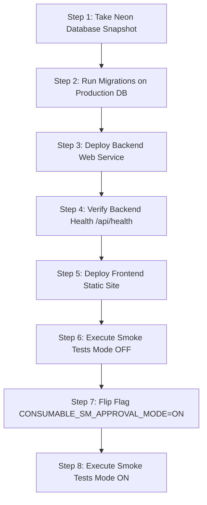

# Consumables Senior Manager Approval Module: Production Rollout Checklist

**Document Version:** 1.0.0  
**Target Environment:** Production (Render Web Services & Static Sites, Neon PostgreSQL Database)  
**Baseline Feature Flag:** `CONSUMABLE_SM_APPROVAL_MODE=OFF` (Mandatory Default)  
**Safety Gate:** Production is LIVE. Zero downtime, zero data loss, fully grandfathered baseline records.

---

## 1. Prerequisites & Account Verification

Before initiating any deployment activities, verify that required administrative and approver accounts exist in the production database.

### 1.1 Approver Role Requirement
The module strictly authorizes users with role `SENIOR_MANAGER` or `ADMIN`. The `GENERAL_MANAGER` role is explicitly barred from approval actions (403 Forbidden).

Verify active approver accounts using SQL:
```sql
SELECT u.id, u.email, u.name, r.name AS role, u.is_active
FROM users u
JOIN roles r ON u.role_id = r.id
WHERE r.name IN ('SENIOR_MANAGER', 'ADMIN') AND u.is_active = true;
```
* **Required:** At least one active `SENIOR_MANAGER` account and at least one active `ADMIN` account.

---

## 2. Environment Variables Configuration (Render)

Configure environment variables in the Render Dashboard under **v-smart-backend** -> **Environment**:

| Key | Mandatory Value | Purpose / Behavior |
| :--- | :--- | :--- |
| `CONSUMABLE_SM_APPROVAL_MODE` | `OFF` | **CRITICAL:** Defaults to `OFF` during initial deployment. Requisitions bypass approval until explicitly flipped `ON`. |
| `CONSUMABLE_SM_APPROVAL_SCOPE` | `ALL` | Defines approval scope (`ALL` requisitions undergo approval when mode is `ON`). |
| `FRONTEND_URL` | `https://v-smart-frontend.onrender.com` | Base URL used by email templates for direct links (`/consumables/approvals`, `/consumables/purchase-store`, etc.). Never use `localhost`. |
| `TYPEORM_SYNC` | `false` | Ensures TypeORM synchronization is strictly disabled in production. |

---

## 3. Database Migrations Execution

The implementation consists of four additive, idempotent migrations designed to run cleanly on production with zero impact on existing records.

### 3.1 Migration Sequence & Responsibilities

1. **`1794300000000-AddConsumableSmApprovalFields.ts`**
   - Creates enum type `"public"."consumable_approval_status_enum"` (`'PENDING_SM_APPROVAL'`, `'APPROVED'`, `'REJECTED'`).
   - Adds 7 nullable columns to `consumable_request_items`:
     - `approval_status` (enum)
     - `approved_by_id` (uuid, FK `FK_65232156438c5b94d99fe783558` -> `users(id)`)
     - `approved_at` (timestamptz)
     - `rejected_by_id` (uuid, FK `FK_792d7fb504b7a60bde39d601314` -> `users(id)`)
     - `rejected_at` (timestamptz)
     - `rejection_reason` (text)
     - `approval_batch_id` (uuid)
   - Creates 3 performance indexes: `IDX_cri_approval_status_created_at`, `IDX_cri_approved_at`, `IDX_cri_status_approval`.
   - **Grandfathering Backfill:** Sets `approval_status = 'APPROVED'` and `approved_at = created_at` for all existing records.
2. **`1794300001000-AddConsumableRequestCreatedByUserId.ts`**
   - Adds `created_by_user_id` (uuid, FK `FK_87035767e14fa7864d9c738c97a` -> `users(id)`) to `consumable_requests`.
   - Backfills existing requests from user lookup where available.
3. **`1794300002000-SeedConsumablesApprovalSystemModule.ts`**
   - Seeds `consumables_approval` into `system_modules`.
   - Grants module permissions to `SENIOR_MANAGER` and `ADMIN` roles only.
4. **`1794400000000-SeedConsumableApprovalEmailEvents.ts`**
   - Seeds 3 Priority 1 notification events into `notification_events`:
     - `CONSUMABLE_APPROVAL_REQUESTED` (category: `WORKFLOW`, target: `ROLE_BASED`)
     - `CONSUMABLE_APPROVED` (category: `WORKFLOW`, target: `ROLE_BASED`)
     - `CONSUMABLE_REJECTED` (category: `WORKFLOW`, target: `ROLE_BASED`)
   - Populates `role_email_settings` matrix:
     - `CONSUMABLE_APPROVAL_REQUESTED` -> `SENIOR_MANAGER: ON`, `ADMIN: ON`, `GENERAL_MANAGER: OFF`, `STORES: OFF`, `PRODUCTION: OFF`.
     - `CONSUMABLE_APPROVED` -> `STORES: ON`, all other roles OFF (requester notified dynamically).
     - `CONSUMABLE_REJECTED` -> all role defaults OFF (requester notified dynamically).

### 3.2 Production Migration Execution Method
In the repository, `app.module.ts` does **not** set `migrationsRun: true` in production. Therefore, migrations must be executed explicitly via Render Shell or as a pre-deploy release command:

```bash
# Execute migrations via TypeORM CLI
npm --prefix backend run migration:run
```

Verify migration status in database:
```sql
SELECT timestamp, name FROM migrations WHERE timestamp >= 1794300000000 ORDER BY timestamp ASC;
```
Expected output: Exactly 4 rows returned.

---

## 4. Deployment Sequence (Strict Backend-First Order)

Deploy components in the following strict order to avoid any window of client errors:



1. **Step 1: Backup / Snapshot**
   - Take a Neon branch snapshot or create a PostgreSQL dump of `rm_workflow_db`.
2. **Step 2: Run Migrations**
   - Execute `npm --prefix backend run migration:run`.
   - Verify 0 errors and all 4 migrations recorded.
3. **Step 3: Deploy Backend**
   - Trigger deployment of `v-smart-backend` on Render.
   - Confirm build succeeds (`nest build`).
4. **Step 4: Healthcheck Verification**
   - Send GET request to `https://v-smart-backend.onrender.com/api/health`.
   - Confirm HTTP 200 OK: `{"status":"ok","service":"v-smart-backend",...}`.
5. **Step 5: Deploy Frontend**
   - Trigger deployment of `v-smart-frontend` on Render (`tsc -b && vite build`).
6. **Step 6: Frontend Graceful Degrade Guarantee**
   - If frontend assets propagate before backend is fully warmed, sidebar badge defaults to `0` and `/consumables/approvals` displays a non-crashing retry state.

---

## 5. Smoke Testing Checklist: Stage 1 (MODE = OFF)

Verify system stability with the feature flag OFF (current baseline behavior):

- [ ] **Database Integrity:** Existing 43 consumable records remain `APPROVED` with `approved_at = created_at`.
- [ ] **Store Queues:** Store Purchase Queue shows all open procurement items; In-Stock Queue shows available items.
- [ ] **Request Creation:** Raise a new consumable request from Production floor.
  - Line items must be saved with `approval_status = 'APPROVED'`.
  - Line items must immediately appear in Store Queues without requiring managerial approval.
- [ ] **Email Suppression:** Zero approval notification emails queued (`CONSUMABLE_APPROVAL_REQUESTED`).
- [ ] **SLA Sweeps:** Automated hourly sweeps run cleanly without errors.

---

## 6. Smoke Testing Checklist: Stage 2 (MODE = ON Activation)

Activate the approval workflow:

1. Update Render env var: `CONSUMABLE_SM_APPROVAL_MODE=ON`.
2. Wait for backend service auto-reload.
3. Verify config endpoint: `GET /api/consumables/approvals/config` returns `{"mode":"ON","scope":"ALL"}`.

### Functional Verification Steps:
- [ ] **1. Requisition Creation:**
  - Production raises a 5-line request (e.g. 3 stock items, 2 purchase items).
  - All 5 lines are created with status `PENDING_SM_APPROVAL`.
  - All 5 lines are **absent** from Store In-Stock and Purchase queues.
- [ ] **2. Approval Notifications:**
  - Check `email_jobs` table: Exactly 1 email queued for each active approver (`SENIOR_MANAGER` and `ADMIN`).
  - Job priority is strictly `1`.
- [ ] **3. Approver View & Sidebar Badge:**
  - Senior Manager logs in.
  - Sidebar shows amber badge count reflecting pending items.
  - `/consumables/approvals` displays items under the **Pending** tab with running totals.
- [ ] **4. Action Guarding:**
  - Direct calls to `/api/consumables/purchase/print-pr`, `/receive`, or `/issue-to-production` targeting pending lines return HTTP 400 Bad Request.
  - Users with role `GENERAL_MANAGER`, `STORES`, or `PRODUCTION` calling `/api/consumables/approvals/bulk-approve` receive HTTP 403 Forbidden.
- [ ] **5. Managerial Approval & Stock Check:**
  - Senior Manager approves lines.
  - If a stock item's available stock was depleted between requisition and approval, it automatically switches to `NON_STOCK_OR_NEW` (Purchase track).
  - Approver is alerted with confirmation toast listing switched lines.
- [ ] **6. Managerial Rejection:**
  - Senior Manager rejects lines with a mandatory reason ($\ge 5$ characters).
  - Rejected lines update to `REJECTED`, record `rejected_by_id`, `rejected_at`, and `rejection_reason`.
  - Rejected lines remain excluded from store queues.
  - Attempting to delete a rejected line returns HTTP 400.
  - Requester views reason in accordion tooltip and clicks **Re-raise** to pre-fill a new requisition.
- [ ] **7. Downstream Fulfillment:**
  - Approved purchase lines appear in Stores Purchase Queue.
  - Stores prints PR (`PURCHASE_REQUESTED`), receives goods, and issues to production.
  - Production confirms receipt (`RECEIVED_BY_PRODUCTION`).
- [ ] **8. SLA Sweeps:**
  - Sweeps strictly ignore `PENDING_SM_APPROVAL` and `REJECTED` lines.

---

## 7. Emergency Rollback Procedures

If any unanticipated blocker arises during deployment:

### Fast Rollback (Zero Downtime, < 1 Minute)
1. Go to Render Dashboard -> **v-smart-backend** -> **Environment**.
2. Change `CONSUMABLE_SM_APPROVAL_MODE` back to `OFF`.
3. Save changes. Backend auto-restarts within 30 seconds.
4. **Result:** All subsequent requisitions immediately bypass the approval queue and enter store queues as `APPROVED`. Any items created while mode was `ON` remain safely preserved in their current state and remain visible to Senior Managers.

### Full Database Rollback (If Schema Reversion Required)
Execute the migration revert commands in reverse order:
```bash
npm --prefix backend run typeorm migration:revert
npm --prefix backend run typeorm migration:revert
npm --prefix backend run typeorm migration:revert
npm --prefix backend run typeorm migration:revert
```
Alternatively, restore the Neon snapshot created in Step 1.

---

## 8. User-Visible Changes Summary

| Role | Before Rollout | After Rollout (`MODE=ON`) |
| :--- | :--- | :--- |
| **Production (Requester)** | Requisitions immediately entered store queues. | Requisitions await Senior Manager approval. Items show "Pending SM" badge. Rejections display reasons with 1-click "Re-raise". |
| **Senior Manager / Admin** | No consumable review interface. | Dedicated "Consumable Approvals" workspace with live sidebar counter, running stock tally, bulk authorization, and rejection modal. |
| **General Manager** | N/A | Strictly barred from approving consumable requisitions (403 Forbidden). |
| **Stores** | Requisitions appeared immediately in stock/purchase queues. | Items appear in queues only after Senior Manager authorization. Stock items that ran out of stock auto-switch to purchase track. |
