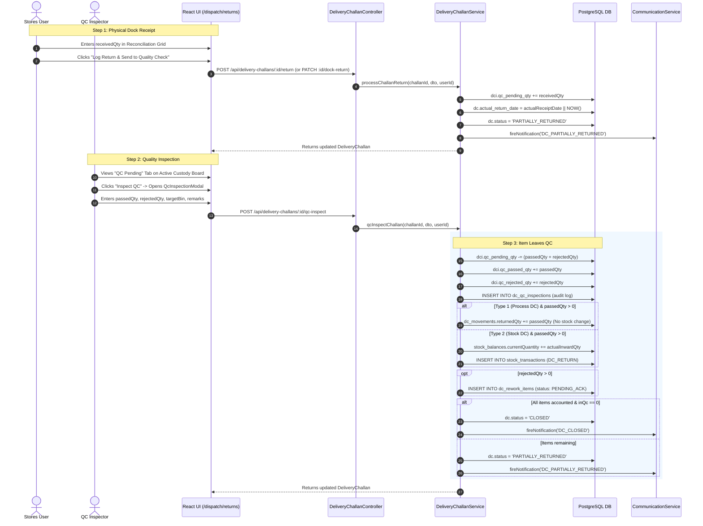

# Delivery Challan (DC) Inward to QC Audit & Alert Specification

This document provides an exhaustive, read-only architectural audit of how Delivery Challan inwarding flows into the Quality Check (QC) module across the NestJS backend and React frontend. It specifies the exact data model, state transitions, timestamp tracking, and SQL logic required to detect items pending in QC for over 24 hours (`DC_QC_PENDING_24H`).

---

## 1. QC Data Model

The Delivery Challan subsystem tracks custody and quality checks across five primary database tables. Note that Delivery Challans manage inwarding directly—there are no separate "GRN" tables for DC returns.

### A. `DcQcInspection` (`dc_qc_inspections`)
- **File**: [`backend/src/delivery-challan/entities/dc-qc-inspection.entity.ts#L18-L63`](file:///c:/Users/Admin/OneDrive/Desktop/rm-workflow-system/backend/src/delivery-challan/entities/dc-qc-inspection.entity.ts#L18-L63)
- **Role**: Immutable historical audit log of every completed QC inspection execution.

```typescript
// backend/src/delivery-challan/entities/dc-qc-inspection.entity.ts:18-63
@Entity('dc_qc_inspections')
@Index('IDX_dc_qc_inspections_challan_id', ['challanId'])
@Index('IDX_dc_qc_inspections_item_id', ['challanItemId'])
export class DcQcInspection {
  @PrimaryGeneratedColumn('uuid')
  id: string;

  @Column({ name: 'challan_id', type: 'uuid' })
  challanId: string;

  @ManyToOne(() => DeliveryChallan, { onDelete: 'CASCADE' })
  @JoinColumn({ name: 'challan_id' })
  challan: Relation<DeliveryChallan>;

  @Column({ name: 'challan_item_id', type: 'uuid' })
  challanItemId: string;

  @ManyToOne(() => DeliveryChallanItem, { onDelete: 'CASCADE' })
  @JoinColumn({ name: 'challan_item_id' })
  challanItem: Relation<DeliveryChallanItem>;

  @Column({ name: 'batch_received_qty', type: 'numeric', precision: 12, scale: 3 })
  batchReceivedQty: number;

  @Column({ name: 'passed_qty', type: 'numeric', precision: 12, scale: 3, default: 0 })
  passedQty: number;

  @Column({ name: 'rejected_qty', type: 'numeric', precision: 12, scale: 3, default: 0 })
  rejectedQty: number;

  @Column({ name: 'actual_inward_qty', type: 'numeric', precision: 12, scale: 3, nullable: true })
  actualInwardQty?: number | null;

  @Column({ type: 'text', nullable: true })
  remarks?: string | null;

  @Column({ name: 'inspected_by_id', type: 'uuid', nullable: true })
  inspectedById?: string | null;

  @ManyToOne(() => User, { nullable: true })
  @JoinColumn({ name: 'inspected_by_id' })
  inspectedBy?: Relation<User> | null;

  @Column({ name: 'inspected_at', type: 'timestamptz', default: () => 'CURRENT_TIMESTAMP' })
  inspectedAt: Date;

  @CreateDateColumn({ name: 'created_at', type: 'timestamptz' })
  createdAt: Date;
}
```

---

### B. `DeliveryChallanItem` (`delivery_challan_items`)
- **File**: [`backend/src/delivery-challan/entities/delivery-challan-item.entity.ts#L28-L152`](file:///c:/Users/Admin/OneDrive/Desktop/rm-workflow-system/backend/src/delivery-challan/entities/delivery-challan-item.entity.ts#L28-L152)
- **Role**: Maintains the active split-accounting quantities (`qc_pending_qty`, `qc_passed_qty`, `qc_rejected_qty`).

```typescript
// backend/src/delivery-challan/entities/delivery-challan-item.entity.ts:28-152
@Entity('delivery_challan_items')
@Index('IDX_dci_challan_id', ['challanId'])
@Index('IDX_dci_product_id', ['productId'])
@Index('IDX_dci_output_product_id', ['outputProductId'])
@Index('IDX_dci_bin_id', ['binId'])
@Index('IDX_dci_output_bin_id', ['outputBinId'])
@Index('IDX_dci_sc_id', ['scId'])
@Index('IDX_dci_process_id', ['processId'])
@Index('IDX_dci_return_target_bin_id', ['returnTargetBinId'])
export class DeliveryChallanItem {
  @PrimaryGeneratedColumn('uuid')
  id: string;

  @Column({ name: 'sc_id', type: 'uuid', nullable: true })
  scId?: string | null;

  @ManyToOne('SalesOrderComponent', { nullable: true })
  @JoinColumn({ name: 'sc_id', foreignKeyConstraintName: 'FK_dci_sc_id' })
  sc?: any;

  @Column({ name: 'process_id', type: 'uuid', nullable: true })
  processId?: string | null;

  @ManyToOne('ProductionProcess', { nullable: true })
  @JoinColumn({ name: 'process_id', foreignKeyConstraintName: 'FK_dci_process_id' })
  process?: any;

  @Column({ name: 'process_name', type: 'varchar', length: 255, nullable: true })
  processName?: string | null;

  @Column({ name: 'part_number', type: 'varchar', length: 100, nullable: true })
  partNumber?: string | null;

  @Column({ name: 'part_name', type: 'varchar', length: 255, nullable: true })
  partName?: string | null;

  @Column({ type: 'text', nullable: true })
  description?: string | null;

  @Column({ name: 'batch_number', type: 'varchar', length: 100, nullable: true })
  batchNumber?: string | null;

  @Column({ name: 'po_part_label', type: 'varchar', nullable: true })
  poPartLabel?: string | null;

  @Column({ name: 'is_extra_item', type: 'boolean', default: false })
  isExtraItem!: boolean;

  @Column({ name: 'merc_item_id', type: 'varchar', nullable: true })
  mercItemId?: string | null;

  @Column({ name: 'challan_id', type: 'uuid' })
  challanId: string;

  @ManyToOne(() => DeliveryChallan, (challan) => challan.items, { onDelete: 'CASCADE' })
  @JoinColumn({ name: 'challan_id' })
  challan: Relation<DeliveryChallan>;

  @Column({ name: 'product_id', type: 'uuid', nullable: true })
  productId?: string | null;

  @ManyToOne(() => Product, { nullable: true })
  @JoinColumn({ name: 'product_id' })
  product?: Product;

  @Column({ name: 'bin_id', type: 'uuid', nullable: true })
  binId?: string | null;

  @ManyToOne(() => Bin, { nullable: true, onDelete: 'SET NULL' })
  @JoinColumn({ name: 'bin_id' })
  bin?: Bin;

  // Type 2 Asymmetric Stock Conversion Fields
  @Column({ name: 'output_product_id', type: 'uuid', nullable: true })
  outputProductId?: string | null;

  @ManyToOne(() => Product, { nullable: true })
  @JoinColumn({ name: 'output_product_id' })
  outputProduct?: Product;

  @Column({ name: 'expected_output_quantity', type: 'numeric', precision: 12, scale: 3, nullable: true })
  expectedOutputQuantity?: number | null;

  @Column({ name: 'output_bin_id', type: 'uuid', nullable: true })
  outputBinId?: string | null;

  @ManyToOne(() => Bin, { nullable: true })
  @JoinColumn({ name: 'output_bin_id' })
  outputBin?: Bin;

  @Column({ name: 'quantity_dispatched', type: 'numeric', precision: 12, scale: 3 })
  quantityDispatched: number;

  @Column({ name: 'quantity_returned', type: 'numeric', precision: 12, scale: 3, default: 0 })
  quantityReturned: number;

  // Phase 23 Split-Accounting & QC Gate Fields
  @Column({ name: 'qc_pending_qty', type: 'numeric', precision: 12, scale: 3, default: 0 })
  qcPendingQty: number;

  @Column({ name: 'qc_passed_qty', type: 'numeric', precision: 12, scale: 3, default: 0 })
  qcPassedQty: number;

  @Column({ name: 'qc_rejected_qty', type: 'numeric', precision: 12, scale: 3, default: 0 })
  qcRejectedQty: number;

  @Column({ name: 'initial_expected_qty', type: 'numeric', precision: 12, scale: 3, nullable: true })
  initialExpectedQty?: number | null;

  @Column({ name: 'expected_return_qty', type: 'numeric', precision: 12, scale: 3, nullable: true })
  expectedReturnQty?: number | null;

  @Column({ name: 'actual_received_qty', type: 'numeric', precision: 12, scale: 3, default: 0 })
  actualReceivedQty: number;

  @Column({ name: 'return_target_bin_id', type: 'uuid', nullable: true })
  returnTargetBinId?: string | null;

  @ManyToOne(() => Bin, { nullable: true })
  @JoinColumn({ name: 'return_target_bin_id' })
  returnTargetBin?: Relation<Bin> | null;

  @OneToMany(() => DcMovement, (movement) => movement.challanItem)
  movements?: Relation<DcMovement[]>;

  @OneToMany(() => DcQcInspection, (qc) => qc.challanItem)
  qcInspections?: Relation<DcQcInspection[]>;

  @CreateDateColumn({ name: 'created_at', type: 'timestamptz' })
  createdAt: Date;

  @UpdateDateColumn({ name: 'updated_at', type: 'timestamptz' })
  updatedAt: Date;
}
```

---

### C. `DeliveryChallan` (`delivery_challans`)
- **File**: [`backend/src/delivery-challan/entities/delivery-challan.entity.ts#L21-L133`](file:///c:/Users/Admin/OneDrive/Desktop/rm-workflow-system/backend/src/delivery-challan/entities/delivery-challan.entity.ts#L21-L133)
- **Role**: Header entity representing outward and inward movement with the vendor.

```typescript
// backend/src/delivery-challan/entities/delivery-challan.entity.ts:21-33
export enum DeliveryChallanType {
  PRODUCTION_PROCESS_OUTWARD = 'PRODUCTION_PROCESS_OUTWARD',
  GENERAL_INVENTORY_OUTWARD = 'GENERAL_INVENTORY_OUTWARD',
  SPL_PROCESS = 'SPL_PROCESS',
}

export enum DeliveryChallanStatus {
  OPEN = 'OPEN',
  DISPATCHED = 'DISPATCHED',
  PARTIALLY_RETURNED = 'PARTIALLY_RETURNED',
  RETURNED = 'RETURNED',
  CLOSED = 'CLOSED',
}

// backend/src/delivery-challan/entities/delivery-challan.entity.ts:41-133
@Entity('delivery_challans')
@Index('IDX_dc_challan_number', ['challanNumber'], { unique: true })
@Index('IDX_dc_vendor_id', ['vendorId'])
@Index('IDX_dc_sc_id', ['scId'])
@Index('IDX_dc_status', ['status'])
@Index('idx_delivery_challans_po_number', ['poNumber'])
export class DeliveryChallan {
  @PrimaryGeneratedColumn('uuid')
  id: string;

  @Column({ name: 'challan_number', type: 'varchar', length: 50, unique: true })
  challanNumber: string;

  @Column({ type: 'varchar', length: 40 })
  type: string;

  @Column({ name: 'vendor_id', type: 'uuid' })
  vendorId: string;

  @ManyToOne(() => Vendor)
  @JoinColumn({ name: 'vendor_id' })
  vendor: Vendor;

  @Column({ name: 'sc_id', type: 'uuid', nullable: true })
  scId?: string | null;

  @ManyToOne(() => SalesOrderComponent)
  @JoinColumn({ name: 'sc_id' })
  sc?: SalesOrderComponent | null;

  @Column({ name: 'process_id', type: 'uuid', nullable: true })
  processId?: string | null;

  @ManyToOne(() => ProductionProcess)
  @JoinColumn({ name: 'process_id' })
  process?: ProductionProcess | null;

  @Column({ name: 'process_name', type: 'varchar', length: 255, nullable: true })
  processName?: string | null;

  @Column({ name: 'dispatch_date', type: 'timestamptz' })
  dispatchDate: Date;

  @Column({ name: 'expected_return_date', type: 'timestamptz', nullable: true })
  expectedReturnDate?: Date | null;

  @Column({ type: 'varchar', length: 30, default: DeliveryChallanStatus.DISPATCHED })
  status: string;

  @Column({ type: 'text', nullable: true })
  notes?: string | null;

  @Column({ name: 'created_by_id', type: 'uuid', nullable: true })
  createdById?: string | null;

  @ManyToOne(() => User)
  @JoinColumn({ name: 'created_by_id' })
  createdBy?: User | null;

  @Column({ name: 'actual_return_date', type: 'timestamptz', nullable: true })
  actualReturnDate?: Date | null;

  @Column({ name: 'verified_by_id', type: 'uuid', nullable: true })
  verifiedById?: string | null;

  @ManyToOne(() => User)
  @JoinColumn({ name: 'verified_by_id' })
  verifiedBy?: User | null;

  @Column({ name: 'verification_remarks', type: 'text', nullable: true })
  verificationRemarks?: string | null;

  @Column({ name: 'po_number', type: 'varchar', nullable: true })
  poNumber?: string | null;

  @Column({ name: 'layout_number', type: 'varchar', nullable: true })
  layoutNumber?: string | null;

  @Column({ name: 'merc_indent_id', type: 'varchar', nullable: true })
  mercIndentId?: string | null;

  @Column({ name: 'merc_indent_number', type: 'varchar', nullable: true })
  mercIndentNumber?: string | null;

  @CreateDateColumn({ name: 'created_at', type: 'timestamptz' })
  createdAt: Date;

  @UpdateDateColumn({ name: 'updated_at', type: 'timestamptz' })
  updatedAt: Date;

  @OneToMany(() => DeliveryChallanItem, (item) => item.challan, { cascade: true })
  items: Relation<DeliveryChallanItem>[];

  @OneToMany(() => DcQcInspection, (qc) => qc.challan)
  qcInspections?: Relation<DcQcInspection[]>;

  @OneToMany(() => DcReworkItem, (rework) => rework.sourceDc)
  reworkItems?: Relation<DcReworkItem[]>;
}
```

---

### D. `DcReworkItem` (`dc_rework_items`)
- **File**: [`backend/src/delivery-challan/entities/dc-rework-item.entity.ts#L18-L121`](file:///c:/Users/Admin/OneDrive/Desktop/rm-workflow-system/backend/src/delivery-challan/entities/dc-rework-item.entity.ts#L18-L121)
- **Role**: Automatically populated when an item fails QC (`rejectedQty > 0`).

```typescript
// backend/src/delivery-challan/entities/dc-rework-item.entity.ts:18-22
export enum ReworkItemStatus {
  PENDING_ACK = 'PENDING_ACK',
  MARKED_OKAY = 'MARKED_OKAY',
  RE_DISPATCHED = 'RE_DISPATCHED',
}

// backend/src/delivery-challan/entities/dc-rework-item.entity.ts:29-121 (excerpt)
@Entity('dc_rework_items')
export class DcReworkItem {
  @PrimaryGeneratedColumn('uuid')
  id: string;

  @Column({ name: 'source_dc_id', type: 'uuid' })
  sourceDcId: string;

  @Column({ name: 'source_dc_number', type: 'varchar', length: 50 })
  sourceDcNumber: string;

  @Column({ name: 'rejected_qty', type: 'numeric', precision: 12, scale: 3 })
  rejectedQty: number;

  @Column({ name: 'qc_remarks', type: 'text', nullable: true })
  qcRemarks?: string | null;

  @Column({ name: 'rework_status', type: 'varchar', length: 30, default: ReworkItemStatus.PENDING_ACK })
  reworkStatus: ReworkItemStatus;

  @Column({ name: 'rework_dc_id', type: 'uuid', nullable: true })
  reworkDcId?: string | null;

  @CreateDateColumn({ name: 'created_at', type: 'timestamptz' })
  createdAt: Date;
}
```

---

## 2. Inward Flow: Step-by-Step

The complete operational flow from receiving material at the dock through QC verification to stock or rework is summarized below:



### Detailed Endpoint and Service Citations:

1. **Dock Inwarding (Item Enters QC)**:
   - **Controller**: [`backend/src/delivery-challan/delivery-challan.controller.ts#L196-L212`](file:///c:/Users/Admin/OneDrive/Desktop/rm-workflow-system/backend/src/delivery-challan/delivery-challan.controller.ts#L196-L212) (`@Post(':id/return')`) and [`#L214-L230`](file:///c:/Users/Admin/OneDrive/Desktop/rm-workflow-system/backend/src/delivery-challan/delivery-challan.controller.ts#L214-L230) (`@Patch(':id/dock-return')`).
   - **Service**: [`backend/src/delivery-challan/delivery-challan.service.ts#L2320-L2473`](file:///c:/Users/Admin/OneDrive/Desktop/rm-workflow-system/backend/src/delivery-challan/delivery-challan.service.ts#L2320-L2473) (`processChallanReturn`).
   - **Logic**:
     - Increments `challanItem.qcPendingQty = Number(challanItem.qcPendingQty || 0) + qtyReceived` ([`#L2423`](file:///c:/Users/Admin/OneDrive/Desktop/rm-workflow-system/backend/src/delivery-challan/delivery-challan.service.ts#L2423)).
     - Sets header timestamp: `challan.actualReturnDate = new Date(dto.actualReceiptDate || Date.now())` ([`#L2455`](file:///c:/Users/Admin/OneDrive/Desktop/rm-workflow-system/backend/src/delivery-challan/delivery-challan.service.ts#L2455)).
     - Sets status: `challan.status = DeliveryChallanStatus.PARTIALLY_RETURNED` ([`#L2460`](file:///c:/Users/Admin/OneDrive/Desktop/rm-workflow-system/backend/src/delivery-challan/delivery-challan.service.ts#L2460)).
     - Saves item, updating `delivery_challan_items.updated_at` ([`#L2452`](file:///c:/Users/Admin/OneDrive/Desktop/rm-workflow-system/backend/src/delivery-challan/delivery-challan.service.ts#L2452)).

2. **QC Verification (Item Leaves QC)**:
   - **Controller**: [`backend/src/delivery-challan/delivery-challan.controller.ts#L232-L248`](file:///c:/Users/Admin/OneDrive/Desktop/rm-workflow-system/backend/src/delivery-challan/delivery-challan.controller.ts#L232-L248) (`@Post(':id/qc-inspect')`).
   - **Service**: [`backend/src/delivery-challan/delivery-challan.service.ts#L2484-L2715`](file:///c:/Users/Admin/OneDrive/Desktop/rm-workflow-system/backend/src/delivery-challan/delivery-challan.service.ts#L2484-L2715) (`qcInspectChallan`).
   - **Logic**:
     - Decrements `challanItem.qcPendingQty -= (passedQty + rejectedQty)` ([`#L2550`](file:///c:/Users/Admin/OneDrive/Desktop/rm-workflow-system/backend/src/delivery-challan/delivery-challan.service.ts#L2550)).
     - Increments `challanItem.qcPassedQty += passedQty` ([`#L2551`](file:///c:/Users/Admin/OneDrive/Desktop/rm-workflow-system/backend/src/delivery-challan/delivery-challan.service.ts#L2551)).
     - Increments `challanItem.qcRejectedQty += rejectedQty` ([`#L2552`](file:///c:/Users/Admin/OneDrive/Desktop/rm-workflow-system/backend/src/delivery-challan/delivery-challan.service.ts#L2552)).
     - Type 1: Updates `dc_movements.returnedQty += passedQty` ([`#L2568`](file:///c:/Users/Admin/OneDrive/Desktop/rm-workflow-system/backend/src/delivery-challan/delivery-challan.service.ts#L2568)).
     - Type 2: Atomically increments `stock_balances.currentQuantity` and inserts a `stock_transactions` entry with `referenceType = 'DELIVERY_CHALLAN_TYPE_2_QC_PASS'` ([`#L2613-L2626`](file:///c:/Users/Admin/OneDrive/Desktop/rm-workflow-system/backend/src/delivery-challan/delivery-challan.service.ts#L2613-L2626)).
     - Rejections: Inserts into `dc_rework_items` ([`#L2639-L2657`](file:///c:/Users/Admin/OneDrive/Desktop/rm-workflow-system/backend/src/delivery-challan/delivery-challan.service.ts#L2639-L2657)).
     - Audit: Inserts into `dc_qc_inspections` ([`#L2661-L2672`](file:///c:/Users/Admin/OneDrive/Desktop/rm-workflow-system/backend/src/delivery-challan/delivery-challan.service.ts#L2661-L2672)).
     - Status: Sets `challan.status = DeliveryChallanStatus.CLOSED` if all items are fully accounted and all `qcPendingQty == 0`, else `PARTIALLY_RETURNED` ([`#L2680-L2693`](file:///c:/Users/Admin/OneDrive/Desktop/rm-workflow-system/backend/src/delivery-challan/delivery-challan.service.ts#L2680-L2693)).

---

## 3. Status Values: "In QC" vs "QC Finished"

### DC Header Status (`DeliveryChallanStatus`)
- `OPEN`: Challan generated, awaiting dispatch.
- `DISPATCHED`: Dispatched to vendor.
- `PARTIALLY_RETURNED`: Material returned at dock (either awaiting QC inspection or partially inspected with balance remaining at vendor).
- `RETURNED`: Legacy status (modern code transitions to `CLOSED`).
- `CLOSED`: Fully settled and completed.

> [!IMPORTANT]
> **DC status alone does not signify that material is in QC.** A DC with `status = 'PARTIALLY_RETURNED'` could be waiting for QC, or it could have already completed QC with its remaining balance still sitting at the vendor.

### Item Split-Accounting (The True Condition)
In `delivery_challan_items`:
- **"Still in QC" (Pending QC)**:
  $$\mathbf{dci.qc\_pending\_qty > 0}$$
  This is the precise, canonical database indicator that an item has been received at the dock and is waiting for QC inspection.
- **"QC Finished (Passed)"**:
  `dci.qc_passed_qty > 0`
- **"QC Finished (Rejected)"**:
  `dci.qc_rejected_qty > 0`
- **"QC Fully Completed for Item"**:
  `dci.qc_pending_qty = 0 AND (dci.qc_passed_qty + dci.qc_rejected_qty) > 0`

---

## 4. Timestamps: When Did the Item Enter QC?

### Existing Database Columns:
1. **At the Item Level (`delivery_challan_items`)**:
   - **NO dedicated inward timestamp column currently exists** (there is no `inwarded_at`, `qc_entered_at`, or `dock_received_at`).
   - The only timestamps on `delivery_challan_items` are:
     - `created_at` (`timestamptz`, [`#L148`](file:///c:/Users/Admin/OneDrive/Desktop/rm-workflow-system/backend/src/delivery-challan/entities/delivery-challan-item.entity.ts#L148)): Records when the item was created at DC dispatch.
     - `updated_at` (`timestamptz`, [`#L150`](file:///c:/Users/Admin/OneDrive/Desktop/rm-workflow-system/backend/src/delivery-challan/entities/delivery-challan-item.entity.ts#L150)): TypeORM `@UpdateDateColumn`. This is updated when `itemRepo.save(challanItem)` runs at dock return ([`#L2452`](file:///c:/Users/Admin/OneDrive/Desktop/rm-workflow-system/backend/src/delivery-challan/delivery-challan.service.ts#L2452)), but it also gets overwritten if the item is saved again during inspection or editing.
2. **At the DC Header Level (`delivery_challans`)**:
   - **Column**: `actual_return_date` (`timestamptz`, nullable, [`backend/src/delivery-challan/entities/delivery-challan.entity.ts#L94`](file:///c:/Users/Admin/OneDrive/Desktop/rm-workflow-system/backend/src/delivery-challan/entities/delivery-challan.entity.ts#L94)).
   - **Where set**: [`backend/src/delivery-challan/delivery-challan.service.ts#L2455`](file:///c:/Users/Admin/OneDrive/Desktop/rm-workflow-system/backend/src/delivery-challan/delivery-challan.service.ts#L2455):
     ```typescript
     challan.actualReturnDate = new Date(dto.actualReceiptDate || Date.now());
     ```
   - **Limitation**: It is a single header-level column. If a DC receives multiple deliveries on different days, `actual_return_date` reflects the latest receipt date.
3. **At the Inspection Audit Level (`dc_qc_inspections`)**:
   - **Column**: `inspected_at` (`timestamptz`, [`backend/src/delivery-challan/entities/dc-qc-inspection.entity.ts#L58`](file:///c:/Users/Admin/OneDrive/Desktop/rm-workflow-system/backend/src/delivery-challan/entities/dc-qc-inspection.entity.ts#L58)).
   - Records when QC inspection **completed**, not when the item entered QC. No row exists for items currently pending in QC.

### Smallest Additive Change Proposed (Without Implementing):
Add a nullable timestamp column to `delivery_challan_items`:
- **Column**: `qc_entered_at: timestamptz NULL`
- **Entity**: `backend/src/delivery-challan/entities/delivery-challan-item.entity.ts`:
  ```typescript
  @Column({ name: 'qc_entered_at', type: 'timestamptz', nullable: true })
  qcEnteredAt?: Date | null;
  ```
- **Where to set it**:
  In `backend/src/delivery-challan/delivery-challan.service.ts` inside `processChallanReturn` at line 2424:
  ```typescript
  if (qtyReceived > 0) {
    challanItem.qcPendingQty = Number(challanItem.qcPendingQty || 0) + qtyReceived;
    if (!challanItem.qcEnteredAt) {
      challanItem.qcEnteredAt = new Date(dto.actualReceiptDate || Date.now());
    }
  }
  ```
  And when inspection is complete in `qcInspectChallan` at line 2555:
  ```typescript
  if (Number(challanItem.qcPendingQty) <= 0.0001) {
    challanItem.qcEnteredAt = null;
  }
  ```

### Immediate Zero-Schema Solution (Using Existing Columns):
Until such a column is migrated, the system can reliably evaluate elapsed time using:
$$\mathbf{COALESCE(dc.actual\_return\_date,\; dci.updated\_at) \le NOW() - INTERVAL\text{ '24 hours'}}$$

---

## 5. Granularity: Tracking & Alert Aggregation

1. **Database Tracking Granularity**:
   - Tracked strictly at the **line item level** (`delivery_challan_items.qc_pending_qty`).
2. **Can one DC be partly in QC and partly done?**
   - **Yes.** A single Delivery Challan can contain:
     - Item 1: `qc_pending_qty = 10` (waiting in QC).
     - Item 2: `qc_passed_qty = 50` (inspected and moved to stock).
     - Item 3: `pendingVendorQty = 25` (still physically at vendor).
   - Even a single line item can be partially inspected (e.g., 40 inspected out of 100 received, leaving 60 in `qc_pending_qty`).
3. **Alert Aggregation Recommendation**:
   - **One email per Delivery Challan**, aggregating all overdue line items into a single notification.
   - Sending per-item emails would create severe notification fatigue (a challan with 8 line items would generate 8 identical emails per sweep).
   - Deduplication key: `${dc.id}_qc_pending_${todayStr}` (ensuring 1 email per DC per day, exactly matching the pattern in `DC_OVERDUE`).

---

## 6. Existing Alerts & Sweeps Touching QC

1. **Delivery Challan Hourly Sweep**:
   - **File**: [`backend/src/delivery-challan/delivery-challan.service.ts#L3776-L3850`](file:///c:/Users/Admin/OneDrive/Desktop/rm-workflow-system/backend/src/delivery-challan/delivery-challan.service.ts#L3776-L3850)
   - **Schedule**: `@Cron(process.env.DC_SLA_CRON_SCHEDULE || CronExpression.EVERY_HOUR)`
   - **Scope**:
     - Line 3811: Dispatches `DC_OVERDUE` when `now > expectedReturnDate`.
     - Line 3828: Dispatches `DC_APPROACHING_SLA` when `expectedReturnDate - now <= 24h`.
     - **Current Gap**: This sweep only checks dispatch SLA against vendor expected return date; **it does not inspect `qc_pending_qty` at all**.
2. **Delivery Challan Lifecycle In-App Notifications**:
   - [`backend/src/delivery-challan/delivery-challan.service.ts#L3744-L3769`](file:///c:/Users/Admin/OneDrive/Desktop/rm-workflow-system/backend/src/delivery-challan/delivery-challan.service.ts#L3744-L3769) (`fireNotification`):
     - `DC_PARTIALLY_RETURNED` fired at line 2465 and line 2705.
     - `DC_CLOSED` fired at line 2703 and line 2983.
     - Note: In [`backend/src/notifications/communication.service.ts#L67-68`](file:///c:/Users/Admin/OneDrive/Desktop/rm-workflow-system/backend/src/notifications/communication.service.ts#L67-68), these events generate in-app alerts, but are suppressed from email dispatch because they are not listed in `PERMITTED_EMAIL_CONFIG`.
3. **Phase 1 Configuration Status for `DC_QC_PENDING_24H`**:
   - Event `DC_QC_PENDING_24H` was seeded in Phase 1 into `notification_events` and enabled in `role_email_settings` for `STORES` and `SENIOR_MANAGER`.
   - However, no cron sweep or dispatch trigger currently fires `DC_QC_PENDING_24H`.

---

## 7. Draft SQL (Read-Only SELECT)

The following query identifies all Delivery Challan items that have been inwarded and have remained in QC for more than 24 hours, using only existing columns and tables:

```sql
SELECT 
  dc.id AS challan_id,
  dc.challan_number,
  dc.type AS challan_type,
  dc.status AS challan_status,
  v.name AS vendor_name,
  dc.actual_return_date,
  dci.id AS item_id,
  dci.part_number,
  dci.part_name,
  p.name AS product_name,
  dci.qc_pending_qty,
  ROUND((EXTRACT(EPOCH FROM (NOW() - COALESCE(dc.actual_return_date, dci.updated_at))) / 3600)::numeric, 1) AS hours_in_qc
FROM delivery_challan_items dci
JOIN delivery_challans dc ON dc.id = dci.challan_id
LEFT JOIN vendors v ON v.id = dc.vendor_id
LEFT JOIN products p ON p.id = dci.product_id
WHERE dci.qc_pending_qty > 0
  AND dc.status != 'CLOSED'
  AND COALESCE(dc.actual_return_date, dci.updated_at) <= (NOW() - INTERVAL '24 hours')
ORDER BY COALESCE(dc.actual_return_date, dci.updated_at) ASC;
```

*Validated against the local PostgreSQL test database with clean syntax execution.*

---

## 8. Edge Cases & False Alert Prevention

1. **Items Already Past QC**:
   - When an item is inspected, `dci.qc_pending_qty` is immediately decremented by `passedQty + rejectedQty` ([`#L2550`](file:///c:/Users/Admin/OneDrive/Desktop/rm-workflow-system/backend/src/delivery-challan/delivery-challan.service.ts#L2550)).
   - Filtering on `dci.qc_pending_qty > 0` ensures items that have completed QC are never flagged.
2. **Administratively Closed DCs**:
   - A DC can be closed via `closeChallan` ([`#L2962`](file:///c:/Users/Admin/OneDrive/Desktop/rm-workflow-system/backend/src/delivery-challan/delivery-challan.service.ts#L2962)).
   - `dc.status != 'CLOSED'` guarantees closed challans are ignored.
3. **Multiple Inward Batches for a Single DC**:
   - If Batch 1 is received on Monday and Batch 2 on Thursday, `dc.actual_return_date` updates to Thursday.
   - If Batch 1 was still in QC, relying solely on `dc.actual_return_date` would reset the 24h clock.
   - Using `COALESCE(dc.actual_return_date, dci.updated_at)` or introducing the proposed `qc_entered_at` column eliminates this risk.
4. **Partial QC Inspection**:
   - If 100 units arrive and 30 are inspected, 70 remain in `qc_pending_qty`.
   - Inspection saves `dci`, which updates `dci.updated_at`. If `dci.updated_at` is used as the timestamp, partial inspection resets the 24-hour clock for the remaining 70 units. The proposed `qc_entered_at` column fixes this permanently.
5. **Zero-Inward Receipts**:
   - Stores can record 0 inward quantity to update notes without receiving physical material ([`DockReceiptWorkspace.tsx#L799`](file:///c:/Users/Admin/OneDrive/Desktop/rm-workflow-system/frontend/src/pages/DockReceiptWorkspace.tsx#L799)).
   - In `processChallanReturn` ([`#L2422`](file:///c:/Users/Admin/OneDrive/Desktop/rm-workflow-system/backend/src/delivery-challan/delivery-challan.service.ts#L2422)), `qc_pending_qty` is only incremented when `qtyReceived > 0`, preventing false alerts on zero-quantity receipts.

---

## 9. Frontend Screen & Deep Linking

- **Primary Route**: `/dispatch/returns`
- **Route Name**: `DC Returns`
- **Route Definition**: [`frontend/src/routeConfig.tsx#L196`](file:///c:/Users/Admin/OneDrive/Desktop/rm-workflow-system/frontend/src/routeConfig.tsx#L196)
- **Component File**: [`frontend/src/pages/DockReceiptWorkspace.tsx#L34`](file:///c:/Users/Admin/OneDrive/Desktop/rm-workflow-system/frontend/src/pages/DockReceiptWorkspace.tsx#L34)
- **Active Board Component**: [`frontend/src/components/dispatch/ActiveCustodyBoard.tsx#L170`](file:///c:/Users/Admin/OneDrive/Desktop/rm-workflow-system/frontend/src/components/dispatch/ActiveCustodyBoard.tsx#L170)
  - Tab 4 is dedicated to `"Quality Check"` ([`#L404-L425`](file:///c:/Users/Admin/OneDrive/Desktop/rm-workflow-system/frontend/src/components/dispatch/ActiveCustodyBoard.tsx#L404-L425)), filtered by `stats.totalQcPending > 0`.
  - Displays a `"Inspect QC"` button on each pending card ([`#L757`](file:///c:/Users/Admin/OneDrive/Desktop/rm-workflow-system/frontend/src/components/dispatch/ActiveCustodyBoard.tsx#L757)) that opens `QcInspectionModal` ([`frontend/src/components/dispatch/QcInspectionModal.tsx#L36`](file:///c:/Users/Admin/OneDrive/Desktop/rm-workflow-system/frontend/src/components/dispatch/QcInspectionModal.tsx#L36)).
- **Email Link Target**: The alert email should include a link pointing directly to:
  `https://<app-host>/dispatch/returns`

---

## 10. Open Questions for Decision

1. **Timestamp Precision vs Schema Migration**:
   - Are you comfortable adding the proposed additive nullable column `qc_entered_at timestamptz` to `delivery_challan_items` in the next phase, or should we use the zero-schema proxy `COALESCE(dc.actual_return_date, dci.updated_at)`?
2. **Email Frequency & Sweep Cadence**:
   - Should `DC_QC_PENDING_24H` be checked in the existing hourly sweep (`checkAndAlertExpectedReturnDates`) or in a dedicated hourly cron method?
   - If an item remains in QC for 48 hours, should an email be dispatched once per day (using deduplication key `${dc.id}_qc_${todayStr}`), or every hour?
3. **Email Content & Grouping**:
   - Confirming that one email per Delivery Challan (with an HTML table listing all overdue items) is preferred over separate individual emails per item.
4. **Authorized Roles**:
   - In Phase 1 seed, `DC_QC_PENDING_24H` was enabled for `STORES` and `SENIOR_MANAGER`. Should any other role (e.g., `ADMIN`) receive this by default?
