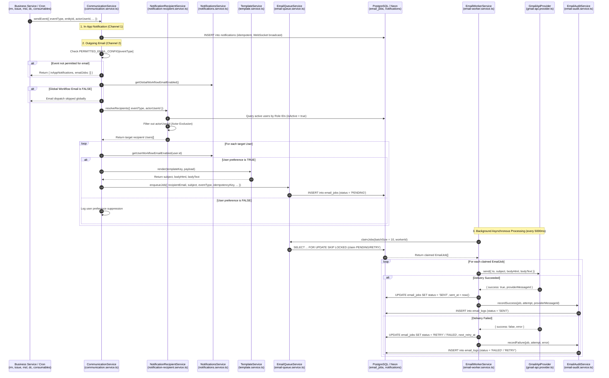

# Comprehensive Audit: Existing Email Notification System in RMRIT

> **Audit Type:** Read-Only Architectural & Implementation Audit  
> **Target System:** RMRIT (NestJS + TypeORM + PostgreSQL/Neon Backend, React + Vite Frontend)  
> **Output Document:** `docs/email-notification-audit.md`  
> **Safety Guarantee:** No source code, schema, or migrations have been modified.

---

## 1. Event Inventory

Below is the complete inventory of all email event codes implemented in the application.

### Proof of Completeness (Grep Commands Used)

To prove that every email trigger and queuing call has been located without omissions, the following repository-wide queries were executed:

1. **Grep for `enqueueJob` calls across backend:**
   ```powershell
   Select-String -Path "backend\src\**\*.ts" -Pattern "enqueueJob" | Select-Object Path, LineNumber, Line
   ```
   *Matches:*
   - `backend/src/notifications/communication.service.ts:766` (Central workflow email dispatch)
   - `backend/src/auth/auth.service.ts:360` (Password reset email dispatch)
   - `backend/src/email/email.controller.ts:168` (Admin diagnostic test email)
   - `backend/src/email/email-queue.service.ts:47` (Queue method definition)

2. **Grep for direct email provider sending:**
   ```powershell
   Select-String -Path "backend\src\**\*.ts" -Pattern "(sendMail|sendEmail|emailProvider\.send)" | Select-Object Path, LineNumber, Line
   ```
   *Matches:*
   - `backend/src/email/email-worker.service.ts:254` (Background worker delivery loop via `emailProvider.send`)
   - `backend/src/email/email.controller.ts:192` (Immediate synchronous delivery attempt in test-send)

3. **Grep for workflow notification event triggers:**
   ```powershell
   Select-String -Path "backend\src\**\*.ts" -Pattern "(workflowNotificationService|communicationService)" | Select-Object Path, LineNumber
   ```
   *Matches located in:* `rm.service.ts`, `material-issue.service.ts`, `additional-request.service.ts`, `production.service.ts`, `sc.service.ts`, `msl-alert.service.ts`, `delivery-challan.service.ts`, and `consumables.service.ts`.

---

### Master Email Event Inventory Table

| Event Code | Trigger Location (`file:line`) | Business Meaning | Current Recipient Roles | Recipient-Resolution Logic | Template Used |
| :--- | :--- | :--- | :--- | :--- | :--- |
| `RM_SUBMITTED` | `backend/src/rm/rm.service.ts:205`<br/>`backend/src/rm/rm.service.ts:989` | Designer submits a single RM requisition or batch submits all SC requisitions under a PO for Stores review. | `STORES` | `NotificationRecipientService.findActiveUsersByRoles(['STORES'])` in `communication.service.ts:733`. Actor (`createdById`) excluded via `u.id !== params.actorUserId`. | `RM_SUBMITTED`<br/>(`backend/src/email/template.service.ts:120`) |
| `MATERIAL_ISSUED` | `backend/src/material-issue/material-issue.service.ts:406` | Stores issues initial raw material batch for an SC to the production shop floor. | `PRODUCTION` | `NotificationRecipientService.findActiveUsersByRoles(['PRODUCTION'])` in `communication.service.ts:733`. Actor excluded. | `MATERIAL_ISSUED`<br/>(`backend/src/email/template.service.ts:140`) |
| `ADDITIONAL_REQUEST`<br/>*(alias: `ADDITIONAL_MATERIAL_REQUESTED`)* | `backend/src/additional-request/additional-request.service.ts:161` | Production requests supplementary raw materials due to defects, scrap, or quantity shortage. | `STORES` | `NotificationRecipientService.findActiveUsersByRoles(['STORES'])` in `communication.service.ts:733`. Actor (`requestedById`) excluded. | `ADDITIONAL_MATERIAL_REQUESTED`<br/>(`backend/src/email/template.service.ts:159`) |
| `MATERIAL_RETURNED` | `backend/src/production/production.service.ts:549` | Production returns leftover / scrap / excess material to the store dock for verification. | `STORES` | `NotificationRecipientService.findActiveUsersByRoles(['STORES'])` in `communication.service.ts:733`. Actor (`returnedById`) excluded. | `MATERIAL_RETURNED`<br/>(`backend/src/email/template.service.ts:280`) |
| `EXTRA_MATERIAL_ISSUED` | `backend/src/material-issue/material-issue.service.ts:398` | Stores fulfills and issues the approved extra raw material requested by Production. | `PRODUCTION` | `NotificationRecipientService.findActiveUsersByRoles(['PRODUCTION'])` in `communication.service.ts:733`. Actor excluded. | `EXTRA_MATERIAL_ISSUED`<br/>(`backend/src/email/template.service.ts:356`) |
| `MSL_LOW_STOCK` | `backend/src/inventory/msl-alert.service.ts:107` | Total stock of a product/raw material has dropped below its Minimum Stock Level (MSL), warning stores to start re-ordering. | `STORES` | `NotificationRecipientService.findActiveUsersByRoles(['STORES'])` in `communication.service.ts:733`. | `MSL_LOW_STOCK`<br/>(`backend/src/email/template.service.ts:196`) |
| `MSL_CRITICAL` | `backend/src/inventory/msl-alert.service.ts:107` | Stock is critically low (near zero), creating severe risk of production stoppage. | `STORES` | `NotificationRecipientService.findActiveUsersByRoles(['STORES'])` in `communication.service.ts:733`. | `MSL_OUT_OF_STOCK`<br/>(`backend/src/email/template.service.ts:218`) |
| `MSL_OUT_OF_STOCK` | `backend/src/inventory/msl-alert.service.ts:107` | Stock is completely exhausted (0 available inventory). | `STORES` | `NotificationRecipientService.findActiveUsersByRoles(['STORES'])` in `communication.service.ts:733`. | `MSL_OUT_OF_STOCK`<br/>(`backend/src/email/template.service.ts:218`) |
| `DC_APPROACHING_SLA` | `backend/src/delivery-challan/delivery-challan.service.ts:3828` | Delivery Challan sent to an outside vendor is due today or within 24 hours (Automated hourly check). | `STORES` | `NotificationRecipientService.findActiveUsersByRoles(['STORES'])` in `communication.service.ts:733`. | `DC_APPROACHING_SLA`<br/>(`backend/src/email/template.service.ts:411`) |
| `DC_OVERDUE` | `backend/src/delivery-challan/delivery-challan.service.ts:3811` | Delivery Challan has crossed its expected return date without full material return (Automated hourly check). | `STORES` | `NotificationRecipientService.findActiveUsersByRoles(['STORES'])` in `communication.service.ts:733`. | `DC_OVERDUE`<br/>(`backend/src/email/template.service.ts:429`) |
| `CONSUMABLE_RECEIPT_OVERDUE` | `backend/src/consumables/consumables.service.ts:1283` | Consumable PR/request created >24h ago has not been physically received into stores (Automated hourly check). | `STORES`, `ADMIN` | `NotificationRecipientService.findActiveUsersByRoles(['STORES', 'ADMIN'])` in `communication.service.ts:733`. | `CONSUMABLE_RECEIPT_OVERDUE`<br/>(`backend/src/email/template.service.ts:498`) |
| `CONSUMABLE_PARTIALLY_ISSUED_OVERDUE` | `backend/src/consumables/consumables.service.ts:1314` | Consumable item was partially issued, with open balance remaining to be issued to floor (Automated hourly check). | `STORES`, `ADMIN`, `PRODUCTION` | `NotificationRecipientService.findActiveUsersByRoles(['STORES', 'ADMIN', 'PRODUCTION'])` in `communication.service.ts:733`. | `CONSUMABLE_PARTIALLY_ISSUED_OVERDUE`<br/>(`backend/src/email/template.service.ts:556`) |
| `PASSWORD_RESET` | `backend/src/auth/auth.service.ts:360` | User requested a password reset link to recover their account. | Requesting User (`USER`) | Direct user lookup by email from `users` table (`auth.service.ts:322`). Direct single recipient (`recipientType: 'USER'`). | `PASSWORD_RESET`<br/>(`backend/src/email/template.service.ts:82`) |
| `TEST_EMAIL` | `backend/src/email/email.controller.ts:168` | Diagnostic test initiated by an Admin/Manager to verify Gmail API provider connectivity. | Explicit target email (`ADMIN`, `SM`, `GM` callers) | Direct email address from HTTP request body (`dto.recipientEmail`). | `SYSTEM_TEST_EMAIL`<br/>(`backend/src/email/email.controller.ts:174-183`) |

> **Audit Note on In-App-Only Events:**  
> The following events are processed by `CommunicationService` but **explicitly excluded** from `PERMITTED_EMAIL_CONFIG` (`communication.service.ts:48-79`):  
> - `SC_COMPLETED` (notifies `DESIGNER`, `SM`, `GM` in-app)  
> - `MATERIAL_RECEIVED` (notifies `STORES`, `SM`, `GM` in-app)  
> - `RETURN_VERIFIED` (notifies `PRODUCTION`, `SM`, `GM` in-app)  
> - `EXTRA_MATERIAL_APPROVED` (notifies `PRODUCTION`, `SM` in-app)  
> - `EXTRA_MATERIAL_REJECTED` (notifies `PRODUCTION`, `SM` in-app)  
> - `MSL_RESOLVED` (notifies `STORES` in-app)  
> - `DC_CREATED`, `DC_DISPATCHED`, `DC_PARTIALLY_RETURNED`, `DC_RETURNED`, `DC_CLOSED` (in-app notifications only)  
> These events intentionally generate in-app bell notifications but do not queue emails.

---

## 2. Dispatch Flow

### Step-by-Step Architecture

1. **Trigger:** A business transaction or cron job completes. The service invokes `WorkflowNotificationService` or calls `CommunicationService.sendEvent(...)` directly.
2. **Dual-Channel Orchestration:** `CommunicationService.sendEvent(...)` delegates to `orchestrateChannelDelivery(...)`:
   - **Channel 1 (In-App):** Creates records in `notifications` table and emits real-time WebSocket payloads via `NotificationsGateway`.
   - **Channel 2 (Email):** Evaluates email whitelist and recipients:
     - Checks `PERMITTED_EMAIL_CONFIG[eventType]`. If absent, email dispatch is suppressed.
     - Checks `NotificationsService.getGlobalWorkflowEmailEnabled()`. If false, email dispatch is skipped.
     - For consumable events, checks `NotificationsService.getConsumableEmailAlertsEnabled()`. If false, skipped.
     - Resolves users via `NotificationRecipientService.findActiveUsersByRoles(allowedRoles)`.
     - Excludes `actorUserId` so initiating users do not receive self-notifications.
     - For each candidate user, checks `NotificationsService.getUserWorkflowEmailEnabled(user.id)`.
     - If allowed, renders template via `TemplateService.render(...)`, generates an idempotency key via `EmailIdempotencyService`, and enqueues the job via `EmailQueueService.enqueueJob(...)`.
3. **Queue Enqueue:** `EmailQueueService.enqueueJob(...)` persists a row into `email_jobs` with status `PENDING`, priority, sanitized headers, and uniqueness check on `idempotency_key`.
4. **Worker Processing:** `EmailWorkerService` polls every 5000ms, claims jobs via `SELECT ... FOR UPDATE SKIP LOCKED` (`EmailQueueService.claimJobs(...)`), renders final MIME content via `TemplateResolver`, and calls `IEmailProvider.send(...)` (`GmailApiProvider` via Google OAuth2 API).
5. **Outcome & Audit:**
   - **Success:** Marks job as `SENT`, sets `sentAt` and `providerMessageId`, writes record to `email_logs`.
   - **Failure:** Calculates exponential backoff (`attempts * retryBackoffSeconds`), increments `attempts`, sets `status = RETRY` (or `FAILED` if max attempts reached), writes error to `email_logs`.

### Sequence Diagram



---

## 3. Existing Models Related to Email / Notification / User / Role

> **Note on Stack Architecture:**  
> The project backend is built on **NestJS + TypeORM + PostgreSQL (Neon)**. There is no `schema.prisma` file; all persistence models are defined using TypeORM entity classes and synced via TypeORM migrations (`backend/src/database/migrations/`).

Below are the exact TypeORM entity definitions from the codebase.

### 1. `EmailJob` Entity
**File:** `backend/src/email/entities/email-job.entity.ts#L1-L96`
```typescript
@Entity('email_jobs')
@Index('IDX_email_jobs_status_next_retry', ['status', 'nextRetryAt'])
@Index('IDX_email_jobs_queue_claim', ['status', 'nextRetryAt', 'priority', 'createdAt'])
export class EmailJob {
  @PrimaryGeneratedColumn('uuid')
  id!: string;

  @Index('IDX_email_jobs_recipient_user_id')
  @Column({ name: 'recipient_user_id', type: 'uuid', nullable: true })
  recipientUserId?: string | null;

  @ManyToOne(() => User, { onDelete: 'SET NULL', nullable: true })
  @JoinColumn({ name: 'recipient_user_id' })
  user?: User | null;

  @Column({ name: 'recipient_email', type: 'varchar', length: 255 })
  recipientEmail!: string;

  @Column({ name: 'recipient_name', type: 'varchar', length: 150, nullable: true })
  recipientName?: string | null;

  @Column({ name: 'event_type', type: 'varchar', length: 100 })
  eventType!: string;

  @Column({ name: 'template_key', type: 'varchar', length: 100 })
  templateKey!: string;

  @Column({ type: 'varchar', length: 255 })
  subject!: string;

  @Column({ name: 'body_text', type: 'text' })
  bodyText!: string;

  @Column({ name: 'body_html', type: 'text' })
  bodyHtml!: string;

  @Column({ type: 'varchar', length: 50, default: EmailJobStatus.PENDING })
  status!: EmailJobStatus;

  @Column({ type: 'integer', default: 100 })
  priority!: number;

  @Column({ type: 'integer', default: 0 })
  attempts!: number;

  @Column({ name: 'max_attempts', type: 'integer', default: 3 })
  maxAttempts!: number;

  @Column({ name: 'last_error', type: 'text', nullable: true })
  lastError?: string | null;

  @Column({ name: 'next_retry_at', type: 'timestamptz', nullable: true })
  nextRetryAt?: Date | null;

  @Column({ name: 'locked_at', type: 'timestamptz', nullable: true })
  lockedAt?: Date | null;

  @Column({ name: 'locked_by', type: 'varchar', length: 100, nullable: true })
  lockedBy?: string | null;

  @Column({ name: 'sent_at', type: 'timestamptz', nullable: true })
  sentAt?: Date | null;

  @Column({ type: 'varchar', length: 50, default: EmailProvider.GMAIL_API })
  provider!: EmailProvider;

  @Column({ name: 'provider_message_id', type: 'varchar', length: 255, nullable: true })
  providerMessageId?: string | null;

  @Index('UQ_email_jobs_idempotency_key', { unique: true })
  @Column({ name: 'idempotency_key', type: 'varchar', length: 255, unique: true })
  idempotencyKey!: string;

  @Column({ type: 'jsonb', nullable: true })
  payload?: Record<string, any> | null;

  @CreateDateColumn({ name: 'created_at' })
  createdAt!: Date;

  @UpdateDateColumn({ name: 'updated_at' })
  updatedAt!: Date;
}
```

### 2. `EmailLog` Entity
**File:** `backend/src/email/entities/email-log.entity.ts#L1-L73`
```typescript
@Entity('email_logs')
@Index('IDX_email_logs_job_id', ['jobId'])
@Index('IDX_email_logs_created_at', ['createdAt'])
@Index('IDX_email_logs_provider_message_id', ['providerMessageId'])
@Index('IDX_email_logs_status', ['status'])
export class EmailLog {
  @PrimaryGeneratedColumn('uuid')
  id!: string;

  @Column({ name: 'job_id', type: 'uuid', nullable: true })
  jobId?: string | null;

  @ManyToOne(() => EmailJob, { onDelete: 'RESTRICT', nullable: true })
  @JoinColumn({ name: 'job_id' })
  job?: EmailJob | null;

  @Column({ name: 'event_type', type: 'varchar', length: 100 })
  eventType!: string;

  @Column({ name: 'recipient_email', type: 'varchar', length: 255 })
  recipientEmail!: string;

  @Column({ name: 'recipient_user_id', type: 'uuid', nullable: true })
  recipientUserId?: string | null;

  @ManyToOne(() => User, { onDelete: 'SET NULL', nullable: true })
  @JoinColumn({ name: 'recipient_user_id' })
  user?: User | null;

  @Column({ name: 'recipient_name', type: 'varchar', length: 150, nullable: true })
  recipientName?: string | null;

  @Column({ type: 'varchar', length: 255 })
  subject!: string;

  @Column({ type: 'varchar', length: 50, default: EmailProvider.GMAIL_API })
  provider!: EmailProvider;

  @Column({ type: 'integer' })
  attempt!: number;

  @Column({ type: 'varchar', length: 50 })
  status!: EmailJobStatus;

  @Column({ name: 'provider_message_id', type: 'varchar', length: 255, nullable: true })
  providerMessageId?: string | null;

  @Column({ name: 'error_code', type: 'varchar', length: 100, nullable: true })
  errorCode?: string | null;

  @Column({ name: 'error_message', type: 'text', nullable: true })
  errorMessage?: string | null;

  @Column({ name: 'attempted_at', type: 'timestamptz', default: () => 'CURRENT_TIMESTAMP' })
  attemptedAt!: Date;

  @CreateDateColumn({ name: 'created_at' })
  createdAt!: Date;
}
```

### 3. `Notification` Entity (In-App Channel)
**File:** `backend/src/notifications/entities/notification.entity.ts#L1-L53`
```typescript
@Entity('notifications')
export class Notification {
  @PrimaryGeneratedColumn('uuid')
  id!: string;

  @Index()
  @Column({ name: 'user_id', type: 'uuid' })
  userId!: string;

  @ManyToOne(() => User, { onDelete: 'CASCADE' })
  @JoinColumn({ name: 'user_id' })
  user!: User;

  @Column({ type: 'varchar', length: 150 })
  title!: string;

  @Column({ type: 'text' })
  message!: string;

  @Column({ type: 'varchar', length: 50, default: NotificationType.INFO })
  type!: NotificationType | string;

  @Column({ type: 'varchar', name: 'target_entity', nullable: true, length: 50 })
  targetEntity?: string;

  @Column({ type: 'varchar', name: 'target_id', nullable: true, length: 100 })
  targetId?: string;

  @Index('UQ_notifications_idempotency_key', { unique: true })
  @Column({ type: 'varchar', name: 'idempotency_key', nullable: true, length: 255 })
  idempotencyKey?: string;

  @Index()
  @Column({ name: 'is_read', default: false })
  isRead!: boolean;

  @CreateDateColumn({ name: 'created_at' })
  createdAt!: Date;
}
```

### 4. `UserNotificationPreference` Entity
**File:** `backend/src/notifications/entities/user-notification-preference.entity.ts#L1-L34`
```typescript
@Entity('user_notification_preferences')
export class UserNotificationPreference {
  @PrimaryGeneratedColumn('uuid')
  id!: string;

  @Index({ unique: true })
  @Column({ name: 'user_id', type: 'uuid', unique: true })
  userId!: string;

  @OneToOne('User', { onDelete: 'CASCADE' })
  @JoinColumn({ name: 'user_id' })
  user?: User;

  @Column({ name: 'workflow_email_enabled', default: true })
  workflowEmailEnabled!: boolean;

  @CreateDateColumn({ name: 'created_at' })
  createdAt!: Date;

  @UpdateDateColumn({ name: 'updated_at' })
  updatedAt!: Date;
}
```

### 5. `SystemSetting` Entity
**File:** `backend/src/notifications/entities/system-setting.entity.ts#L1-L30`
```typescript
@Entity('system_settings')
export class SystemSetting {
  @PrimaryGeneratedColumn('uuid')
  id!: string;

  @Index({ unique: true })
  @Column({ unique: true, length: 100 })
  key!: string;

  @Column({ length: 255 })
  value!: string;

  @Column({ name: 'updated_by', nullable: true, length: 100 })
  updatedBy?: string;

  @CreateDateColumn({ name: 'created_at' })
  createdAt!: Date;

  @UpdateDateColumn({ name: 'updated_at' })
  updatedAt!: Date;
}
```

### 6. `User` Entity
**File:** `backend/src/users/entities/user.entity.ts#L1-L46`
```typescript
@Entity('users')
export class User {
  @PrimaryGeneratedColumn('uuid')
  id!: string;

  @Column({ length: 100 })
  name!: string;

  @Index({ unique: true })
  @Column({ unique: true, length: 150 })
  email!: string;

  @Column({ name: 'password_hash', length: 255 })
  passwordHash!: string;

  @Column({ name: 'role_id', type: 'uuid' })
  roleId!: string;

  @ManyToOne('Role', (role: Role) => role.users, { onDelete: 'RESTRICT' })
  @JoinColumn({ name: 'role_id' })
  role!: Role;

  @Column({ nullable: true, length: 100 })
  department?: string;

  @Column({ name: 'is_active', default: true })
  isActive!: boolean;

  @CreateDateColumn({ name: 'created_at' })
  createdAt!: Date;

  @UpdateDateColumn({ name: 'updated_at' })
  updatedAt!: Date;
}
```

### 7. `Role` Entity & `UserRole` Enum
**File:** `backend/src/roles/entities/role.entity.ts#L1-L30`
```typescript
@Entity('roles')
export class Role {
  @PrimaryGeneratedColumn('uuid')
  id!: string;

  @Column({ unique: true, length: 50 })
  name!: string;

  @Column({ nullable: true, length: 255 })
  description?: string;

  @OneToMany('User', (user: User) => user.role)
  users!: User[];

  @CreateDateColumn({ name: 'created_at' })
  createdAt!: Date;

  @UpdateDateColumn({ name: 'updated_at' })
  updatedAt!: Date;
}
```

**Enum Definition (`backend/src/auth/enums/role.enum.ts#L1-L8`):**
```typescript
export enum UserRole {
  ADMIN = 'ADMIN',
  DESIGNER = 'DESIGNER',
  STORES = 'STORES',
  PRODUCTION = 'PRODUCTION',
  SENIOR_MANAGER = 'SENIOR_MANAGER',
  GENERAL_MANAGER = 'GENERAL_MANAGER',
}
```

---

## 4. Existing Preferences & Settings

The codebase currently implements several configuration switches and controls:

### 1. Global Master Switch: `GLOBAL_WORKFLOW_EMAIL_ENABLED`
- **Storage:** Key in `system_settings` table (`backend/src/notifications/notifications.service.ts:12`).
- **Default:** `true` (seeded via Migration `Phase159NotificationPreferences1790400000000`).
- **Read & Write Methods:**
  - `NotificationsService.getGlobalWorkflowEmailEnabled()` (`notifications.service.ts:63-75`)
  - `NotificationsService.setGlobalWorkflowEmailEnabled(enabled, updatedBy)` (`notifications.service.ts:77-98`)
- **Evaluation Point:** `CommunicationService.orchestrateChannelDelivery` (`communication.service.ts:716-720`):
  ```typescript
  const globalEmailEnabled = await this.notificationsService.getGlobalWorkflowEmailEnabled();
  if (!globalEmailEnabled) {
    this.logger.log(`Global workflow email is disabled. Skipping email jobs for event "${params.eventType}".`);
    return { inAppNotifications, emailJobs };
  }
  ```

### 2. Consumable Alerts Granular Switches
- **Keys in `system_settings` (`notifications.service.ts:13-15`):**
  - `CONSUMABLE_EMAIL_ALERTS_ENABLED`: Master toggle for consumable emails (`notifications.service.ts:100-128`).
  - `CONSUMABLE_RECEIPT_OVERDUE_ALERTS_ENABLED`: Enables >24h receipt alerts (`notifications.service.ts:161-176`).
  - `CONSUMABLE_PARTIALLY_ISSUED_ALERTS_ENABLED`: Enables partially issued balance alerts (`notifications.service.ts:177-192`).
- **Evaluation Points:**
  - In `communication.service.ts:722-728`
  - In `consumables.service.ts:1274` and `consumables.service.ts:1310`

### 3. User-Level Toggle: `workflowEmailEnabled`
- **Storage:** Column in `user_notification_preferences` table (`user-notification-preference.entity.ts:26`).
- **Default:** `true`.
- **Read & Write Methods:**
  - `NotificationsService.getUserWorkflowEmailEnabled(userId)` (`notifications.service.ts:196-211`)
  - `NotificationsService.setUserWorkflowEmailEnabled(userId, enabled)` (`notifications.service.ts:213-229`)
- **Evaluation Point:** `communication.service.ts:753`:
  ```typescript
  const isUserAllowed = await this.notificationsService.getUserWorkflowEmailEnabled(user.id);
  if (isUserAllowed) {
    // enqueue email job
  }
  ```

### 4. Actor-Exclusion Implementation
- **Purpose:** Prevent users from receiving email alerts for actions they personally initiated.
- **Implementation Location 1 (`communication.service.ts:735-737`):**
  ```typescript
  emailRecipients = roleUsers.filter(
    (u) => u && u.isActive && (!params.actorUserId || u.id !== params.actorUserId),
  );
  ```
- **Implementation Location 2 (`notification-recipient.service.ts:208-212`):**
  ```typescript
  if (actorUserId && recipientMap.has(actorUserId)) {
    this.logger.log(`Excluding actor "${actorUserId}" from notification recipient list for event "${eventType}"`);
    recipientMap.delete(actorUserId);
  }
  ```

### 5. Security Emails (Password Reset)
- **Method:** `AuthService.forgotPassword(email)` (`backend/src/auth/auth.service.ts:312-380`).
- **Bypass Rule:** Security emails **completely bypass** workflow email toggles and user notification preference checks (`notifications.service.ts:243-255`):
  ```typescript
  async shouldSendEmail(category: 'SECURITY' | 'WORKFLOW' | string, userId?: string): Promise<boolean> {
    if (category.toUpperCase() === 'SECURITY') {
      return true;
    }
    return this.isWorkflowEmailAllowed(userId);
  }
  ```
- **Execution:** Calls `EmailQueueService.enqueueJob` directly (`auth.service.ts:360`) with `eventType: 'PASSWORD_RESET'` and a 60-minute single-use token URL.

### 6. Diagnostic Test-Email Endpoint
- **Endpoint:** `POST /api/email/test-send` (`backend/src/email/email.controller.ts:155-220`).
- **RBAC Guards:** `@UseGuards(JwtAuthGuard, RolesGuard)` with `@Roles(UserRole.ADMIN, UserRole.GENERAL_MANAGER, UserRole.SENIOR_MANAGER)`.
- **Dual Behavior:** Enqueues a job into `email_jobs` (`email.controller.ts:168`), then immediately calls `emailProvider.send(...)` (`email.controller.ts:192`) to test connectivity synchronously and records an attempt in `email_logs`.

---

## 5. Duplicate-Prevention Logic Currently in Place

The application implements three layers of duplicate prevention:

### Layer 1: Deterministic Idempotency Key Generation
- **Service:** `EmailIdempotencyService` (`backend/src/email/email-idempotency.service.ts#L1-L60`).
- **Format:** `<EVENT_TYPE>:<ENTITY_ID>:<RECIPIENT_USER_ID>` (or `<EVENT_TYPE>:<ENTITY_ID>` if user ID is omitted).
- **Truncation:** Safely truncated to 255 characters to match column length.

### Layer 2: Pre-Insert Lookup & Database Unique Constraint
- **Database Constraint:** `UQ_email_jobs_idempotency_key` unique index on `email_jobs.idempotency_key` (`Migration 1790100000000`).
- **Code Enforcement (`EmailQueueService.enqueueJob`, `email-queue.service.ts:94-101` & `148-161`):**
  ```typescript
  if (idempotencyKey) {
    const existing = await this.emailJobRepository.findOne({
      where: { idempotencyKey },
    });
    if (existing) {
      return existing; // returns existing job without creating a duplicate
    }
  }
  ```
  If a race condition occurs during concurrent insertions, PostgreSQL error `23505` (`duplicate key value violates unique constraint`) is caught, and the existing record is retrieved and returned safely (`email-queue.service.ts:149-160`).

### Layer 3: Daily Cadence Partitioning for Automated Cron Sweeps
- Scheduled checks (Delivery Challan SLA sweeps and Consumable SLA sweeps) run every hour.
- To prevent spamming recipients 24 times a day for the same overdue item, the entity ID includes today's date formatted as `YYYY-MM-DD`:
  - **Delivery Challan Overdue (`delivery-challan.service.ts:3814`):**
    `entityId: ${dc.id}_overdue_${todayStr}`
  - **Delivery Challan Approaching SLA (`delivery-challan.service.ts:3831`):**
    `entityId: ${dc.id}_reached_${todayStr}`
  - **Consumable Overdue Receipt (`consumables.service.ts:1286`):**
    `entityId: ${item.id}_${todayStr}`
  - **Consumable Partially Issued (`consumables.service.ts:1317`):**
    `entityId: ${item.id}_part_${todayStr}`

---

## 6. Gaps & Architectural Risks

1. **Hardcoded Role Whitelists in Code:**  
   `PERMITTED_EMAIL_CONFIG` (`communication.service.ts:48-79`) and `PERMITTED_EMAIL_EVENT_TYPES` (`email-queue.service.ts:11-26`) are hardcoded in static JavaScript dictionaries. Adding a new role recipient or changing permissions currently requires code editing and redeployment.
2. **Direct Queue Enqueue Bypasses (`auth.service.ts` & `email.controller.ts`):**  
   `PASSWORD_RESET` (`auth.service.ts:360`) and `TEST_EMAIL` (`email.controller.ts:168`) call `EmailQueueService.enqueueJob` directly rather than routing through `CommunicationService`.
   - *Risk:* If a centralized preference service is placed *only* inside `CommunicationService`, it will not see `PASSWORD_RESET` or `TEST_EMAIL` (which is desirable for security and diagnostics, but must be explicitly documented).
3. **Double Send in `test-send` Endpoint:**  
   `EmailController.sendTestEmail` (`email.controller.ts:168-208`) enqueues a job into `email_jobs` with status `PENDING`, and then immediately calls `emailProvider.send(...)` synchronously.
   - *Risk:* If the worker polls before the synchronous call finishes and updates the job to `SENT`, there is a minor race window where the email could be sent twice.
4. **Coarse-Grained User Preferences:**  
   `user_notification_preferences` only has a single blanket boolean column: `workflow_email_enabled`. A user cannot turn off low-stock alerts while keeping material-issued alerts on.
5. **No Role-Level Config Table:**  
   There is currently no database table for role-based event toggles (Level 1). All role-event mappings exist only in static code.

---

## 7. Proposed Default Role × Event Matrix (Current Behavior Reproduction)

To ensure that deploying the two-level configurable Email Notification Management module introduces **zero breaking changes or behavior drift**, the database must be seeded with the following exact default values:

| # | Event Code | DESIGNER | STORES | PRODUCTION | SENIOR_MANAGER (SM) | GENERAL_MANAGER (GM) | ADMIN |
|---|---|:---:|:---:|:---:|:---:|:---:|:---:|
| 1 | `RM_SUBMITTED` | ❌ OFF | ✅ **ON** | ❌ OFF | ❌ OFF | ❌ OFF | ❌ OFF |
| 2 | `MATERIAL_ISSUED` | ❌ OFF | ❌ OFF | ✅ **ON** | ❌ OFF | ❌ OFF | ❌ OFF |
| 3 | `ADDITIONAL_REQUEST` | ❌ OFF | ✅ **ON** | ❌ OFF | ❌ OFF | ❌ OFF | ❌ OFF |
| 4 | `MATERIAL_RETURNED` | ❌ OFF | ✅ **ON** | ❌ OFF | ❌ OFF | ❌ OFF | ❌ OFF |
| 5 | `EXTRA_MATERIAL_ISSUED` | ❌ OFF | ❌ OFF | ✅ **ON** | ❌ OFF | ❌ OFF | ❌ OFF |
| 6 | `MSL_LOW_STOCK` | ❌ OFF | ✅ **ON** | ❌ OFF | ❌ OFF | ❌ OFF | ❌ OFF |
| 7 | `MSL_CRITICAL` | ❌ OFF | ✅ **ON** | ❌ OFF | ❌ OFF | ❌ OFF | ❌ OFF |
| 8 | `MSL_OUT_OF_STOCK` | ❌ OFF | ✅ **ON** | ❌ OFF | ❌ OFF | ❌ OFF | ❌ OFF |
| 9 | `DC_APPROACHING_SLA` | ❌ OFF | ✅ **ON** | ❌ OFF | ❌ OFF | ❌ OFF | ❌ OFF |
| 10 | `DC_OVERDUE` | ❌ OFF | ✅ **ON** | ❌ OFF | ❌ OFF | ❌ OFF | ❌ OFF |
| 11 | `CONSUMABLE_RECEIPT_OVERDUE` | ❌ OFF | ✅ **ON** | ❌ OFF | ❌ OFF | ❌ OFF | ✅ **ON** |
| 12 | `CONSUMABLE_PARTIALLY_ISSUED_OVERDUE` | ❌ OFF | ✅ **ON** | ✅ **ON** | ❌ OFF | ❌ OFF | ✅ **ON** |
| 13 | `PASSWORD_RESET` | *System Security* | *System Security* | *System Security* | *System Security* | *System Security* | *System Security* |
| 14 | `TEST_EMAIL` | *N/A (Admin Tool)* | *N/A (Admin Tool)* | *N/A (Admin Tool)* | *N/A (Admin Tool)* | *N/A (Admin Tool)* | *N/A (Admin Tool)* |

*Note:* `PASSWORD_RESET` is mandatory security infrastructure and is not toggleable. `TEST_EMAIL` is an on-demand administrative diagnostic test.

---

## 8. Proposed Insertion Point(s) for `NotificationPreferenceService.shouldSend(event, user)`

The ideal design is a single centralized evaluation method:
```typescript
async shouldSend(eventType: string, user: User): Promise<boolean>
```

### Hierarchy of Evaluation in `shouldSend`
1. **Security Exemption:** If `eventType === 'PASSWORD_RESET'`, return `true`.
2. **Global Switch:** Check `NotificationsService.getGlobalWorkflowEmailEnabled()`. If `false`, return `false`.
3. **Consumable Master Check:** If event is a consumable alert and consumable alerts are disabled globally, return `false`.
4. **Level 2 (User Override):** Query user override for `(userId, eventType)`:
   - If `ON` -> return `true`.
   - If `OFF` -> return `false`.
   - If `INHERIT` (or no record) -> proceed to Level 1.
5. **Level 1 (Role-Based Config):** Query role config for `(user.role.name, eventType)`:
   - If `true` -> return `true`.
   - If `false` -> return `false`.
   - Fallback default -> return `false`.

### Recommended Insertion Location
**Primary Insertion Point:** `backend/src/notifications/communication.service.ts` inside `orchestrateChannelDelivery(...)` at lines 730–755.

```typescript
// Replace lines 731-755 with:
const candidateUsers = await this.userRepository.find({
  where: { isActive: true },
  relations: { role: true },
});

const eligibleUsers = candidateUsers.filter(
  (u) => !params.actorUserId || u.id !== params.actorUserId,
);

for (const user of eligibleUsers) {
  const allowed = await this.notificationPreferenceService.shouldSend(params.eventType, user);
  if (allowed) {
    // Render template and enqueue job
    const rendered = this.templateService.render(params.templateKey, {
      recipientName: user.name,
      ...params.payload,
    });
    await this.emailQueueService.enqueueJob({
      recipientEmail: user.email,
      recipientUserId: user.id,
      recipientName: user.name,
      eventType: params.eventType,
      templateKey: rendered.templateKey,
      subject: rendered.subject,
      bodyText: rendered.text,
      bodyHtml: rendered.html,
      payload: params.payload,
      idempotencyKey: this.emailIdempotencyService.generateKey({
        eventType: params.eventType,
        entityId: params.targetId,
        recipientUserId: user.id,
      }),
    });
  }
}
```

**Secondary Defensive Insertion Point:** `backend/src/email/email-queue.service.ts` in `enqueueJob(...)` (lines 48–58).  
If `jobData.recipientUserId` is provided and `jobData.eventType !== 'PASSWORD_RESET'`, `enqueueJob` can perform a secondary sanity check to ensure no unauthorized email is ever persisted to `email_jobs`.

---

## 9. Existing Admin / Settings Frontend Integration

In the frontend repository (`frontend/src/`):

### Existing Routes & RBAC Architecture
- **Route Definitions:** `frontend/src/routeConfig.tsx#L221-L235`
  - `/settings` (System Configuration) -> `roles: ['ADMIN', 'GENERAL_MANAGER']`
  - `/communication` & `/settings/communication` (Email Communication Workspace) -> `roles: ['ADMIN', 'GENERAL_MANAGER', 'SENIOR_MANAGER']`
  - `/profile` (User Profile) -> accessible by all 6 roles
- **Existing Email Component:** `frontend/src/pages/EmailCommunicationWorkspace.tsx`
  - Currently contains Email Queue Observability, Delivery Logs, Failed Job Retry, and Test Email Modal.
- **Existing Settings Component:** `frontend/src/pages/SystemConfigurationWorkspace.tsx`
  - Currently manages system theme, density, regional settings, thresholds, and high-level alert switches.
- **Existing User Preferences Component:** `frontend/src/pages/NotificationSettingsPage.tsx`
  - Created in Phase 15.9 to toggle personal and global workflow email.

### Recommended UI Placement for the 2 Levels
1. **Level 1 (Role-Based Event Matrix):**
   - Add a tab named **"Notification Rules"** inside `frontend/src/pages/EmailCommunicationWorkspace.tsx` (or a dedicated route `/settings/email-rules` under `SYSTEM SETTINGS` in `routeConfig.tsx`).
   - Accessible to: `ADMIN` and `GENERAL_MANAGER`.
   - Displays an interactive grid of **Events × 6 Roles** with toggles, matching Section 7.
2. **Level 2 (Per-User Event Overrides):**
   - **Admin Management View:** Add an "Email Preferences" tab in `UserMasterWorkspace.tsx` (`/masters/users`) allowing Admins to view/set any user's override (`INHERIT` / `ON` / `OFF`).
   - **Self-Service User View:** Add an "Email Notifications" section in `ProfileWorkspace.tsx` (`/profile`) allowing any logged-in user to override notifications for events applicable to their department.

---

## 10. Open Architectural Questions

1. **Storage Design for Level 1 (Role Config) & Level 2 (User Overrides):**
   - *Option A (Relational Tables):* Two new tables:
     - `role_email_settings (id, role_id, event_type, enabled)`
     - `user_email_overrides (id, user_id, event_type, state: 'INHERIT' | 'ON' | 'OFF')`
   - *Option B (JSONB Document):* A JSONB column `email_rules` on `roles` and `email_overrides` on `user_notification_preferences`.  
   *Which schema pattern is preferred for this phase?*
2. **Scope of User Overrides (Level 2):**
   - Can a user override *any* event, or only events where their role has been granted access at Level 1? (e.g. Can a Designer turn ON an alert that is disabled for the DESIGNER role?)
3. **Admin Hierarchy & Governance:**
   - Should `GENERAL_MANAGER` be permitted to edit the Role Matrix, or should it be strictly restricted to `ADMIN`?
4. **In-App Notification Coupling:**
   - Should Level 1 and Level 2 settings apply *only* to outgoing emails, or should they also control in-app bell notifications? (Currently, in-app notifications are authoritative and stored regardless of email preferences).
5. **Handling of Aliased Event Codes:**
   - Both `ADDITIONAL_REQUEST` and `ADDITIONAL_MATERIAL_REQUESTED` exist in the codebase for the same business action. Should these be unified into a single canonical event key in the UI?
