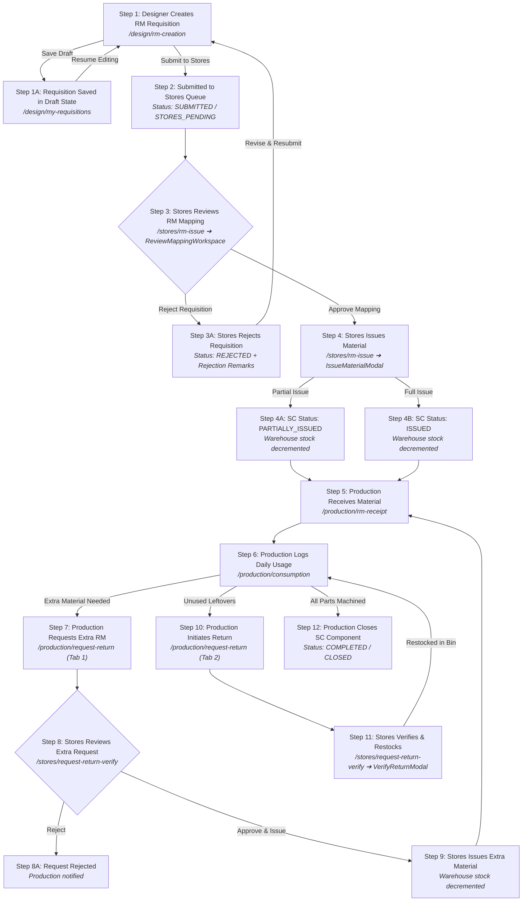
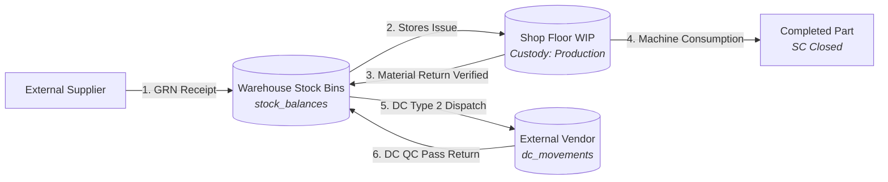

# Business Flow Analysis: V-SMART (RM) Application

> **Document Type:** System Business Process & Integration Mapping  
> **Application:** V-SMART RM (Raw Material, Inventory & Subcontracting Management System)  
> **Workspace Context:** `rm-workflow-system`  
> **Target Deliverable:** `/docs/flow/rm-flow.md` & `/docs/flow/v-smart-rm-flow.md`  
> **Source Evidence Base:** Read-only audit across `backend/src/` and `frontend/src/`  
> **Integrations Under Design:** Bidirectional ecosystem synchronization with sibling applications **MERC** (Merchandising / Customer POs / Special Indents) and **ECR** (Engineering Change Request / Quality Rework & Rejection).

---

## 1. Executive Purpose & Daily User Roles

### One-Paragraph Purpose of the App
**V-SMART (RM)** is the operational backbone for raw material planning, warehouse inventory management, shop-floor material issuance, and subcontracted vendor processing within the manufacturing plant. It enables Design Engineers to transform customer purchase orders and product blueprints into itemized Raw Material (RM) bills of materials; empowers the Stores Department to verify inventory stock, allocate materials from warehouse bins, and track vendor deliveries via formal Delivery Challans (DC); provides Production Supervisors with real-time tools to receive issued materials on the shop floor, record daily machine consumption, request supplemental hardware, or return unused remnants; and gives Plant Leadership end-to-end traceability from customer purchase order to finished component without allowing manual stock discrepancies.

### Who Uses It Daily
1. **Design Engineers (`DESIGNER`):** Create component breakdowns (Size Cards / SCs), define required raw materials (grades, specifications, dimensions), upload technical engineering drawings, and submit RM requisitions to Stores.
2. **Stores Officers (`STORES`):** Manage physical stock across warehouse racks and bins, review and map requested materials against catalog inventory, issue raw materials to the shop floor, generate Goods Receipt Notes (GRN) from external suppliers, dispatch and inward subcontracting Delivery Challans (DCs), and verify physical material returns.
3. **Production Supervisors (`PRODUCTION`):** Inspect and confirm physical receipt of issued raw materials on the shop floor, record daily machine consumption against active jobs, raise extra material requests for re-machining or engineering scrap, initiate returns for leftover material, and request workshop consumables.
4. **Quality Control & Subcontracting Officers (`STORES` / `ADMIN`):** Inspect goods returned from external processing vendors (heat treatment, plating, machining), execute pass/reject splits, log defect descriptions, and initiate rework re-dispatches.
5. **Plant Leadership (`SENIOR_MANAGER`, `GENERAL_MANAGER`, `ADMIN`):** Monitor live Minimum Stock Level (MSL) breach alerts, analyze vendor delivery SLA compliance, audit system-wide inventory movements, and export executive multi-tab Excel workbooks for governance.

---

## 2. Step-by-Step Business Flow

The following sequence reflects the complete, real-world lifecycle of a manufacturing order in V-SMART (RM), including standard execution, exceptions, branches, and returns.

---

### Step 1: Designer Drafts RM Requisition & Component BOM
- **Actor Role:** `DESIGNER` (or `ADMIN`) [`backend/src/rm/rm.controller.ts:40`](file:///c:/Users/Admin/OneDrive/Desktop/rm-workflow-system/backend/src/rm/rm.controller.ts#L40)
- **Screen / Route:** `/design/rm-creation` ([`frontend/src/pages/RmCreationWorkspace.tsx:60`](file:///c:/Users/Admin/OneDrive/Desktop/rm-workflow-system/frontend/src/pages/RmCreationWorkspace.tsx#L60))
- **What They Do:** The Designer enters the top-level order reference, creates one or more Size Cards (SCs) representing the parts being manufactured, selects the raw materials needed from the product catalog, and inputs dimensional specifications and quantities.
- **What Data They Enter / Select:**
  - **Request Mode:** Chooses between `1. According to Purchase Order (PO)` (`BY_PO`), `2. According to Size Card (SC)` (`BY_SC`), or `3. Separately (Standalone Request)` (`STANDALONE`) ([`RmCreationWorkspace.tsx:580-618`](file:///c:/Users/Admin/OneDrive/Desktop/rm-workflow-system/frontend/src/pages/RmCreationWorkspace.tsx#L580-L618)).
  - **PO Number / Reference:** Free-text string (e.g., `PO-2026-901` or auto-generated `REQ-SHOP-261031-102`) ([`RmCreationWorkspace.tsx:706-712`](file:///c:/Users/Admin/OneDrive/Desktop/rm-workflow-system/frontend/src/pages/RmCreationWorkspace.tsx#L706-L712)).
  - **SC Card Data:**
    - `scNumber` (Free-text string, e.g., `SC-101`)
    - `productName` (Free-text string of manufactured part, e.g., `Flange Bushing`)
    - `targetQuantity` (Numeric integer, min 1)
  - **RM Item Grid (per SC Card):**
    - `productId` (Selected from master catalog dropdown: displays code, name, family, UOM) ([`RmCreationWorkspace.tsx:852-859`](file:///c:/Users/Admin/OneDrive/Desktop/rm-workflow-system/frontend/src/pages/RmCreationWorkspace.tsx#L852-L859))
    - `partName` (Free-text string, auto-defaults to product name, editable) ([`RmCreationWorkspace.tsx:861-868`](file:///c:/Users/Admin/OneDrive/Desktop/rm-workflow-system/frontend/src/pages/RmCreationWorkspace.tsx#L861-L868))
    - `partNumber` (Auto-generated sequential string, e.g., `PRD 001`, editable) ([`RmCreationWorkspace.tsx:870-878`](file:///c:/Users/Admin/OneDrive/Desktop/rm-workflow-system/frontend/src/pages/RmCreationWorkspace.tsx#L870-L878))
    - `spec` (Free-text string for material grade/dimensions, e.g., `EN8 / DIA 25mm`) ([`RmCreationWorkspace.tsx:880-887`](file:///c:/Users/Admin/OneDrive/Desktop/rm-workflow-system/frontend/src/pages/RmCreationWorkspace.tsx#L880-L887))
    - `quantity` (Decimal quantity required, step 0.001) ([`RmCreationWorkspace.tsx:895-902`](file:///c:/Users/Admin/OneDrive/Desktop/rm-workflow-system/frontend/src/pages/RmCreationWorkspace.tsx#L895-L902))
- **System Action Follows:**
  - Client queries live inventory balance for the selected `productId` via `GET /api/inventory/balances?productId=...` and displays warehouse availability pill (emerald if $> 0$, amber if 0) ([`RmCreationWorkspace.tsx:903-910`](file:///c:/Users/Admin/OneDrive/Desktop/rm-workflow-system/frontend/src/pages/RmCreationWorkspace.tsx#L903-L910)).
- **Next Actor:** `DESIGNER` (can either click *Save Draft* or *Submit to Stores*).

#### Branch 1A: Save Draft
- **Action:** Designer clicks **Save Draft** ([`RmCreationWorkspace.tsx:534-540`](file:///c:/Users/Admin/OneDrive/Desktop/rm-workflow-system/frontend/src/pages/RmCreationWorkspace.tsx#L534-L540)).
- **System Action:** Calls `POST /api/rm/draft` (or `PUT /api/rm/po/:poId/draft`). Backend executes a database transaction saving `purchase_orders` (auto-creating default customer `BDL-IND` if customer omitted), `sales_order_components` in `DRAFT` status, `rm_requests` in `DRAFT` status, and `rm_items` ([`backend/src/rm/rm.service.ts:415-460`](file:///c:/Users/Admin/OneDrive/Desktop/rm-workflow-system/backend/src/rm/rm.service.ts#L415-L460)). Stock is **NOT** affected.
- **Next Screen:** Visible in `/design/my-requisitions` under the *Draft* tab ([`frontend/src/pages/RmRequisitionWorkspace.tsx:124-126`](file:///c:/Users/Admin/OneDrive/Desktop/rm-workflow-system/frontend/src/pages/RmRequisitionWorkspace.tsx#L124-L126)).

#### Branch 1B: Attach Supporting Engineering Documents
- **Action:** Designer attaches CAD drawings or customer specifications ([`frontend/src/features/rm/components/RmDocumentsSection.tsx:39-66`](file:///c:/Users/Admin/OneDrive/Desktop/rm-workflow-system/frontend/src/features/rm/components/RmDocumentsSection.tsx#L39-L66)).
- **Data Entered:** File upload (PDF/PNG/JPG, max 5MB) + Document Classification dropdown (`CUSTOMER_DRAWING`, `DESIGN_DRAWING`, `RM_SPECIFICATION`, `TECHNICAL_DRAWING`, `DESIGNER_REFERENCE`).
- **System Action:** Calls `POST /api/files/upload` to store file in Supabase Object Storage, then `POST /api/rm/:id/documents` to link `rm_document_attachments`.

---

### Step 2: Designer Submits Requisition to Stores
- **Actor Role:** `DESIGNER`
- **Screen / Route:** `/design/rm-creation` (Confirmation Modal) ([`RmCreationWorkspace.tsx:636-665`](file:///c:/Users/Admin/OneDrive/Desktop/rm-workflow-system/frontend/src/pages/RmCreationWorkspace.tsx#L636-L665))
- **What They Do:** Designer clicks **Submit to Stores**, confirms the dialogue modal specifying the PO reference and count of SC components.
- **System Action Follows:**
  - Calls `POST /api/rm/po/:poId/submit` ([`RmCreationWorkspace.tsx:500`](file:///c:/Users/Admin/OneDrive/Desktop/rm-workflow-system/frontend/src/pages/RmCreationWorkspace.tsx#L500)).
  - Backend transitions `sales_order_components.status` from `DRAFT` to `STORES_PENDING` (or `SUBMITTED`).
  - Backend transitions `rm_requests.status` from `DRAFT` to `SUBMITTED` ([`backend/src/rm/rm.service.ts:635-645`](file:///c:/Users/Admin/OneDrive/Desktop/rm-workflow-system/backend/src/rm/rm.service.ts#L635-L645)).
  - Lock Enforced: Requisition is locked from further editing by Designers (`isLockedBySubmission = true`), with an amber banner displayed unless edited by an Admin override ([`RmCreationWorkspace.tsx:559-576`](file:///c:/Users/Admin/OneDrive/Desktop/rm-workflow-system/frontend/src/pages/RmCreationWorkspace.tsx#L559-L576)).
  - **Notification Dispatched:** Event `RM_SUBMITTED` fired via `CommunicationService.sendEvent` ([`backend/src/notifications/communication.service.ts:246-258`](file:///c:/Users/Admin/OneDrive/Desktop/rm-workflow-system/backend/src/notifications/communication.service.ts#L246-L258)).
    - *In-App & WebSocket:* Stores officers receive: `"RM Request <PO/SC> was submitted."`
    - *Email (if enabled):* Template `RM_SUBMITTED` queued to users with role `STORES`.
  - Stock is **NOT** changed.
- **Next Actor:** `STORES`.

---

### Step 3: Stores Reviews RM Mapping & Stock Feasibility
- **Actor Role:** `STORES` (or `ADMIN`)
- **Screen / Route:** `/stores/rm-issue` ➔ Click *Review Mapping* ➔ Opens `ReviewMappingWorkspace` ([`frontend/src/pages/StoresRmIssueWorkspace.tsx:132-150`](file:///c:/Users/Admin/OneDrive/Desktop/rm-workflow-system/frontend/src/pages/StoresRmIssueWorkspace.tsx#L132-L150), [`frontend/src/pages/ReviewMappingWorkspace.tsx:47-56`](file:///c:/Users/Admin/OneDrive/Desktop/rm-workflow-system/frontend/src/pages/ReviewMappingWorkspace.tsx#L47-L56)).
- **What They Do:** Stores Officer inspects the raw materials requested by the Designer, confirms that each requested item maps to an active product in the warehouse catalog, and verifies physical warehouse bin balances.
- **What Data They Enter / Select:**
  - Review Item Mappings: If Designer specified an unmapped or generic material, Stores selects `mappedProductId` from catalog dropdown ([`ReviewMappingWorkspace.tsx:133-160`](file:///c:/Users/Admin/OneDrive/Desktop/rm-workflow-system/frontend/src/pages/ReviewMappingWorkspace.tsx#L133-L160)).
  - Stores Remarks (Optional free-text).
- **System Action Follows:**
  - Client dynamically loads all bin balances for the mapped products (`inventoryService.getBalancesByProduct`) showing warehouse rack/bin distribution and total available stock ([`ReviewMappingWorkspace.tsx:96-102`](file:///c:/Users/Admin/OneDrive/Desktop/rm-workflow-system/frontend/src/pages/ReviewMappingWorkspace.tsx#L96-L102)).
- **Next Action / Branches:** Stores Officer either **Approves** mapping or **Rejects** requisition.

#### Branch 3A: Stores Rejects Requisition Back to Designer
- **Action:** Stores clicks **Reject Requisition**, opens modal, inputs mandatory rejection reason (e.g., *"Specified EN8 DIA 25mm is out of stock; use DIA 28mm or wait for supplier delivery"*), and confirms ([`ReviewMappingWorkspace.tsx:197-215`](file:///c:/Users/Admin/OneDrive/Desktop/rm-workflow-system/frontend/src/pages/ReviewMappingWorkspace.tsx#L197-L215)).
- **System Action:**
  - Calls `POST /api/rm/:id/reject` with `{ reason: rejectReason }` ([`backend/src/rm/rm.service.ts:740-770`](file:///c:/Users/Admin/OneDrive/Desktop/rm-workflow-system/backend/src/rm/rm.service.ts#L740-L770)).
  - `rm_requests.status` transitions to `REJECTED`.
  - `sales_order_components.status` transitions to `REJECTED`, and rejection reason is appended to `sales_order_components.remarks`.
  - Requisition is removed from Stores active issue queue.
  - Notification sent to original Designer.
- **Next Actor & Screen:** `DESIGNER` opens `/design/my-requisitions` (red *Rejected by Stores* badge), clicks *Edit*, which reopens `/design/rm-creation?poId=...` with a red banner displaying the rejection reason ([`RmCreationWorkspace.tsx:621-633`](file:///c:/Users/Admin/OneDrive/Desktop/rm-workflow-system/frontend/src/pages/RmCreationWorkspace.tsx#L621-L633)). Designer modifies the specification and re-submits.

#### Branch 3B: Stores Approves Mapping
- **Action:** Stores clicks **Approve Mapping** ([`ReviewMappingWorkspace.tsx:162-195`](file:///c:/Users/Admin/OneDrive/Desktop/rm-workflow-system/frontend/src/pages/ReviewMappingWorkspace.tsx#L162-L195)).
- **System Action:**
  - Calls `POST /api/rm/:id/review` with item mappings array.
  - `rm_requests.status` transitions to `REVIEWED`.
  - Requisition is marked ready for physical issue.
- **Next Step:** Stores proceeds to issue material.

---

### Step 4: Stores Issues Raw Materials to Production
- **Actor Role:** `STORES`
- **Screen / Route:** `/stores/rm-issue` ➔ Click *Issue Material* ➔ Opens `IssueMaterialModal` ([`frontend/src/components/modals/IssueMaterialModal.tsx:31`](file:///c:/Users/Admin/OneDrive/Desktop/rm-workflow-system/frontend/src/components/modals/IssueMaterialModal.tsx#L31)).
- **What They Do:** Stores Officer fulfills the material request by selecting the source warehouse bin and entering the quantity physically handed over to the shop floor.
- **What Data They Enter / Select:**
  - `issueQty`: Decimal quantity to issue for each item (auto-suggested based on available stock vs remaining required quantity) ([`IssueMaterialModal.tsx:113-115`](file:///c:/Users/Admin/OneDrive/Desktop/rm-workflow-system/frontend/src/components/modals/IssueMaterialModal.tsx#L113-L115)).
  - `selectedBinId`: Dropdown of warehouse bins holding active stock of this product (displays bin code, rack code, and available stock) ([`IssueMaterialModal.tsx:102-111`](file:///c:/Users/Admin/OneDrive/Desktop/rm-workflow-system/frontend/src/components/modals/IssueMaterialModal.tsx#L102-L111)). If left unselected, backend auto-allocates from the first bin with sufficient stock.
  - `remarks`: Optional free-text notes (e.g., *"Issued batch HEAT-882"*).
- **System Action Follows (Transactional Execution):**
  - Calls `POST /api/material-issues` with `{ scId, items: [{ rmItemId, binId, quantityIssued }], remarks }` ([`backend/src/material-issue/material-issue.service.ts:140-230`](file:///c:/Users/Admin/OneDrive/Desktop/rm-workflow-system/backend/src/material-issue/material-issue.service.ts#L140-L230)).
  - Backend runs a single atomic database transaction:
    1. Creates `material_issues` record (auto-generates `issue_number`, e.g., `ISSUE-2026-0012`).
    2. Creates `material_issue_items` records linking issued quantities.
    3. **Decrements warehouse inventory:** Deducts `quantityIssued` from `stock_balances` where `product_id` and `bin_id` match.
    4. Records immutable `stock_transactions` entry of type `STORES_ISSUE`.
    5. Evaluates Minimum Stock Level (MSL): If balance falls below threshold, creates `msl_alerts` record.
    6. **Status Calculation:**
       - If total issued $< $ required quantity: `sales_order_components.status` $\rightarrow$ `PARTIALLY_ISSUED`.
       - If all items fully issued: `sales_order_components.status` $\rightarrow$ `ISSUED`.
       - If all SCs in the PO are fully issued: `purchase_orders` is flagged as completed.
  - **Notification Dispatched:** Event `MATERIAL_ISSUED` sent to all users with role `PRODUCTION` ([`backend/src/notifications/communication.service.ts:260-272`](file:///c:/Users/Admin/OneDrive/Desktop/rm-workflow-system/backend/src/notifications/communication.service.ts#L260-L272)).
    - *"Material has been issued for RM Request <PO/SC>."*
  - **Slip Generation:** Stores Officer can click *Print Slip* to download the official vector PDF Material Issue Slip via `GET /api/reports/export/pdf/material-issue/:id` ([`backend/src/reports/reports.controller.ts:161-187`](file:///c:/Users/Admin/OneDrive/Desktop/rm-workflow-system/backend/src/reports/reports.controller.ts#L161-L187)).
- **Next Actor:** `PRODUCTION`.

---

### Step 5: Production Inspects & Confirms Receipt on Shop-Floor
- **Actor Role:** `PRODUCTION`
- **Screen / Route:** `/production/rm-receipt` ([`frontend/src/pages/ProductionRmVerifyWorkspace.tsx:69`](file:///c:/Users/Admin/OneDrive/Desktop/rm-workflow-system/frontend/src/pages/ProductionRmVerifyWorkspace.tsx#L69))
- **What They Do:** Production Supervisor inspects materials delivered by Stores, verifies physical tags, part numbers, and heat numbers, and records shop-floor receipt.
- **What Data They Enter / Select:**
  - View grouped by Purchase Order or flat list ([`ProductionRmVerifyWorkspace.tsx:71`](file:///c:/Users/Admin/OneDrive/Desktop/rm-workflow-system/frontend/src/pages/ProductionRmVerifyWorkspace.tsx#L71)).
  - `receiveInputQty`: Pre-populated with the pending issued quantity; supervisor can adjust downwards if only a partial lot was received ([`ProductionRmVerifyWorkspace.tsx:313-322`](file:///c:/Users/Admin/OneDrive/Desktop/rm-workflow-system/frontend/src/pages/ProductionRmVerifyWorkspace.tsx#L313-L322)).
  - `remarks`: Optional verification notes (e.g., *"Visual inspection OK, no transit damage"*).
- **System Action Follows:**
  - Calls `POST /api/production/receipt` ([`backend/src/production/production.service.ts:78-140`](file:///c:/Users/Admin/OneDrive/Desktop/rm-workflow-system/backend/src/production/production.service.ts#L78-L140)).
  - Backend creates `material_receipts` header and `material_receipt_items` records.
  - Status updates: `sales_order_components.status` $\rightarrow$ `IN_PRODUCTION`.
  - **Stock Effect:** Does **NOT** alter warehouse `stock_balances`. Material is already out of the warehouse; this action confirms transfer of physical custody to shop-floor work-in-progress (WIP).
  - **Notification Dispatched:** Event `MATERIAL_RECEIVED` sent to Stores: *"Material receipt has been confirmed for SC <SC_NUMBER>."* ([`backend/src/notifications/communication.service.ts:303-314`](file:///c:/Users/Admin/OneDrive/Desktop/rm-workflow-system/backend/src/notifications/communication.service.ts#L303-L314)).
  - **Ledger Update:** Confirmed lots move from *Pending Receipts* tab to *Confirmed Material Receipt Ledger* history tab ([`ProductionRmVerifyWorkspace.tsx:886`](file:///c:/Users/Admin/OneDrive/Desktop/rm-workflow-system/frontend/src/pages/ProductionRmVerifyWorkspace.tsx#L886)).
- **Next Actor:** `PRODUCTION`.

---

### Step 6: Production Logs Daily Machine Consumption
- **Actor Role:** `PRODUCTION`
- **Screen / Route:** `/production/consumption` ([`frontend/src/pages/ProductionConsumptionWorkspace.tsx:27`](file:///c:/Users/Admin/OneDrive/Desktop/rm-workflow-system/frontend/src/pages/ProductionConsumptionWorkspace.tsx#L27))
- **What They Do:** During machining or assembly, Production records the actual quantity of raw material consumed per shift or process.
- **What Data They Enter / Select:**
  - Select active SC from the left-hand navigation list ([`ProductionConsumptionWorkspace.tsx:57`](file:///c:/Users/Admin/OneDrive/Desktop/rm-workflow-system/frontend/src/pages/ProductionConsumptionWorkspace.tsx#L57)).
  - Select RM Item being consumed.
  - `consumeQty`: Quantity cut/machined.
  - `consumeRemarks`: Shift details, machine operator name, or stage notes.
- **System Action Follows:**
  - Calls `POST /api/production/consume` ([`backend/src/production/production.service.ts:180-230`](file:///c:/Users/Admin/OneDrive/Desktop/rm-workflow-system/backend/src/production/production.service.ts#L180-L230)).
  - Inserts record into `material_consumptions` table.
  - Updates the Material Accounting Matrix in real time: calculates Cumulative Consumed, Available Shop-Floor Balance, and Scrap Variance ([`ProductionConsumptionWorkspace.tsx:88-96`](file:///c:/Users/Admin/OneDrive/Desktop/rm-workflow-system/frontend/src/pages/ProductionConsumptionWorkspace.tsx#L88-L96)).
  - Stock Effect: Local shop-floor WIP accounting only (no warehouse bin mutation).
- **Next Action / Branches:**
  - If more material is needed due to machining defects $\rightarrow$ **Proceed to Step 7 (Extra Material Request)**.
  - If job finishes with leftover material $\rightarrow$ **Proceed to Step 10 (Return Unused Material)**.
  - If all machining is completed $\rightarrow$ **Proceed to Step 12 (Close Component)**.

---

### Step 7: Production Requests Extra Material (Branch / Exception)
- **Actor Role:** `PRODUCTION`
- **Screen / Route:** `/production/request-return` (Tab 1: *Request Material*) ([`frontend/src/pages/ProductionRequestReturnWorkspace.tsx:18-26`](file:///c:/Users/Admin/OneDrive/Desktop/rm-workflow-system/frontend/src/pages/ProductionRequestReturnWorkspace.tsx#L18-L26))
- **What They Do:** When extra stock, replacement bars, or standard fasteners are required to complete a job, Production raises an Additional Material Request.
- **What Data They Enter / Select:**
  - Select active `scId` from searchable dropdown.
  - Select `productId` from product catalog. Screen immediately displays available Stores stock and rack/bin locations ([`ProductionRequestReturnWorkspace.tsx:257-273`](file:///c:/Users/Admin/OneDrive/Desktop/rm-workflow-system/frontend/src/pages/ProductionRequestReturnWorkspace.tsx#L257-L273)).
  - `requestQty`: Numeric quantity needed.
  - `requestReason`: Dropdown (`ADDITIONAL_REQUIREMENT`, `TOOLING_WEAR`, `DIMENSIONAL_DEFECT`, `DESIGN_MODIFICATION`).
  - `requestRemarks`: Free-text justification.
- **System Action Follows:**
  - Calls `POST /api/additional-requests` ([`backend/src/additional-request/additional-request.service.ts:65-110`](file:///c:/Users/Admin/OneDrive/Desktop/rm-workflow-system/backend/src/additional-request/additional-request.service.ts#L65-L110)).
  - Creates record in `additional_material_requests` with status `REQUESTED` and line items in `additional_material_request_items`.
  - `sales_order_components.status` temporarily flags `ADDITIONAL_REQUEST`.
  - **Notification Dispatched:** Event `ADDITIONAL_MATERIAL_REQUESTED` sent to `STORES`: *"Additional material request has been created for RM Request <PO/SC>."* ([`backend/src/notifications/communication.service.ts:274-287`](file:///c:/Users/Admin/OneDrive/Desktop/rm-workflow-system/backend/src/notifications/communication.service.ts#L274-L287)).
- **Next Actor:** `STORES`.

---

### Step 8: Stores Reviews & Approves Extra Material Request
- **Actor Role:** `STORES` (or `ADMIN`)
- **Screen / Route:** `/stores/request-return-verify` (Tab 2: *Issue Extra Requests*) ([`frontend/src/pages/StoresRequestReturnVerifyWorkspace.tsx:37-46`](file:///c:/Users/Admin/OneDrive/Desktop/rm-workflow-system/frontend/src/pages/StoresRequestReturnVerifyWorkspace.tsx#L37-L46))
- **What They Do:** Stores reviews the justification and stock availability.
- **System Action Follows:**
  - If Stores clicks **Reject**: Calls `POST /api/additional-requests/:id/reject`. Status becomes `REJECTED`; Production receives `EXTRA_MATERIAL_REJECTED` notification ([`StoresRequestReturnVerifyWorkspace.tsx:97-107`](file:///c:/Users/Admin/OneDrive/Desktop/rm-workflow-system/frontend/src/pages/StoresRequestReturnVerifyWorkspace.tsx#L97-L107)).
  - If Stores clicks **Approve**: Calls `POST /api/additional-requests/:id/approve`. Status transitions to `APPROVED`.
  - **Notification Dispatched:** Event `EXTRA_MATERIAL_APPROVED` sent to `PRODUCTION` ([`backend/src/notifications/communication.service.ts:343-354`](file:///c:/Users/Admin/OneDrive/Desktop/rm-workflow-system/backend/src/notifications/communication.service.ts#L343-L354)).
- **Next Step:** Stores clicks *Issue* on the approved row.

---

### Step 9: Stores Issues Approved Extra Material
- **Actor Role:** `STORES`
- **Screen / Route:** `/stores/request-return-verify` ➔ Opens `IssueMaterialModal` parameterized with `additionalRequestId` ([`IssueMaterialModal.tsx:55-70`](file:///c:/Users/Admin/OneDrive/Desktop/rm-workflow-system/frontend/src/components/modals/IssueMaterialModal.tsx#L55-L70)).
- **What They Do:** Stores selects the warehouse bin and confirms the quantity issued.
- **System Action Follows:**
  - Calls `POST /api/material-issues` passing `additionalRequestId`.
  - Atomically decrements warehouse `stock_balances`, logs `StockTransaction` (`STORES_ISSUE`), and sets request status to `ISSUED`.
  - **Notification Dispatched:** Event `EXTRA_MATERIAL_ISSUED` sent to `PRODUCTION`.
- **Next Step:** Production receives material on shop-floor (returns to **Step 5**).

---

### Step 10: Production Returns Unused / Scrap Material
- **Actor Role:** `PRODUCTION`
- **Screen / Route:** `/production/request-return` (Tab 2: *Return Material*) ([`ProductionRequestReturnWorkspace.tsx:61-70`](file:///c:/Users/Admin/OneDrive/Desktop/rm-workflow-system/frontend/src/pages/ProductionRequestReturnWorkspace.tsx#L61-L70))
- **What They Do:** At job completion, Production returns leftover full bars, cut pieces, or rejected raw stock to Stores.
- **What Data They Enter / Select:**
  - Select active `scId`. Dropdown filters items showing previously received quantities ([`ProductionRequestReturnWorkspace.tsx:105-126`](file:///c:/Users/Admin/OneDrive/Desktop/rm-workflow-system/frontend/src/pages/ProductionRequestReturnWorkspace.tsx#L105-L126)).
  - Select RM Item being returned.
  - `returnQty`: Decimal quantity returned.
  - `returnCondition`: Dropdown (`REUSABLE`, `SCRAP`, `DEFECTIVE`).
  - `returnRemarks`: Free-text notes (e.g., *"Job completed under BOM target; 2 bars unused"*).
- **System Action Follows:**
  - Calls `POST /api/production/return` ([`backend/src/production/production.service.ts:310-360`](file:///c:/Users/Admin/OneDrive/Desktop/rm-workflow-system/backend/src/production/production.service.ts#L310-L360)).
  - Creates `material_returns` record (auto-generates `return_number`, e.g., `RET-2026-0005`) with status `PENDING_STORE_ACK`.
  - **Stock Effect:** Warehouse stock is **NOT** increased yet. Physical custody has left production, but material is not restocked until Stores verifies it.
  - **Notification Dispatched:** Event `MATERIAL_RETURNED` sent to `STORES`: *"Material return has been submitted for SC <SC_NUMBER> and awaits Stores acknowledgment."* ([`backend/src/notifications/communication.service.ts:316-328`](file:///c:/Users/Admin/OneDrive/Desktop/rm-workflow-system/backend/src/notifications/communication.service.ts#L316-L328)).
- **Next Actor:** `STORES`.

---

### Step 11: Stores Inspects, Verifies & Restocks Returned Material
- **Actor Role:** `STORES`
- **Screen / Route:** `/stores/request-return-verify` (Tab 1: *Receive Returns*) ➔ Click *Verify* ➔ Opens `VerifyReturnModal` ([`frontend/src/components/modals/VerifyReturnModal.tsx:16`](file:///c:/Users/Admin/OneDrive/Desktop/rm-workflow-system/frontend/src/components/modals/VerifyReturnModal.tsx#L16)).
- **What They Do:** Stores Officer inspects the physical return, verifies condition, and assigns a destination warehouse restock bin.
- **What Data They Enter / Select:**
  - `selectedBinId`: Dropdown of warehouse bins loaded from master data ([`VerifyReturnModal.tsx:119-130`](file:///c:/Users/Admin/OneDrive/Desktop/rm-workflow-system/frontend/src/components/modals/VerifyReturnModal.tsx#L119-L130)).
  - `remarks`: Verification condition notes.
- **System Action Follows (Transactional Restock):**
  - Calls `POST /api/production/return/:id/verify` ([`backend/src/production/production.service.ts:368-430`](file:///c:/Users/Admin/OneDrive/Desktop/rm-workflow-system/backend/src/production/production.service.ts#L368-L430)).
  - Backend database transaction:
    1. Updates `material_returns.status` $\rightarrow$ `ACKNOWLEDGED`.
    2. Sets `verified_by_id` and `verified_at`.
    3. **Increments warehouse stock:** Adds `quantityReturned` to `stock_balances` in the selected `bin_id`.
    4. Records immutable `stock_transactions` entry of type `RETURN`.
  - **Notification Dispatched:** Event `RETURN_VERIFIED` sent to `PRODUCTION`: *"Material return for SC <SC_NUMBER> has been verified and acknowledged by Stores."* ([`backend/src/notifications/communication.service.ts:330-341`](file:///c:/Users/Admin/OneDrive/Desktop/rm-workflow-system/backend/src/notifications/communication.service.ts#L330-L341)).
- **Result:** Warehouse stock is restored and available for other jobs.

---

### Step 12: Production Marks SC Job Completed / Closed
- **Actor Role:** `PRODUCTION` (or `ADMIN`)
- **Screen / Route:** `/production/consumption` ([`frontend/src/pages/ProductionConsumptionWorkspace.tsx:64-70`](file:///c:/Users/Admin/OneDrive/Desktop/rm-workflow-system/frontend/src/pages/ProductionConsumptionWorkspace.tsx#L64-L70))
- **What They Do:** When all parts are machined and material accounting reconciles, supervisor completes the component.
- **System Action Follows:**
  - Calls `PATCH /api/sc/:id/complete` ([`backend/src/sc/sc.controller.ts:68-80`](file:///c:/Users/Admin/OneDrive/Desktop/rm-workflow-system/backend/src/sc/sc.controller.ts#L68-L80)).
  - `sales_order_components.status` transitions to `COMPLETED` (or `CLOSED`).
  - Sets `completed_at` timestamp and `completed_by_id`.
  - Notification `SC_COMPLETED` sent to management.

---

### Step 13: Subcontracting DC Outward Dispatch (Type 1 Process Outward)
- **Actor Role:** `STORES`
- **Screen / Route:** `/dispatch/delivery-challan/type-1` ([`frontend/src/pages/Type1DispatchWorkspace.tsx:4-34`](file:///c:/Users/Admin/OneDrive/Desktop/rm-workflow-system/frontend/src/pages/Type1DispatchWorkspace.tsx#L4-L34))
- **What They Do:** Dispatch semi-finished components to an external vendor for special heat treatment, surface coating, or rough turning.
- **What Data They Enter / Select:**
  - `vendorId`: SearchSelect from sorted vendor master ([`Type1DispatchWizard.tsx:47-59`](file:///c:/Users/Admin/OneDrive/Desktop/rm-workflow-system/frontend/src/components/dispatch/Type1DispatchWizard.tsx#L47-L59)).
  - `scId`: Select active SC component linked to customer PO.
  - `processId`: Select subcontracting process from master data (e.g., *Heat Treatment*, *Blackodising*, *Plating*).
  - Auto-SLA Calculation: System searches `vendor_slas` table matching `vendorId` and `processId`, retrieves `slaDays`, adds to current date, and auto-populates `expectedReturnDate` (defaults to $+7$ days if no contract SLA exists) ([`Type1DispatchWizard.tsx:68-84`](file:///c:/Users/Admin/OneDrive/Desktop/rm-workflow-system/frontend/src/components/dispatch/Type1DispatchWizard.tsx#L68-L84)).
  - Line Items: `productId`, `batchNumber`, `quantity`, `description`.
  - `notes`: Instructions (e.g., *"HT AND RETURN"*).
- **System Action Follows:**
  - Calls `POST /api/delivery-challans/type-1`.
  - Generates Delivery Challan record (`challan_number`, e.g., `DC/2026/0045`) in status `DISPATCHED`.
  - Inserts tracking record into `dc_movements`.
  - **Stock Effect:** Does **NOT** alter warehouse `stock_balances` because material was already decremented upon Stores Issue in Step 4 ([`Type1DispatchWorkspace.tsx:21-27`](file:///c:/Users/Admin/OneDrive/Desktop/rm-workflow-system/frontend/src/pages/Type1DispatchWorkspace.tsx#L21-L27)).
  - Notification `DC_CREATED` and `DC_DISPATCHED` emitted.

---

### Step 14: Subcontracting DC Outward Dispatch (Type 2 General Inventory Outward)
- **Actor Role:** `STORES`
- **Screen / Route:** `/dispatch/delivery-challan/type-2` ([`frontend/src/pages/Type2DispatchWorkspace.tsx:4-25`](file:///c:/Users/Admin/OneDrive/Desktop/rm-workflow-system/frontend/src/pages/Type2DispatchWorkspace.tsx#L4-L25))
- **What They Do:** Dispatch raw stock directly from warehouse bins to a conversion vendor (e.g., raw forging ingots to be converted into finished turned billets).
- **What Data They Enter / Select:**
  - `vendorId`: Vendor from master.
  - Source Items: `productId`, `binId`, `quantity` to deduct from stock.
  - Expected Output Items: `outputProductId`, `expectedOutputQuantity`, `outputBinId`.
- **System Action Follows:**
  - Calls `POST /api/delivery-challans/type-2`.
  - **Stock Effect:** **Atomically decrements** source raw material from `stock_balances` in `binId` immediately upon dispatch, recording `StockTransaction` of type `DC_DISPATCH`.

---

### Step 15: Subcontracting DC Inward Dock Receipt & Reconciliation
- **Actor Role:** `STORES`
- **Screen / Route:** `/dispatch/returns` ([`frontend/src/pages/DockReceiptWorkspace.tsx:34`](file:///c:/Users/Admin/OneDrive/Desktop/rm-workflow-system/frontend/src/pages/DockReceiptWorkspace.tsx#L34))
- **What They Do:** Vendor delivery vehicle arrives back at plant dock. Stores selects the active DC from the Active Custody Board and records physical parcel receipt.
- **What Data They Enter / Select:**
  - `actualReceivedQty`: Total physical pieces unloaded.
  - Vendor Delivery Note / Challan Number & Date.
- **System Action Follows:**
  - Calls `PATCH /api/delivery-challans/:id/dock-return`.
  - Challan status updates to `PARTIALLY_RETURNED` or `RETURNED`.
  - Received pieces are placed into `qcPendingQty` awaiting inspection.

---

### Step 16: Quality Inspection (QC) & Defect Split
- **Actor Role:** `STORES` (or QC Inspector / `ADMIN`)
- **Screen / Route:** `/dispatch/returns` ➔ Click *QC Inspect* ➔ Opens `QcInspectionModal` ([`frontend/src/components/dispatch/QcInspectionModal.tsx:36`](file:///c:/Users/Admin/OneDrive/Desktop/rm-workflow-system/frontend/src/components/dispatch/QcInspectionModal.tsx#L36)).
- **What They Do:** Inspects parts returned from vendor for dimensional tolerances and metallurgical quality.
- **What Data They Enter / Select:**
  - `passedQty`: Acceptable pieces meeting drawing tolerances ([`QcInspectionModal.tsx:59`](file:///c:/Users/Admin/OneDrive/Desktop/rm-workflow-system/frontend/src/components/dispatch/QcInspectionModal.tsx#L59)).
  - `rejectedQty`: Defective pieces failing quality check ([`QcInspectionModal.tsx:60`](file:///c:/Users/Admin/OneDrive/Desktop/rm-workflow-system/frontend/src/components/dispatch/QcInspectionModal.tsx#L60)).
  - `targetBinId`: Restock warehouse bin for passed pieces ([`QcInspectionModal.tsx:62`](file:///c:/Users/Admin/OneDrive/Desktop/rm-workflow-system/frontend/src/components/dispatch/QcInspectionModal.tsx#L62)).
  - `qcRemarks`: Description of defects.
- **System Action Follows:**
  - Calls `POST /api/delivery-challans/:id/qc-inspect` ([`backend/src/delivery-challan/delivery-challan.service.ts:630-710`](file:///c:/Users/Admin/OneDrive/Desktop/rm-workflow-system/backend/src/delivery-challan/delivery-challan.service.ts#L630-L710)).
  - For Type 2 DCs: Passed pieces increment `stock_balances` for `outputProductId` in `targetBinId` with transaction type `DC_RETURN`.
  - **Defect Handling:** If `rejectedQty > 0`, backend creates a `dc_rework_items` record in status `PENDING_ACK`.
- **Next Actor:** `STORES` / `ADMIN` in Rework Workspace.

---

### Step 17: QC Rework Resolution & Outbound ECR Integration
- **Actor Role:** `STORES` / `ADMIN`
- **Screen / Route:** `/governance/rework` ([`frontend/src/pages/ReworkWorkspace.tsx`](file:///c:/Users/Admin/OneDrive/Desktop/rm-workflow-system/frontend/src/pages/ReworkWorkspace.tsx))
- **What They Do:** Review defective pieces flagged during QC inspection.
- **Branches:**
  1. **Mark Okay (Concession):** Calls `PATCH /api/delivery-challans/rework-items/:id/mark-okay`. Defect is accepted with engineering deviation.
  2. **Re-Dispatch to Vendor:** Calls `POST /api/delivery-challans/rework-items/:id/re-dispatch`. Generates a new rework Delivery Challan to return defective parts back to vendor.
  3. **Outbound ECR Submission:** If rework represents an engineering defect requiring an Engineering Change Request, user submits rework report via `POST /api/rework` ([`backend/src/rework/rework.service.ts:96-107`](file:///c:/Users/Admin/OneDrive/Desktop/rm-workflow-system/backend/src/rework/rework.service.ts#L96-L107)). Backend triggers synchronous HTTP call to sibling app **ECR** at `${ECR_API_URL}/api/internal/rm-intake`.

---

### Step 18: Consumables Requisition Initiation
- **Actor Role:** `PRODUCTION` (or any user)
- **Screen / Route:** `/consumables/requests` ([`frontend/src/pages/ConsumableRequestsWorkspace.tsx:33`](file:///c:/Users/Admin/OneDrive/Desktop/rm-workflow-system/frontend/src/pages/ConsumableRequestsWorkspace.tsx#L33))
- **What They Do:** Production Supervisor raises a request for cutting oil, drill bits, welding electrodes, grinding wheels, or PPE.
- **What Data They Enter / Select:**
  - `paymentMode`: `CASH` or `CREDIT` ([`ConsumableRequestsWorkspace.tsx:47`](file:///c:/Users/Admin/OneDrive/Desktop/rm-workflow-system/frontend/src/pages/ConsumableRequestsWorkspace.tsx#L47)).
  - `endUserInVelan`: Name of machinist or technician receiving item.
  - `requestedBy`: Requester name.
  - Line Items: Item name, specification, requested quantity, UOM ([`ConsumableRequestsWorkspace.tsx:53-67`](file:///c:/Users/Admin/OneDrive/Desktop/rm-workflow-system/frontend/src/pages/ConsumableRequestsWorkspace.tsx#L53-L67)).
- **System Action Follows:**
  - Evaluates stock availability in real time:
    - If item is in warehouse stock: tagged `READY_FOR_ISSUE`.
    - If item is out of stock or non-standard: tagged `OPEN` for purchase requisition.
  - Calls `POST /api/consumables/requests`.
- **Next Actor:** `STORES`.

---

### Step 19: Consumables Purchase Indent & PR Generation
- **Actor Role:** `STORES`
- **Screen / Route:** `/consumables/purchase-store` ([`frontend/src/pages/ConsumablePurchaseStoreWorkspace.tsx:55`](file:///c:/Users/Admin/OneDrive/Desktop/rm-workflow-system/frontend/src/pages/ConsumablePurchaseStoreWorkspace.tsx#L55))
- **What They Do:** Stores selects unfulfilled consumable items and generates an official Velan Purchase Requisition (PR).
- **What Data They Enter / Select:**
  - Target Vendor selection.
  - Unit Price / Estimated Rate.
  - Purchase Quantity.
- **System Action Follows:**
  - Generates PR Number (e.g., `PR-2026-0038`).
  - Opens `VelanPrPrintModal` displaying printable purchase order slip with formula: $\text{Item Total} = \text{purchaseQty} \times \text{unitPrice}$.
  - Line items transition to `PURCHASE_REQUESTED`.

---

### Step 20: Consumables Goods Receipt & Production Handover
- **Actor Role:** `STORES` then `PRODUCTION`
- **Screen / Route:** `/consumables/purchase-store` ➔ `/consumables/requests`
- **What They Do:**
  1. Stores receives supplier delivery in `ConsumablePurchaseStoreWorkspace` via *Receive Purchase Modal*, inputs `realReceivedQty`, selects warehouse `targetBinId`, and clicks *Receive into Stock* ([`ConsumablePurchaseStoreWorkspace.tsx:87-100`](file:///c:/Users/Admin/OneDrive/Desktop/rm-workflow-system/frontend/src/pages/ConsumablePurchaseStoreWorkspace.tsx#L87-L100)).
  2. Stores issues to production (`ISSUED_TO_PRODUCTION`).
  3. Production Supervisor opens `ConsumableRequestsWorkspace` (Tab *Production Tracking*), clicks **Confirm Received**, which marks items `RECEIVED_BY_PRODUCTION` ([`ConsumableRequestsWorkspace.tsx:69-74`](file:///c:/Users/Admin/OneDrive/Desktop/rm-workflow-system/frontend/src/pages/ConsumableRequestsWorkspace.tsx#L69-L74)).

---

## 3. Role x Screen Matrix

Enforced via `ROUTE_CONFIG` ([`frontend/src/routeConfig.tsx:147-221`](file:///c:/Users/Admin/OneDrive/Desktop/rm-workflow-system/frontend/src/routeConfig.tsx#L147-L221)) and `RolesGuard` on backend controllers.

| Screen Name | Frontend Route | Module Group | DESIGNER | STORES | PRODUCTION | SENIOR_MANAGER | GENERAL_MANAGER | ADMIN |
| :--- | :--- | :--- | :---: | :---: | :---: | :---: | :---: | :---: |
| **Overview Dashboard** | `/overview` | OVERVIEW | View | View | View | View | View | View |
| **RM Creation** | `/design/rm-creation` | RM WORKFLOW | Create / Edit / Draft | — | — | — | — | Full Access |
| **My Requisitions** | `/design/my-requisitions` | RM WORKFLOW | View / Revise | — | — | — | — | Full Access |
| **RM Issue** | `/stores/rm-issue` | RM WORKFLOW | — | Review / Issue | — | — | — | Full Access |
| **RM Request & Return Verify** | `/stores/request-return-verify` | RM WORKFLOW | — | Approve / Restock | View | View | View | Full Access |
| **RM Receipt** | `/production/rm-receipt` | RM WORKFLOW | — | View | Receive | View | View | Full Access |
| **RM Request & Return** | `/production/request-return` | RM WORKFLOW | — | View | Request / Return | View | View | Full Access |
| **Material Consumption** | `/production/consumption` | RM WORKFLOW | — | View | Log / Complete | View | View | Full Access |
| **Stock Overview** | `/inventory/stock` | INVENTORY | View | View / Filter | View | View | View | Full Access |
| **Stock Movement** | `/inventory/movements` | INVENTORY | — | Mutate / Adjust | — | — | — | Full Access |
| **Supplier Inward (GRN)** | `/inventory/grn` | INVENTORY | — | Inward / Bin | — | — | — | Full Access |
| **MSL Alerts** | `/inventory/msl-alerts` | INVENTORY | — | View / Sweep | — | View | View | Full Access |
| **Consumable Requests** | `/consumables/requests` | CONSUMABLES | Request | Request / View | Request / Receive | View | View | Full Access |
| **Purchase & Store Consumables**| `/consumables/purchase-store` | CONSUMABLES | — | Indent / PR / Receive | — | View | View | Full Access |
| **DC Type 1 (Process Outward)**| `/dispatch/delivery-challan/type-1`| DELIVERY CHALLAN | — | Create / Dispatch | — | — | — | Full Access |
| **DC Type 2 (General Outward)**| `/dispatch/delivery-challan/type-2`| DELIVERY CHALLAN | — | Create / Dispatch | — | — | — | Full Access |
| **DC Returns & Dock Receipt** | `/dispatch/returns` | DELIVERY CHALLAN | — | Inward / QC Split | — | — | — | Full Access |
| **DC Movements Board** | `/dispatch/movements` | DELIVERY CHALLAN | — | View / Track | View | View | View | Full Access |
| **DC Print Document** | `/dispatch/delivery-challan/:id/print`| DELIVERY CHALLAN | — | Print | Print | Print | Print | Full Access |
| **SC Traceability** | `/governance/traceability` | GOVERNANCE | — | View Audit | View Audit | View Audit | View Audit | Full Access |
| **Rework Ledger** | `/governance/rework` | GOVERNANCE | — | Re-dispatch | View | View | View | Full Access |
| **PO Traceability** | `/governance/po-traceability` | GOVERNANCE | — | View Tree | View Tree | View Tree | View Tree | Full Access |
| **Vendor SLAs** | `/governance/vendor-slas` | GOVERNANCE | — | — | — | Edit SLAs | Edit SLAs | Full Access |
| **Vendor Analytics** | `/governance/vendor-analytics`| GOVERNANCE | — | — | — | View KPIs | View KPIs | Full Access |
| **Process Master** | `/governance/process-master` | MASTERS | — | — | — | — | — | Full Access |
| **Users Master** | `/masters/users` | MASTERS | — | — | — | — | — | Full Access |
| **Products Master** | `/masters/products` | MASTERS | — | — | — | — | — | Full Access |
| **Warehouses & Bins Master** | `/masters/bins` | MASTERS | — | — | — | — | — | Full Access |
| **Vendors Master** | `/masters/vendors` | MASTERS | — | — | — | — | View / Edit | Full Access |
| **Enterprise Report Generator** | `/reports/generation` | REPORTS | — | — | — | Export XLSX | Export XLSX | Full Access |
| **System Configuration** | `/settings` | SETTINGS | — | — | — | — | View | Full Access |
| **Audit Logs** | `/audit-logs` | SETTINGS | View | View | View | View | View | Full Access |
| **Email & Communication** | `/communication` | SETTINGS | — | — | — | View Logs | View Logs | Full Access |

---

## 4. Designer Data-Entry Map

Every field presented to the Designer on `/design/rm-creation` ([`RmCreationWorkspace.tsx`](file:///c:/Users/Admin/OneDrive/Desktop/rm-workflow-system/frontend/src/pages/RmCreationWorkspace.tsx)) and `/features/rm/components/RmDocumentsSection.tsx`:

| Section | Field Label | Data Type | Mandatory / Optional | Free Text vs Master Dropdown | Default Value | Validation Rule | When Is It Needed |
| :--- | :--- | :--- | :--- | :--- | :--- | :--- | :--- |
| **Mode Selector** | Request Mode | String Enum | Mandatory | Radio/Button options | `BY_PO` | Must be one of `BY_PO`, `BY_SC`, `STANDALONE` | At Creation |
| **Header** | Purchase Order (PO) Number / Standalone Reference | Text | Mandatory | Free Text | `""` (or auto `REQ-SHOP-...` for Standalone) | Non-empty string; trimmed; max 100 chars | At Creation & Submit |
| **Header (if BY_SC)** | Select Active Size Card (SC) | UUID | Mandatory in `BY_SC` mode | Master Dropdown (`GET /api/sc`) | `""` | Valid active SC id | At Creation |
| **Component Card** | SC Number / Job Code | Text | Mandatory | Free Text | `""` (or auto `SHOP-JOB-...` for Standalone) | Non-empty string; unique per PO | At Creation & Submit |
| **Component Card** | Manufactured Product Name | Text | Mandatory | Free Text | `""` | Non-empty string; max 150 chars | At Creation & Submit |
| **Component Card** | Target Qty | Integer | Mandatory | Free Text Number | `1` | Numeric integer $\ge 1$ | At Creation & Submit |
| **RM Grid** | RM Product Master | UUID | Mandatory | Master SearchSelect (`GET /api/products?isActive=true`) | `""` | Must resolve to valid `Product.id`; no duplicates in same SC | Before Submit |
| **RM Grid** | Part Name | Text | Mandatory | Free Text (auto-filled with product name) | `""` or `Product.name` | Non-empty string | Before Submit |
| **RM Grid** | Part No. (Auto) | Text | Mandatory | Free Text (auto-incremented) | `PRD 001`, `PRD 002` | Pattern `/PRD\s*0*(\d+)/i` | Auto at Creation, editable |
| **RM Grid** | Spec / Grade | Text | Mandatory | Free Text | `""` | Non-empty string (e.g. `EN8 / SS316 / DIA 25mm`) | Before Submit |
| **RM Grid** | Required Qty | Decimal | Mandatory | Free Text Number | `1` | Numeric $> 0$; precision scale 3 | Before Submit |
| **RM Grid** | Balance Stock Indicator | Display Pill | Read-Only | Read-only API lookup | N/A | Calculated live from warehouse balances | Informational during entry |
| **Documents Modal** | Select Document File | File binary | Mandatory if attaching | File Upload selector | `null` | File types: `.pdf, .png, .jpg, .jpeg`; max size 5MB | Later / Optional |
| **Documents Modal** | Document Classification | String Enum | Mandatory if attaching | Master Dropdown | `CUSTOMER_DRAWING` | One of `CUSTOMER_DRAWING`, `DESIGN_DRAWING`, `RM_SPECIFICATION`, `TECHNICAL_DRAWING`, `DESIGNER_REFERENCE` | Later / Optional |

---

## 5. Standard vs Special Job Variants

### Minimal Standard Set of Fields
In V-SMART (RM), **every standard job** consists of:
- A Purchase Order string (`purchase_orders.po_number`).
- A Component Size Card (`sales_order_components.sc_number`, `product_name`, `target_quantity`).
- One or more Raw Material line items (`rm_items.product_id`, `part_name`, `part_number`, `spec`, `quantity`).

### Does the App Have a Distinct "Special Job" Flag?
**No.** There is no database boolean column such as `is_special_job`, `is_complex`, or `job_type: 'SPECIAL'` in `sales_order_components` or `rm_requests`.

### How the App Differentiates Job Variants
The application differentiates variants strictly through the **Frontend Request Mode** (`CreationMode` in [`RmCreationWorkspace.tsx:12`](file:///c:/Users/Admin/OneDrive/Desktop/rm-workflow-system/frontend/src/pages/RmCreationWorkspace.tsx#L12)):
1. **Mode 1 (`BY_PO` - Standard Multi-Component Production):** The Designer creates an umbrella PO (e.g., `PO-2026-001`) and can attach multiple component cards (`SC-01`, `SC-02`, etc.) with their respective material lists.
2. **Mode 2 (`BY_SC` - Existing Job Amendment):** Loads a previously registered SC and links a new RM requisition to it.
3. **Mode 3 (`STANDALONE` - Ad-Hoc Repair & Shop-floor Fabrication):** Used for non-customer internal repairs, re-machining jigs, or shop maintenance. The app automatically prefixes the reference as `REQ-SHOP-<date>-<rand>` and sets the manufactured product name to `"Ad-Hoc Shopfloor Fabrication / Repair"`.

> [!NOTE]
> **Integration Contrast with Sibling Apps:**  
> While RMRIT treats all jobs under this unified structure, sibling app **MERC** plans to maintain dedicated "Special Job Indent" forms containing cost centers, non-standard customer terms, and accounts sign-offs. RMRIT does **not** capture these financial fields and must remain the pure engineering Bill of Materials.

---

## 6. Shared-Field Overlap Check

Analysis of the 19 candidate shared data items between V-SMART (RM), MERC, and ECR:

| Candidate Shared Item | Captured in RM? | Database Table & Field | Data Format | Free-Text vs Master Data | Sibling Integration Mapping Note |
| :--- | :---: | :--- | :--- | :--- | :--- |
| **Customer** | **Partial** | `purchase_orders.customer_id` ➔ `customers.name`, `code` | UUID FK ➔ `varchar(150)` | Master Data in DB, but **NO UI in frontend**; auto-defaults to `BDL-IND` | **CRITICAL GAP:** MERC must supply canonical customer code. |
| **PO Number** | **YES** | `purchase_orders.po_number` | `varchar(100)`, UNIQUE | **Typed Free-Text** | Primary cross-app matching key for order grouping. |
| **SC Number** | **YES** | `sales_order_components.sc_number` | `varchar(100)` | **Typed Free-Text** | Primary cross-app matching key for manufactured component. |
| **Job / Indent / Report Number** | **NO** | `UNKNOWN` (No dedicated `job_id` or `indent_id` column) | `UNKNOWN` | Not Captured | RMRIT uses `sc_number` as the Job ID. MERC Job ID must map to `sc_number` or new column. |
| **Product Name / Code** | **YES** | Manufactured: `sales_order_components.product_name` Raw Stock: `products.code`, `products.name` | `varchar(150)` `varchar(50)`, `varchar(200)` | Manufactured: **Free-Text** Raw Material: **Master Dropdown** | Manufactured product is free text; RM product must match catalog SKU. |
| **Drawing Number** | **YES** | Table: `sales_order_components.drawing_number` Attachments: `rm_document_attachments` | `varchar(100)` (nullable) PDF / Image binary | Database column exists, but **omitted from creation form UI**; uploaded as attachment | Form component should expose `drawing_number` input field. |
| **Material Name** | **YES** | `rm_items.material` and `rm_items.part_name` | `varchar(100)` / `varchar(255)` | Free-Text (defaults to product name) | Canonical material name from master catalog. |
| **Grade** | **YES** | `rm_items.grade` (and `rm_items.spec`) | `varchar(100)` | **Typed Free-Text** | Entered as free text (e.g. `EN8`, `SS316`); risk of text typos. |
| **Shape** | **YES** | `rm_items.material_type` | `varchar(50)` (default: `ROUND_BAR`) | Master Enum in DB (`ROUND_BAR`, `HEX_BAR`, `SHEET`, `FORGING`), **hidden in UI** | UI defaults to `ROUND_BAR`; needs dropdown exposed in form. |
| **Size / Dimensions** | **YES** | `rm_items.size`, `length`, `width`, `thickness`, `diameter` | `varchar(100)`, `numeric(10,2)` | `size`: **Typed Free-Text** in UI (`spec`); numeric columns exist in DB | UI captures dimensions in free-text `spec`; structured dimensions are in DB. |
| **Quantity** | **YES** | `sales_order_components.target_quantity` `rm_items.quantity` | `numeric(12,3)` | Number Input | Explicitly captured. |
| **Unit (UOM)** | **YES** | `products.uom`, `rm_items.weight_unit` | `varchar(50)` / `varchar(20)` | Master Dropdown from product (`NOS`, `KGS`, `MTRS`) | Tied to product master catalog. |
| **Weight** | **YES** | `rm_items.weight` | `numeric(12,3)` (nullable) | DB column exists, not explicitly prompted on basic form | Exists in schema; defaults to NULL unless calculated. |
| **Required Date** | **NO** | `UNKNOWN` (Only `expected_return_date` on Delivery Challans) | `UNKNOWN` | Not Captured on SC or RM | Delivery Challan has expected return date; SC has no required delivery date. |
| **Priority** | **NO** | `UNKNOWN` | `UNKNOWN` | Not Captured | RMRIT does not have high/medium/low priority flags on jobs. |
| **Department** | **NO** | `departments` table exists, but **no foreign key** on `sc` or `rm_requests` | `UNKNOWN` | Not Captured on Orders | Table exists as an orphaned master with no order relation. |
| **Attachments / Drawings** | **YES** | `rm_document_attachments` ➔ `files` | UUID FK, Supabase URL, classification enum | File Upload Modal | Supports CAD / PDF attachments with classifications. |
| **Remarks** | **YES** | `sales_order_components.remarks`, `rm_items.remarks`, `rm_requests.rejection_remarks` | `text` / `varchar(255)` | Free-Text | Captured at all workflow stages. |
| **User Name / Email** | **YES** | `users.name`, `users.email`, `users.role` | `varchar(150)`, `varchar(255)` | System Identity | **Email is the sole unique identifier** across applications. |

---

## 7. Material and Stock Touchpoints

Every action mutating or inspecting inventory stock balances:

| Lifecycle Step | Screen & Route | Trigger Actor Role | Stock Balance Mutation | Transaction Type Logged | What the User Sees Afterwards |
| :--- | :--- | :--- | :--- | :--- | :--- |
| **1. RM Requisition Creation** | `/design/rm-creation` | `DESIGNER` | **None (0)** | None | Live balance pill showing warehouse availability; no stock holds or locks. |
| **2. Supplier Inward (GRN)** | `/inventory/grn` | `STORES` | **Increment ($+$)** | `GRN_RECEIPT` | Stock balance in assigned warehouse bin increases; available for issuance. |
| **3. Stores RM Issue** | `/stores/rm-issue` | `STORES` | **Decrement ($-$)** | `STORES_ISSUE` | Bin balance immediately decrements; issue slip printable; SC moves to `ISSUED`. |
| **4. Production RM Receipt** | `/production/rm-receipt` | `PRODUCTION` | **None (0)** | None | Warehouse balance untouched; lot moves from *Pending* to *Confirmed Receipts Ledger*. |
| **5. Production Consumption**| `/production/consumption` | `PRODUCTION` | **None (0)** | None (WIP ledger) | Material Accounting matrix updates; available shop-floor balance reduces. |
| **6. Extra Material Issue** | `/stores/request-return-verify` | `STORES` | **Decrement ($-$)** | `STORES_ISSUE` | Bin balance decrements; request status changes to `ISSUED`. |
| **7. Production Return Submitted**| `/production/request-return` | `PRODUCTION` | **None (0)** | None | Pending return card displayed; warehouse stock not yet altered. |
| **8. Stores Return Verified**| `/stores/request-return-verify` | `STORES` | **Increment ($+$)** | `RETURN` | Selected destination bin balance increases; return tagged `ACKNOWLEDGED`. |
| **9. DC Type 1 (Process)** | `/dispatch/delivery-challan/type-1`| `STORES` | **None (0)** | None (`dc_movements`) | Stock was already deducted at Stores Issue; DC movement board tracks vendor custody. |
| **10. DC Type 2 (General)** | `/dispatch/delivery-challan/type-2`| `STORES` | **Decrement ($-$)** | `DC_DISPATCH` | Source raw material balance decrements immediately from warehouse bin. |
| **11. DC QC Inward Return** | `/dispatch/returns` | `STORES` | **Increment ($+$)** (Type 2 output) | `DC_RETURN` | Output product balance increments in target bin for all passed pieces. |
| **12. Manual Stock Adjustment**| `/inventory/movements` | `STORES` / `ADMIN` | **Delta ($\pm$)** | `ADJUSTMENT` | Bin balance adjusted up or down to resolve physical cycle count variances. |
| **13. Warehouse Bin Transfer**| `/inventory/movements` | `STORES` | **Net Zero (Move)** | `TRANSFER` | Source bin decrements; destination bin increments by identical amount. |

---

## 8. Financial & Costing Touchpoints

### Does RMRIT Have Costing or Accounts Functions?
**NO.** In strict accordance with its operational boundaries, V-SMART (RM) has **NO indent/costing form, NO financial ledger, and NO accounts team role**. 

### The Sole Monetary Touchpoint: Consumables PR Printing
The only module in the entire system that captures or displays monetary values is the **Consumables Purchase Indent Generation** module (`backend/src/consumables/` and [`frontend/src/components/consumables/VelanPrPrintModal.tsx`](file:///c:/Users/Admin/OneDrive/Desktop/rm-workflow-system/frontend/src/components/consumables/VelanPrPrintModal.tsx)):
- **Data Entered:** Stores Officer enters estimated rate / unit price (`consumable_request_items.unit_price` or `new_vendor_price`) when converting a consumable request into an official Velan Purchase Requisition.
- **Formula in Words:**
  $$\text{Line Item Amount} = \text{Purchase Quantity} \times \text{Unit Price}$$
  $$\text{Total PR Estimated Value} = \sum_{i=1}^{n} (\text{Purchase Quantity}_i \times \text{Unit Price}_i)$$
- **Enforcement & Sign-off:** This is an unposted estimate intended exclusively for physical print output to hand to external purchase vendors. There are no invoice matchings, payment gateway connections, tax calculations, or general ledger postings.

---

## 9. Notification Matrix

Summary of communication events orchestrated via [`backend/src/notifications/communication.service.ts`](file:///c:/Users/Admin/OneDrive/Desktop/rm-workflow-system/backend/src/notifications/communication.service.ts):

| Workflow Step | Event Name | Target Recipient Role | Channel(s) | One-Line Message |
| :--- | :--- | :--- | :--- | :--- |
| **Step 2: RM Submitted** | `RM_SUBMITTED` | `STORES` | In-App / WS / Email | `"RM Request <PO/SC> was submitted."` |
| **Step 3A: RM Rejected** | `RM_REJECTED` | `DESIGNER` | In-App / WS / Email | `"RM Request <PO/SC> was rejected by Stores: <REASON>"` |
| **Step 4: Material Issued** | `MATERIAL_ISSUED` | `PRODUCTION` | In-App / WS / Email | `"Material has been issued for RM Request <PO/SC>."` |
| **Step 5: Material Received**| `MATERIAL_RECEIVED` | `STORES` | In-App / WS | `"Material receipt has been confirmed for SC <SC_NUMBER>."` |
| **Step 7: Extra Requested** | `ADDITIONAL_MATERIAL_REQUESTED`| `STORES` | In-App / WS / Email | `"Additional material request has been created for RM Request <PO/SC>."` |
| **Step 8: Extra Approved** | `EXTRA_MATERIAL_APPROVED` | `PRODUCTION` | In-App / WS | `"Additional material request for SC <SC_NUMBER> has been APPROVED by Stores."` |
| **Step 8A: Extra Rejected** | `EXTRA_MATERIAL_REJECTED` | `PRODUCTION` | In-App / WS | `"Additional material request for SC <SC_NUMBER> has been REJECTED by Stores."` |
| **Step 9: Extra Issued** | `EXTRA_MATERIAL_ISSUED` | `PRODUCTION` | In-App / WS / Email | `"Additional material has been issued by Stores for SC <SC_NUMBER>."` |
| **Step 10: Return Submitted**| `MATERIAL_RETURNED` | `STORES` | In-App / WS / Email | `"Material return has been submitted for SC <SC_NUMBER> and awaits Stores acknowledgment."` |
| **Step 11: Return Verified** | `RETURN_VERIFIED` | `PRODUCTION` | In-App / WS | `"Material return for SC <SC_NUMBER> has been verified and acknowledged by Stores."` |
| **Step 12: SC Completed** | `SC_COMPLETED` | `ADMIN`, `MANAGERS` | In-App / WS | `"Sales Order Component <SC_NUMBER> has been completed."` |
| **Step 13: DC Created** | `DC_CREATED` | `STORES`, `ADMIN` | In-App / WS | `"A new Delivery Challan <DC_NUM> has been created for vendor <VENDOR>."` |
| **Step 13: DC Dispatched** | `DC_DISPATCHED` | `STORES`, `ADMIN` | In-App / WS | `"Delivery Challan <DC_NUM> dispatched to <VENDOR>."` |
| **Background Cron** | `DC_APPROACHING_SLA` | `STORES` | In-App / WS / Email | `"Delivery Challan <DC_NUM> is approaching its return deadline. Hours remaining: <HOURS>."` |
| **Background Cron** | `DC_OVERDUE` | `STORES` | In-App / WS / Email | `"Delivery Challan <DC_NUM> is OVERDUE. Days overdue: <DAYS>."` |
| **Background Cron** | `MSL_LOW_STOCK` | `STORES` | In-App / WS / Email | `"Product <NAME> has dropped below Minimum Stock Level (<CURR>/<MIN>). Deficit: <DEFICIT>."` |
| **Background Cron** | `MSL_OUT_OF_STOCK` | `STORES` | In-App / WS / Email | `"Product <NAME> is completely OUT OF STOCK (0/<MIN>). Immediate replenishment required."` |

---

## 10. Functional Modules & Completeness Status

| Module / Menu Group | One-Line Functional Description | Operational Status | Status Details / Missing Elements |
| :--- | :--- | :---: | :--- |
| **OVERVIEW** | Executive KPI summary, pending queues, and active alerts | **Complete** | Production-ready with live metric calculations. |
| **RM WORKFLOW** | End-to-end BOM requisition, stores issuing, and shop receipt | **Complete** | Full multi-card builder, draft/reject lifecycles, and receipt ledgers. |
| **INVENTORY** | Real-time bin stock balances, movements, GRN inward, and MSL | **Complete** | Smart bin allocation, audit transactions, and automated cron sweeps. |
| **CONSUMABLES** | Workshop hardware indenting, Velan PR printing, and stock receiving | **Complete** | Implements cash/credit separation and dual in-stock/procurement tracks. |
| **DELIVERY CHALLAN**| Vendor outward dispatch (Types 1 & 2), dock returns, and QC split | **Complete** | Auto SLA calculation, custody board, and vector PDF exports. |
| **GOVERNANCE** | Traceability audit trees, QC rework ledger, and vendor analytics | **Complete** | Multi-level tree exploration, SLA compliance reporting. |
| **REPORTS** | Enterprise multi-tab Excel workbooks and raw CSV data extracts | **Complete** | High-performance ExcelJS streaming with optional Supabase cloud archive. |
| **SYSTEM SETTINGS** | Profile management, audit logs, and Gmail API communication | **Complete** | OAuth2 token rotation, rate-limiting idempotency guards. |
| **MASTERS: Users** | User directory, authentication, and dynamic module permission tiers | **Complete** | Full CRUD and security auditing. |
| **MASTERS: Products**| Product catalog, SKU codes, UOM, and category hierarchy | **Complete** | Full CRUD with MSL threshold configurations. |
| **MASTERS: Bins** | Warehouse facilities, locations, racks, and storage bins | **Complete** | Full CRUD with capacity validation. |
| **MASTERS: Vendors** | Subcontracting and supplier directory with process capabilities | **Complete** | Full CRUD with SLA management. |
| **MASTERS: Customers**| Customer directory and commercial accounts master | **Dead / Orphaned (No UI)** | **Database table and backend CRUD controller exist, but NO frontend UI screen or menu item exists.** Backend auto-links orders to default `BDL-IND`. |
| **MASTERS: Departments**| Plant manufacturing departments directory | **Dead / Orphaned (No UI)** | **Database table and backend CRUD controller exist, but NO frontend UI screen exists.** No foreign key references from order tables. |

---

## 11. Gap Check Against Intended Flow

Comparing the codebase against the Architect's target vision:

| Intended Architecture Principle | Codebase Evaluation | Verdict | Explicit Variance in One Sentence |
| :--- | :--- | :---: | :--- |
| **1. Designer creates PO, SC (job), and RM list as single entry point for shared data** | Designer creates PO string, SC cards, and RM list, but Customer, Drawing Number, and Shape are not captured on the form | **DIFFERS** | While the Designer creates PO, SC, and RM items, the form lacks input fields for Customer (auto-assigned to `BDL-IND`), Drawing Number (only in attachments), and Shape (defaults to `ROUND_BAR`), requiring frontend form enhancements to capture the full shared dataset. |
| **2. Stores reviews/issues (partial/full), Production receives, Extra/Return lifecycle active** | Fully supported in UI and database with atomic transactions, partial allocations, and verification modals | **MATCHES** | The entire physical lifecycle of Stores review/issue, Production receipt, Extra requests, and Restock returns matches the design exactly. |
| **3. Stock, DC (Types 1/2, rework, QC), Consumables, and Reports active** | All five sub-systems are fully implemented and integrated with inventory | **MATCHES** | All peripheral modules exist, are robustly tested, and function precisely as specified in the target architecture. |
| **4. RM has NO indent/costing form and NO accounts team** | RM has zero financial or accounts tables/screens; only Consumables prints unit rates on PRs | **MATCHES** | RMRIT contains no costing or accounts logic for raw materials, preserving separation of concerns. |
| **5. Stores issue and Production receive must later be visible in MERC and ECR** | Stores issue and Production receive operate strictly in local Postgres with zero outbound webhooks | **MISSING** | Currently, Stores issue and Production receive events are recorded only in local Postgres with no webhook, message queue, or API call broadcasting their execution to MERC or ECR. |

---

## 12. Top Questions & Designer Field Re-Ask Analysis

### Top Questions for the Systems Architect (1-Line Answer Format)

1. **Job ID Alignment:** Since RMRIT uses `sales_order_components.sc_number` as its component identifier, should sibling apps map their `Job ID` directly to `sc_number`, or should we introduce an explicit `job_id` column?
2. **Customer Master Authority:** Is MERC the single master source of truth for Customers, and should RMRIT receive customer records via webhook instead of auto-creating default `BDL-IND`?
3. **Outbound Event Delivery:** Should RMRIT push Stores Issue and Production Receive events via HTTP Webhooks, a shared message broker (e.g. RabbitMQ / Kafka), or by writing to a shared Postgres database?
4. **Drawing Number Input:** Should the Designer RM Creation form be updated to include an explicit text field for `drawing_number` on each SC card, or must drawings remain exclusively as uploaded file attachments?
5. **Dimensional Structure:** Should RMRIT's RM Item form expose structured dimensional inputs (`length`, `width`, `thickness`, `diameter`, `shape`) instead of free-text `spec`?
6. **Delivery Date Tracking:** Does MERC require a `required_delivery_date` on the SC component, which RMRIT currently does not capture?
7. **ECR Rework Handoff:** When a QC defect occurs during DC inward inspection, should RMRIT automatically trigger an ECR draft, or must an operator manually review the defect before submission?
8. **User Identity Provider:** Can we confirm that `email` will serve as the canonical user identity claim across MERC, ECR, and RMRIT, given that RMRIT has no `employee_id`?
9. **Dead Masters Purge:** Should the orphaned `departments` backend module be deleted or connected to `sales_order_components`?
10. **Partial Issuance in MERC:** When Stores performs a partial material issue in RMRIT, does MERC expect a milestone status update or a granular itemized quantity broadcast?

---

### Analysis: RM Screens Used by Designer & Fields Asked Again in Sibling Apps

#### 1. Which RM Screens Does a Designer Use Today?
Today, an engineer with the `DESIGNER` role interacts exclusively with three screens:
1. **`/design/rm-creation` ([`RmCreationWorkspace.tsx`](file:///c:/Users/Admin/OneDrive/Desktop/rm-workflow-system/frontend/src/pages/RmCreationWorkspace.tsx)):** Primary authoring canvas where they select Request Mode (`BY_PO`, `BY_SC`, `STANDALONE`), type the PO number, define component SC cards, add raw material line items, inspect live warehouse balance indicators, attach CAD/technical drawings via `RmDocumentsSection`, save drafts, and submit to Stores.
2. **`/design/my-requisitions` ([`RmRequisitionWorkspace.tsx`](file:///c:/Users/Admin/OneDrive/Desktop/rm-workflow-system/frontend/src/pages/RmRequisitionWorkspace.tsx)):** Requisition tracking dashboard where they monitor approval status (`Draft`, `Stores Review`, `Rejected by Stores`, `Material Issued`), inspect Stores feedback/rejection notices, and launch revisions.
3. **`/profile` ([`ProfileWorkspace.tsx`](file:///c:/Users/Admin/OneDrive/Desktop/rm-workflow-system/frontend/src/pages/ProfileWorkspace.tsx)):** Personal account credential and password updates.
*(All other screens—Stores Issue, Dock Receipts, Delivery Challans, Masters, Reports—are gated away from the Designer role by `ROUTE_CONFIG`).*

#### 2. Which Designer-Entered RM Fields Are Probably Asked Again in Sibling Apps?

##### In a Special-Job Indent (MERC):
When a sales engineer or project coordinator initiates a special job in MERC, the following fields entered by the Designer in RMRIT are redundant if not synchronized:
- **Customer PO Number & Reference Date** (Re-entered in MERC commercial headers).
- **Component / Part Name & Description** (Re-entered in MERC customer delivery schedules).
- **Target Component Quantity** (Re-entered in MERC sales order components).
- **Raw Material Specification & Grade** (Re-entered in MERC special procurement requests for high-cost alloy costing).
- **Engineering Drawing Number & Revision** (Re-entered in MERC for customer approval dossiers).

##### In a Rework / Rejection Report (ECR):
When a shop-floor defect, machining error, or vendor processing failure is escalated to ECR, the quality engineer is forced to re-type:
- **Original SC Number / Job Code** (To establish root traceability).
- **Customer PO Number** (To assess customer shipment impact).
- **Manufactured Product Name** (To identify the defective component).
- **Raw Material Catalog Product & Grade** (To evaluate heat-treatment metallurgical composition or tensile failure).
- **Material Batch / Heat Number** (To isolate contaminated bar stock lots).
- **Original Issued Quantity vs Defective Quantity** (To calculate scrap cost and replacement raw material needs).

**Architectural Takeaway:** Synchronizing RMRIT's `SC` and `RM` data models as the upstream single source of truth eliminates this double-entry across both MERC and ECR.
