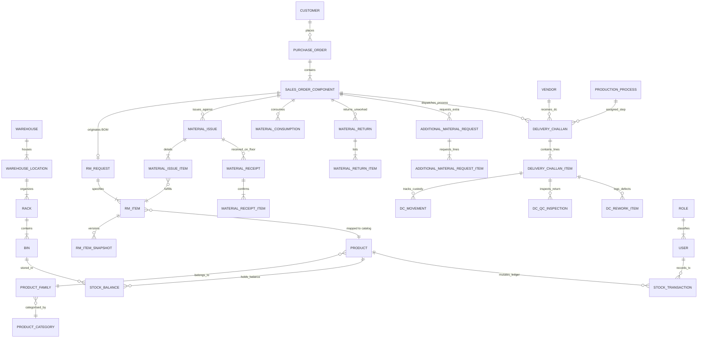

# Integration Audit: V-SMART (RMRIT) Application

> **Audit Context**: System and codebase architecture audit of the **V-SMART (Velan Stock, Material & Asset Resource Tracker System) / RMRIT** application to prepare for bidirectional integration with sibling ecosystem applications: **MERC** (Merchandising / Job Orders / Customer POs) and **ECR** (Engineering Change Request / Quality Rework & Rejection).  
> **Source Baseline**: Monorepo root `c:\Users\Admin\OneDrive\Desktop\rm-workflow-system`, encompassing `backend/` (`v-smart-backend`) and `frontend/` (`v-smart-frontend`).  
> **Rule Adherence**: Pure audit report. No application source code has been altered. Every statement cites source code file paths, symbols, and line numbers. Missing/unsupported capabilities are explicitly designated as `UNKNOWN` or `NOT IMPLEMENTED`.

---

## 1. Stack and Runtime

| Dimension | Specification | Source Citation |
| :--- | :--- | :--- |
| **Primary Languages** | TypeScript 6.0.2 (Backend), TypeScript ~6.0.2 (Frontend) | [`backend/package.json#L91`](file:///c:/Users/Admin/OneDrive/Desktop/rm-workflow-system/backend/package.json#L91), [`frontend/package.json#L41`](file:///c:/Users/Admin/OneDrive/Desktop/rm-workflow-system/frontend/package.json#L41) |
| **Backend Runtime** | Node.js (ECMAScript Modules `"type": "module"`) | [`backend/package.json#L8`](file:///c:/Users/Admin/OneDrive/Desktop/rm-workflow-system/backend/package.json#L8) |
| **Backend Framework** | NestJS 12 (`@nestjs/core: ^12.0.1`, `@nestjs/common: ^12.0.1`, `@nestjs/platform-express: ^12.1.2`) | [`backend/package.json#L35-L41`](file:///c:/Users/Admin/OneDrive/Desktop/rm-workflow-system/backend/package.json#L35-L41) |
| **Frontend Framework** | React 19.2.8 (`react`, `react-dom`) + Vite 8.2.2 SPA | [`frontend/package.json#L19-L20`](file:///c:/Users/Admin/OneDrive/Desktop/rm-workflow-system/frontend/package.json#L19-L20), [`frontend/package.json#L42`](file:///c:/Users/Admin/OneDrive/Desktop/rm-workflow-system/frontend/package.json#L42) |
| **Database Engine** | PostgreSQL 16+ via `pg: ^8.23.0` (Runs on Neon Serverless Postgres / Supabase / Render PostgreSQL) | [`backend/package.json#L66`](file:///c:/Users/Admin/OneDrive/Desktop/rm-workflow-system/backend/package.json#L66), [`render.yaml#L1-L5`](file:///c:/Users/Admin/OneDrive/Desktop/rm-workflow-system/render.yaml#L1-L5) |
| **ORM & Migrations** | TypeORM `^1.1.1` (`@nestjs/typeorm: ^12.0.1`), CLI migrations via `typeorm-ts-node-esm` | [`backend/package.json#L46`](file:///c:/Users/Admin/OneDrive/Desktop/rm-workflow-system/backend/package.json#L46), [`backend/package.json#L70`](file:///c:/Users/Admin/OneDrive/Desktop/rm-workflow-system/backend/package.json#L70), [`backend/package.json#L24-L26`](file:///c:/Users/Admin/OneDrive/Desktop/rm-workflow-system/backend/package.json#L24-L26) |
| **Authentication Method** | Passport JWT (`@nestjs/jwt: ^12.0.1`, `passport-jwt: ^4.0.1`) + bcrypt password hashing (`bcryptjs: ^3.0.3`) | [`backend/package.json#L38`](file:///c:/Users/Admin/OneDrive/Desktop/rm-workflow-system/backend/package.json#L38), [`backend/package.json#L53`](file:///c:/Users/Admin/OneDrive/Desktop/rm-workflow-system/backend/package.json#L53), [`backend/src/auth/auth.service.ts#L62`](file:///c:/Users/Admin/OneDrive/Desktop/rm-workflow-system/backend/src/auth/auth.service.ts#L62) |
| **Session / Token Model** | Stateless Bearer JWT (Access Token) + 7-Day Rotating SHA-256 Refresh Tokens in DB | [`backend/src/auth/auth.service.ts#L90-L112`](file:///c:/Users/Admin/OneDrive/Desktop/rm-workflow-system/backend/src/auth/auth.service.ts#L90-L112), [`backend/src/auth/entities/refresh-token.entity.ts#L28-L32`](file:///c:/Users/Admin/OneDrive/Desktop/rm-workflow-system/backend/src/auth/entities/refresh-token.entity.ts#L28-L32) |
| **Hosting & Deployment** | Render Infrastructure as Code (`render.yaml`): Web Service `v-smart-backend`, Static Site `v-smart-frontend`, Managed DB `v-smart-postgres` | [`render.yaml#L1-L56`](file:///c:/Users/Admin/OneDrive/Desktop/rm-workflow-system/render.yaml#L1-L56) |
| **Binary Object Storage** | Supabase Storage (`@supabase/supabase-js: ^2.116.0`) with local disk fallback | [`backend/package.json#L48`](file:///c:/Users/Admin/OneDrive/Desktop/rm-workflow-system/backend/package.json#L48), [`backend/src/files/files.service.ts#L23-L45`](file:///c:/Users/Admin/OneDrive/Desktop/rm-workflow-system/backend/src/files/files.service.ts#L23-L45) |
| **Configuration Files** | `backend/.env`, `backend/.env.example`, `.env`, schema loaded via `@nestjs/config` into `configuration.ts` | [`backend/src/config/configuration.ts#L1-L25`](file:///c:/Users/Admin/OneDrive/Desktop/rm-workflow-system/backend/src/config/configuration.ts#L1-L25) |
| **Background Jobs & Crons** | `@nestjs/schedule: ^12.0.2` (`ScheduleModule` registered in `AppModule`), executing 4 in-process `@Cron` routines | [`backend/package.json#L43`](file:///c:/Users/Admin/OneDrive/Desktop/rm-workflow-system/backend/package.json#L43), [`backend/src/app.module.ts#L73`](file:///c:/Users/Admin/OneDrive/Desktop/rm-workflow-system/backend/src/app.module.ts#L73) |
| **Queue System** | Custom DB-backed FIFO polling queue on `email_jobs` table (`EmailQueueService` + `EmailWorkerService` polling every 5s) | [`backend/src/email/email-queue.service.ts#L47`](file:///c:/Users/Admin/OneDrive/Desktop/rm-workflow-system/backend/src/email/email-queue.service.ts#L47), [`backend/src/email/email-worker.service.ts#L28-L60`](file:///c:/Users/Admin/OneDrive/Desktop/rm-workflow-system/backend/src/email/email-worker.service.ts#L28-L60) |

### Active Cron Jobs

1. **Consumable SLA Sweep**: Hourly evaluation of overdue PR receipts (>24h) and partial issues:
   - Schedule: `@Cron(process.env.CONSUMABLE_SLA_CRON_SCHEDULE || CronExpression.EVERY_HOUR)`  
   - Implementation: [`backend/src/consumables/consumables.service.ts#L1222`](file:///c:/Users/Admin/OneDrive/Desktop/rm-workflow-system/backend/src/consumables/consumables.service.ts#L1222)
2. **Delivery Challan SLA Sweep**: Hourly evaluation of active outward DCs against `expected_return_date`:
   - Schedule: `@Cron(process.env.DC_SLA_CRON_SCHEDULE || CronExpression.EVERY_HOUR)`  
   - Implementation: [`backend/src/delivery-challan/delivery-challan.service.ts#L2297`](file:///c:/Users/Admin/OneDrive/Desktop/rm-workflow-system/backend/src/delivery-challan/delivery-challan.service.ts#L2297)
3. **MSL Periodic Inventory Evaluation**: Hourly background recalculation of minimum stock breaches:
   - Schedule: `@Cron(process.env.MSL_CRON_SCHEDULE || CronExpression.EVERY_HOUR)`  
   - Implementation: [`backend/src/inventory/msl-trigger.service.ts#L135`](file:///c:/Users/Admin/OneDrive/Desktop/rm-workflow-system/backend/src/inventory/msl-trigger.service.ts#L135)
4. **Google OAuth Token Refresh**: Runs every 45 minutes to refresh the Gmail API OAuth2 access token:
   - Schedule: `@Cron('0 */45 * * * *')`  
   - Implementation: [`backend/src/email/providers/gmail-api.provider.ts#L96`](file:///c:/Users/Admin/OneDrive/Desktop/rm-workflow-system/backend/src/email/providers/gmail-api.provider.ts#L96)

---

## 2. Data Model

The application persistence layer contains **36 primary database tables**, all registered in TypeORM DataSource [`backend/src/config/data-source.ts#L81-L136`](file:///c:/Users/Admin/OneDrive/Desktop/rm-workflow-system/backend/src/config/data-source.ts#L81-L136). All primary keys are UUID v4.

### 2.1 Entity Registry & Schema Definitions

#### 1. Identity & Permissions
- **`roles`**: System role catalog (`ADMIN`, `DESIGNER`, `STORES`, `PRODUCTION`, `SENIOR_MANAGER`, `GENERAL_MANAGER`).
  - Columns: `id` (uuid, PK), `name` (varchar 50, UNIQUE), `description` (varchar 255), `created_at` (timestamptz), `updated_at` (timestamptz).
  - Citation: [`backend/src/roles/entities/role.entity.ts#L11-L30`](file:///c:/Users/Admin/OneDrive/Desktop/rm-workflow-system/backend/src/roles/entities/role.entity.ts#L11-L30).
- **`users`**: User identity and department assignment.
  - Columns: `id` (uuid, PK), `name` (varchar 100), `email` (varchar 150, UNIQUE), `password_hash` (varchar 255), `role_id` (uuid, FK `roles.id`), `department` (varchar 100, nullable), `is_active` (boolean, default true), `created_at` (timestamptz), `updated_at` (timestamptz).
  - Soft-delete: None. Audit: `created_at`, `updated_at`.
  - Citation: [`backend/src/users/entities/user.entity.ts#L13-L46`](file:///c:/Users/Admin/OneDrive/Desktop/rm-workflow-system/backend/src/users/entities/user.entity.ts#L13-L46).
- **`refresh_tokens`**: Opaque token hash store for session renewal and reuse detection.
  - Columns: `id` (uuid, PK), `user_id` (uuid, FK `users.id` CASCADE), `token_hash` (varchar 64, UNIQUE), `expires_at` (timestamptz), `is_revoked` (boolean, default false), `replaced_by_token` (varchar 64, nullable), `device_info` (varchar 255, nullable), `created_at` (timestamptz), `updated_at` (timestamptz).
  - Citation: [`backend/src/auth/entities/refresh-token.entity.ts#L13-L48`](file:///c:/Users/Admin/OneDrive/Desktop/rm-workflow-system/backend/src/auth/entities/refresh-token.entity.ts#L13-L48).
- **`password_reset_tokens`**: Single-use password recovery tokens.
  - Columns: `id` (uuid, PK), `user_id` (uuid, FK `users.id` CASCADE), `token_hash` (varchar 64, UNIQUE), `expires_at` (timestamptz), `is_used` (boolean, default false), `created_at` (timestamptz).
  - Citation: [`backend/src/auth/entities/password-reset-token.entity.ts#L12-L38`](file:///c:/Users/Admin/OneDrive/Desktop/rm-workflow-system/backend/src/auth/entities/password-reset-token.entity.ts#L12-L38).
- **`system_modules`**: Dynamic UI/API module metadata.
  - Columns: `module_key` (varchar 50, PK), `name` (varchar 100), `group_name` (varchar 50), `route_path` (varchar 150), `description` (varchar 255), `sort_order` (int), `is_active` (boolean), `created_at` (timestamptz), `updated_at` (timestamptz).
  - Citation: [`backend/src/permissions/entities/system-module.entity.ts#L9-L37`](file:///c:/Users/Admin/OneDrive/Desktop/rm-workflow-system/backend/src/permissions/entities/system-module.entity.ts#L9-L37).
- **`role_module_permissions`**: Role-to-module grant matrix.
  - Columns: `id` (uuid, PK), `role_id` (uuid, FK `roles.id`), `module_key` (varchar 50, FK `system_modules.module_key`), `is_allowed` (boolean), `created_at` (timestamptz), `updated_at` (timestamptz).
  - Constraints: UNIQUE (`role_id`, `module_key`).
  - Citation: [`backend/src/permissions/entities/role-module-permission.entity.ts#L14-L42`](file:///c:/Users/Admin/OneDrive/Desktop/rm-workflow-system/backend/src/permissions/entities/role-module-permission.entity.ts#L14-L42).
- **`user_module_permissions`**: Explicit user permission overrides.
  - Columns: `id` (uuid, PK), `user_id` (uuid, FK `users.id`), `module_key` (varchar 50, FK `system_modules.module_key`), `access_type` (`FULL_ACCESS`, `VIEW`, `DENY`, `GRANT`, `REVOKE`), `created_at`, `updated_at`.
  - Constraints: UNIQUE (`user_id`, `module_key`).
  - Citation: [`backend/src/permissions/entities/user-module-permission.entity.ts#L16-L44`](file:///c:/Users/Admin/OneDrive/Desktop/rm-workflow-system/backend/src/permissions/entities/user-module-permission.entity.ts#L16-L44).

#### 2. Core Orders & Raw Material Lifecycle
- **`customers`**: Customer entities placing orders.
  - Columns: `id` (uuid, PK), `name` (varchar 150), `code` (varchar 50, UNIQUE), `contact_person` (varchar 100, nullable), `email` (varchar 150, nullable), `phone` (varchar 50, nullable), `is_active` (boolean, default true), `created_at` (timestamptz), `updated_at` (timestamptz).
  - Citation: [`backend/src/customers/entities/customer.entity.ts#L12-L45`](file:///c:/Users/Admin/OneDrive/Desktop/rm-workflow-system/backend/src/customers/entities/customer.entity.ts#L12-L45).
- **`purchase_orders`**: PO headers grouping manufacturing jobs.
  - Columns: `id` (uuid, PK), `po_number` (varchar 100, UNIQUE), `customer_id` (uuid, FK `customers.id`), `external_reference` (varchar 150, nullable), `reference_date` (date, nullable), `remarks` (varchar 255, nullable), `created_at` (timestamptz), `updated_at` (timestamptz).
  - Citation: [`backend/src/po/entities/po.entity.ts#L15-L53`](file:///c:/Users/Admin/OneDrive/Desktop/rm-workflow-system/backend/src/po/entities/po.entity.ts#L15-L53).
- **`sales_order_components` (SCs)**: Core work-order execution component.
  - Columns: `id` (uuid, PK), `sc_number` (varchar 100), `po_id` (uuid, FK `purchase_orders.id`), `product_name` (varchar 150), `description` (varchar 255, nullable), `drawing_number` (varchar 100, nullable), `target_quantity` (numeric 12,3, default 1), `status` (varchar 50, default `DRAFT`), `completed_at` (timestamptz, nullable), `completed_by_id` (uuid, FK `users.id`, nullable), `completion_remarks` (text, nullable), `created_at` (timestamptz), `updated_at` (timestamptz).
  - Constraints: UNIQUE (`po_id`, `sc_number`), CHECK (`target_quantity` > 0).
  - Statuses (`ScStatus`): `DRAFT`, `SUBMITTED`, `STORES_PENDING`, `PARTIALLY_ISSUED`, `ISSUED`, `IN_PRODUCTION`, `ADDITIONAL_REQUEST`, `COMPLETED`, `CLOSED`, `REJECTED`.
  - Citation: [`backend/src/sc/entities/sc.entity.ts#L23-L37`](file:///c:/Users/Admin/OneDrive/Desktop/rm-workflow-system/backend/src/sc/entities/sc.entity.ts#L23-L37).
- **`rm_requests`**: Designer BOM requisition document.
  - Columns: `id` (uuid, PK), `po_id` (uuid, FK `purchase_orders.id`, nullable), `sc_id` (uuid, FK `sales_order_components.id`, UNIQUE, nullable), `form_type` (varchar 20, enum `SC` | `PO`), `created_by_id` (uuid, FK `users.id`), `status` (varchar 50, default `DRAFT`), `revision_number` (int, default 1), `submitted_at` (timestamptz, nullable), `completed_at` (timestamptz, nullable), `reviewed_at` (timestamptz, nullable), `reviewed_by_id` (uuid, FK `users.id`, nullable), `remarks` (text, nullable), `created_at`, `updated_at`.
  - Statuses (`RmRequestStatus`): `DRAFT`, `SUBMITTED`, `REVIEWED`, `COMPLETED`, `REJECTED`.
  - Citation: [`backend/src/rm/entities/rm-request.entity.ts#L18-L33`](file:///c:/Users/Admin/OneDrive/Desktop/rm-workflow-system/backend/src/rm/entities/rm-request.entity.ts#L18-L33).
- **`rm_items`**: Material line specifications under an RM Request.
  - Columns: `id` (uuid, PK), `rm_form_id` (uuid, FK `rm_requests.id` CASCADE), `sc_id` (uuid, FK `sales_order_components.id`, nullable), `material` (varchar 100), `material_type` (varchar 50, default `ROUND_BAR`), `grade` (varchar 100), `quantity` (numeric 12,3), `size` (varchar 100), `length` (numeric 10,2, nullable), `width` (numeric 10,2, nullable), `thickness` (numeric 10,2, nullable), `diameter` (numeric 10,2, nullable), `weight` (numeric 12,3, nullable), `weight_unit` (varchar 20, default `KG`), `part_number` (varchar 100, nullable), `part_name` (varchar 255, nullable), `remarks` (text, nullable), `mapped_product_id` (uuid, FK `products.id`, nullable), `availability_status` (varchar 50, enum `AVAILABLE` | `PARTIAL` | `NOT_AVAILABLE`, nullable), `available_quantity_snapshot` (numeric 12,3, nullable), `created_at`, `updated_at`.
  - Citation: [`backend/src/rm/entities/rm-item.entity.ts#L19-L168`](file:///c:/Users/Admin/OneDrive/Desktop/rm-workflow-system/backend/src/rm/entities/rm-item.entity.ts#L19-L168).
- **`rm_form_scs`**: Many-to-many junction table for PO-level RM Requests linking multiple SCs.
  - Columns: `id` (uuid, PK), `rm_form_id` (uuid, FK `rm_requests.id`), `sc_id` (uuid, FK `sales_order_components.id`), `created_at` (timestamptz).
  - Constraints: UNIQUE (`rm_form_id`, `sc_id`).
  - Citation: [`backend/src/rm/entities/rm-form-sc.entity.ts#L14-L38`](file:///c:/Users/Admin/OneDrive/Desktop/rm-workflow-system/backend/src/rm/entities/rm-form-sc.entity.ts#L14-L38).
- **`rm_item_snapshots`**: Immutable historical revision snapshots of RM Items.
  - Columns: `id` (uuid, PK), `rm_item_id` (uuid, FK `rm_items.id`), `rm_form_id` (uuid, FK `rm_requests.id`), `revision_number` (int), `change_type` (`ORIGINAL_SUBMISSION` | `DESIGNER_REVISION`), `changed_by_id` (uuid, FK `users.id`), `material`, `material_type`, `grade`, `quantity`, `size`, `length`, `width`, `thickness`, `diameter`, `weight`, `weight_unit`, `revision_reason` (text), `created_at` (timestamptz).
  - Citation: [`backend/src/rm/entities/rm-item-snapshot.entity.ts#L14-L60`](file:///c:/Users/Admin/OneDrive/Desktop/rm-workflow-system/backend/src/rm/entities/rm-item-snapshot.entity.ts#L14-L60).

#### 3. Stores Issue & Production Execution
- **`material_issues`**: Stores issue voucher header.
  - Columns: `id` (uuid, PK), `sc_id` (uuid, FK `sales_order_components.id`), `issue_number` (varchar 100, UNIQUE), `issue_type` (varchar 50, enum `INITIAL_ISSUE` | `ADDITIONAL_ISSUE`), `additional_request_id` (uuid, FK `additional_material_requests.id`, nullable), `issued_by_id` (uuid, FK `users.id`), `issue_date` (timestamptz), `remarks` (text, nullable), `created_at` (timestamptz).
  - Citation: [`backend/src/material-issue/entities/material-issue.entity.ts#L17-L91`](file:///c:/Users/Admin/OneDrive/Desktop/rm-workflow-system/backend/src/material-issue/entities/material-issue.entity.ts#L17-L91).
- **`material_issue_items`**: Material issue lines.
  - Columns: `id` (uuid, PK), `material_issue_id` (uuid, FK `material_issues.id`), `rm_item_id` (uuid, FK `rm_items.id`), `quantity_issued` (numeric 12,3), `heat_number` (varchar 100, nullable), `batch_number` (varchar 100, nullable), `remarks` (text, nullable), `created_at` (timestamptz).
  - Citation: [`backend/src/material-issue/entities/material-issue-item.entity.ts#L13-L57`](file:///c:/Users/Admin/OneDrive/Desktop/rm-workflow-system/backend/src/material-issue/entities/material-issue-item.entity.ts#L13-L57).
- **`material_receipts`**: Shop-floor physical receipt confirmation.
  - Columns: `id` (uuid, PK), `material_issue_id` (uuid, FK `material_issues.id`), `received_by_id` (uuid, FK `users.id`), `status` (varchar 50, enum `RECEIVED` | `PARTIAL` | `DISCREPANCY`), `idempotency_key` (varchar 100, UNIQUE where NOT NULL), `remarks` (text, nullable), `created_at` (timestamptz).
  - Citation: [`backend/src/production/entities/production-receipt.entity.ts#L15-L69`](file:///c:/Users/Admin/OneDrive/Desktop/rm-workflow-system/backend/src/production/entities/production-receipt.entity.ts#L15-L69).
- **`material_receipt_items`**: Receipt line quantities.
  - Columns: `id` (uuid, PK), `material_receipt_id` (uuid, FK `material_receipts.id`), `rm_item_id` (uuid, FK `rm_items.id`), `quantity_received` (numeric 12,3), `remarks` (text, nullable), `created_at` (timestamptz).
  - Citation: [`backend/src/production/entities/material-receipt-item.entity.ts#L13-L49`](file:///c:/Users/Admin/OneDrive/Desktop/rm-workflow-system/backend/src/production/entities/material-receipt-item.entity.ts#L13-L49).
- **`material_consumptions`**: Shop floor physical consumption log.
  - Columns: `id` (uuid, PK), `sc_id` (uuid, FK `sales_order_components.id`), `rm_item_id` (uuid, FK `rm_items.id`), `consumed_quantity` (numeric 12,3), `unit` (varchar 20, default `NOS`), `recorded_by_id` (uuid, FK `users.id`), `remarks` (text, nullable), `recorded_at` (timestamptz), `created_at` (timestamptz).
  - Citation: [`backend/src/production/entities/material-consumption.entity.ts#L15-L66`](file:///c:/Users/Admin/OneDrive/Desktop/rm-workflow-system/backend/src/production/entities/material-consumption.entity.ts#L15-L66).
- **`material_returns`**: Production return voucher.
  - Columns: `id` (uuid, PK), `sc_id` (uuid, FK `sales_order_components.id`), `status` (varchar 50, enum `PENDING_STORE_ACK` | `ACKNOWLEDGED` | `REJECTED`), `returned_by_id` (uuid, FK `users.id`), `confirmed_by_id` (uuid, FK `users.id`, nullable), `confirmed_at` (timestamptz, nullable), `remarks` (text, nullable), `returned_at` (timestamptz), `created_at` (timestamptz).
  - Citation: [`backend/src/production/entities/material-return.entity.ts#L15-L85`](file:///c:/Users/Admin/OneDrive/Desktop/rm-workflow-system/backend/src/production/entities/material-return.entity.ts#L15-L85).
- **`material_return_items`**: Returned material line quantities.
  - Columns: `id` (uuid, PK), `material_return_id` (uuid, FK `material_returns.id`), `rm_item_id` (uuid, FK `rm_items.id`), `quantity_returned` (numeric 12,3), `remarks` (text, nullable), `created_at` (timestamptz).
  - Citation: [`backend/src/production/entities/material-return-item.entity.ts#L13-L49`](file:///c:/Users/Admin/OneDrive/Desktop/rm-workflow-system/backend/src/production/entities/material-return-item.entity.ts#L13-L49).
- **`additional_material_requests`**: Production request for extra RM.
  - Columns: `id` (uuid, PK), `sc_id` (uuid, FK `sales_order_components.id`), `requested_by_id` (uuid, FK `users.id`), `status` (varchar 50, enum `REQUESTED` | `APPROVED` | `REJECTED` | `ISSUED` | `CANCELLED`), `reason` (varchar 50, enum `ADDITIONAL_REQUIREMENT` | `DAMAGE` | `WASTAGE` | `MANUFACTURING_ERROR` | `TOOL_WEAR_SCRAP` | `OTHER`), `remarks` (text, nullable), `requested_at` (timestamptz), `approved_at` (timestamptz, nullable), `approved_by_id` (uuid, FK `users.id`, nullable), `created_at`, `updated_at`.
  - Constraints: Partial Unique Index `idx_single_active_request` ON `sc_id` WHERE `status IN ('REQUESTED', 'APPROVED')`.
  - Citation: [`backend/src/additional-request/entities/additional-request.entity.ts#L16-L60`](file:///c:/Users/Admin/OneDrive/Desktop/rm-workflow-system/backend/src/additional-request/entities/additional-request.entity.ts#L16-L60).
- **`additional_material_request_items`**: Extra material line items.
  - Columns: `id` (uuid, PK), `request_id` (uuid, FK `additional_material_requests.id`), `rm_item_id` (uuid, FK `rm_items.id`), `quantity_requested` (numeric 12,3), `quantity_approved` (numeric 12,3, nullable), `remarks` (text, nullable), `created_at` (timestamptz).
  - Citation: [`backend/src/additional-request/entities/additional-request-item.entity.ts#L13-L66`](file:///c:/Users/Admin/OneDrive/Desktop/rm-workflow-system/backend/src/additional-request/entities/additional-request-item.entity.ts#L13-L66).

#### 4. Inventory, Master Data & General Issues
- **`products`**: Unified product catalog master.
  - Columns: `id` (uuid, PK), `family_id` (uuid, FK `product_families.id`), `code` (varchar 100, UNIQUE, nullable), `barcode` (varchar 100, UNIQUE, nullable), `name` (varchar 255, UNIQUE), `minimum_inventory` (numeric 12,3, default 0), `maximum_inventory` (numeric 12,3, nullable), `is_active` (boolean, default true), `uom` (varchar 50, default `KG`), `created_at`, `updated_at`.
  - Constraints: CHECK (`minimum_inventory` >= 0), CHECK (`maximum_inventory` IS NULL OR `maximum_inventory` >= `minimum_inventory`).
  - Citation: [`backend/src/inventory/entities/product.entity.ts#L18-L84`](file:///c:/Users/Admin/OneDrive/Desktop/rm-workflow-system/backend/src/inventory/entities/product.entity.ts#L18-L84).
- **`product_families`**: Product family classification.
  - Columns: `id` (uuid, PK), `category_id` (uuid, FK `product_categories.id`), `name` (varchar 100), `is_active` (boolean), `created_at`, `updated_at`.
  - Constraints: UNIQUE (`category_id`, `name`).
  - Citation: [`backend/src/inventory/entities/product-family.entity.ts#L15-L44`](file:///c:/Users/Admin/OneDrive/Desktop/rm-workflow-system/backend/src/inventory/entities/product-family.entity.ts#L15-L44).
- **`product_categories`**: Top-level product category.
  - Columns: `id` (uuid, PK), `name` (varchar 100, UNIQUE), `is_active` (boolean), `created_at`, `updated_at`.
  - Citation: [`backend/src/inventory/entities/product-category.entity.ts#L11-L30`](file:///c:/Users/Admin/OneDrive/Desktop/rm-workflow-system/backend/src/inventory/entities/product-category.entity.ts#L11-L30).
- **`warehouses`**: Storage facility master.
  - Columns: `id` (uuid, PK), `code` (varchar 50, UNIQUE), `name` (varchar 100, UNIQUE), `is_active` (boolean), `created_at`, `updated_at`.
  - Citation: [`backend/src/inventory/entities/warehouse.entity.ts#L11-L36`](file:///c:/Users/Admin/OneDrive/Desktop/rm-workflow-system/backend/src/inventory/entities/warehouse.entity.ts#L11-L36).
- **`warehouse_locations`**: Sub-location/zones within warehouse.
  - Columns: `id` (uuid, PK), `warehouse_id` (uuid, FK `warehouses.id`), `code` (varchar 50), `name` (varchar 100), `is_active` (boolean), `created_at`, `updated_at`.
  - Constraints: UNIQUE (`warehouse_id`, `code`).
  - Citation: [`backend/src/inventory/entities/warehouse-location.entity.ts#L15-L47`](file:///c:/Users/Admin/OneDrive/Desktop/rm-workflow-system/backend/src/inventory/entities/warehouse-location.entity.ts#L15-L47).
- **`racks`**: Racks within a warehouse location.
  - Columns: `id` (uuid, PK), `location_id` (uuid, FK `warehouse_locations.id`), `code` (varchar 50), `name` (varchar 100), `is_active` (boolean), `created_at`, `updated_at`.
  - Constraints: UNIQUE (`location_id`, `code`).
  - Citation: [`backend/src/inventory/entities/rack.entity.ts#L15-L47`](file:///c:/Users/Admin/OneDrive/Desktop/rm-workflow-system/backend/src/inventory/entities/rack.entity.ts#L15-L47).
- **`bins`**: Physical bin storage units.
  - Columns: `id` (uuid, PK), `rack_id` (uuid, FK `racks.id`), `code` (varchar 50), `name` (varchar 100), `is_active` (boolean, default true), `created_at`, `updated_at`.
  - Constraints: UNIQUE (`rack_id`, `code`).
  - Citation: [`backend/src/inventory/entities/bin.entity.ts#L16-L54`](file:///c:/Users/Admin/OneDrive/Desktop/rm-workflow-system/backend/src/inventory/entities/bin.entity.ts#L16-L54).
- **`stock_balances`**: Real-time aggregated inventory balances.
  - Columns: `id` (uuid, PK), `product_id` (uuid, FK `products.id`, nullable), `bin_id` (uuid, FK `bins.id`, nullable), `inventory_item_id` (uuid, FK `inventory_items.id`, UNIQUE, nullable), `current_quantity` (numeric 12,3, default 0), `opening_balance` (numeric 12,3, nullable), `last_transaction_id` (uuid, FK `stock_transactions.id`, nullable), `created_at`, `updated_at`.
  - Constraints: UNIQUE (`product_id`, `bin_id`).
  - Citation: [`backend/src/inventory/entities/stock-balance.entity.ts#L18-L84`](file:///c:/Users/Admin/OneDrive/Desktop/rm-workflow-system/backend/src/inventory/entities/stock-balance.entity.ts#L18-L84).
- **`stock_transactions`**: Immutable stock movement ledger.
  - Columns: `id` (uuid, PK), `product_id` (uuid, FK `products.id`, nullable), `inventory_item_id` (uuid, FK `inventory_items.id`, nullable), `source_bin_id` (uuid, FK `bins.id`, nullable), `destination_bin_id` (uuid, FK `bins.id`, nullable), `transaction_type` (enum `TransactionType`: `STOCK_IN`, `STOCK_OUT`, `STORES_ISSUE`, `RETURN`, `ADJUSTMENT`, `TRANSFER`, `GRN_RECEIPT`, `DC_DISPATCH`, `DC_RETURN`, `PRODUCTION_CONSUMPTION`, etc.), `adjustment_direction` (enum `INCREASE` | `DECREASE`, nullable), `quantity` (numeric 12,3), `reference_type` (varchar 50), `reference_id` (varchar, nullable), `reason` (text, nullable), `remarks` (text, nullable), `lot_batch_number` (varchar 100, nullable), `cost` (numeric 12,2, nullable), `created_by_id` (uuid, FK `users.id`), `created_at` (timestamptz).
  - Constraints: CHECK (`quantity` > 0).
  - Citation: [`backend/src/inventory/entities/stock-transaction.entity.ts#L15-L135`](file:///c:/Users/Admin/OneDrive/Desktop/rm-workflow-system/backend/src/inventory/entities/stock-transaction.entity.ts#L15-L135).
- **`general_issues`**: Non-SC / Non-PO general inventory issue vouchers.
  - Columns: `id` (uuid, PK), `issue_number` (varchar 100, UNIQUE), `sc_id` (uuid, FK `sales_order_components.id`, nullable), `po_id` (uuid, FK `purchase_orders.id`, nullable), `department` (varchar 100, nullable), `requester` (varchar 100, nullable), `reason` (varchar 255, nullable), `external_reference` (varchar 100, nullable), `status` (enum `GeneralIssueStatus`: `ISSUED` | `CANCELLED`), `issued_by_id` (uuid, FK `users.id`), `issue_date` (timestamptz), `remarks` (text, nullable), `created_at` (timestamptz).
  - Citation: [`backend/src/general-issue/entities/general-issue.entity.ts#L16-L89`](file:///c:/Users/Admin/OneDrive/Desktop/rm-workflow-system/backend/src/general-issue/entities/general-issue.entity.ts#L16-L89).
- **`general_issue_items`**: Lines issued under general issue.
  - Columns: `id` (uuid, PK), `general_issue_id` (uuid, FK `general_issues.id` CASCADE), `product_id` (uuid, FK `products.id`), `bin_id` (uuid, FK `bins.id`, nullable), `quantity_issued` (numeric 12,3), `remarks` (text, nullable).
  - Citation: [`backend/src/general-issue/entities/general-issue-item.entity.ts#L12-L50`](file:///c:/Users/Admin/OneDrive/Desktop/rm-workflow-system/backend/src/general-issue/entities/general-issue-item.entity.ts#L12-L50).
- **`msl_alerts`**: Minimum stock level violation alerts.
  - Columns: `id` (uuid, PK), `product_id` (uuid, FK `products.id` CASCADE), `trigger_quantity` (numeric 12,3), `minimum_inventory` (numeric 12,3), `status` (enum `MslAlertStatus`: `ACTIVE` | `RESOLVED`), `resolved_at` (timestamptz, nullable), `created_at`, `updated_at`.
  - Citation: [`backend/src/inventory/entities/msl-alert.entity.ts#L13-L62`](file:///c:/Users/Admin/OneDrive/Desktop/rm-workflow-system/backend/src/inventory/entities/msl-alert.entity.ts#L13-L62).

#### 5. Delivery Challans & Subcontracting
- **`production_processes`**: Sequential manufacturing processes.
  - Columns: `id` (uuid, PK), `code` (varchar 50, UNIQUE), `name` (varchar 150), `sequence_number` (int, UNIQUE), `category` (varchar 50, nullable), `is_active` (boolean, default true), `is_skippable` (boolean, default false), `is_repeatable` (boolean, default false), `allows_outside_vendor` (boolean, default false), `description` (text, nullable), `created_at`, `updated_at`.
  - Citation: [`backend/src/production-process/entities/production-process.entity.ts#L10-L49`](file:///c:/Users/Admin/OneDrive/Desktop/rm-workflow-system/backend/src/production-process/entities/production-process.entity.ts#L10-L49).
- **`vendors`**: External subcontractor vendor master.
  - Columns: `id` (uuid, PK), `code` (varchar 50, UNIQUE), `name` (varchar 150), `category` (varchar 255, nullable), `contact_person` (varchar 100, nullable), `email` (varchar 150, nullable), `phone` (varchar 50, nullable), `address` (text, nullable), `is_active` (boolean, default true), `notes` (text, nullable), `created_at`, `updated_at`.
  - Citation: [`backend/src/vendor/entities/vendor.entity.ts#L10-L51`](file:///c:/Users/Admin/OneDrive/Desktop/rm-workflow-system/backend/src/vendor/entities/vendor.entity.ts#L10-L51).
- **`vendor_process_capabilities`**: Vendor-to-process qualification matrix.
  - Columns: `id` (uuid, PK), `vendor_id` (uuid, FK `vendors.id` CASCADE), `process_id` (uuid, FK `production_processes.id` CASCADE), `is_approved` (boolean, default true), `lead_time_days` (int, nullable), `notes` (text, nullable), `created_at`, `updated_at`.
  - Constraints: UNIQUE (`vendor_id`, `process_id`).
  - Citation: [`backend/src/vendor/entities/vendor-process-capability.entity.ts#L15-L53`](file:///c:/Users/Admin/OneDrive/Desktop/rm-workflow-system/backend/src/vendor/entities/vendor-process-capability.entity.ts#L15-L53).
- **`vendor_slas`**: SLA agreements governing vendor turnaround.
  - Columns: `id` (uuid, PK), `vendor_id` (uuid, FK `vendors.id` CASCADE), `process_id` (uuid, FK `production_processes.id` CASCADE), `sla_days` (int), `effective_date` (timestamptz), `is_active` (boolean, default true), `notes` (text, nullable), `lead_time_multiplier` (numeric 4,2, default 1.00), `tolerance_buffer_days` (int, default 1), `alert_72h` (boolean, default false), `created_at`, `updated_at`.
  - Constraints: UNIQUE (`vendor_id`, `process_id`).
  - Citation: [`backend/src/vendor/entities/vendor-sla.entity.ts#L15-L79`](file:///c:/Users/Admin/OneDrive/Desktop/rm-workflow-system/backend/src/vendor/entities/vendor-sla.entity.ts#L15-L79).
- **`vendor_sla_overrides`**: Authorized SLA extension logs.
  - Columns: `id` (uuid, PK), `sla_id` (uuid, FK `vendor_slas.id` CASCADE), `dc_id` (uuid, FK `delivery_challans.id`, nullable), `authorized_by_id` (uuid, FK `users.id`), `original_target_date` (timestamptz, nullable), `new_target_date` (timestamptz), `justification_code` (varchar 50), `justification_notes` (text), `created_at` (timestamptz).
  - Citation: [`backend/src/vendor/entities/vendor-sla-override.entity.ts#L14-L56`](file:///c:/Users/Admin/OneDrive/Desktop/rm-workflow-system/backend/src/vendor/entities/vendor-sla-override.entity.ts#L14-L56).
- **`delivery_challans`**: Outward delivery challan header.
  - Columns: `id` (uuid, PK), `challan_number` (varchar 50, UNIQUE), `type` (varchar 40, enum `PRODUCTION_PROCESS_OUTWARD` [Type 1] | `GENERAL_INVENTORY_OUTWARD` [Type 2]), `vendor_id` (uuid, FK `vendors.id`), `sc_id` (uuid, FK `sales_order_components.id`, nullable), `process_id` (uuid, FK `production_processes.id`, nullable), `process_name` (varchar 255, nullable), `dispatch_date` (timestamptz), `expected_return_date` (timestamptz, nullable), `status` (varchar 30, enum `OPEN`, `DISPATCHED`, `PARTIALLY_RETURNED`, `RETURNED`, `CLOSED`), `notes` (text, nullable), `created_by_id` (uuid, FK `users.id`, nullable), `actual_return_date` (timestamptz, nullable), `verified_by_id` (uuid, FK `users.id`, nullable), `verification_remarks` (text, nullable), `created_at`, `updated_at`.
  - Citation: [`backend/src/delivery-challan/entities/delivery-challan.entity.ts#L21-L119`](file:///c:/Users/Admin/OneDrive/Desktop/rm-workflow-system/backend/src/delivery-challan/entities/delivery-challan.entity.ts#L21-L119).
- **`delivery_challan_items`**: Material lines on Delivery Challan.
  - Columns: `id` (uuid, PK), `sc_id` (uuid, nullable), `process_id` (uuid, nullable), `process_name` (varchar 255, nullable), `part_number` (varchar 100, nullable), `part_name` (varchar 255, nullable), `description` (text, nullable), `batch_number` (varchar 100, nullable), `challan_id` (uuid, FK `delivery_challans.id` CASCADE), `product_id` (uuid, FK `products.id`, nullable), `bin_id` (uuid, FK `bins.id`, nullable), `output_product_id` (uuid, FK `products.id`, nullable), `expected_output_quantity` (numeric 12,3, nullable), `output_bin_id` (uuid, FK `bins.id`, nullable), `quantity_dispatched` (numeric 12,3), `quantity_returned` (numeric 12,3, default 0), `qc_pending_qty` (numeric 12,3, default 0), `qc_passed_qty` (numeric 12,3, default 0), `qc_rejected_qty` (numeric 12,3, default 0), `initial_expected_qty` (numeric 12,3, nullable), `expected_return_qty` (numeric 12,3, nullable), `actual_received_qty` (numeric 12,3, default 0), `return_target_bin_id` (uuid, FK `bins.id`, nullable), `created_at`, `updated_at`.
  - Citation: [`backend/src/delivery-challan/entities/delivery-challan-item.entity.ts#L19-L143`](file:///c:/Users/Admin/OneDrive/Desktop/rm-workflow-system/backend/src/delivery-challan/entities/delivery-challan-item.entity.ts#L19-L143).
- **`dc_movements`**: Running ledger of process outward movements and vendor custody.
  - Columns: `id` (uuid, PK), `challan_id` (uuid, FK `delivery_challans.id` CASCADE), `challan_item_id` (uuid, FK `delivery_challan_items.id` CASCADE), `sc_id` (uuid, FK `sales_order_components.id`), `process_id` (uuid, FK `production_processes.id`, nullable), `dispatched_product_id` (uuid, FK `products.id`), `dispatched_qty` (numeric 12,3), `returned_product_id` (uuid, FK `products.id`, nullable), `returned_qty` (numeric 12,3, default 0), `status` (varchar 50, enum `DISPATCHED` | `PARTIALLY_RETURNED` | `RETURNED`), `created_at`, `updated_at`.
  - Citation: [`backend/src/delivery-challan/entities/dc-movement.entity.ts#L18-L94`](file:///c:/Users/Admin/OneDrive/Desktop/rm-workflow-system/backend/src/delivery-challan/entities/dc-movement.entity.ts#L18-L94).
- **`dc_qc_inspections`**: Quality check inspection events on inwarded DC items.
  - Columns: `id` (uuid, PK), `challan_id` (uuid, FK `delivery_challans.id` CASCADE), `challan_item_id` (uuid, FK `delivery_challan_items.id` CASCADE), `batch_received_qty` (numeric 12,3), `passed_qty` (numeric 12,3, default 0), `rejected_qty` (numeric 12,3, default 0), `actual_inward_qty` (numeric 12,3, nullable), `remarks` (text, nullable), `inspected_by_id` (uuid, FK `users.id`, nullable), `inspected_at` (timestamptz), `created_at` (timestamptz).
  - Citation: [`backend/src/delivery-challan/entities/dc-qc-inspection.entity.ts#L15-L63`](file:///c:/Users/Admin/OneDrive/Desktop/rm-workflow-system/backend/src/delivery-challan/entities/dc-qc-inspection.entity.ts#L15-L63).
- **`dc_rework_items`**: Rejected parts pending rework or re-dispatch.
  - Columns: `id` (uuid, PK), `source_dc_id` (uuid, FK `delivery_challans.id` CASCADE), `source_dc_number` (varchar 50), `dc_type` (varchar 40), `sc_id` (uuid, FK `sales_order_components.id`, nullable), `sc_number` (varchar 50, nullable), `po_id` (uuid, FK `purchase_orders.id`, nullable), `po_number` (varchar 50, nullable), `product_id` (uuid, FK `products.id`, nullable), `product_name` (varchar 255), `part_number` (varchar 100, nullable), `uom` (varchar 20, default `PCS`), `original_vendor_id` (uuid, FK `vendors.id`), `original_vendor_name` (varchar 255), `rejected_qty` (numeric 12,3), `qc_remarks` (text, nullable), `rework_status` (varchar 30, enum `PENDING_ACK`, `MARKED_OKAY`, `RE_DISPATCHED`), `rework_dc_id` (uuid, FK `delivery_challans.id`, nullable), `rework_dc_number` (varchar 50, nullable), `created_at`, `updated_at`.
  - Citation: [`backend/src/delivery-challan/entities/dc-rework-item.entity.ts#L18-L121`](file:///c:/Users/Admin/OneDrive/Desktop/rm-workflow-system/backend/src/delivery-challan/entities/dc-rework-item.entity.ts#L18-L121).

#### 6. Consumables Management
- **`consumable_requests`**: Consumable indent voucher header.
  - Columns: `id` (uuid, PK), `request_code` (varchar 100, UNIQUE), `payment_mode` (enum `CASH` | `CREDIT`), `end_user_in_velan` (varchar 255, nullable), `requested_by` (varchar 150), `prepared_by` (varchar 150, nullable), `verified_by` (varchar 150, nullable), `approved_by` (varchar 150, nullable), `request_date` (timestamptz), `remarks` (text, nullable), `created_at`, `updated_at`.
  - Citation: [`backend/src/consumables/entities/consumable-request.entity.ts#L12-L69`](file:///c:/Users/Admin/OneDrive/Desktop/rm-workflow-system/backend/src/consumables/entities/consumable-request.entity.ts#L12-L69).
- **`consumable_request_items`**: Consumable line item tracking.
  - Columns: `id` (uuid, PK), `request_id` (uuid, FK `consumable_requests.id` CASCADE), `pr_number` (varchar 50, nullable), `product_id` (uuid, FK `products.id`), `product_code` (varchar 100, nullable), `description` (text), `uom` (varchar 50, default `NOS`), `is_new_product` (boolean, default false), `item_category_track` (enum `STOCK_ITEM` | `NON_STOCK_OR_NEW`), `stock_available_at_request` (numeric 12,3, default 0), `requested_qty` (numeric 12,3, default 0), `purchase_qty` (numeric 12,3, nullable), `real_received_qty` (numeric 12,3, default 0), `issued_qty` (numeric 12,3, default 0), `vendor_id` (uuid, FK `vendors.id`, nullable), `vendor_name` (varchar 255, nullable), `unit_price` (numeric 12,2, nullable), `is_new_vendor` (boolean, default false), `new_vendor_name` (varchar 255, nullable), `new_vendor_address` (text, nullable), `new_vendor_mobile` (varchar 50, nullable), `new_vendor_price` (numeric 12,2, nullable), `end_user_in_velan` (varchar 255, nullable), `requested_by` (varchar 150, nullable), `bin_id` (uuid, FK `bins.id`, nullable), `status` (enum `ConsumableItemStatus`: `READY_FOR_ISSUE`, `OPEN`, `PURCHASE_REQUESTED`, `PURCHASE_RECEIVED`, `PARTIALLY_ISSUED`, `ISSUED_TO_PRODUCTION`, `RECEIVED_BY_PRODUCTION`), `printed_at` (timestamptz, nullable), `purchase_received_at` (timestamptz, nullable), `issued_at` (timestamptz, nullable), `production_received_at` (timestamptz, nullable), `production_received_by_id` (uuid, nullable), `created_at`, `updated_at`.
  - Citation: [`backend/src/consumables/entities/consumable-request-item.entity.ts#L16-L227`](file:///c:/Users/Admin/OneDrive/Desktop/rm-workflow-system/backend/src/consumables/entities/consumable-request-item.entity.ts#L16-L227).

#### 7. Audit, Files & Communications
- **`notifications`**: In-app notifications.
  - Columns: `id` (uuid, PK), `user_id` (uuid, FK `users.id` CASCADE), `title` (varchar 150), `message` (text), `type` (varchar 50), `target_entity` (varchar 50, nullable), `target_id` (varchar 100, nullable), `idempotency_key` (varchar 255, UNIQUE, nullable), `is_read` (boolean, default false), `created_at` (timestamptz).
  - Citation: [`backend/src/notifications/entities/notification.entity.ts#L14-L53`](file:///c:/Users/Admin/OneDrive/Desktop/rm-workflow-system/backend/src/notifications/entities/notification.entity.ts#L14-L53).
- **`user_notification_preferences`**: User-level workflow email dispatch toggles.
  - Columns: `id` (uuid, PK), `user_id` (uuid, FK `users.id`, UNIQUE), `workflow_email_enabled` (boolean, default true), `created_at`, `updated_at`.
  - Citation: [`backend/src/notifications/entities/user-notification-preference.entity.ts#L13-L34`](file:///c:/Users/Admin/OneDrive/Desktop/rm-workflow-system/backend/src/notifications/entities/user-notification-preference.entity.ts#L13-L34).
- **`system_settings`**: Global key-value operational configuration.
  - Columns: `id` (uuid, PK), `key` (varchar 100, UNIQUE), `value` (varchar 255), `updated_by` (varchar 100, nullable), `created_at`, `updated_at`.
  - Citation: [`backend/src/notifications/entities/system-setting.entity.ts#L10-L30`](file:///c:/Users/Admin/OneDrive/Desktop/rm-workflow-system/backend/src/notifications/entities/system-setting.entity.ts#L10-L30).
- **`audit_logs`**: General audit log entries.
  - Columns: `id` (uuid, PK), `entity_name` (varchar 100), `entity_id` (varchar 100), `action_type` (varchar 50), `actor_id` (uuid, FK `users.id`, nullable), `old_values` (jsonb, nullable), `new_values` (jsonb, nullable), `metadata` (jsonb, nullable), `created_at` (timestamptz).
  - Citation: [`backend/src/audit/entities/audit-log.entity.ts#L12-L47`](file:///c:/Users/Admin/OneDrive/Desktop/rm-workflow-system/backend/src/audit/entities/audit-log.entity.ts#L12-L47).
- **`email_jobs`**: Persistent outbound email queue.
  - Columns: `id` (uuid, PK), `recipient_user_id` (uuid, FK `users.id`, nullable), `recipient_email` (varchar 255), `recipient_name` (varchar 150, nullable), `event_type` (varchar 100), `template_key` (varchar 100), `subject` (varchar 255), `body_text` (text), `body_html` (text), `status` (varchar 50, enum `PENDING`, `PROCESSING`, `SENT`, `FAILED`, `CANCELLED`), `priority` (int, default 100), `attempts` (int, default 0), `max_attempts` (int, default 3), `last_error` (text, nullable), `next_retry_at` (timestamptz, nullable), `locked_at` (timestamptz, nullable), `locked_by` (varchar 100, nullable), `sent_at` (timestamptz, nullable), `provider` (varchar 50, default `GMAIL_API`), `provider_message_id` (varchar 255, nullable), `idempotency_key` (varchar 255, UNIQUE), `payload` (jsonb, nullable), `created_at`, `updated_at`.
  - Citation: [`backend/src/email/entities/email-job.entity.ts#L15-L96`](file:///c:/Users/Admin/OneDrive/Desktop/rm-workflow-system/backend/src/email/entities/email-job.entity.ts#L15-L96).
- **`email_logs`**: Permanent historical ledger of email delivery attempts.
  - Columns: `id` (uuid, PK), `job_id` (uuid, FK `email_jobs.id`), `event_type` (varchar 100), `recipient_email` (varchar 255), `recipient_user_id` (uuid, nullable), `recipient_name` (varchar 150, nullable), `subject` (varchar 255), `provider` (varchar 50), `attempt` (int), `status` (varchar 50), `provider_message_id` (varchar 255, nullable), `error_message` (text, nullable), `duration_ms` (int, nullable), `metadata` (jsonb, nullable), `created_at` (timestamptz).
  - Citation: [`backend/src/email/entities/email-log.entity.ts#L15-L73`](file:///c:/Users/Admin/OneDrive/Desktop/rm-workflow-system/backend/src/email/entities/email-log.entity.ts#L15-L73).
- **`uploaded_files`**: Uploaded file metadata.
  - Columns: `id` (uuid, PK), `original_name` (varchar 255), `storage_key` (varchar 255, UNIQUE), `mime_type` (varchar 100), `size` (numeric 12,0), `provider` (varchar 50), `is_active` (boolean, default true), `created_by_id` (uuid, FK `users.id`), `removed_by_id` (uuid, FK `users.id`, nullable), `removed_at` (timestamptz, nullable), `created_at`, `updated_at`.
  - Citation: [`backend/src/files/entities/uploaded-file.entity.ts#L13-L59`](file:///c:/Users/Admin/OneDrive/Desktop/rm-workflow-system/backend/src/files/entities/uploaded-file.entity.ts#L13-L59).
- **`attachments`**: Contextual document association.
  - Columns: `id` (uuid, PK), `file_id` (uuid, FK `uploaded_files.id`), `context` (enum `AttachmentContext`: `PO`, `SC`, `RM_REQUEST`, `PRODUCTION`, `ADDITIONAL_MATERIAL_REQUEST`, `DELIVERY_CHALLAN`), `record_id` (uuid), `is_active` (boolean, default true), `document_type` (varchar 50, nullable), `created_by_id` (uuid, FK `users.id`), `created_at`, `updated_at`.
  - Constraints: UNIQUE (`file_id`, `context`, `record_id`) WHERE `is_active = true`.
  - Citation: [`backend/src/attachments/entities/attachment.entity.ts#L23-L61`](file:///c:/Users/Admin/OneDrive/Desktop/rm-workflow-system/backend/src/attachments/entities/attachment.entity.ts#L23-L61).

---

### 2.2 Core Entity Relationship Diagram (ERD)



---

### 2.3 Identifier (ID) Format Analysis

| Entity Domain | Current Identifier in RMRIT | Database Type & Constraints | Generation & Pattern | Sibling App Compatibility Notes |
| :--- | :--- | :--- | :--- | :--- |
| **Job / Order** | `sc_number` on SC, `po_number` on PO | `varchar(100)` | Manual input (`SC-001`, `PO-001`) | **NO DISTINCT JOB TABLE**. In RMRIT, PO Reference groups SCs. If MERC or ECR emits a unified Job Order ID, RMRIT has no dedicated column to bind it today. |
| **Sub-Contract (SC)** | `sc_number` | `varchar(100)`, UNIQUE(`po_id`, `sc_number`) | Manual input string from shop floor | Originates outside RMRIT; unique only per PO. Sibling apps must supply both `po_number` and `sc_number` to uniquely match an SC. |
| **Purchase Order (PO)** | `po_number` | `varchar(100)`, UNIQUE globally | Manual string entry (`CreatePoDto.poNumber`) | Primary key is UUID (`purchase_orders.id`), but business operations lookup by `po_number`. |
| **Product Master** | `products.code`, `products.barcode` | `varchar(100)`, UNIQUE | Auto-generated or manual: `PRD-XXXXX` (random 5-digit), Barcode: `890` + 9 digits | Primary key is UUID. `code` and `barcode` are both unique strings. |
| **Raw Material Item** | `rm_items.id`, `rm_items.part_number` | `id`: UUID v4, `part_number`: `varchar(100)` nullable | Sequential per company: `RM-0001` or free-form | `rm_items.mapped_product_id` links line items to `products.id`. |
| **User** | `users.id`, `users.email` | `id`: UUID v4, `email`: `varchar(150)` UNIQUE | Standard email address | **EMAIL IS THE ONLY RECONCILIATION IDENTIFIER**. No `employee_id` or `username` exists in `users`. |
| **Department** | `users.department`, `general_issues.department` | `varchar(100)`, nullable | Free text string (e.g. `Assembly`, `Stores`) | **NO MASTER TABLE**. Free text only; causes casing and naming drift across apps. |
| **Delivery Challan** | `delivery_challans.challan_number` | `varchar(50)`, UNIQUE | Type 1: `DC-YYYYMMDD-XXXX`, Type 2: `DC2-YYYYMMDD-XXXX` | Auto-generated chronologically by `DeliveryChallanService`. |
| **Consumable PR** | `consumable_request_items.pr_number` | `varchar(50)`, nullable | Numeric sequence starting at 1 (`1`, `2`, `3`...) | Generated upon PR print slip confirmation. |

---

## 3. Users and Roles

### 3.1 Role Model & Capabilities

RMRIT enforces role-based access control via [`backend/src/auth/enums/role.enum.ts#L1-L8`](file:///c:/Users/Admin/OneDrive/Desktop/rm-workflow-system/backend/src/auth/enums/role.enum.ts#L1-L8). The system defines **6 discrete roles**:

```typescript
export enum UserRole {
  ADMIN = 'ADMIN',
  DESIGNER = 'DESIGNER',
  STORES = 'STORES',
  PRODUCTION = 'PRODUCTION',
  SENIOR_MANAGER = 'SENIOR_MANAGER',
  GENERAL_MANAGER = 'GENERAL_MANAGER',
}
```

#### Detailed Role Capabilities:
1. **`ADMIN`**: Full superuser privilege. User administration, dynamic permission matrix overrides, master data creation/modification, global system data resets, approval of additional material requests, delivery challan dispatch and closure, system settings.
2. **`DESIGNER`**: Responsible for BOM formulation. Creates and edits draft RM requests, adds material lines, uploads drawings, and submits RM requests to Stores. Can view POs, SCs, and read product master catalogs. Cannot issue stock or approve DCs.
3. **`STORES`**: Manages warehouse stock. Reviews/approves RM lists, performs initial and additional material issues, confirms physical material returns from production, executes warehouse GRN/stock-in/stock-out/adjustments, dispatches Type 1 and Type 2 delivery challans, receives inward vendor goods, performs QC inspections, prints PR indents for consumables.
4. **`PRODUCTION`**: Shop-floor execution. Acknowledges shop-floor receipt of issued materials, logs material consumptions, initiates unused material returns, requests additional raw materials (with reason codes), confirms shop-floor receipt of consumables, views DC process movements.
5. **`SENIOR_MANAGER`**: Operational management oversight. Read-only visibility into POs, SCs, RM lists, inventory balances, ledger transactions, DC lifecycle tracking, vendor performance, and export of multi-tab Excel workbooks. Cannot mutate stock.
6. **`GENERAL_MANAGER`**: Executive governance. Possesses all Senior Manager capabilities plus authorization to print consumable PRs, update consumable alert settings, toggle vendor active status, update production processes, and review management dashboards.

### 3.2 Permission Enforcement Architecture

Permission checks operate at two complementary levels:

1. **Controller-Level Enforcement (API Gate)**:
   - Handlers are guarded with `@UseGuards(JwtAuthGuard, RolesGuard)` and decorated with `@Roles(UserRole.STORES, UserRole.ADMIN)`.
   - The [`backend/src/auth/guards/roles.guard.ts#L10-L33`](file:///c:/Users/Admin/OneDrive/Desktop/rm-workflow-system/backend/src/auth/guards/roles.guard.ts#L10-L33) extracts `requiredRoles` from Reflector metadata and verifies that the authenticated `req.user.role` or `req.user.roles` matches at least one permitted role.
2. **Dynamic UI Permission Matrix**:
   - Persisted in tables `system_modules`, `role_module_permissions`, and `user_module_permissions`.
   - Managed via [`backend/src/permissions/permissions.controller.ts#L19-L77`](file:///c:/Users/Admin/OneDrive/Desktop/rm-workflow-system/backend/src/permissions/permissions.controller.ts#L19-L77). Enables admins to grant, view, or deny specific navigation views (e.g. `INVENTORY_BALANCES`, `DELIVERY_CHALLAN_QC`) on a per-role or per-user basis.

### 3.3 Authentication & Session Flow

1. **Credentials Validation**: `POST /api/auth/login` receives email and password. `AuthService.validateUserCredentials` executes [`backend/src/auth/auth.service.ts#L46-L68`](file:///c:/Users/Admin/OneDrive/Desktop/rm-workflow-system/backend/src/auth/auth.service.ts#L46-L68):
   - Queries `users` table filtering by `email.toLowerCase().trim()`.
   - Rejects inactive users (`user.isActive === false`).
   - Verifies password with `bcrypt.compare(pass, user.passwordHash)`.
2. **Access Token Generation**:
   - Signed with `@nestjs/jwt` using `JWT_SECRET` (configured via env or fallback [`backend/src/auth/strategies/jwt.strategy.ts#L18`](file:///c:/Users/Admin/OneDrive/Desktop/rm-workflow-system/backend/src/auth/strategies/jwt.strategy.ts#L18)).
   - JWT Payload contains: `{ sub: user.id, email: user.email, name: user.name, role: user.role.name, department: user.department }`.
3. **Rotating Refresh Token**:
   - Generates 32-byte cryptographically secure hex string (`crypto.randomBytes(32).toString('hex')`).
   - Hashes with SHA-256 and persists in `refresh_tokens` table with 7-day expiration (`expires_at = now() + 7 days`).
   - Supports **Reuse Detection**: If a revoked refresh token is submitted to `POST /api/auth/refresh`, all active sessions for that user are immediately revoked ([`backend/src/auth/auth.service.ts#L132-L140`](file:///c:/Users/Admin/OneDrive/Desktop/rm-workflow-system/backend/src/auth/auth.service.ts#L132-L140)).

### 3.4 User Mapping across Sibling Apps

| Attribute | Availability in RMRIT | Usable for Sibling Identity Mapping? |
| :--- | :--- | :--- |
| **Email Address** | **Present & Unique** (`users.email varchar(150) UNIQUE`) | **YES (Primary Identity Anchor)**. This is the only shared cross-app key available today. |
| **Employee ID** | **UNKNOWN / NOT IMPLEMENTED** | **NO**. No `employee_id` or `badge_number` column exists in `users`. |
| **Username** | **UNKNOWN / NOT IMPLEMENTED** | **NO**. Login is strictly by email. |
| **Display Name** | Present (`users.name varchar(100)`) | **NO**. Non-unique free text; changes over time. |

---

## 4. Workflows and State Machines

### 4.1 SC, PO and BOM (RM Request) Lifecycle

```
[DRAFT] ──(Designer: submitRm)──► [SUBMITTED] ──(Stores: reviewRm)──► [REVIEWED] ──(Stores: issue full)──► [COMPLETED]
   │                                     │
   └──(Designer: deleteRm)──► [DELETED]   └──(Stores: rejectRm)──► [REJECTED]
```

- **Transitions**:
  1. `DRAFT` ➔ `SUBMITTED`: Triggered by `DESIGNER` / `ADMIN` via `POST /api/rm/:id/submit` ([`backend/src/rm/rm.service.ts#L220`](file:///c:/Users/Admin/OneDrive/Desktop/rm-workflow-system/backend/src/rm/rm.service.ts#L220)). Creates immutable snapshot in `rm_item_snapshots`. Sets `rm_requests.submitted_at`. Emits `RM_SUBMITTED` notification. **[IMPORTANT FOR INTEGRATION]**
  2. `SUBMITTED` ➔ `REVIEWED`: Triggered by `STORES` / `ADMIN` via `POST /api/rm/:id/review` ([`backend/src/rm/rm.service.ts#L260`](file:///c:/Users/Admin/OneDrive/Desktop/rm-workflow-system/backend/src/rm/rm.service.ts#L260)). Stores verifies material availability. Sets `rm_requests.reviewed_at`. **[IMPORTANT FOR INTEGRATION]**
  3. `SUBMITTED` ➔ `REJECTED`: Triggered by `STORES` via `POST /api/rm/:id/reject` ([`backend/src/rm/rm.service.ts#L310`](file:///c:/Users/Admin/OneDrive/Desktop/rm-workflow-system/backend/src/rm/rm.service.ts#L310)). Reverts SC status to `DRAFT`. **[IMPORTANT FOR INTEGRATION]**
  4. `REVIEWED` ➔ `COMPLETED`: Triggered automatically by `STORES` upon full material issue fulfillment via `POST /api/material-issues` ([`backend/src/material-issue/material-issue.service.ts#L332`](file:///c:/Users/Admin/OneDrive/Desktop/rm-workflow-system/backend/src/material-issue/material-issue.service.ts#L332)). Sets `rm_requests.completed_at`. **[IMPORTANT FOR INTEGRATION]**

### 4.2 Material Issuance & Shop-Floor Receipt Lifecycle

```
[STORES_PENDING] ──(Stores: createIssue [partial])──► [PARTIALLY_ISSUED] ──(Stores: createIssue [balance])──► [ISSUED]
                                                                                                                  │
[IN_PRODUCTION] ◄──────────────────────(Production: receiveMaterial)──────────────────────────────────────────────┘
```

- **Transitions**:
  1. `STORES_PENDING` ➔ `PARTIALLY_ISSUED`: Triggered by `STORES` via `POST /api/material-issues` ([`backend/src/material-issue/material-issue.service.ts#L339`](file:///c:/Users/Admin/OneDrive/Desktop/rm-workflow-system/backend/src/material-issue/material-issue.service.ts#L339)). Atomically decrements `stock_balances` in specific bins. Inserts immutable `StockTransaction` of type `STORES_ISSUE`. Emits `MATERIAL_ISSUED`. **[IMPORTANT FOR INTEGRATION]**
  2. `PARTIALLY_ISSUED` ➔ `ISSUED`: Triggered by `STORES` when cumulative issued equals total requested quantity ([`backend/src/material-issue/material-issue.service.ts#L332`](file:///c:/Users/Admin/OneDrive/Desktop/rm-workflow-system/backend/src/material-issue/material-issue.service.ts#L332)). **[IMPORTANT FOR INTEGRATION]**
  3. `ISSUED` ➔ `IN_PRODUCTION`: Triggered by `PRODUCTION` via `POST /api/production/receipt` ([`backend/src/production/production.service.ts#L70`](file:///c:/Users/Admin/OneDrive/Desktop/rm-workflow-system/backend/src/production/production.service.ts#L70)). Confirms physical acceptance on floor. Sets SC status to `IN_PRODUCTION`. Emits `MATERIAL_RECEIVED`. **[IMPORTANT FOR INTEGRATION]**

### 4.3 Production Consumption & Unused Material Return Lifecycle

```
[Material in Production] ──(Production: recordConsumption)──► [Logged in material_consumptions (No DB stock change)]
                         ──(Production: recordReturn)──────► [PENDING_STORE_ACK in material_returns]
                                                                    │
                                                            (Stores: verifyReturn)
                                                                    ▼
                                                            [ACKNOWLEDGED] (Stock credited to bin & RETURN tx logged)
```

- **Transitions**:
  1. Production Consumption Entry: Triggered by `PRODUCTION` via `POST /api/production/consume` ([`backend/src/production/production.service.ts#L310`](file:///c:/Users/Admin/OneDrive/Desktop/rm-workflow-system/backend/src/production/production.service.ts#L310)). Validates `consumed_quantity <= (issued - previous_consumed - returned)`. Writes to `material_consumptions`. **[LOCAL ONLY / EXPORTABLE VIA FINAL RM USAGE REPORT]**
  2. Return Voucher Submission: Triggered by `PRODUCTION` via `POST /api/production/return` ([`backend/src/production/production.service.ts#L450`](file:///c:/Users/Admin/OneDrive/Desktop/rm-workflow-system/backend/src/production/production.service.ts#L450)). Creates `material_returns` in `PENDING_STORE_ACK` state. Does NOT alter stock yet. Emits `MATERIAL_RETURNED`. **[IMPORTANT FOR INTEGRATION]**
  3. Return Acknowledgment & Stock Restoration: Triggered by `STORES` via `POST /api/production/return/:id/verify` ([`backend/src/production/production.service.ts#L573`](file:///c:/Users/Admin/OneDrive/Desktop/rm-workflow-system/backend/src/production/production.service.ts#L573)). Atomically credits `stock_balances` in destination bin (`INSERT ... ON CONFLICT DO UPDATE SET current_quantity = current_quantity + returned`). Writes immutable `StockTransaction` of type `RETURN`. Sets return status to `ACKNOWLEDGED`. Emits `RETURN_VERIFIED`. **[IMPORTANT FOR INTEGRATION]**

### 4.4 Additional Material Request Lifecycle

```
[REQUESTED] ──(Stores/Admin: approveRequest)──► [APPROVED] ──(Stores: createIssue [ADDITIONAL_ISSUE])──► [ISSUED]
    │                                                │
    └──(Stores/Admin: rejectRequest)──► [REJECTED]  └──(Production: cancelRequest)─────────────────────► [CANCELLED]
```

- **Transitions**:
  1. Extra Material Request: Triggered by `PRODUCTION` via `POST /api/additional-requests` ([`backend/src/additional-request/additional-request.service.ts#L30`](file:///c:/Users/Admin/OneDrive/Desktop/rm-workflow-system/backend/src/additional-request/additional-request.service.ts#L30)). Requires reason code (`DAMAGE`, `WASTAGE`, `MANUFACTURING_ERROR`, etc.). Sets SC status to `ADDITIONAL_REQUEST`. Emits `ADDITIONAL_MATERIAL_REQUESTED`. **[IMPORTANT FOR INTEGRATION]**
  2. Extra Material Approval: Triggered by `STORES` / `ADMIN` via `POST /api/additional-requests/:id/approve` ([`backend/src/additional-request/additional-request.service.ts#L95`](file:///c:/Users/Admin/OneDrive/Desktop/rm-workflow-system/backend/src/additional-request/additional-request.service.ts#L95)). Sets status to `APPROVED`. Emits `EXTRA_MATERIAL_APPROVED`. **[IMPORTANT FOR INTEGRATION]**
  3. Extra Material Rejection: Triggered by `STORES` / `ADMIN` via `POST /api/additional-requests/:id/reject` ([`backend/src/additional-request/additional-request.service.ts#L130`](file:///c:/Users/Admin/OneDrive/Desktop/rm-workflow-system/backend/src/additional-request/additional-request.service.ts#L130)). Reverts SC status to `IN_PRODUCTION`. **[IMPORTANT FOR INTEGRATION]**
  4. Extra Material Issuance: Triggered by `STORES` via `POST /api/material-issues` with `issueType = ADDITIONAL_ISSUE` ([`backend/src/material-issue/material-issue.service.ts#L346`](file:///c:/Users/Admin/OneDrive/Desktop/rm-workflow-system/backend/src/material-issue/material-issue.service.ts#L346)). Atomically decrements warehouse stock. Sets request status to `ISSUED`. Emits `EXTRA_MATERIAL_ISSUED`. **[IMPORTANT FOR INTEGRATION]**

### 4.5 Delivery Challan (Type 1: Process Outward & Return) Lifecycle

```
[DISPATCHED] ──(Stores: processChallanReturn / dock-return)──► [Inwarded & Pending QC]
                                                                        │
                                                                (Stores: qcInspectChallan)
                                                                        ├─ Passed: Ledger DcMovement marked RETURNED (Zero stock impact)
                                                                        └─ Rejected: DcReworkItem generated (rework_status = PENDING_ACK)
```

- **Transitions**:
  1. Process Dispatch: Triggered by `STORES` / `ADMIN` via `POST /api/delivery-challans/type-1` ([`backend/src/delivery-challan/delivery-challan.service.ts#L180`](file:///c:/Users/Admin/OneDrive/Desktop/rm-workflow-system/backend/src/delivery-challan/delivery-challan.service.ts#L180)). Sets status to `DISPATCHED`. Writes to `dc_movements` ledger. Does NOT deduct stock (already issued to production). Generates PDF. Emits `DC_CREATED` / `DC_DISPATCHED`. **[IMPORTANT FOR INTEGRATION]**
  2. Dock Inwarding: Triggered by `STORES` via `POST /api/delivery-challans/:id/return` or `PATCH :id/dock-return` ([`backend/src/delivery-challan/delivery-challan.service.ts#L980`](file:///c:/Users/Admin/OneDrive/Desktop/rm-workflow-system/backend/src/delivery-challan/delivery-challan.service.ts#L980)). Increments `qc_pending_qty` on challan items. **[IMPORTANT FOR INTEGRATION]**
  3. QC Inspection: Triggered by `STORES` via `POST /api/delivery-challans/:id/qc-inspect` ([`backend/src/delivery-challan/delivery-challan.service.ts#L1180`](file:///c:/Users/Admin/OneDrive/Desktop/rm-workflow-system/backend/src/delivery-challan/delivery-challan.service.ts#L1180)). Decrements `qc_pending_qty`. Increments `qc_passed_qty` and `qc_rejected_qty`. Writes to `dc_qc_inspections`. If rejected, creates `dc_rework_items`. If all returned, sets status to `RETURNED`. **[IMPORTANT FOR INTEGRATION]**
  4. Closure: Triggered by `STORES` via `PATCH /api/delivery-challans/:id/close` ([`backend/src/delivery-challan/delivery-challan.service.ts#L1450`](file:///c:/Users/Admin/OneDrive/Desktop/rm-workflow-system/backend/src/delivery-challan/delivery-challan.service.ts#L1450)). Sets status to `CLOSED`. **[LOCAL ONLY]**

### 4.6 Delivery Challan (Type 2: General Inventory Outward & Stock Conversion) Lifecycle

```
[Warehouse Stock] ──(Stores: createType2Challan)──► [Stock Decremented & DC_DISPATCH logged]
                                                               │
                                                       (Vendor Processing)
                                                               │
                                                               ▼
                                                    [Inward & QC Inspect]
                                                               ├─ Passed: New Product/Quantity credited to bin (DC_RETURN tx)
                                                               └─ Rejected: DcReworkItem logged
```

- **Transitions**:
  1. General Outward Dispatch: Triggered by `STORES` / `ADMIN` via `POST /api/delivery-challans/type-2` ([`backend/src/delivery-challan/delivery-challan.service.ts#L430`](file:///c:/Users/Admin/OneDrive/Desktop/rm-workflow-system/backend/src/delivery-challan/delivery-challan.service.ts#L430)). Atomically decrements warehouse `stock_balances` and logs `StockTransaction` of type `DC_DISPATCH`. **[IMPORTANT FOR INTEGRATION]**
  2. Inward Stock Conversion QC: Triggered by `STORES` via `POST /api/delivery-challans/:id/qc-inspect` ([`backend/src/delivery-challan/delivery-challan.service.ts#L1277`](file:///c:/Users/Admin/OneDrive/Desktop/rm-workflow-system/backend/src/delivery-challan/delivery-challan.service.ts#L1277)). Credits converted finished product (`output_product_id`) into target warehouse bin (`return_target_bin_id` / `output_bin_id`) and logs `StockTransaction` of type `DC_RETURN`. **[IMPORTANT FOR INTEGRATION]**

### 4.7 Consumables Requisition, Indent & Receipt Lifecycle

```
[Requisition Created] ──(Stores: printPurchaseRequisition)──► [PURCHASE_REQUESTED (PR Assigned)]
                                                                      │
                                                              (Vendor Purchase)
                                                                      │
                                                                      ▼
                                                      [Stores: receivePurchase]
                                                      (Atomic STOCK_IN to Bin)
                                                                      │
                                                       (Stores: issueToProduction)
                                                      (Atomic STOCK_OUT from Bin)
                                                                      │
                                                                      ▼
                                                   [ISSUED_TO_PRODUCTION]
                                                                      │
                                                (Production: confirmProductionReceipt)
                                                                      ▼
                                                   [RECEIVED_BY_PRODUCTION]
```

- **Transitions**:
  1. Indent Generation: `STORES` selects items in `OPEN` state and clicks print PR via `POST /api/consumables/purchase/print-pr` ([`backend/src/consumables/consumables.service.ts#L610`](file:///c:/Users/Admin/OneDrive/Desktop/rm-workflow-system/backend/src/consumables/consumables.service.ts#L610)). Assigns sequential PR number (`pr_number`), transitions status to `PURCHASE_REQUESTED`, sets `printed_at`. **[IMPORTANT FOR INTEGRATION]**
  2. Stores Purchase Receipt: Triggered by `STORES` via `POST /api/consumables/purchase/receive` ([`backend/src/consumables/consumables.service.ts#L720`](file:///c:/Users/Admin/OneDrive/Desktop/rm-workflow-system/backend/src/consumables/consumables.service.ts#L720)). Records actual quantity received (`real_received_qty`), assigns storage bin, performs atomic `STOCK_IN` to `stock_balances`, logs `StockTransaction`. If requested, auto-issues directly to production. **[IMPORTANT FOR INTEGRATION]**
  3. Issue to Production: Triggered by `STORES` via `POST /api/consumables/line-items/:id/issue-to-production` ([`backend/src/consumables/consumables.service.ts#L860`](file:///c:/Users/Admin/OneDrive/Desktop/rm-workflow-system/backend/src/consumables/consumables.service.ts#L860)). Atomically decrements bin stock balance (`STOCK_OUT`). Status becomes `ISSUED_TO_PRODUCTION` (or `PARTIALLY_ISSUED`). **[IMPORTANT FOR INTEGRATION]**
  4. Production Acceptance Confirmation: Triggered by `PRODUCTION` operator via `PATCH /api/consumables/line-items/:id/production-receive` ([`backend/src/consumables/consumables.service.ts#L1020`](file:///c:/Users/Admin/OneDrive/Desktop/rm-workflow-system/backend/src/consumables/consumables.service.ts#L1020)). Closes fulfillment loop. Sets status to `RECEIVED_BY_PRODUCTION` and timestamps `production_received_at`. **[IMPORTANT FOR INTEGRATION]**

---

## 5. API Surface

The backend exposes **104 endpoints** across **39 NestJS controllers**. All routes (except auth login, reset, and health) require `Authorization: Bearer <JWT>`.

### 5.1 Route Catalog

| Owning Module | HTTP Method | Route Path | Authorized Roles | Request Payload (DTO) | Primary Response Shape |
| :--- | :--- | :--- | :--- | :--- | :--- |
| **System** | `GET` | `/` | Public | None | `{ message: string }` |
| **System** | `GET` | `/health` | Public | None | `{ status: 'ok', service: string, timestamp: string }` |
| **Auth** | `POST` | `/api/auth/login` | Public | `LoginDto` (`email`, `password`) | `{ accessToken: string, refreshToken: string, user: TokenUser }` |
| **Auth** | `POST` | `/api/auth/refresh` | Public | `{ refreshToken: string }` | `{ accessToken: string, refreshToken: string, user: TokenUser }` |
| **Auth** | `POST` | `/api/auth/logout` | Authenticated | `{ refreshToken: string }` | `{ success: boolean }` |
| **Auth** | `GET` | `/api/auth/profile` | Authenticated | None | `TokenUser` payload |
| **Auth** | `POST` | `/api/auth/forgot-password` | Public | `ForgotPasswordDto` (`email`) | `{ success: boolean, message: string }` |
| **Auth** | `POST` | `/api/auth/reset-password` | Public | `ResetPasswordDto` (`token`, `newPassword`) | `{ success: boolean, message: string }` |
| **Users** | `GET` | `/api/users` | Authenticated | None | `User[]` |
| **Users** | `GET` | `/api/users/:id` | Authenticated | None | `User` |
| **Users** | `POST` | `/api/users` | `ADMIN` | `CreateUserDto` | Created `User` |
| **Users** | `PUT` | `/api/users/:id` | `ADMIN` | `UpdateUserDto` | Updated `User` |
| **Users** | `PATCH` | `/api/users/:id/active` | `ADMIN` | `ToggleUserActiveDto` (`isActive`) | `User` |
| **Users** | `PATCH` | `/api/users/:id/role` | `ADMIN` | `UpdateUserRoleDto` (`role`) | `User` |
| **Users** | `PATCH` | `/api/users/:id/activate` | `ADMIN` | None | `User` |
| **Users** | `PATCH` | `/api/users/:id/deactivate` | `ADMIN` | None | `User` |
| **Users** | `POST` | `/api/users/:id/reset-password`| `ADMIN` | `{ newPassword?: string }` | `{ success: boolean }` |
| **Users** | `DELETE` | `/api/users/:id` | `ADMIN` | None (Optional `force=true`) | `{ success: boolean }` |
| **Permissions** | `GET` | `/api/permissions/modules` | Authenticated | None | `SystemModule[]` |
| **Permissions** | `GET` | `/api/permissions/matrix` | `ADMIN` | None | `{ roles: Role[], modules: SystemModule[], matrix: Record<string, string[]> }` |
| **Permissions** | `PUT` | `/api/permissions/role/:roleId`| `ADMIN` | `UpdateRolePermissionsDto` | `{ success: boolean }` |
| **Permissions** | `GET` | `/api/permissions/my-modules` | Authenticated | None | `{ allowedModules: string[], overrides: any[] }` |
| **Permissions** | `GET` | `/api/permissions/user/:userId`| Authenticated / `ADMIN` | None | `{ allowedModules: string[], overrides: any[] }` |
| **Permissions** | `PUT` | `/api/permissions/user/:userId`| `ADMIN` | `UpdateUserPermissionsDto` | `{ success: boolean }` |
| **Customers** | `GET` | `/api/customers` | Authenticated | None | `Customer[]` |
| **Customers** | `GET` | `/api/customers/:id` | Authenticated | None | `Customer` |
| **Customers** | `POST` | `/api/customers` | `ADMIN`, `STORES` | `CreateCustomerDto` | `Customer` |
| **Customers** | `PATCH` | `/api/customers/:id` | `ADMIN`, `STORES` | `UpdateCustomerDto` | `Customer` |
| **Customers** | `DELETE` | `/api/customers/:id` | `ADMIN` | None | `{ success: boolean }` |
| **PO** | `GET` | `/api/po` | All authenticated roles | None | `PurchaseOrder[]` |
| **PO** | `GET` | `/api/po/:id` | All authenticated roles | None | `PurchaseOrder` with relations |
| **PO** | `POST` | `/api/po` | `ADMIN`, `STORES`, `DESIGNER` | `CreatePoDto` (`poNumber`, `customerId`) | `PurchaseOrder` |
| **PO** | `PATCH` | `/api/po/:id` | `ADMIN`, `STORES`, `DESIGNER` | `UpdatePoDto` | `PurchaseOrder` |
| **PO** | `DELETE` | `/api/po/:id` | `ADMIN` | None | `{ success: boolean }` |
| **PO** | `POST` | `/api/po/:id/documents` | `ADMIN`, `STORES`, `DESIGNER` | `CreatePoDocumentDto` (`fileId`, `documentType`) | `Attachment` |
| **PO** | `GET` | `/api/po/:id/documents` | All authenticated roles | None | `Attachment[]` |
| **PO** | `GET` | `/api/po/:id/documents/:attId/download` | All authenticated roles | None | `{ url: string }` |
| **PO** | `DELETE` | `/api/po/:id/documents/:attId` | `ADMIN`, `STORES`, `DESIGNER` | None | `{ success: boolean }` |
| **SC** | `GET` | `/api/sc` | All authenticated roles | Query: `poId`, `scNumber`, `status`, `search` | `SalesOrderComponent[]` |
| **SC** | `GET` | `/api/sc/:id` | All authenticated roles | None | `SalesOrderComponent` with relations |
| **SC** | `POST` | `/api/sc` | `ADMIN`, `DESIGNER`, `STORES` | `CreateScDto` (`poId`, `scNumber`, `productName`) | `SalesOrderComponent` |
| **SC** | `PATCH` | `/api/sc/:id` | `ADMIN`, `DESIGNER`, `STORES` | Partial `CreateScDto` | `SalesOrderComponent` |
| **SC** | `POST` | `/api/sc/:id/complete` | `ADMIN`, `PRODUCTION` | `CompleteScDto` (`remarks`) | `SalesOrderComponent` |
| **SC** | `POST` | `/api/sc/:id/close` | `ADMIN` | `CloseScDto` (`remarks`) | `SalesOrderComponent` |
| **SC** | `DELETE` | `/api/sc/:id` | `ADMIN` | None | `{ success: boolean }` |
| **SC** | `POST` | `/api/sc/:id/supporting-documents` | `ADMIN`, `DESIGNER`, `STORES` | `CreateScSupportingDocumentDto` | `Attachment` |
| **SC** | `GET` | `/api/sc/:id/supporting-documents` | All authenticated roles | None | `Attachment[]` |
| **SC Documents**| `POST`| `/api/sc/:id/production-documents`| `ADMIN`, `PRODUCTION` | `ProductionDocumentDto` | `Attachment` |
| **SC Documents**| `GET` | `/api/sc/:id/production-documents`| All authenticated roles | None | `Attachment[]` |
| **RM** | `GET` | `/api/rm` | All authenticated roles | Query: `scId`, `status` | `RmRequest[]` |
| **RM** | `GET` | `/api/rm/:id` | All authenticated roles | None | `RmRequest` with line items |
| **RM** | `POST` | `/api/rm` | `PRODUCTION`, `DESIGNER`, `ADMIN`| `CreateRmDto` | `RmRequest` |
| **RM** | `POST` | `/api/rm/draft` | `PRODUCTION`, `DESIGNER`, `ADMIN`| `CreateDraftRmDto` | Draft `RmRequest` |
| **RM** | `GET` | `/api/rm/po/:poId/draft` | `PRODUCTION`, `DESIGNER`, `ADMIN`| None | Draft `RmRequest` |
| **RM** | `PUT` | `/api/rm/po/:poId/draft` | `PRODUCTION`, `DESIGNER`, `ADMIN`| `UpdateDraftRmDto` | Updated draft |
| **RM** | `POST` | `/api/rm/po/:poId/submit` | `PRODUCTION`, `DESIGNER`, `ADMIN`| None | Submitted `RmRequest` |
| **RM** | `GET` | `/api/rm/next-part-number` | All authenticated roles | None | `{ nextPartNumber: string }` |
| **RM** | `GET` | `/api/rm/mine` | `PRODUCTION`, `DESIGNER`, `ADMIN`| None | `RmRequest[]` created by caller |
| **RM** | `GET` | `/api/rm/stores/queue` | `STORES`, `ADMIN`, Management | None | `RmRequest[]` awaiting review |
| **RM** | `POST` | `/api/rm/:id/items` | `PRODUCTION`, `DESIGNER`, `ADMIN`| `CreateRmItemDto` | Created `RmItem` |
| **RM** | `POST` | `/api/rm/:id/submit` | `PRODUCTION`, `DESIGNER`, `ADMIN`| `SubmitRmDto` | Submitted `RmRequest` |
| **RM** | `POST` | `/api/rm/:id/review` | `STORES`, `ADMIN` | `StoresReviewRmDto` (`items` availability) | Reviewed `RmRequest` |
| **RM** | `POST` | `/api/rm/:id/reject` | `STORES`, `ADMIN` | `{ remarks: string }` | Rejected `RmRequest` |
| **RM** | `PATCH` | `/api/rm/:id/items/:itemId` | `DESIGNER`, `ADMIN` | Update line item DTO | Updated `RmItem` |
| **RM** | `DELETE`| `/api/rm/:id/items/:itemId` | `DESIGNER`, `ADMIN` | None | `{ success: boolean }` |
| **RM** | `DELETE`| `/api/rm/:id` | `DESIGNER`, `ADMIN` | None | `{ success: boolean }` |
| **RM** | `POST` | `/api/rm/:id/documents` | `DESIGNER`, `ADMIN` | `CreateRmDocumentDto` | `Attachment` |
| **RM** | `GET` | `/api/rm/:id/documents` | All authenticated roles | None | `Attachment[]` |
| **Material Issue** | `POST` | `/api/material-issues` | `STORES`, `ADMIN` | `CreateMaterialIssueDto` (`scId`, `items`, allocations) | `MaterialIssue` with lines |
| **Material Issue** | `GET` | `/api/material-issues` | All authenticated roles | Query: `scId` | `MaterialIssue[]` |
| **Material Issue** | `GET` | `/api/material-issues/:id` | All authenticated roles | None | `MaterialIssue` |
| **Production**| `POST` | `/api/production/receipt` | `PRODUCTION`, `STORES`, `ADMIN` | `CreateProductionReceiptDto` (`materialIssueId`, `items`) | `MaterialReceipt` |
| **Production**| `POST` | `/api/production/consume` | `PRODUCTION`, `ADMIN` | `CreateMaterialConsumptionDto` (`scId`, `rmItemId`, `quantity`) | `MaterialConsumption` |
| **Production**| `POST` | `/api/production/return` | `PRODUCTION`, `ADMIN` | `CreateMaterialReturnDto` (`scId`, `items`) | `MaterialReturn` |
| **Production**| `POST` | `/api/production/return/:id/verify` | `STORES`, `ADMIN` | `VerifyReturnDto` (`destinationBinId`, `remarks`) | `MaterialReturn` (Verified) |
| **Production**| `GET` | `/api/production/returns` | All authenticated roles | Query: `status` | `MaterialReturn[]` |
| **Production**| `GET` | `/api/production/receipts` | All authenticated roles | Query: `scId` | `MaterialReceipt[]` |
| **Production**| `GET` | `/api/production/accounting/:scId`| All authenticated roles | None | Accounting balance breakdown |
| **Additional Req**| `POST`| `/api/additional-requests` | `PRODUCTION`, `DESIGNER`, `ADMIN`| `CreateAdditionalRequestDto` (`scId`, `reason`, `items`) | `AdditionalMaterialRequest` |
| **Additional Req**| `GET` | `/api/additional-requests` | All authenticated roles | Query: `scId` | `AdditionalMaterialRequest[]` |
| **Additional Req**| `GET` | `/api/additional-requests/:id`| All authenticated roles | None | `AdditionalMaterialRequest` |
| **Additional Req**| `POST`| `/api/additional-requests/:id/approve`| `STORES`, `ADMIN` | None | Approved `AdditionalMaterialRequest` |
| **Additional Req**| `POST`| `/api/additional-requests/:id/reject` | `STORES`, `ADMIN` | None | Rejected `AdditionalMaterialRequest` |
| **Inventory** | `GET` | `/api/inventory` | `STORES`, `ADMIN`, Management | Query: `GetInventoryFilterDto` | Paginated `InventoryItem[]` |
| **Inventory** | `GET` | `/api/inventory/balances` | All authenticated roles | Query: `GetBalancesFilterDto`, `productId` | Paginated `StockBalance[]` |
| **Inventory** | `GET` | `/api/inventory/transactions` | `STORES`, `ADMIN`, Management | Query: `GetTransactionFilterDto` | Paginated `StockTransaction[]` |
| **Inventory** | `POST` | `/api/inventory/grn` | `STORES`, `ADMIN` | `CreateGrnDto` (`productId`, `binId`, `quantity`) | Recorded `StockTransaction` |
| **Inventory** | `POST` | `/api/inventory/stock-in` | `STORES`, `ADMIN` | `ModernStockInDto` | Recorded `StockTransaction` |
| **Inventory** | `POST` | `/api/inventory/stock-out`| `STORES`, `ADMIN` | `ModernStockOutDto` | Recorded `StockTransaction` |
| **Inventory** | `POST` | `/api/inventory/adjustment`| `STORES`, `ADMIN` | `ModernStockAdjustmentDto` | Recorded `StockTransaction` |
| **Inventory** | `POST` | `/api/inventory/transfer` | `STORES`, `ADMIN` | `ModernStockTransferDto` (`sourceBin`, `destBin`) | Recorded `StockTransaction` |
| **Inventory** | `POST` | `/api/inventory/scan-transaction`| `STORES`, `ADMIN`, `PRODUCTION`| `ScanStockTransactionDto` (Barcode scan) | Executed transaction |
| **Inventory** | `GET` | `/api/inventory/reconciliation`| `STORES`, `ADMIN`, Management | None | `ReconciliationResultDto[]` |
| **Inventory** | `GET` | `/api/inventory/reconciliation/workflow`| `STORES`, `ADMIN`, Management | None | Workflow reconciliation data |
| **MSL** | `GET` | `/api/inventory/msl` | All authenticated roles | None | `MslCalculationResult[]` |
| **MSL** | `GET` | `/api/inventory/msl/breached` | All authenticated roles | None | Breached items list |
| **MSL** | `GET` | `/api/inventory/msl/alerts` | `ADMIN`, `STORES`, Management | None | Active `MslAlert[]` |
| **MSL** | `GET` | `/api/inventory/msl/products/:id`| All authenticated roles | None | Product `MslCalculationResult` |
| **MSL** | `POST` | `/api/inventory/msl/evaluate` | `ADMIN`, `STORES` | None | On-demand evaluation results |
| **MSL** | `POST` | `/api/inventory/msl/sweep` | `ADMIN`, `STORES` | None | Sweep evaluation results |
| **MSL** | `GET` | `/api/inventory/msl/sweep-status` | All authenticated roles | None | Concurrency lock & timestamp status |
| **General Issue**| `POST`| `/api/general-issue` | `STORES`, `ADMIN` | `CreateGeneralIssueDto` (`department`, items) | Created `GeneralIssue` |
| **General Issue**| `GET` | `/api/general-issue` | All authenticated roles | None | `GeneralIssue[]` |
| **General Issue**| `GET` | `/api/general-issue/:id` | All authenticated roles | None | `GeneralIssue` with lines |
| **General Issue**| `POST`| `/api/general-issue/:id/cancel`| `STORES`, `ADMIN` | `CancelGeneralIssueDto` (`remarks`) | Cancelled `GeneralIssue` |
| **Delivery Challan**| `POST`| `/api/delivery-challans/type-1`| `STORES`, `ADMIN` | `CreateDeliveryChallanDto` (Process Outward) | `DeliveryChallan` |
| **Delivery Challan**| `POST`| `/api/delivery-challans/type-2`| `STORES`, `ADMIN` | `CreateDeliveryChallanDto` (Inventory Outward) | `DeliveryChallan` |
| **Delivery Challan**| `GET` | `/api/delivery-challans` | All authenticated roles | Query: `scId`, `vendorId`, `type`, `status` | `DeliveryChallan[]` |
| **Delivery Challan**| `GET` | `/api/delivery-challans/:id` | All authenticated roles | None | `DeliveryChallan` with items |
| **Delivery Challan**| `GET` | `/api/delivery-challans/:id/printable`| All authenticated roles | Query: `reworkId`, `view` | Formatted printable DC data |
| **Delivery Challan**| `POST`| `/api/delivery-challans/:id/return`| `STORES`, `ADMIN` | `ReturnDeliveryChallanDto` | Inwarded `DeliveryChallan` |
| **Delivery Challan**| `PATCH`| `/api/delivery-challans/:id/dock-return`| `STORES`, `ADMIN` | `ReturnDeliveryChallanDto` | Inwarded `DeliveryChallan` |
| **Delivery Challan**| `POST`| `/api/delivery-challans/:id/qc-inspect`| `STORES`, `ADMIN` | `QcInspectDeliveryChallanDto` (`passedQty`, `rejectedQty`) | Inspected `DeliveryChallan` |
| **Delivery Challan**| `PATCH`| `/api/delivery-challans/:id/close`| `STORES`, `ADMIN` | None | Closed `DeliveryChallan` |
| **Delivery Challan**| `GET` | `/api/delivery-challans/rework-items`| All authenticated roles | None | `DcReworkItem[]` |
| **Delivery Challan**| `PATCH`| `/api/delivery-challans/rework-items/:id/mark-okay`| `STORES`, `ADMIN` | None | Updated `DcReworkItem` |
| **Delivery Challan**| `POST`| `/api/delivery-challans/rework-items/:id/re-dispatch`| `STORES`, `ADMIN` | `ReworkReDispatchDto` | New Rework `DeliveryChallan` |
| **Delivery Challan**| `GET` | `/api/delivery-challans/custody/vendor/:id`| All authenticated roles | None | Vendor custody summary |
| **Delivery Challan**| `GET` | `/api/delivery-challans/all-movements`| All authenticated roles | None | `DcMovement[]` |
| **Delivery Challan**| `GET` | `/api/delivery-challans/lifecycle-report`| All authenticated roles | Query: `type`, `vendorId`, `status`, dates | DC lifecycle analytics |
| **Rework / ECR**| `GET` | `/api/rework/sc-list` | Authenticated | None | SC list eligible for rework |
| **Rework / ECR**| `POST`| `/api/rework/submit` | Authenticated | `SubmitReworkDto` (`scId`, `type`, defect details) | Forwarded to ECR intake endpoint |
| **Consumables** | `POST` | `/api/consumables/requests` | `PRODUCTION`, `STORES`, `ADMIN`, GM | `CreateConsumableRequestDto` | Created `ConsumableRequest` |
| **Consumables** | `GET` | `/api/consumables/requests` | All authenticated roles | None | `ConsumableRequest[]` |
| **Consumables** | `GET` | `/api/consumables/requests/:id`| All authenticated roles | None | Single request with items |
| **Consumables** | `GET` | `/api/consumables/line-items` | All authenticated roles | Query: `QueryConsumableItemsDto` | Filtered line items |
| **Consumables** | `GET` | `/api/consumables/catalog-with-stock`| All authenticated roles | None | Products + live stock |
| **Consumables** | `POST` | `/api/consumables/purchase/print-pr`| `STORES`, `ADMIN`, `GENERAL_MANAGER`| `PrintPrDto` (`itemIds`) | `{ prNumber: string, count: number }` |
| **Consumables** | `POST` | `/api/consumables/purchase/receive` | `STORES`, `ADMIN`, `GENERAL_MANAGER`| `ReceiveConsumablePurchaseDto` | Received item + stock credited |
| **Consumables** | `POST` | `/api/consumables/line-items/:id/issue-to-production`| `STORES`, `ADMIN`, `GENERAL_MANAGER`| `IssueConsumableToProductionDto` | Issued line item + stock decremented |
| **Consumables** | `PATCH`| `/api/consumables/line-items/:id/production-receive`| `PRODUCTION`, `ADMIN`, `GENERAL_MANAGER`| None | Closed line item |
| **Traceability**| `GET` | `/api/traceability/rm/lifecycle-summary`| `STORES`, `PRODUCTION`, Management | Query: `RmLifecycleFilterDto` | RM Lifecycle aggregate metrics |
| **Traceability**| `GET` | `/api/traceability/rm/reconciliation-queue`| `STORES`, `PRODUCTION`, Management | Query: `RmReconciliationQueueFilterDto` | Discrepancy & open queues |
| **Traceability**| `GET` | `/api/traceability/po/:poId/consolidated`| `STORES`, `PRODUCTION`, Management | None | Comprehensive PO Tree |
| **Traceability**| `GET` | `/api/traceability/sc/:scId/consolidated`| `STORES`, `PRODUCTION`, Management | None | Comprehensive SC Tree |
| **Traceability**| `GET` | `/api/traceability/sc/:scId/rm-usage` | `STORES`, `PRODUCTION`, Management | None | Final RM Usage numbers |
| **Traceability**| `GET` | `/api/traceability/vendors/performance-analytics`| `STORES`, `PRODUCTION`, Management | None | Vendor SLA Rankings |
| **Reports** | `GET` | `/api/reports/process-wise` | `SENIOR_MANAGER`, `GENERAL_MANAGER`, `ADMIN`| None | Process-wise volume report |
| **Reports** | `GET` | `/api/reports/item-wise` | `SENIOR_MANAGER`, `GENERAL_MANAGER`, `ADMIN`| None | Item-wise outward report |
| **Reports** | `GET` | `/api/reports/rm-consumption` | `SENIOR_MANAGER`, `GENERAL_MANAGER`, `ADMIN`| None | RM Consumption summary |
| **Reports** | `GET` | `/api/reports/export/excel/traceability`| `SENIOR_MANAGER`, `GENERAL_MANAGER`, `ADMIN`| Query: `archive=true` | Streams .xlsx / Supabase URL |
| **Reports** | `GET` | `/api/reports/export/excel/stock-movement`| `SENIOR_MANAGER`, `GENERAL_MANAGER`, `ADMIN`, `STORES`| Query: `archive=true` | Streams .xlsx / Supabase URL |
| **Reports** | `GET` | `/api/reports/export/excel/vendor-sla` | `SENIOR_MANAGER`, `GENERAL_MANAGER`, `ADMIN`| Query: `archive=true` | Streams .xlsx / Supabase URL |
| **Reports** | `GET` | `/api/reports/export/pdf/delivery-challan/:id`| All authenticated roles | Query: `archive=true` | Streams PDF / Supabase URL |
| **Reports** | `GET` | `/api/reports/export/pdf/material-issue/:id` | All authenticated roles | Query: `archive=true` | Streams PDF / Supabase URL |
| **Notifications**| `GET`| `/api/notifications` | Authenticated | Query: `GetNotificationsQueryDto` | Paginated `Notification[]` |
| **Notifications**| `GET`| `/api/notifications/unread-count`| Authenticated | None | `{ unreadCount: number }` |
| **Notifications**| `PATCH`| `/api/notifications/read-all`| Authenticated | None | `{ success: boolean }` |
| **Notifications**| `PATCH`| `/api/notifications/:id/read`| Authenticated | None | `Notification` |
| **Files** | `POST` | `/api/files` | Authenticated | Multipart form: `file` (<=5MB) | `{ id, originalName, mimeType, size }` |
| **Files** | `GET` | `/api/files/:id/download` | Authenticated | None | `{ url: string }` |
| **Audit** | `GET` | `/api/audit/logs` | All authenticated roles | Query: `search`, `module`, `action`, `limit`, `offset` | `AuditLog[]` |
| **Audit** | `GET` | `/api/audit/export-csv` | `ADMIN`, `GENERAL_MANAGER`, `SENIOR_MANAGER`| Query: `search`, `module`, `action` | CSV Stream |

---

### 5.2 Outbound Calls to External Systems

RMRIT makes outbound HTTP calls to 3 external systems:

#### 1. Outbound Call to Sibling App: ECR (Engineering Change Request)
- **Destination URL**: `${process.env.ECR_API_URL}/internal/rm-intake` (or `${ECR_API_URL}/api/internal/rm-intake` if base does not end with `/api`).
- **Code Location**: [`backend/src/rework/rework.service.ts#L92-L107`](file:///c:/Users/Admin/OneDrive/Desktop/rm-workflow-system/backend/src/rework/rework.service.ts#L92-L107).
- **Authentication**: Custom HTTP header `x-internal-secret: ${process.env.ECR_INTERNAL_SECRET}`.
- **HTTP Method & Content-Type**: `POST`, `application/json`.
- **Payload Shape**:
  ```json
  {
    "type": "REWORK" | "REJECTION",
    "scNumber": "string",
    "poNumber": "string",
    "component": "string",
    "quantityAffected": 5,
    "stageOfFailure": "string",
    "errorType": "string",
    "defectDescription": "string",
    "responsibleParty": "string",
    "operatorName": "string",
    "reworkDescription": "string",
    "rejectionDescription": "string",
    "rejectionProcessTemplate": "string",
    "rejectionFailedStage": "string",
    "rejectionStageCosts": { "machining": 500 },
    "costEstimation": 1200.50,
    "lossEstimation": 300.00,
    "alternativeNotes": "string",
    "raisedByName": "string"
  }
  ```
- **Trigger**: Shop-floor quality/production personnel submitting rework or rejection from RMRIT UI via `POST /api/rework/submit`.
- **Error Handling**: If `!res.ok`, reads `await res.text()` and throws `BadGatewayException('ECR rejected the report: ' + errText)`.
- **Retry Mechanism**: **NONE / UNKNOWN**. The call is synchronous; there is no queue, retry backoff, or transactional outbox. If ECR is offline, the report fails and must be re-entered by the user.

#### 2. Outbound Call to Google Gmail API
- **Destination**: Google OAuth2 REST API (`googleapis: ^181.0.0`).
- **Code Location**: [`backend/src/email/providers/gmail-api.provider.ts#L175-L224`](file:///c:/Users/Admin/OneDrive/Desktop/rm-workflow-system/backend/src/email/providers/gmail-api.provider.ts#L175-L224).
- **Authentication**: OAuth2 refresh token exchange (`GMAIL_CLIENT_ID`, `GMAIL_CLIENT_SECRET`, `GMAIL_REFRESH_TOKEN`).
- **Trigger**: Background `EmailWorkerService` polling `email_jobs` table.
- **Error Handling & Retry**: Sanitizes secrets from logs, increments `attempts`, applies exponential backoff up to `maxAttempts: 3`.

#### 3. Outbound Call to Supabase Object Storage
- **Destination**: Supabase S3/REST API (`@supabase/supabase-js: ^2.116.0`).
- **Code Location**: [`backend/src/files/files.service.ts#L30-L75`](file:///c:/Users/Admin/OneDrive/Desktop/rm-workflow-system/backend/src/files/files.service.ts#L30-L75), [`backend/src/reports/pdf/pdf-generator.service.ts#L335`](file:///c:/Users/Admin/OneDrive/Desktop/rm-workflow-system/backend/src/reports/pdf/pdf-generator.service.ts#L335).
- **Authentication**: `SUPABASE_URL` and `SUPABASE_SERVICE_ROLE_KEY`.
- **Payload**: Raw binary PDF/Excel buffers. Returns signed storage key and download URI.

---

### 5.3 Webhooks and Real-Time Events

- **Inbound Webhooks from External Systems**: **NONE / UNKNOWN**. RMRIT has zero inbound webhook receivers or internal ingestion controllers listening for external notifications from MERC or ECR.
- **Real-Time WebSockets (In-App)**: Socket.io server running via `@WebSocketGateway` in [`backend/src/notifications/notifications.gateway.ts#L15-L129`](file:///c:/Users/Admin/OneDrive/Desktop/rm-workflow-system/backend/src/notifications/notifications.gateway.ts#L15-L129).
  - Authenticates connection handshake via JWT.
  - Clients automatically join user room `user:<userId>` and role room `role:<role>`.
  - Emits real-time event `'notification'` and `'notification:unread-count'`.

---

## 6. Notifications

RMRIT manages multi-channel notifications through [`backend/src/notifications/communication.service.ts#L80-L150`](file:///c:/Users/Admin/OneDrive/Desktop/rm-workflow-system/backend/src/notifications/communication.service.ts#L80-L150).

### 6.1 Supported Channels
- **In-App WebSockets**: Instant UI badge updates and toast alerts via Socket.IO.
- **In-App Persistent Storage**: Logged to `notifications` table for unread tracking.
- **Email**: Dispatched asynchronously via Gmail API provider using templated HTML/plain-text.
- **SMS**: **NOT IMPLEMENTED / UNKNOWN** (no SMS SDK or gateway integrated).
- **Mobile Push (FCM / APNS)**: **NOT IMPLEMENTED / UNKNOWN**.

### 6.2 Trigger & Dispatch Matrix

| Business Event Trigger | Event Key | Recipient Roles / Users | Delivery Channels | Originating Code Symbol |
| :--- | :--- | :--- | :--- | :--- |
| **BOM Submitted by Designer** | `RM_SUBMITTED` | `STORES` | Email + In-App Socket | [`rm.service.ts#L240`](file:///c:/Users/Admin/OneDrive/Desktop/rm-workflow-system/backend/src/rm/rm.service.ts#L240) |
| **Material Issued to Shop Floor** | `MATERIAL_ISSUED` | `PRODUCTION` | Email + In-App Socket | [`material-issue.service.ts#L366`](file:///c:/Users/Admin/OneDrive/Desktop/rm-workflow-system/backend/src/material-issue/material-issue.service.ts#L366) |
| **Shop Floor Receipt Confirmed** | `MATERIAL_RECEIVED` | `STORES`, `ADMIN` | In-App Socket | [`production.service.ts#L125`](file:///c:/Users/Admin/OneDrive/Desktop/rm-workflow-system/backend/src/production/production.service.ts#L125) |
| **Unused Material Returned** | `MATERIAL_RETURNED` | `STORES` | Email + In-App Socket | [`production.service.ts#L510`](file:///c:/Users/Admin/OneDrive/Desktop/rm-workflow-system/backend/src/production/production.service.ts#L510) |
| **Returned Material Verified by Stores** | `RETURN_VERIFIED` | Production Requester | In-App Socket | [`production.service.ts#L670`](file:///c:/Users/Admin/OneDrive/Desktop/rm-workflow-system/backend/src/production/production.service.ts#L670) |
| **Extra Material Requested** | `ADDITIONAL_MATERIAL_REQUESTED` | `STORES` | Email + In-App Socket | [`additional-request.service.ts#L55`](file:///c:/Users/Admin/OneDrive/Desktop/rm-workflow-system/backend/src/additional-request/additional-request.service.ts#L55) |
| **Extra Material Approved** | `EXTRA_MATERIAL_APPROVED` | `PRODUCTION` | In-App Socket | [`additional-request.service.ts#L115`](file:///c:/Users/Admin/OneDrive/Desktop/rm-workflow-system/backend/src/additional-request/additional-request.service.ts#L115) |
| **Extra Material Rejected** | `EXTRA_MATERIAL_REJECTED` | `PRODUCTION` | In-App Socket | [`additional-request.service.ts#L145`](file:///c:/Users/Admin/OneDrive/Desktop/rm-workflow-system/backend/src/additional-request/additional-request.service.ts#L145) |
| **Extra Material Issued by Stores**| `EXTRA_MATERIAL_ISSUED` | `PRODUCTION` | Email + In-App Socket | [`material-issue.service.ts#L366`](file:///c:/Users/Admin/OneDrive/Desktop/rm-workflow-system/backend/src/material-issue/material-issue.service.ts#L366) |
| **Stock Breaches Minimum Stock Level**| `MSL_LOW_STOCK` | `STORES` | Email + In-App Socket | [`msl-alert.service.ts#L95`](file:///c:/Users/Admin/OneDrive/Desktop/rm-workflow-system/backend/src/inventory/msl-alert.service.ts#L95) |
| **Stock Completely Depleted** | `MSL_OUT_OF_STOCK` | `STORES` | Email + In-App Socket | [`msl-alert.service.ts#L105`](file:///c:/Users/Admin/OneDrive/Desktop/rm-workflow-system/backend/src/inventory/msl-alert.service.ts#L105) |
| **DC Approaching Expected Return Date**| `DC_APPROACHING_SLA` | `STORES` | Email + In-App Socket | [`delivery-challan.service.ts#L2330`](file:///c:/Users/Admin/OneDrive/Desktop/rm-workflow-system/backend/src/delivery-challan/delivery-challan.service.ts#L2330) |
| **DC Past Expected Return Date** | `DC_OVERDUE` | `STORES` | Email + In-App Socket | [`delivery-challan.service.ts#L2355`](file:///c:/Users/Admin/OneDrive/Desktop/rm-workflow-system/backend/src/delivery-challan/delivery-challan.service.ts#L2355) |
| **Consumable PR Receipt Overdue (>24h)**| `CONSUMABLE_RECEIPT_OVERDUE` | `STORES`, `ADMIN` | Email + In-App Socket | [`consumables.service.ts#L1250`](file:///c:/Users/Admin/OneDrive/Desktop/rm-workflow-system/backend/src/consumables/consumables.service.ts#L1250) |
| **Consumable Partially Issued Overdue**| `CONSUMABLE_PARTIALLY_ISSUED_OVERDUE`| `STORES`, `ADMIN`, `PRODUCTION`| Email + In-App Socket | [`consumables.service.ts#L1290`](file:///c:/Users/Admin/OneDrive/Desktop/rm-workflow-system/backend/src/consumables/consumables.service.ts#L1290) |
| **Password Reset Link Requested**| `PASSWORD_RESET` | Requesting User | Email | [`auth.service.ts#L330`](file:///c:/Users/Admin/OneDrive/Desktop/rm-workflow-system/backend/src/auth/auth.service.ts#L330) |

---

## 7. Master and Reference Data

| Master Entity | Storage Table | Editable By Roles | Key Natural Keys | Estimated Record Volume | Integration Impact |
| :--- | :--- | :--- | :--- | :--- | :--- |
| **Products** | `products` | `ADMIN`, `STORES` | `code`, `barcode`, `name` | 500 – 10,000 | **HIGH**. Must be shared/synchronized with MERC so job orders reference certified product codes. |
| **Product Hierarchy**| `product_families`, `product_categories` | `ADMIN`, `STORES` | `name` | 50 – 500 | Medium. Categorization for analytics. |
| **Storage Topology** | `warehouses`, `warehouse_locations`, `racks`, `bins` | `ADMIN`, `STORES` | `code` (hierarchical) | 100 – 2,000 | Local only. Sibling apps only need product stock level, not bin ID. |
| **Customers** | `customers` | `ADMIN`, `STORES` | `code` (e.g. `CUST-001`) | 50 – 1,000 | **HIGH**. Must sync with MERC Customer Master. |
| **Vendors** | `vendors` | `ADMIN`, `STORES` | `code` (e.g. `VEN-001`) | 50 – 500 | **HIGH**. Must sync with MERC Subcontractor Master and ECR Vendor list. |
| **Production Processes**| `production_processes` | `ADMIN`, `STORES`, `PRODUCTION`| `code`, `sequence_number` | 10 – 50 | **HIGH**. Must sync with ECR process stages for rejection/rework stage attribution. |
| **Units of Measure** | String fields on entities (`uom`, `weight_unit`) | Any writer | Free-form (`KG`, `NOS`, `PCS`) | N/A | **RISK**. No master table. Sibling apps must harmonize casing/abbreviations (`PCS` vs `NOS`). |
| **Departments** | String fields (`users.department`, `general_issues.department`) | `ADMIN` (on user create) | Free-form (`Assembly`, `Stores`) | N/A | **RISK**. No master table. Subject to string drift. |

---

## 8. Integration Readiness Assessment

### 8.1 Transactions & Idempotency
- **Database Transactions**: Well-engineered for core financial stock changes. `material-issue.service.ts`, `production.service.ts` (`verifyReturn`), `delivery-challan.service.ts` (`createType2Challan`, `qcInspectChallan`), `consumables.service.ts`, and `inventory.service.ts` all initialize explicit TypeORM `QueryRunner` transactions (`startTransaction`, `commitTransaction`, `rollbackTransaction`).
- **Idempotency Gaps**:
  - `material_receipts` has an explicit `idempotency_key` unique constraint ([`production-receipt.entity.ts#L48`](file:///c:/Users/Admin/OneDrive/Desktop/rm-workflow-system/backend/src/production/entities/production-receipt.entity.ts#L48)).
  - `notifications` and `email_jobs` have `idempotency_key` unique constraints.
  - **CRITICAL GAP**: Mutation endpoints `POST /api/material-issues`, `POST /api/po`, `POST /api/sc`, `POST /api/delivery-challans/type-1`, `POST /api/delivery-challans/type-2`, `POST /api/consumables/requests` **DO NOT** check an `Idempotency-Key` header. If a network timeout occurs during integration sync and the sibling retries, **duplicate issues, duplicate challans, and double stock deductions will occur**.

### 8.2 Audit & History Tracking
- An `audit_logs` table exists in PostgreSQL ([`audit-log.entity.ts#L12-L47`](file:///c:/Users/Admin/OneDrive/Desktop/rm-workflow-system/backend/src/audit/entities/audit-log.entity.ts#L12-L47)).
- **CRITICAL GAP**: Domain services (`rm.service.ts`, `material-issue.service.ts`, `delivery-challan.service.ts`, `po.service.ts`, `sc.service.ts`) **DO NOT** write to `audit_logs`. Audit logging is only implemented for email queue changes and administrative resets. Stock changes are audited separately via `stock_transactions`, and RM item changes via `rm_item_snapshots`, but general entity state transitions have no historical delta audit trail.

### 8.3 Pagination, Filtering & CDC ("Updated Since")
- **Pagination**:
  - Implemented on `inventory`, `consumables`, `master-data`, and `notifications` list endpoints via `page` and `limit`.
  - **CRITICAL GAP**: `GET /api/sc`, `GET /api/po`, `GET /api/rm`, `GET /api/delivery-challans`, `GET /api/production/receipts`, and `GET /api/production/returns` are **completely unpaginated**. They load entire tables into memory, creating high latency and OOM crash risks under high volume.
- **"Updated Since" (Change Data Capture)**:
  - **COMPLETELY ABSENT**. None of the listing endpoints support `updatedSince`, `since`, or timestamp filtering. Sibling apps attempting to poll for new or changed records must fetch the full dataset.

### 8.4 Source of Truth & Architectural Blockers
1. **Absence of Unified Job Order Model**: In RMRIT, work is tracked as Sub-Contracts (`sales_order_components`) subordinate to Purchase Orders (`purchase_orders`). There is no `jobs` table or `job_id` foreign key.
2. **String Status Columns**: Most status columns (`sales_order_components.status`, `rm_requests.status`, `delivery_challans.status`, `material_returns.status`, `additional_material_requests.status`) are typed as `varchar` rather than native PostgreSQL `enum` types or constrained with DB-level `CHECK` clauses. Status string drift (`STORES_ISSUED` vs `ISSUED` in `rework.service.ts#L29-L35`) is already present in legacy code paths.
3. **Nullable Product Mappings on BOM Lines**: `rm_items.mapped_product_id` is nullable ([`rm-item.entity.ts#L130`](file:///c:/Users/Admin/OneDrive/Desktop/rm-workflow-system/backend/src/rm/entities/rm-item.entity.ts#L130)). If a designer creates an RM item without selecting a catalog product, stores cannot issue stock atomically, breaking automated stock deduction.

---

## 9. Risks and Gaps (Top 10 Integration Risks)

| Rank | Risk Description | Architectural Impact | Suggested Fix | Effort |
| :---: | :--- | :--- | :--- | :---: |
| **1** | **Missing Job Order Entity & Cross-App Job ID** | MERC operates on Job Orders; RMRIT only tracks POs and SC numbers. Sibling sync cannot correlate jobs without fragile string parsing. | Add `job_id` UUID column with index to `purchase_orders` and `sales_order_components`. Add `jobs` reference view or table. | **M** |
| **2** | **Synchronous, Unqueued Outbound Call to ECR** | `ReworkService.submitToEcr` uses synchronous `fetch` with no retry or outbox ([`rework.service.ts#L96`](file:///c:/Users/Admin/OneDrive/Desktop/rm-workflow-system/backend/src/rework/rework.service.ts#L96)). If ECR is down, rework data is lost. | Implement a Transactional Outbox table (`ecr_outbox_events`) + background retry worker with exponential backoff. | **M** |
| **3** | **No Inbound Webhook / Integration Receiver** | RMRIT cannot receive inbound events from MERC (e.g. PO canceled, drawing updated) or ECR (rework decision finalized). | Create dedicated `/api/internal/integrations/webhook` controller protected by HMAC-SHA256 signatures and idempotency ledger. | **M** |
| **4** | **Unpaginated List Endpoints on High-Volume Entities** | `GET /api/sc`, `GET /api/po`, `GET /api/rm`, `GET /api/delivery-challans` return unpaginated arrays. Bulk sync will exhaust Node.js memory. | Enforce standardized cursor or limit/offset pagination across all list endpoints using `PaginationDto`. | **M** |
| **5** | **No "Updated Since" / CDC Polling Support** | List endpoints lack `updatedSince` timestamp filters, forcing sibling sync jobs to perform full-table scans. | Add `@Query('updatedSince')` filter and index `updated_at` across all mutable entities. | **S** |
| **6** | **Lack of Idempotency on Core Mutation Endpoints** | Retrying `POST /api/material-issues`, `POST /api/delivery-challans/type-2`, or `POST /api/sc` causes duplicate records and double stock deduction. | Implement NestJS Idempotency Interceptor verifying `Idempotency-Key` header against an `idempotency_keys` table. | **M** |
| **7** | **PostgreSQL Varchar Status Column Drift** | Status fields are `varchar` without DB constraints. Legacy status discrepancies (`STORES_ISSUED` vs `ISSUED`) cause queries to miss records. | Create native PostgreSQL `ENUM` types or database `CHECK (status IN (...))` constraints on all state columns. | **S** |
| **8** | **Nullable Product IDs on RM Line Items** | `rm_items.mapped_product_id` is nullable. If unmapped, stores issue bypasses warehouse stock balances, breaking inventory accuracy. | Enforce `mapped_product_id NOT NULL` at submission gate (`POST /api/rm/:id/submit`). | **S** |
| **9** | **Master Data Identity Fragmentation (Vendors, Customers, Products)** | Vendors and customers have internal UUIDs with no cross-app ERP key, risking duplicate customer/vendor records across apps. | Add indexed `external_erp_id` column to `products`, `customers`, and `vendors` tables. | **M** |
| **10**| **No Domain Entity Audit Trail in `audit_logs`** | Changes to POs, SCs, and DCs do not write to `audit_logs`, preventing root-cause analysis when sync conflicts occur. | Implement TypeORM `EntitySubscriber` to automatically record pre/post mutation deltas into `audit_logs`. | **L** |

---

## 10. App-Specific Extra Focus: V-SMART (RM)

### 10.1 The 4 Workflow Loops Documented as Discrete Modules

#### Module 1: Job RM List ➔ Stores Issue ➔ Production Receive ➔ Extra Request / Return
- **Database Tables**: `purchase_orders`, `sales_order_components`, `rm_requests`, `rm_items`, `rm_item_snapshots`, `rm_form_scs`, `material_issues`, `material_issue_items`, `material_receipts`, `material_receipt_items`, `material_consumptions`, `material_returns`, `material_return_items`, `additional_material_requests`, `additional_material_request_items`.
- **Status Progression**:
  - SC: `DRAFT` ➔ `SUBMITTED` ➔ `STORES_PENDING` ➔ `PARTIALLY_ISSUED` ➔ `ISSUED` ➔ `IN_PRODUCTION` ➔ `COMPLETED` / `CLOSED`.
  - RM Request: `DRAFT` ➔ `SUBMITTED` ➔ `REVIEWED` ➔ `COMPLETED`.
  - Material Return: `PENDING_STORE_ACK` ➔ `ACKNOWLEDGED`.
  - Additional Request: `REQUESTED` ➔ `APPROVED` ➔ `ISSUED`.
- **Governing Roles**: `DESIGNER` (creates BOM), `STORES` (issues material, acknowledges returns), `PRODUCTION` (receives material, logs scrap/returns, requests extra RM), `ADMIN` (approves, closes).
- **Core Endpoints**:
  - `POST /api/rm/draft`, `PUT /api/rm/po/:poId/draft`, `POST /api/rm/po/:poId/submit`
  - `POST /api/material-issues`
  - `POST /api/production/receipt`, `POST /api/production/consume`, `POST /api/production/return`, `POST /api/production/return/:id/verify`
  - `POST /api/additional-requests`, `POST /api/additional-requests/:id/approve`

#### Module 2: Stock Inventory, Stock Movement & MSL Alert Engine
- **Database Tables**: `products`, `product_families`, `product_categories`, `warehouses`, `warehouse_locations`, `racks`, `bins`, `stock_balances`, `stock_transactions`, `general_issues`, `general_issue_items`, `msl_alerts`.
- **Status Progression**:
  - `MslAlertStatus`: `ACTIVE` ➔ `RESOLVED`.
  - `GeneralIssueStatus`: `ISSUED` ➔ `CANCELLED`.
  - `StockTransaction.transactionType`: `STOCK_IN`, `STOCK_OUT`, `STORES_ISSUE`, `RETURN`, `ADJUSTMENT`, `TRANSFER`, `GRN_RECEIPT`, `DC_DISPATCH`, `DC_RETURN`.
- **Governing Roles**: `STORES` & `ADMIN` (stock mutations, adjustments, transfers, general issues), All Roles (read balances, alerts).
- **Core Endpoints**:
  - `POST /api/inventory/grn`, `POST /api/inventory/stock-in`, `POST /api/inventory/stock-out`, `POST /api/inventory/adjustment`, `POST /api/inventory/transfer`
  - `GET /api/inventory/balances`, `GET /api/inventory/transactions`, `GET /api/inventory/reconciliation`
  - `GET /api/inventory/msl/breached`, `GET /api/inventory/msl/alerts`, `POST /api/inventory/msl/evaluate`, `POST /api/inventory/msl/sweep`
  - `POST /api/general-issue`, `POST /api/general-issue/:id/cancel`

#### Module 3: Delivery Challan (Creation, Inward/Outward, Rework DC, QC Inspection)
- **Database Tables**: `delivery_challans`, `delivery_challan_items`, `dc_movements`, `dc_qc_inspections`, `dc_rework_items`, `vendors`, `vendor_slas`, `vendor_sla_overrides`, `vendor_process_capabilities`, `production_processes`.
- **Status Progression**:
  - Delivery Challan: `OPEN` ➔ `DISPATCHED` ➔ `PARTIALLY_RETURNED` ➔ `RETURNED` ➔ `CLOSED`.
  - DcMovement: `DISPATCHED` ➔ `PARTIALLY_RETURNED` ➔ `RETURNED`.
  - Rework Item: `PENDING_ACK` ➔ `MARKED_OKAY` / `RE_DISPATCHED`.
- **Governing Roles**: `STORES` & `ADMIN` (creates Type 1 / Type 2 DC, inward returns, logs QC inspection, executes rework re-dispatch, closes DC).
- **Core Endpoints**:
  - `POST /api/delivery-challans/type-1`, `POST /api/delivery-challans/type-2`
  - `POST /api/delivery-challans/:id/return`, `PATCH /api/delivery-challans/:id/dock-return`
  - `POST /api/delivery-challans/:id/qc-inspect`
  - `GET /api/delivery-challans/rework-items`, `PATCH /api/delivery-challans/rework-items/:id/mark-okay`, `POST /api/delivery-challans/rework-items/:id/re-dispatch`
  - `GET /api/delivery-challans/:id/printable`, `PATCH /api/delivery-challans/:id/close`

#### Module 4: Consumables Indent ➔ Purchase ➔ Receive ➔ Indent Generation
- **Database Tables**: `consumable_requests`, `consumable_request_items`, `products`, `bins`, `vendors`, `stock_balances`, `stock_transactions`.
- **Status Progression**:
  - Item Status: `OPEN` ➔ `PURCHASE_REQUESTED` ➔ `PURCHASE_RECEIVED` ➔ `ISSUED_TO_PRODUCTION` ➔ `RECEIVED_BY_PRODUCTION`.
  - In-stock Items: `READY_FOR_ISSUE` ➔ `ISSUED_TO_PRODUCTION` ➔ `RECEIVED_BY_PRODUCTION`.
- **Governing Roles**: `PRODUCTION` (initiates request, confirms shop-floor receipt), `STORES` (prints PR, receives purchase, issues stock), `ADMIN` / `GENERAL_MANAGER` (reviews, triggers sweeps).
- **Core Endpoints**:
  - `POST /api/consumables/requests`, `GET /api/consumables/line-items`
  - `POST /api/consumables/purchase/print-pr`, `POST /api/consumables/requests/archive-pr-pdf`
  - `POST /api/consumables/purchase/receive`
  - `POST /api/consumables/line-items/:id/issue-to-production`
  - `PATCH /api/consumables/line-items/:id/production-receive`
  - `GET /api/consumables/alert-settings`, `POST /api/consumables/check-sla-alerts`

---

### 10.2 Module 5: Report Modules & Data Sources

| Report Name | Endpoint | Owning Service & Symbol | Underlying Data Sources & Tables | Output Formats |
| :--- | :--- | :--- | :--- | :--- |
| **1. Consolidated SC Traceability** | `GET /api/traceability/sc/:scId/consolidated` | `TraceabilityService.getConsolidatedScTraceability` | `sales_order_components`, `purchase_orders`, `customers`, `rm_requests`, `rm_items`, `material_issues`, `material_receipts`, `material_consumptions`, `material_returns`, `delivery_challans`, `dc_movements`, `dc_qc_inspections`, `dc_rework_items` | JSON |
| **2. Consolidated PO Traceability** | `GET /api/traceability/po/:poId/consolidated` | `TraceabilityService.getConsolidatedPoTraceability` | `purchase_orders`, `customers`, `sales_order_components`, aggregates all child SC trees | JSON |
| **3. Final RM Usage Report** | `GET /api/traceability/sc/:scId/rm-usage` | `TraceabilityService.getFinalRmUsage` | `rm_items`, `material_issue_items`, `material_receipt_items`, `material_consumptions`, `material_return_items` | JSON |
| **4. RM Lifecycle Summary** | `GET /api/traceability/rm/lifecycle-summary` | `TraceabilityService.getRmLifecycleSummary` | `sales_order_components`, `rm_requests`, `rm_items`, `material_issues`, `material_returns` | JSON |
| **5. RM Reconciliation Queue**| `GET /api/traceability/rm/reconciliation-queue`| `TraceabilityService.getRmReconciliationQueue` | `sales_order_components`, `material_returns` (`PENDING_STORE_ACK`), unresolved variance queries | JSON |
| **6. Vendor Performance & SLA Analytics** | `GET /api/traceability/vendors/performance-analytics` | `TraceabilityService.getVendorPerformanceAnalytics` | `vendors`, `delivery_challans`, `vendor_slas`, `dc_movements`, `dc_qc_inspections` | JSON |
| **7. Vendor Specific Traceability** | `GET /api/traceability/vendors/:id/traceability` | `TraceabilityService.getVendorTraceability` | `delivery_challans`, `delivery_challan_items`, `vendors`, `dc_movements` | JSON |
| **8. Process-wise Outward Summary** | `GET /api/reports/process-wise` / `GET /api/traceability/analytics/process-outward` | `ReportsService.getProcessWiseReport` | `production_processes`, `delivery_challans`, `delivery_challan_items` | JSON |
| **9. Item-wise Outward Summary** | `GET /api/reports/item-wise` / `GET /api/traceability/analytics/item-outward` | `ReportsService.getItemWiseReport` | `products`, `delivery_challan_items`, `delivery_challans` | JSON |
| **10. RM Consumption Summary** | `GET /api/reports/rm-consumption` / `GET /api/traceability/analytics/rm-consumption` | `ReportsService.getRmConsumptionReport` | `material_consumptions`, `rm_items`, `products`, `sales_order_components` | JSON |
| **11. Multi-Tab Traceability Excel Export** | `GET /api/reports/export/excel/traceability` | `ExcelReportService.generateTraceabilityWorkbook` | Multi-tab Excel generated from SC, PO, RM, and consumption data | `.xlsx` file / Supabase URL |
| **12. Multi-Tab Stock Movement Excel Export**| `GET /api/reports/export/excel/stock-movement` | `ExcelReportService.generateStockMovementWorkbook` | Multi-tab Excel generated from `stock_balances`, `stock_transactions`, and `products` | `.xlsx` file / Supabase URL |

---

### 10.3 Job Order Creation Analysis

1. **Is Job Order creation in RM today?**  
   **NO**. RMRIT does not have a "Job Order" entity or table. Work-orders exist strictly as **Sub-Contracts (SCs)** (`sales_order_components` table) grouped under a **Purchase Order Reference** (`purchase_orders` table).
2. **Which fields exist today?**  
   - On `purchase_orders`: `po_number` (varchar 100), `customer_id` (uuid), `external_reference` (varchar 150), `reference_date` (date), `remarks` (varchar 255).
   - On `sales_order_components`: `sc_number` (varchar 100), `po_id` (uuid), `product_name` (varchar 150), `description` (varchar 255), `drawing_number` (varchar 100), `target_quantity` (numeric 12,3).
3. **Who creates it?**  
   - PO creation: `ADMIN`, `STORES`, `DESIGNER` ([`po.controller.ts#L44`](file:///c:/Users/Admin/OneDrive/Desktop/rm-workflow-system/backend/src/po/po.controller.ts#L44)).
   - SC creation: `ADMIN`, `DESIGNER`, `STORES` ([`sc.controller.ts#L40`](file:///c:/Users/Admin/OneDrive/Desktop/rm-workflow-system/backend/src/sc/sc.controller.ts#L40)).
4. **How is a Job identified, and could MERC and ECR reference the same Job ID?**  
   - Currently, users informally treat either `po_number` (e.g. `PO-1001`) or `sc_number` (e.g. `SC-001`) as the job identifier.
   - **Cross-Referencing Feasibility**: **NOT DIRECTLY FEASIBLE WITHOUT SCHEMA EXTENSION**. Because an SC is uniquely constrained only within a PO (`UNIQUE("po_id", "sc_number")`), if MERC emits a global `job_id: "JOB-2026-99"`, RMRIT cannot store it unless it is stuffed into `external_reference` or `sc_number`. Sibling apps cannot reference the same Job ID cleanly until a dedicated `job_id` column is added to `sales_order_components`.

---

### 10.4 The Existing API Integration with ECR

- **Endpoints & Direction**: Outbound from RMRIT ➔ ECR. Calls `POST ${process.env.ECR_API_URL}/api/internal/rm-intake`.
- **Authentication**: Custom HTTP header `x-internal-secret: ${process.env.ECR_INTERNAL_SECRET}`.
- **Trigger**: Quality / Production operator clicks "Submit to ECR" on the RMRIT Rework/Rejection screen, invoking `ReworkController.submitRework` ➔ `ReworkService.submitToEcr` ([`rework.service.ts#L58-L111`](file:///c:/Users/Admin/OneDrive/Desktop/rm-workflow-system/backend/src/rework/rework.service.ts#L58-L111)).
- **Payload**:
  ```json
  {
    "type": "REWORK",
    "scNumber": "SC-001",
    "poNumber": "PO-1001",
    "component": "Main Body Flange",
    "quantityAffected": 5,
    "stageOfFailure": "Machining Stage 2",
    "errorType": "DIMENSIONAL_OUT_OF_SPEC",
    "defectDescription": "Bore diameter undersized by 0.2mm",
    "responsibleParty": "In-house CNC-04",
    "operatorName": "K. Sharma",
    "reworkDescription": "Skim bore to 50.05mm",
    "costEstimation": 750.00,
    "lossEstimation": 150.00,
    "raisedByName": "Production Supervisor"
  }
  ```
- **Limitations**: Completely synchronous. No local failure persistence. If ECR returns an HTTP 500 or times out, the user receives a 502 Bad Gateway and the report must be re-entered manually.

---

### 10.5 Stock Effects & Transactional Integrity

| Action / Operation | Changes Physical Stock? | Direction | Tables Mutated | Transactional? | Concurrency Protection Mechanism |
| :--- | :---: | :---: | :--- | :---: | :--- |
| **Designer RM Submission** | NO | None | `rm_requests`, `rm_items`, `rm_item_snapshots` | Yes | TypeORM transaction (`rm.service.ts#L220`) |
| **Stores Review of RM** | NO | None | `rm_requests`, `rm_items` | Yes | Snapshot comparison |
| **Stores Initial Issue** | **YES** | **DECREMENT** | `stock_balances`, `stock_transactions`, `sales_order_components`, `material_issues`, `material_issue_items` | **YES** | Atomic raw SQL: `UPDATE stock_balances SET current_quantity = current_quantity - $1 WHERE bin_id = $2 AND product_id = $3 AND current_quantity >= $1` ([`material-issue.service.ts#L253`](file:///c:/Users/Admin/OneDrive/Desktop/rm-workflow-system/backend/src/material-issue/material-issue.service.ts#L253)) |
| **Stores Additional Issue**| **YES** | **DECREMENT** | `stock_balances`, `stock_transactions`, `material_issues`, `additional_material_requests` | **YES** | Atomic SQL decrement (`material-issue.service.ts#L253`) |
| **Production Receipt** | NO | None | `material_receipts`, `material_receipt_items`, `sales_order_components` | **YES** | TypeORM transaction (`production.service.ts#L70`) |
| **Production Consumption** | NO | None | `material_consumptions` | **YES** | TypeORM transaction + mathematical validation (`consumed <= issued - scrap - returned`) |
| **Production Return Entry**| NO | None | `material_returns`, `material_return_items` | **YES** | `PENDING_STORE_ACK` header created (`production.service.ts#L450`) |
| **Stores Verify Return** | **YES** | **INCREMENT** | `stock_balances`, `stock_transactions`, `material_returns` | **YES** | Pessimistic write lock + `INSERT ... ON CONFLICT (product_id, bin_id) DO UPDATE SET current_quantity = stock_balances.current_quantity + EXCLUDED.current_quantity` ([`production.service.ts#L630`](file:///c:/Users/Admin/OneDrive/Desktop/rm-workflow-system/backend/src/production/production.service.ts#L630)) |
| **DC Type 1 Dispatch** | NO | None | `delivery_challans`, `delivery_challan_items`, `dc_movements` | **YES** | TypeORM transaction. Stock was already deducted at Stores Issue ([`delivery-challan.service.ts#L298`](file:///c:/Users/Admin/OneDrive/Desktop/rm-workflow-system/backend/src/delivery-challan/delivery-challan.service.ts#L298)). |
| **DC Type 1 Inward & QC** | NO | None | `dc_qc_inspections`, `dc_movements`, `dc_rework_items` | **YES** | TypeORM transaction. Updates vendor custody ledger only ([`delivery-challan.service.ts#L1262`](file:///c:/Users/Admin/OneDrive/Desktop/rm-workflow-system/backend/src/delivery-challan/delivery-challan.service.ts#L1262)). |
| **DC Type 2 Dispatch** | **YES** | **DECREMENT** | `stock_balances`, `stock_transactions`, `delivery_challans`, `delivery_challan_items` | **YES** | Pessimistic write lock (`setLock('pessimistic_write')`) on `stock_balances` ([`delivery-challan.service.ts#L453`](file:///c:/Users/Admin/OneDrive/Desktop/rm-workflow-system/backend/src/delivery-challan/delivery-challan.service.ts#L453)) |
| **DC Type 2 QC Pass Inward**| **YES** | **INCREMENT** | `stock_balances`, `stock_transactions`, `dc_qc_inspections`, `delivery_challan_items` | **YES** | Pessimistic write lock on target bin + `TransactionType.DC_RETURN` ([`delivery-challan.service.ts#L1300`](file:///c:/Users/Admin/OneDrive/Desktop/rm-workflow-system/backend/src/delivery-challan/delivery-challan.service.ts#L1300)) |
| **Consumable Purchase Receipt**| **YES** | **INCREMENT** | `stock_balances`, `stock_transactions`, `consumable_request_items` | **YES** | Atomic `STOCK_IN` credited to assigned warehouse bin ([`consumables.service.ts#L780`](file:///c:/Users/Admin/OneDrive/Desktop/rm-workflow-system/backend/src/consumables/consumables.service.ts#L780)) |
| **Consumable Issue to Prod**| **YES** | **DECREMENT** | `stock_balances`, `stock_transactions`, `consumable_request_items` | **YES** | Atomic `STOCK_OUT` deducted from bin balance ([`consumables.service.ts#L865`](file:///c:/Users/Admin/OneDrive/Desktop/rm-workflow-system/backend/src/consumables/consumables.service.ts#L865)) |
| **General Issue** | **YES** | **DECREMENT** | `stock_balances`, `stock_transactions`, `general_issues`, `general_issue_items` | **YES** | Atomic raw SQL decrement ([`general-issue.service.ts#L150`](file:///c:/Users/Admin/OneDrive/Desktop/rm-workflow-system/backend/src/general-issue/general-issue.service.ts#L150)) |
| **General Issue Cancel** | **YES** | **INCREMENT** | `stock_balances`, `stock_transactions`, `general_issues` | **YES** | Atomic SQL increment / reversal ([`general-issue.service.ts#L260`](file:///c:/Users/Admin/OneDrive/Desktop/rm-workflow-system/backend/src/general-issue/general-issue.service.ts#L260)) |

---

### 10.6 Proposed Event List for Sibling Integration

These are the enterprise integration events that **MERC** and **ECR** will need to consume, mapped to trigger points and payloads available in RMRIT today:

```
                                  PROPOSED INTEGRATION EVENT BUS
                                                │
       ┌────────────────────────┬───────────────┴───────────────┬────────────────────────┐
       ▼                        ▼                               ▼                        ▼
[JOB_OR_SC_CREATED]   [RM_LIST_APPROVED]              [MATERIAL_ISSUED]        [DC_REWORK_ITEM_CREATED]
(Consumed by MERC)    (Consumed by MERC/ECR)          (Consumed by MERC)       (Consumed by ECR)
```

#### Event 1: `SC_WORKFLOW_INITIALIZED` (or `JOB_CREATED`)
- **Description**: Triggered when a new Sub-Contract / Work-Order is created under a PO reference.
- **Trigger Location**: [`backend/src/sc/sc.service.ts#L45`](file:///c:/Users/Admin/OneDrive/Desktop/rm-workflow-system/backend/src/sc/sc.service.ts#L45) in `createSc`.
- **Payload Fields Available Today**:
  ```json
  {
    "eventId": "uuid",
    "eventType": "SC_WORKFLOW_INITIALIZED",
    "scId": "uuid",
    "scNumber": "SC-001",
    "poId": "uuid",
    "poNumber": "PO-1001",
    "productName": "Main Valve Body",
    "targetQuantity": 10.0,
    "drawingNumber": "DWG-V-9902",
    "status": "DRAFT",
    "createdAt": "2026-10-31T10:00:00.000Z"
  }
  ```

#### Event 2: `RM_LIST_APPROVED`
- **Description**: Triggered when Stores reviews and approves the raw material BOM list for an SC.
- **Trigger Location**: [`backend/src/rm/rm.service.ts#L260`](file:///c:/Users/Admin/OneDrive/Desktop/rm-workflow-system/backend/src/rm/rm.service.ts#L260) in `reviewRm`.
- **Payload Fields Available Today**:
  ```json
  {
    "eventId": "uuid",
    "eventType": "RM_LIST_APPROVED",
    "rmRequestId": "uuid",
    "scId": "uuid",
    "scNumber": "SC-001",
    "poNumber": "PO-1001",
    "status": "REVIEWED",
    "revisionNumber": 1,
    "reviewedById": "uuid",
    "reviewedAt": "2026-10-31T10:15:00.000Z",
    "items": [
      {
        "rmItemId": "uuid",
        "material": "SS 316 Round Bar",
        "grade": "316L",
        "size": "50mm DIA",
        "quantity": 12.5,
        "weightUnit": "KG",
        "mappedProductId": "uuid",
        "availabilityStatus": "AVAILABLE"
      }
    ]
  }
  ```

#### Event 3: `MATERIAL_ISSUED`
- **Description**: Triggered when Stores executes an initial or partial material issue, allocating physical warehouse inventory to production.
- **Trigger Location**: [`backend/src/material-issue/material-issue.service.ts#L354`](file:///c:/Users/Admin/OneDrive/Desktop/rm-workflow-system/backend/src/material-issue/material-issue.service.ts#L354) in `createIssue`.
- **Payload Fields Available Today**:
  ```json
  {
    "eventId": "uuid",
    "eventType": "MATERIAL_ISSUED",
    "issueId": "uuid",
    "issueNumber": "ISSUE-1790-001",
    "issueType": "INITIAL_ISSUE",
    "scId": "uuid",
    "scNumber": "SC-001",
    "poNumber": "PO-1001",
    "issuedById": "uuid",
    "issueDate": "2026-10-31T10:30:00.000Z",
    "items": [
      {
        "rmItemId": "uuid",
        "productId": "uuid",
        "binId": "uuid",
        "quantityIssued": 12.5,
        "heatNumber": "HT-88991",
        "batchNumber": "BATCH-01"
      }
    ]
  }
  ```

#### Event 4: `MATERIAL_RECEIVED_SHOPFLOOR`
- **Description**: Triggered when shop-floor production explicitly confirms physical receipt of raw materials.
- **Trigger Location**: [`backend/src/production/production.service.ts#L125`](file:///c:/Users/Admin/OneDrive/Desktop/rm-workflow-system/backend/src/production/production.service.ts#L125) in `receiveMaterial`.
- **Payload Fields Available Today**:
  ```json
  {
    "eventId": "uuid",
    "eventType": "MATERIAL_RECEIVED_SHOPFLOOR",
    "receiptId": "uuid",
    "materialIssueId": "uuid",
    "scId": "uuid",
    "scNumber": "SC-001",
    "receivedById": "uuid",
    "status": "RECEIVED",
    "receivedAt": "2026-10-31T10:45:00.000Z"
  }
  ```

#### Event 5: `EXTRA_MATERIAL_REQUESTED`
- **Description**: Triggered when production requests extra raw materials due to scrap, machining error, or wastage.
- **Trigger Location**: [`backend/src/additional-request/additional-request.service.ts#L55`](file:///c:/Users/Admin/OneDrive/Desktop/rm-workflow-system/backend/src/additional-request/additional-request.service.ts#L55) in `createRequest`.
- **Payload Fields Available Today**:
  ```json
  {
    "eventId": "uuid",
    "eventType": "EXTRA_MATERIAL_REQUESTED",
    "additionalRequestId": "uuid",
    "scId": "uuid",
    "scNumber": "SC-001",
    "reason": "MANUFACTURING_ERROR",
    "remarks": "Part gouged on CNC mill",
    "requestedById": "uuid",
    "items": [
      {
        "rmItemId": "uuid",
        "quantityRequested": 2.0
      }
    ]
  }
  ```

#### Event 6: `MATERIAL_RETURN_CONFIRMED`
- **Description**: Triggered when Stores accepts and verifies unused raw materials returned from production into warehouse bins.
- **Trigger Location**: [`backend/src/production/production.service.ts#L664`](file:///c:/Users/Admin/OneDrive/Desktop/rm-workflow-system/backend/src/production/production.service.ts#L664) in `verifyReturn`.
- **Payload Fields Available Today**:
  ```json
  {
    "eventId": "uuid",
    "eventType": "MATERIAL_RETURN_CONFIRMED",
    "returnId": "uuid",
    "scId": "uuid",
    "scNumber": "SC-001",
    "confirmedById": "uuid",
    "confirmedAt": "2026-10-31T11:00:00.000Z",
    "items": [
      {
        "rmItemId": "uuid",
        "productId": "uuid",
        "destinationBinId": "uuid",
        "quantityReturned": 1.5
      }
    ]
  }
  ```

#### Event 7: `DC_REWORK_ITEM_CREATED` (or `REWORK_OR_REJECTION_CREATED`)
- **Description**: Triggered when subcontractor quality check rejects inwarded parts and logs a rework/rejection requirement.
- **Trigger Location**: [`backend/src/delivery-challan/delivery-challan.service.ts#L1334`](file:///c:/Users/Admin/OneDrive/Desktop/rm-workflow-system/backend/src/delivery-challan/delivery-challan.service.ts#L1334) in `qcInspectChallan`.
- **Payload Fields Available Today**:
  ```json
  {
    "eventId": "uuid",
    "eventType": "DC_REWORK_ITEM_CREATED",
    "reworkId": "uuid",
    "sourceDcId": "uuid",
    "sourceDcNumber": "DC-20261031-001",
    "scId": "uuid",
    "scNumber": "SC-001",
    "poNumber": "PO-1001",
    "originalVendorId": "uuid",
    "originalVendorName": "Precision Heat Treating Ltd",
    "productId": "uuid",
    "productName": "Hardened Pinion Shaft",
    "partNumber": "PRD-10294",
    "rejectedQty": 4.0,
    "qcRemarks": "Surface hardness 42 HRC (spec requires 58-62 HRC)",
    "reworkStatus": "PENDING_ACK"
  }
  ```

---

## 11. Developer Integration Blueprint & Summary

A software engineer integrating sibling applications (**MERC** and **ECR**) with **V-SMART (RMRIT)** should structure their integration pipeline according to the following boundary principles:

1. **Identity & Authorization**:
   - Authenticate as a service account via `POST /api/auth/login` to acquire a Bearer JWT.
   - Sibling users map 1:1 to RMRIT users via `email`. No username or employee ID lookup is supported.
2. **Order Hierarchy & Binding**:
   - RMRIT does not create true Purchase Orders; it consumes PO numbers to group Sub-Contracts.
   - Sibling applications must first ensure the `Customer` and `PurchaseOrder` records exist (`POST /api/customers`, `POST /api/po`) before registering `SalesOrderComponent` records (`POST /api/sc`).
3. **Inventory Authority**:
   - RMRIT is the **sole source of truth** for physical Raw Material stock balances (`stock_balances`) and transaction movements (`stock_transactions`).
   - Sibling apps should never update stock directly; all physical stock movement must flow through RMRIT's certified endpoints (`POST /api/material-issues`, `POST /api/production/return/:id/verify`, `POST /api/inventory/grn`).
4. **ECR Rework Loop**:
   - Outward rework records originate in RMRIT's QC inspection (`dc_rework_items`).
   - Sibling app ECR should accept RMRIT's intake payload via `${ECR_API_URL}/api/internal/rm-intake` and return an ECR Report ID and Number to maintain end-to-end traceability.
